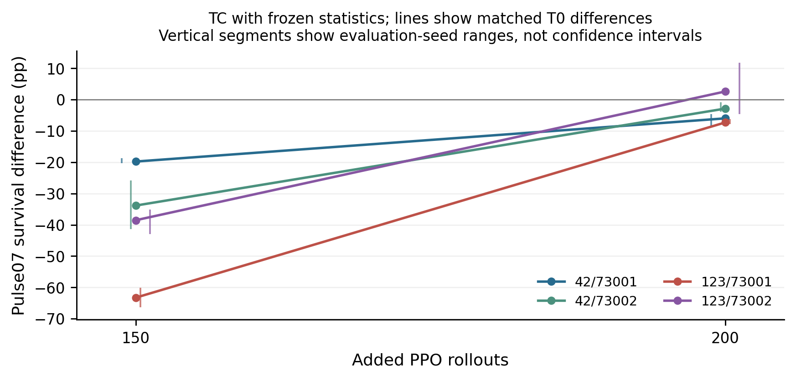
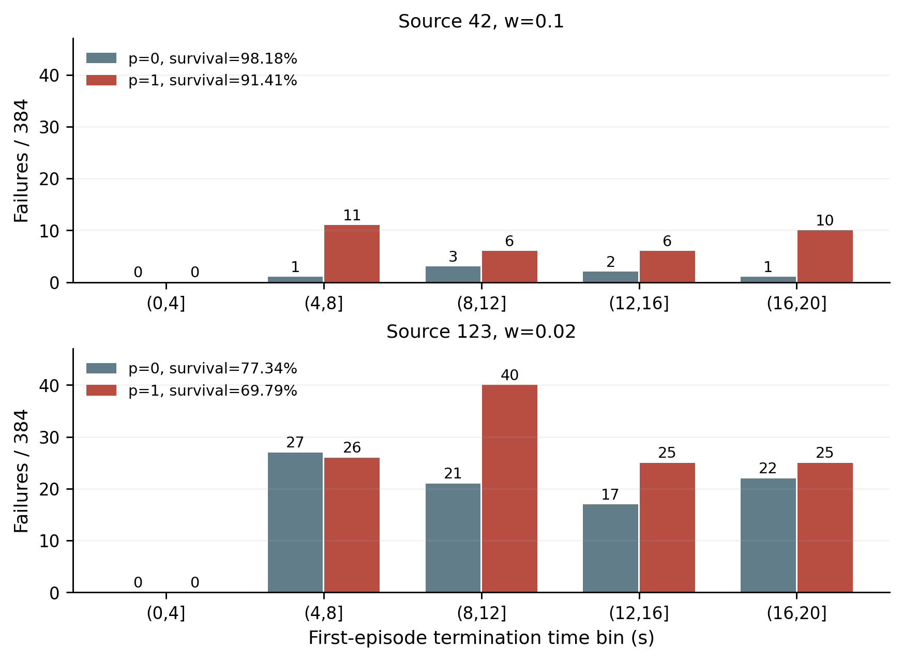

# MicroDuck步行策略的预处理兼容性与故障鲁棒性实证研究

Preprocessing Compatibility and Fault Robustness of MicroDuck Locomotion Policies

## 摘要

正常行走条件下的高存活率能否充分反映学习控制策略的故障鲁棒性，是评估预处理变更和继续训练效果时的一个具体问题。本文以 MicroDuck 仿真步行策略为对象，通过统计处理、实际 PPO 继续训练和固定权重统计剂量三个实验，考察预处理状态与训练路径变化对闭环行为的影响。全部分析覆盖 1,764 项评估和 225,792 个首回合，并逐项核对原始 CSV、已提交结果与模型文件摘要。结果表明，干净 IMU 重校准已使三个源模型的正常存活率降至零，其中 99.13% 的相关脉冲评估回合在首个脉冲前失败，提示兼容性失配会混淆污染效应。在实际 PPO 实验中，全部评估快照均通过正常前进存活测试，但部分分支在脉冲条件下出现较大退化；共同旋转且冻结统计的四个分块在干净恢复阶段均缩小了相对干净对照的差距。固定权重实验中，54 个脉冲剂量单元有 11 个在三个评估种子下均下降，但九条固定污染比例曲线均未呈现全范围单调下降。统计交换与相同原模型的跨批次评估进一步限制了单一最终统计机制和小幅效应的解释。本文提供的是有限源模型下的探索性实证：正常存活测试存在故障验收盲点，当前证据尚不足以建立普遍污染攻击效果或统计冻结的通用防御结论。

关键词  腿式机器人  强化学习  观测归一化  预处理兼容性  故障鲁棒性  实验可重复性

## Abstract

Nominal survival is commonly inspected when modifying a locomotion policy, yet it may provide limited information about fault robustness. We study MicroDuck policies through three experiments: direct manipulation of normalization statistics, PPO continuation with sparse observation rotations, and controlled moment mixtures with fixed policy weights. The analysis covers 1,764 evaluation cases and 225,792 first episodes, with raw records and artifact hashes verified. Clean IMU recalibration alone eliminates nominal survival in three source policies; 99.13% of the corresponding pulse episodes fail before the first scheduled pulse. In PPO continuation, all evaluated policy snapshots survive nominal forward walking, while some exhibit substantial pulse degradation. All four coherent-rotation blocks with frozen statistics reduce their matched deficits during the clean recovery phase. In the fixed-weight experiment, 11 of 54 pulse cells decrease in all three evaluation seeds, but none of nine fixed-contamination curves is nonincreasing across the full statistics-weight grid. Statistic swaps and repeated evaluations of identical source artifacts constrain mechanistic interpretation. These exploratory results expose a gap between nominal survival and fault robustness without establishing a universal poisoning effect or defense.

## 1 引言

强化学习已成为腿式机器人运动控制的一条可行路线。PPO 通过反复采集交互数据和优化策略实现连续控制[1]，大规模并行训练进一步提高了腿式运动策略的训练效率[2]。在这一流程中，部署行为由策略权重、观测预处理和环境状态共同决定。归一化模块虽然常被视作实现配置，其更新或替换仍可能改变固定权重网络接收的输入坐标。

一个容易出现的评估问题是：研究者观察到处理后策略在故障下退化，却没有确认同路径的干净处理是否已经破坏策略；或者策略仍可正常存活，便将其视为功能保持，从而忽略故障响应和连续控制质量的改变。实现细节对策略性能的影响已有系统研究[3,4]，但在一个具体机器人管线中，仍需通过适当对照判断观察到的差异对应哪一条路径。

本文围绕三个问题开展研究。其一，局部统计重校准导致的失败，是否需要污染数据才能出现。其二，当策略权重经过实际 PPO 更新时，稀疏观测坐标变换产生的差异是否在停止干预后保留，以及统计更新方式能否统一解释差异。其三，在固定策略权重时，逐渐增大新数据统计权重与污染比例是否呈现稳定的剂量关系。

为回答这些问题，我们保留干净重校准、同预算干净继续训练、同权重干净统计混合以及最终统计交换等对照，并按源模型、训练种子和评估种子报告结果。三个实验共同提供了正常验收与故障表现不一致的实例，也保留了干净流程失败、剂量非单调和种子间方向变化等反证。本文的贡献是对一个有限机器人控制系统的可追溯实证与解释边界，而非提出新的优化算法或经确认的攻击机制。

## 2 相关工作

**强化学习实现与归一化。**Engstrom 等通过 PPO 与 TRPO 的比较展示了实现细节对性能归因的重要影响[3]。Andrychowicz 等在统一框架下考察了大量 on-policy 训练选择，其中观测归一化、价值归一化及裁剪具有不同作用和交互[4]。PopArt 研究了价值目标的自适应归一化[5]。本文处理的是策略输入侧统计与闭环兼容性；输入仿射重参数化在此作为诊断对照使用，不被视作新的归一化算法。

**策略观测扰动。**Huang 等研究了通过小幅原始输入扰动降低强化学习策略测试表现的对抗样本[6]。本文的训练干预为预先固定的稀疏旋转，评估故障为预先固定的延迟和加性脉冲，没有逐步优化攻击目标。训练输入变化、推理时统计变化与测试时故障因而分别定义，避免将不同干预统称为同一攻击。

**实验可重复性与统计推断。**Henderson 等指出环境非确定性和算法自身方差会影响结果解释[7]。Agarwal 等进一步讨论了有限训练次数下点估计的不确定性及更可靠的汇总方式[8]。本文只有三个源模型，实际继续训练仅覆盖两个来源和每个来源两个训练种子，因此以分块效应、完整网格和种子范围作描述，不将大量评估回合当作独立训练重复，也不据此宣称总体显著性。

## 3 问题定义与比较方法

### 观测预处理

策略 actor 接收 61 维观测并产生 14 维动作。前 3 维为角速度，随后 3 维为投影重力；训练干预仅涉及这 6 维。原生归一化按维度采用均值、标准差与稳定项 ε，其中 ε=0.01。设某一维的归一化输出为 z，原始输入为 x，则有

$$
z_j=\frac{x_j-\mu_j}{\sigma_j+\epsilon}. \tag{1}
$$

若归一化统计变化而其余网络权重不变，输入坐标与后续激活通常随之变化。对于第一层仿射映射，令旧、新分母向量分别为 d₀ 和 d₁，可用如下变换保持该层对原始输入的函数一致：

$$
W_1=W_0\operatorname{diag}(d_1\oslash d_0),\qquad b_1=b_0+W_0[(\mu_1-\mu_0)\oslash d_0]. \tag{2}
$$

其中 ⊘ 表示逐元素除法。该等式要求变更位于所述仿射链路，且没有额外非线性裁剪破坏关系。本文以此构造 N6_EQ 功能等价对照。离线函数接近不等于数值敏感仿真中的逐轨迹一致。

### 受控统计混合

固定权重实验将历史总体矩与新观测总体矩以权重 w 合并。总体方差使用有偏总体定义，并包括组间均值项：

$$
\mu=(1-w)\mu_0+w\mu_1, \tag{3}
$$

$$
v=(1-w)v_0+wv_1+w(1-w)(\mu_1-\mu_0)^2. \tag{4}
$$

式（4）的平方按元素计算，新的标准差为方差的平方根。w 描述统计贡献，p 描述新观测内的污染比例。实际拟合观测数固定为 49,152；按历史 count 解释的虚拟质量仅为权重解释，不表示实际采集了相应数量的观测。派生模型保留历史 count 作来源记录，均限于推理。

### 配对效应与恢复

每个模型和条件由三个评估种子分别执行 128 个首回合。存活率 S 定义为达到 20 秒超时且未被记录为跌倒、非有限状态或地形出界的回合比例。平均时长包含全部回合，并在 20 秒截断。我们同时报告速度跟踪误差、动作差分与关节超限记录。

对固定权重实验，令下划线 e 表示同一评估种子，额外污染效应定义为

$$
\Delta_{s,w,p,c,e}=100[S_{s,w,p,c,e}-S_{s,w,0,c,e}]. \tag{5}
$$

式（5）单位为百分点。另计算 p=0 更新相对原模型的差，以区分干净统计更新和额外污染的贡献。T 阶段采用相同原则，在固定来源、训练种子、统计模式与评估条件下，以 TC 或 TI 减 T0，记为阶段 k 的 Δₖ。相对恢复量定义为

$$
R=\Delta_{200}-\Delta_{150}. \tag{6}
$$

R 为正表示处理组相对同阶段干净组的差值提高；它不同于处理组自身的绝对存活率提高。相同评估种子用于配置级匹配，不假定 episode 编号构成逐轨迹反事实配对。

## 4 实验设置

### 平台与评估条件

实验基于 mjlab 与 RSL-RL 的 MicroDuck 平地速度任务，任务标识为 Mjlab-Velocity-Flat-MicroDuck。源模型编号 42、123、2026 表示既有训练来源。继续训练恢复原模型及优化器等保存状态，actor 和 critic 的隐藏层均为 512、256、128，激活函数为 ELU。主要 PPO 配置列于附录 A。本文不将现有模型数量解释为覆盖了不同机器人结构或不同策略族。

全部正式评估采用 5 ms 物理步长、20 ms 控制步长和 20 秒时限，保留环境原生延迟。Forward 固定命令为前进 0.3 m/s，Turning 固定偏航命令为 0.6 rad/s。Delay20 和 Delay40 分别对观测前 34 维额外延迟 1、2 个控制步，初始缓冲采用可获得的最早观测。它们表示额外延迟，而非系统总延迟。

Pulse07 在控制索引 200、400、600、800 起各施加 5 帧加性脉冲，每段持续 0.1 秒。脉冲作用于角速度、投影重力和关节速度观测，不改命令及其余保护字段。角速度偏置为 0.7×(12, −16, 24)，重力观测偏置为 0.7×(0.8, 0, 0)，关节速度偏置使用附录 A 的 14 维固定向量。其幅度定义于已有观测坐标中，不宣称对应真实传感器噪声分布或统一物理故障强度。

评估首次终止前的物理状态通过终止前记录钩子捕获，避免自动重置后的状态混入。派生状态仍保留一个物理步的记录时序限制。所有正式回合均进入汇总，不按存活率筛选。

表 1  三个实验的范围

| 实验 | 模型或训练设计 | 评估条件 | case 数 | 首回合数 |
|---|---|---|---:|---:|
| N | 3 来源各 9 分支及 1 官方参考模型 | Forward Turning Delay40 Pulse07 | 336 | 43,008 |
| T | 24 个继续训练 run 和 8 个最终统计交换模型 | 150 轮 2 条件 200 轮 4 条件 | 528 | 67,584 |
| 固定权重统计剂量 | 3 原模型和 72 派生模型 | Forward Delay20 Delay40 Pulse07 | 900 | 115,200 |
| 合计 | 不跨协议合并推断 | — | 1,764 | 225,792 |

### N统计处理实验

N 使用固定的 49,152 条拟合观测。N0 为原模型；N1 与 N2 分别向原生历史统计追加干净数据和 10% 污染数据。N3 只对前 6 维 IMU 作干净重校准；N4、N5、N6 对应 1%、5%、10% 污染重校准。N7 为既定随机扰动参考。N6_EQ 在 N6 上按式（2）补偿第一层参数。重校准不更新其他 55 维统计，也不作 PPO 训练。污染观测对角速度与重力共同绕 Y 轴旋转 6°，采用固定嵌套样本索引。

### T实际继续训练实验

T 设计为 2 来源×2 训练种子×3 输入分支×2 统计模式，共 24 run。来源为 42、123，训练种子为 73001、73002。每个 run 使用 4,096 个并行环境，每 rollout 每环境采集 24 步，共 200 新 rollout，依次为 50 干净、100 干预、50 干净。每个 run 的新增预算为 19,660,800 个环境控制步，不能视作同数量独立训练重复。

T0 不施加输入干预。TC 对所选角速度和重力使用同符号旋转；TI 对角速度与重力使用相反符号旋转。角度均为 6°，每个干预 rollout 选择 9,830/98,304 个 actor 消费样本，其中正负符号各 4,915 个，共修改 983,000 个消费样本。所选索引在同一训练 seed 下配对，critic 原始输入和其他 actor 维度保持原规则。TC 保留两个三维向量间的共同旋转关系，TI 改变该关系；本文没有单独识别这一几何差异在最终结果中的因果贡献。

F 模式冻结 actor 和 critic 归一化状态；U 模式延续原生累计统计并保留历史 count。采样动作、缓存观测和旧 log probability 使用同一份干预后 actor 输入。统计更新相对动作消费前看一帧的边界计数另行记录，统计更新样本数不能直接当作实际动作消费污染数。150 轮与 200 轮模型分别对应干预结束和干净恢复结束。保存和恢复会重建仿真及延迟历史，因此不声称逐位不中断等价。

### 固定权重统计剂量实验

对三个源模型采用 w∈{0.001, 0.005, 0.01, 0.02, 0.05, 0.1}、p∈{0, 0.1, 0.5, 1}，得到 72 个派生 actor。拟合观测来自固定 teacher 数据的前 48 个环境；污染使用相同嵌套样本顺序，对角速度和重力共同作正向 6° 旋转，其他维度原始值不改。合并统计涉及原生 61 维，其他 55 维可能因干净数据更新而变化，但在同 w 的不同 p 配对中保持相同。策略网络权重不训练，稳定项 ε 保持原值。

三个原模型的 9 个 Forward case 先通过至少 95% 存活且非有限状态和地形出界为零的可用性门槛，才执行其余矩阵。该门槛是队列前置检查，不改变后续成功定义，也不用于删除不良结果。通道补测在运行前取消，未产生正式评估回合，不进入表 1。

### 原始记录审计与统计口径

我们逐项核验 1,764 份原始 CSV 的 SHA、每份 128 个唯一 episode、模型和条件身份、终止标志、必需数值有限性及汇总均值，确认结果与已提交 case JSON 一致。三个 results 和 registry 的文件摘要均与完成回执匹配，156 个不同模型路径的 SHA 复核通过。浮点归约精度造成的平均时长最大差约 1.93×10⁻⁶ 秒，vx 误差最大差约 3.11×10⁻⁸ m/s。没有窗口样本的脉冲窗口均值保留为空值，不置零、不删除回合。

由于独立训练重复有限，本文采用描述性推断。各评估种子单独保留，完整网格用于避免仅报告最差点；三个种子的极值范围只表示观察范围。本文没有将 54 个共享对照的剂量单元当作独立样本作显著性检验，也没有以回合数构造训练总体置信区间。剂量最差单元和失败时间分析均属于探索性分析。

## 5 结果

### 干净重校准已足以造成基础控制失败

三个源模型的 N0 在 Forward 下均为 384/384 存活，而 N3 与 N6 均为 0/384。N3 平均首回合时长只有 0.91～1.71 秒。N6_EQ 的正常存活恢复至 384/384，见表 2。

表 2  N实验正常前进结果

| 来源 | N0存活率 | N3存活率 | N6存活率 | N3时长 秒 | N6时长 秒 | N6_EQ存活率 |
|---|---:|---:|---:|---:|---:|---:|
| 42 | 100% | 0% | 0% | 1.268 | 1.258 | 100% |
| 123 | 100% | 0% | 0% | 1.709 | 1.711 | 100% |
| 2026 | 100% | 0% | 0% | 0.910 | 0.940 | 100% |

在 N3 的 Pulse07 记录中，来源 42、123、2026 分别有 381、377、384 个回合只执行了不超过 200 个控制步，在首个脉冲动作前终止。合计为 1,142/1,152，即 99.13%。由此，N3 的低故障存活首先反映尚未经历故障的基础控制失败。

N6−N3 多数条件存活率差为零，来源 42 的 Turning 为 +2.08 pp。大量零存活结果存在地板效应，不足以证明不同污染比例等效。保留历史累计统计的 N2−N1 则在正常两条件下均为零差，故障差值为 −1.30～+4.17 pp，方向不一致。N 实验因此支持兼容性失配的解释，尚不支持稳定的额外污染损害。第一层补偿对照说明输入坐标与权重匹配的重要性，但没有识别校准数据覆盖、采集配置和统计尺度各自的贡献。

### 正常前进存活保持下仍存在较大的故障差异

T 的 56 个评估模型快照在 Forward 中合计 21,504/21,504 存活；固定权重实验的 75 个模型合计 28,800/28,800 存活。两组 Forward 均未记录关节超限。但 T 的 Forward 组均值 vx 绝对误差为 0.0987～0.1344 m/s，固定权重实验为 0.1162～0.1297 m/s。因此，正常存活保持是成立的二值观测，并非所有连续功能指标等价。

T 中，来源 123、训练 seed73001 的 TI_F 最终 Pulse07 存活为 114/384，同分块 T0_F 为 377/384，差值为 −68.49 pp，平均时长差为 −7.81 秒。相同 TI_F 处理在来源 123 的另一训练 seed 下差值为 −14.06 pp，而在来源 42 下分别为 +1.04 和 −1.56 pp。这个结果构成具体模型上正常验收与故障表现不一致的实例，同时显示了来源和训练随机性的影响。

### 干净恢复阶段缩小了共同旋转分支的相对差距

TC_F 在四个来源与训练种子分块中，150 轮差值均为负，200 轮均提高。相对恢复量依次为 13.80、30.99、55.99 和 41.15 pp。TI_F 的恢复更不一致，来源 123 的最终残余差仍明显，见表 3 与图 1。

表 3  冻结统计分支的Pulse07配对差

| 来源与训练seed | 分支 | 150轮差 pp | 200轮差 pp | 相对恢复 pp |
|---|---|---:|---:|---:|
| 42 / 73001 | TC_F | −19.79 | −5.99 | +13.80 |
| 42 / 73002 | TC_F | −33.85 | −2.86 | +30.99 |
| 123 / 73001 | TC_F | −63.28 | −7.29 | +55.99 |
| 123 / 73002 | TC_F | −38.54 | +2.60 | +41.15 |
| 42 / 73001 | TI_F | −1.30 | +1.04 | +2.34 |
| 42 / 73002 | TI_F | −1.56 | −1.56 | 0.00 |
| 123 / 73001 | TI_F | −75.00 | −68.49 | +6.51 |
| 123 / 73002 | TI_F | −51.56 | −14.06 | +37.50 |

图 1  TC_F在150与200轮的Pulse07差值。每条线表示一个来源与训练seed分块，均相对同分块T0_F计算。连线只连接两个已测快照，不表示中间轨迹。

相对恢复不能由处理组的绝对改善代替。例如，42/73002 的 TC_U 自身存活率提高 7.55 pp，但它相对 T0_U 的优势从 +4.43 降至 +1.04 pp，相对变化为 −3.39 pp。150 到 200 轮同时发生停止输入干预和继续干净训练，本文没有反事实分支来单独识别二者贡献。

最终 16 个 T 干预配对中，10 个均值下降，9 个在三个评估 seed 下均下降；另有 6 个均值提高。上述配对共享四个训练分块与干净对照，不能将 10/16 解释为总体攻击成功概率。完整 16 个分支结果见附录 B。

### 统计模式对干净训练与干预效应均有条件性影响

仅比较干净 T0，最终 Pulse07 的 U−F 差在 42/73001、42/73002、123/73001、123/73002 下分别为 −9.64、−1.30、−63.28、+7.81 pp。因而，直接比较干预_U 和干预_F 会混入干净学习路径的差异。

采用干预相对各自 T0 的差再比较 F/U，TI 的交互差在来源 123 两个训练 seed 下分别为 +71.88 与 −40.36 pp，方向相反。F 模式下仍观察到严重退化，说明统计继续更新不是这些现象出现的必要条件；但固定统计与变化后的原始训练输入仍会相互作用，不能据此认为统计在训练机制中无关。

### 最终统计交换未消除严重退化

PC 表示 TI_U 权重配 T0_U 最终 actor 统计，CP 表示 T0_U 权重配 TI_U 最终 actor 统计。四个分块的结果见表 4。替换为干净最终统计后，TI_U 存活率变化分别为 0、+1.04、+3.65、+0.26 pp。尤其在 123/73002 的严重退化格，PC 仅从 26.56% 变到 26.82%，远未恢复对应的 54.43 pp 差距。

表 4  最终统计交换的Pulse07存活率

| 来源与训练seed | T0_U | TI_U | PC | CP |
|---|---:|---:|---:|---:|
| 42 / 73001 | 89.32% | 98.44% | 98.44% | 92.71% |
| 42 / 73002 | 97.92% | 95.83% | 96.88% | 98.96% |
| 123 / 73001 | 34.90% | 38.28% | 41.93% | 34.90% |
| 123 / 73002 | 80.99% | 26.56% | 26.82% | 82.55% |

反向交换后，干净权重的存活率变化为 +3.39、+1.04、0、+1.56 pp。当前推理统计值因而不能单独解释这些分块的大部分严重差异。不过，交换没有撤销训练期统计历史，也没有重新优化权重，结果不能被解释为已经证明某种后门存在于权重中。

### 固定权重剂量实验呈现局部效应与非单调关系

Pulse07 每个来源有 18 个污染单元。来源 42、123、2026 分别有 13、13、6 个单元均值下降，三个评估 seed 严格同向下降的单元分别为 3、6、2 个，合计 11/54。来源 123 的配对差中位数为 −3.26 pp，来源 2026 则为 +0.65 pp，见图 2。

图 2  固定权重统计实验的54个Pulse07单元。值为污染减同w干净组的平均存活率差，单位pp。星号仅表示三个评估seed差值均为负，不代表显著性。

九条固定来源、固定 p 的曲线，没有一条在六个递增 w 上全部非增。例如来源 123、p=1 的差依次为 −3.65、−1.82、−3.65、−7.55、−4.17、−3.91 pp；来源 2026、p=1 从最小 w 的 −3.65 pp 变为最大 w 的 +2.86 pp。当前观测不能建立全范围单调剂量响应，也不能定位安全边界；这不排除有限噪声下存在尚未被识别的潜在趋势。

两个探索性案例具有较一致的评估种子方向：来源 42、w=.1、p=1 从同预算干净组的 377/384 降至 351/384，差 −6.77 pp，三个 seed 差范围为 −7.81～−4.69 pp；来源 123、w=.02、p=1 从 297/384 降至 268/384，差 −7.55 pp，范围为 −10.16～−3.13 pp。两格平均首回合时长分别减少 0.633 和 0.713 秒。这些点是在完整网格中观察后选出，不能忽略最差点选择偏差。

干净统计更新本身也产生变化。在 w=.1 时，来源 123 的 Pulse07 从原模型 77.08% 降至 p=0 的 70.83%。同 w、p=.5 为 64.84%，其对原模型的 −12.24 pp 可在算术上拆为干净更新差 −6.25 pp 和额外污染差 −5.99 pp。因此，对原模型的总下降不能全部归给污染，该分解也不等于普遍线性因果模型。

Delay20 的最差均值配对下降，来源 42 为 −0.78 pp，另两个来源各为 −0.26 pp。Delay40 原基线已接近地板，主要保留为诊断，不能以低基线下的小变化证明污染有效。

### 相同原模型的跨批次差异限制了小效应解释

N0 与固定权重实验原模型共有 27 对配置可匹配 case。模型 SHA、命令、故障参数、评估 seed、回合数、控制及物理步长、动作裁剪配置和成功定义一致。相同核心评估源码下，两批仍有线程设置、节流和执行批次差异。

表 5  相同原模型的Pulse07跨批次差值

| 来源 | 三个seed差值 pp | 均值差 pp |
|---|---|---:|
| 42 | +0.78 / 0.00 / +0.78 | +0.52 |
| 123 | +2.34 / +6.25 / −3.13 | +1.82 |
| 2026 | +2.34 / +0.78 / −3.13 | 0.00 |

表 5 采用固定权重实验原模型减 N0。Forward 存活率差均为零，Delay40 某些 case 的差更大。该结果说明相同 seed 不能保证相同闭环轨迹，但仅有两批历史评估，不能估计纯随机误差分布，不能把 6.25 pp 设为显著门槛，也不能从污染差值中减掉它作校正。

### 失败时间与关节超限补充了存活率信息

上述两个剂量案例在首个脉冲前均无失败；来源 42 增加的失败分散在多个后续区间，来源 123 的约 (8,12] 秒失败数从 21 增至 40，见图 3。该分布描述失败发生于故障过程内，但没有按每段在险回合归一化，不能称为阶段危险率，也不能据此识别某一个脉冲的独立因果作用。

图 3  两个探索性剂量单元的失败时间分布。区间按控制步数定义为(0,200]至(800,1000]，所有存活回合仍计入主指标。

N、T、固定权重实验分别有 30,752/43,008、24,792/67,584、47,538/115,200 个回合出现过关节超限。条件构成不同，不能按这些比例给处理方式排名。在来源 42、w=.1 的案例中，超限回合为 189→210，控制采样网格占用时间均值为 0.0852→0.1191 秒；来源 123、w=.02 的对应数为 225→229 和 0.08255→0.08286 秒。后者的存活明显降低，超限占用却几乎不变，因此不存在由这些案例支持的统一单指标恶化关系。

来源 42 干净组中，377 个存活回合仍有 182 个出现过超限。这里的占用时间由控制步计数乘 0.02 秒获得，不等于连续物理超限时长，更不能直接解释为真实硬件损伤。

## 6 讨论

**正常验收的覆盖范围。**本文的反例成立于明确的有限系统：一些处理分支通过正常前进存活检查，却在同一故障协议下显示不同存活和时长。这个结果不意味着正常评估没有价值，而是说明它只覆盖一个工作条件和一个二值指标。若验收目标包括抗延迟、抗瞬态观测异常或连续控制质量，就需要针对这些目标保留对应测试。

**兼容性与额外污染的区分。**N3 在故障前失效表明干净流程本身可能成为混杂因素。对于当前校准方案，先验证干净更新的兼容性，是解释污染效应的前提。N6_EQ 支持坐标与权重匹配这一传递路径；它没有完成对采集覆盖、坐标尺度和数据分布的进一步因果分解。固定权重实验的同 w 干净对照正是为避免把更新效应归给污染而设置。

**训练轨迹与最终统计。**F 下仍有退化以及 PC 恢复有限，限制了“只改最终归一化统计就足以解释严重差异”的假设。T 的干净 F/U 对照和交互差又说明，统计方式不能从训练路径中完全剥离。现有数据支持多因素相互作用的解释，不足以确认唯一机制。

**恢复与持续性。**TC_F 四个分块方向一致的差距缩小值得保留，但不应据此把干净恢复阶段称为已验证的防御：实验没有分别控制继续训练、停止干预和恢复数据组成。TI_F 在部分来源上的残余差也不构成普遍持久性结论。后续若进行确认，应预先锁定现象，并以独立训练重复而非更多评估回合检验。

**研究定位。**当前结果更适合支持预处理兼容性与稳健验收的实证研究。训练输入干预没有面向特定失败目标优化，测试故障也不是已识别的学习后门触发器。将有限分块的大降幅直接命名为普遍攻击，会超过本研究的对照和推断范围。

## 7 局限性

第一，来源与独立训练重复有限。T 仅有两个来源、每个来源两个训练 seed，固定权重剂量实验只有三个源模型。共享基线与拟合数据还使不同网格单元相关。大量首回合提高了给定模型的描述精度，但不补足策略总体的训练重复。

第二，最差格、单调性检查和失败时间比较均包含事后探索。本文公布完整网格并限定解释，没有预注册的确认性检验。当前六个 w 和三个非零 p 不能给出稳定边界；高存活条件的天花板和 Delay40 的地板都会限制区分度。

第三，软件与恢复历史影响可重复性。训练和评估出现过 CUDA 或仿真异常，先保存证据，再对未提交 case 在新进程中有限重试。已提交回合未因失败或异常过滤，但缺失的失败尝试轨迹不能由成功提交记录补齐。如果异常与模型状态相关，执行选择偏差仍可能存在。训练恢复会重建环境及延迟历史；父 checkpoint 未保存的独立学习率标量按 runner 规则初始化，因而不声称完整恢复父训练的所有动态状态。

第四，指标与故障覆盖有限。平均跟踪误差取自实际终止前时段，比较失败与存活模型时可能混入暴露时长差。脉冲为固定幅度、通道与时序，不能代表所有现实故障。关节超限为仿真控制采样记录，本文没有实体实验或事故风险推断。

## 8 结论

本文通过统计处理、实际 PPO 继续训练和固定权重统计剂量三个实验，分析了 MicroDuck 步行策略的预处理兼容性与故障鲁棒性。干净重校准即可造成故障前基础控制失败，说明兼容性检查对污染解释不可缺少。实际训练中，正常前进存活保持与部分故障退化并存，且干净恢复、来源及训练种子共同影响结果。固定权重矩阵提供了局部一致下降的案例，但未建立跨来源单调剂量响应。最终统计交换和相同原模型跨批次评估进一步约束了机制归因。

这些结果支持将正常存活、连续控制质量与故障表现分别纳入验收，并保留同路径干净对照和训练层级信息。当前证据提供有限系统中的可追溯实例，普遍攻击有效性、通用防御和实体安全结论仍需相应的独立确认。

## 参考文献

[1] Schulman J, Wolski F, Dhariwal P, Radford A, Klimov O. Proximal Policy Optimization Algorithms. arXiv:1707.06347, 2017. https://arxiv.org/abs/1707.06347

[2] Rudin N, Hoeller D, Reist P, Hutter M. Learning to Walk in Minutes Using Massively Parallel Deep Reinforcement Learning. CoRL 2021. arXiv:2109.11978. https://arxiv.org/abs/2109.11978

[3] Engstrom L, Ilyas A, Santurkar S, Tsipras D, Janoos F, Rudolph L, Madry A. Implementation Matters in Deep Policy Gradients: A Case Study on PPO and TRPO. ICLR, 2020. https://arxiv.org/abs/2005.12729

[4] Andrychowicz M, Raichuk A, Stańczyk P, et al. What Matters In On-Policy Reinforcement Learning? A Large-Scale Empirical Study. arXiv:2006.05990, 2020. https://arxiv.org/abs/2006.05990

[5] van Hasselt H, Guez A, Hessel M, Mnih V, Silver D. Learning values across many orders of magnitude. NeurIPS, 2016. https://arxiv.org/abs/1602.07714

[6] Huang S, Papernot N, Goodfellow I, Duan Y, Abbeel P. Adversarial Attacks on Neural Network Policies. arXiv:1702.02284, 2017. https://arxiv.org/abs/1702.02284

[7] Henderson P, Islam R, Bachman P, Pineau J, Precup D, Meger D. Deep Reinforcement Learning that Matters. AAAI, 2018. https://arxiv.org/abs/1709.06560

[8] Agarwal R, Schwarzer M, Castro P S, Courville A, Bellemare M G. Deep Reinforcement Learning at the Edge of the Statistical Precipice. NeurIPS, 2021. https://arxiv.org/abs/2108.13264

## 附录A 关键配置与故障定义

表 A1  PPO与评估配置

| 项目 | 数值或规则 |
|---|---|
| Actor观测与动作维度 | 61与14 |
| Actor与critic隐藏层 | 512 256 128，ELU |
| 每rollout采集量 | 4096×24＝98,304 |
| 新增rollout | 200，50干净＋100干预＋50干净 |
| 优化器与epoch | Adam，每次更新5 epoch、4 minibatch |
| 配置学习率与调度 | 0.001，adaptive，desired KL 0.01 |
| 折扣与GAE参数 | γ＝0.99，λ＝0.95 |
| PPO裁剪与梯度上限 | 0.2与1.0 |
| 熵系数与价值损失系数 | 0.01与1.0 |
| 评估seed | 112301 112302 112303 |
| 每case与时限 | 128首回合，20秒 |
| 物理步长与控制步长 | 0.005与0.02秒 |
| 推理动作裁剪 | 无额外clip_actions裁剪 |

表中学习率为配置值；实际继续训练采用保存的优化器状态及 runner 规则，恢复研究 checkpoint 时读取已保存的算法学习率标量，不能将该配置值视为每轮实际学习率。F/U 对 actor 与 critic 统计同时作用，本文未用额外分支拆分其各自影响。

Pulse07 的角速度观测增量为 (8.4, −11.2, 16.8)，投影重力增量为 (0.56, 0, 0)，关节速度增量为 0.7×(8, −10, 7, −8, 10, −7, 6, −6, 8, −8, 5, −5, 7, −7)。增量加于已有 actor 观测对应字段，前进命令和后续保护字段不变。该加性脉冲与训练时 6° 坐标旋转是不同干预，幅度不能解释为等强。

N7 为原有随机正负旋转参考，N4/N5 为重校准比例诊断；这些分支全部保留在原始记录中。本文主要对照为 N2−N1、N6−N3 与 N6_EQ−N0，没有因这些分支的失败而重新选择校准数据。

N准备阶段冻结的软件清单记录为 PyTorch 2.9.1、mjlab 1.3.0、rsl-rl-lib 5.0.1、MuJoCo 3.10.0 和 warp-lang 1.12.0，仓库提交为 cb70b792312d559a4da09064d92009079671815f。版本号用于识别当时的软件环境，各阶段具体执行源码与模型仍以各自冻结清单中的文件SHA为准。

## 附录B 全部T分支结果

表 B1  Pulse07的16个配对差值

| 来源与训练seed | 分支 | 150轮差 pp | 200轮差 pp | 相对恢复 pp |
|---|---|---:|---:|---:|
| 42 / 73001 | TC_F | −19.79 | −5.99 | +13.80 |
| 42 / 73001 | TI_F | −1.30 | +1.04 | +2.34 |
| 42 / 73001 | TC_U | +3.91 | +9.90 | +5.99 |
| 42 / 73001 | TI_U | +4.69 | +9.11 | +4.43 |
| 42 / 73002 | TC_F | −33.85 | −2.86 | +30.99 |
| 42 / 73002 | TI_F | −1.56 | −1.56 | 0.00 |
| 42 / 73002 | TC_U | +4.43 | +1.04 | −3.39 |
| 42 / 73002 | TI_U | +10.16 | −2.08 | −12.24 |
| 123 / 73001 | TC_F | −63.28 | −7.29 | +55.99 |
| 123 / 73001 | TI_F | −75.00 | −68.49 | +6.51 |
| 123 / 73001 | TC_U | −10.16 | −7.29 | +2.86 |
| 123 / 73001 | TI_U | −14.84 | +3.39 | +18.23 |
| 123 / 73002 | TC_F | −38.54 | +2.60 | +41.15 |
| 123 / 73002 | TI_F | −51.56 | −14.06 | +37.50 |
| 123 / 73002 | TC_U | −54.69 | −19.27 | +35.42 |
| 123 / 73002 | TI_U | −61.20 | −54.43 | +6.77 |

三个评估seed的完整差值、所有剂量单元和正常连续指标由配套机器可读分析记录提供。表内四舍五入后的数值仅用于阅读，计算均使用未舍入数据。

## 附录C 数据追溯与审计范围

审计将 registry、结果 JSON、逐 case 提交和原始 CSV 连接为同一来源链，逐项确认回合计数、身份和均值。窗口缺失值仅在对应样本数为零时允许存在，必需数值与终止记录均完整核对。结果文件的 SHA256 如下。

N结果  1d7b2ed8f076557eadcfd690bf7b24d070a960c55c2dc7d207127df543d056c2

T结果  5b00b0120278f6b6fea8473b6a6fbb4cf61cbf7317d940847456d96f894befb4

统计剂量结果  b9cdd5b5ca025f5135237798359d8a5ab6bc485aed9186ac7c8d3849fe303ff0

以上摘要用于识别本研究的具体记录版本，不等于验证硬件或软件确定性。模型文件在本次数据复算时作字节级 SHA 核验，张量有限性与24 run完成状态由既有完成回执支持。本文未宣称数据已公开上传；配套目录保留本地分析、图表与来源清单。
