# MicroDuck十六项工作研究报告合订本

[全部图册](index.html) · [全部任务浏览器](data_explorer.html)

- [完整PPO训练](reports/01_report.md)
- [导出与来源核验](reports/02_report.md)
- [固定命令任务评估](reports/03_report.md)
- [独立评估seed故障确认](reports/04_report.md)
- [精细响应完整基准](reports/05_report.md)
- [原生延迟诊断](reports/06_report.md)
- [论文报告与统一视频](reports/07_report.md)
- [脉冲机制拆分](reports/08_report.md)
- [完整actor监督顺序](reports/09_report.md)
- [同末尾clean恢复](reports/10_report.md)
- [小型BC 归一化与replay](reports/11_report.md)
- [安全预处理](reports/12_report.md)
- [零更新克隆](reports/13_report.md)
- [V2 N推理统计对照](reports/14_report.md)
- [V2 T真实PPO续训](reports/15_report.md)
- [人工有效剂量状态](reports/16_report.md)

---

# 01 完整PPO训练研究报告

我们完成了三个真实规模的本地MicroDuck运动策略训练，建立后续所有闭环比较的模型底座。三个策略不等于官方发布权重的逐位复现，也不能仅凭训练回报给故障鲁棒性排名。

## 工作范围

三个本地来源seed42、123、2026，4096并行环境，24步rollout，最终checkpoint标签3999。

## 我们如何完成这项工作

沿用公开提交cb70b792312d559a4da09064d92009079671815f的任务和架构。42和123最终谱系各含4000个rollout、393,216,000条环境转移；2026从3250恢复，最终含4001个rollout、393,314,304条转移。图册直接解析四个真实运行目录的TensorBoard，保留全部已记录标量。

## 现有结果及解释

1. seed42最终训练平均回报118.5304，最高127.9663发生在1438；最终平均回合长度960.26步，训练nan记录为0。该运行记录墙钟约11.98小时。

2. 2026父阶段日志到3272，但有效恢复点为3250。图中只把父阶段至3250与恢复段3250—3999作为最终模型谱系展示；重复的3250标签不能简单平均，父阶段3251—3272不计入最终有效训练预算。

3. 后期训练回报受到课程难度、命令和奖励权重变化影响，回报下降不自动代表部署性能退化。正常任务、推扰和传感器故障应查看独立评估报告。

## 完整结果表

| 来源seed | 最终谱系rollout | 历史样本count | 训练平均回报 |
|---|---|---|---|
| 42 | 4000 | 393216000 | 118.53041076660156 |
| 123 | 4000 | 393216000 | 见完整原日志曲线 |
| 2026 | 4001 | 393314304 | 父/恢复分段见图 |

## 图表及读图注释

> 读图注释：rollout是一批采样，不是完整episode。4096×24=98,304条环境转移；同一回合可能跨多个rollout。

> 读图注释：图中所有训练标量使用原日志定义和原尺度，未平滑。fell_over等训练聚合项不是以固定首回合为分母的跌倒百分比。

> 英文坐标速查：survival=规定时长存活；duration/seconds=首回合有效寿命；vx=前向速度；XY=平面速度；yaw=绕竖直轴旋转；MSE=动作拟合平方误差；pp=百分点。完整解释见[读图指南](READING_GUIDE.md)。

### 图1 三个来源的训练日志 Curriculum

横轴为原日志迭代编号，未平滑。2026实线为保留的parent至3250，虚线为恢复段3250至3999；重复编号不合并为同一训练轮，丢弃parent的3251至3272。训练聚合量不是闭环评估百分比。

### 图2 三个来源的训练日志 Curriculum

横轴为原日志迭代编号，未平滑。2026实线为保留的parent至3250，虚线为恢复段3250至3999；重复编号不合并为同一训练轮，丢弃parent的3251至3272。训练聚合量不是闭环评估百分比。

### 图3 三个来源的训练日志 Episode_Metrics

横轴为原日志迭代编号，未平滑。2026实线为保留的parent至3250，虚线为恢复段3250至3999；重复编号不合并为同一训练轮，丢弃parent的3251至3272。训练聚合量不是闭环评估百分比。

### 图4 三个来源的训练日志 Episode_Reward

横轴为原日志迭代编号，未平滑。2026实线为保留的parent至3250，虚线为恢复段3250至3999；重复编号不合并为同一训练轮，丢弃parent的3251至3272。训练聚合量不是闭环评估百分比。

### 图5 三个来源的训练日志 Episode_Reward

横轴为原日志迭代编号，未平滑。2026实线为保留的parent至3250，虚线为恢复段3250至3999；重复编号不合并为同一训练轮，丢弃parent的3251至3272。训练聚合量不是闭环评估百分比。

### 图6 三个来源的训练日志 Episode_Reward

横轴为原日志迭代编号，未平滑。2026实线为保留的parent至3250，虚线为恢复段3250至3999；重复编号不合并为同一训练轮，丢弃parent的3251至3272。训练聚合量不是闭环评估百分比。

### 图7 三个来源的训练日志 Episode_Termination

横轴为原日志迭代编号，未平滑。2026实线为保留的parent至3250，虚线为恢复段3250至3999；重复编号不合并为同一训练轮，丢弃parent的3251至3272。训练聚合量不是闭环评估百分比。

### 图8 三个来源的训练日志 Loss

横轴为原日志迭代编号，未平滑。2026实线为保留的parent至3250，虚线为恢复段3250至3999；重复编号不合并为同一训练轮，丢弃parent的3251至3272。训练聚合量不是闭环评估百分比。

### 图9 三个来源的训练日志 Metrics

横轴为原日志迭代编号，未平滑。2026实线为保留的parent至3250，虚线为恢复段3250至3999；重复编号不合并为同一训练轮，丢弃parent的3251至3272。训练聚合量不是闭环评估百分比。

### 图10 三个来源的训练日志 Perf

横轴为原日志迭代编号，未平滑。2026实线为保留的parent至3250，虚线为恢复段3250至3999；重复编号不合并为同一训练轮，丢弃parent的3251至3272。训练聚合量不是闭环评估百分比。

### 图11 三个来源的训练日志 Policy

横轴为原日志迭代编号，未平滑。2026实线为保留的parent至3250，虚线为恢复段3250至3999；重复编号不合并为同一训练轮，丢弃parent的3251至3272。训练聚合量不是闭环评估百分比。

### 图12 三个来源的回报与回合长度 迭代轴与时间轴

左列横轴为PPO迭代标签，右列为各运行日志elapsed秒，恢复段时钟单独保留，不能看作同一连续墙钟。2026父阶段按3250保存点对应wall_time截断，再与恢复段区分展示，不把/time的秒数误当迭代编号。

### 图13 checkpoint evaluation

保留原实验图，不改变其样本、区间或协议定义。原图英文标注见本报告名词注释；探索、确认与历史快照不可混合累计。

### 图14 command tracking errors

保留原实验图，不改变其样本、区间或协议定义。原图英文标注见本报告名词注释；探索、确认与历史快照不可混合累计。

### 图15 safety and policy metrics

保留原实验图，不改变其样本、区间或协议定义。原图英文标注见本报告名词注释；探索、确认与历史快照不可混合累计。

### 图16 training reward episode

保留原实验图，不改变其样本、区间或协议定义。原图英文标注见本报告名词注释；探索、确认与历史快照不可混合累计。

## 限制与不能支持的结论

只在本地仿真中复现，没有实体或sim-to-real证据。恢复会重建环境、延迟历史和随机状态，不是不中断训练的逐位恢复。2026多出的0.025%预算必须披露，但没有证据将鲁棒性差异归因于它。

## 证据入口与复核范围

输入清单与SHA：[input_manifest.json](data/input_manifest.json)。本轮计数/均值复算：[AUDIT.json](data/AUDIT.json)。

## 这项工作的价值

本工作的价值是提供来源清楚、真实规模、可做同协议比较的三个本地策略和完整训练轨迹，使后续故障差异不再建立在小型替代模型或单段视频上。它是实验基础设施成果，不应单独包装为新算法。

---

# 02 导出与来源核验研究报告

导出接口与测试输入数值一致性通过；244份真实checkpoint未发现被探针构造的var/std或count不一致。恢复链确实存在2026重复迭代标签，但它不是已发现的恶意污染。

## 工作范围

三个最终ONNX导出，四个实际训练目录中的244份已保存checkpoint及恢复边界。

## 我们如何完成这项工作

分别检查actor和critic统计的有限性、std与sqrt(var)、历史count与环境计数、优化器step，关联配置YAML和TensorBoard。三个导出模型接口为float32的61维输入到14维动作；ONNX checker、CPU推理及既有PyTorch数值对照分别记录，不混为一个检查。

## 现有结果及解释

1. 244份checkpoint分为42的81份、123的81份、2026父阶段66份与恢复阶段16份。已审计actor/critic的std与sqrt(var)最大误差为0，count相同并等于环境common_step_counter×4096。

2. 三个最终ONNX归一化mean及分母分别与对应checkpoint的mean及std+0.01逐元素一致。既有完整输出数值对照最大绝对误差约4.17×10^-7至5.36×10^-7。

3. 2026恢复前3250点含3251个rollout，恢复后同编号点含3252个rollout，count增加98,304、环境计数增加24、Adam step增加20，相互吻合。

## 完整结果表

| 真实训练目录 | 已保存checkpoint数 | 首标签 | 末标签 |
|---|---|---|---|
| seed42 | 81 | 0 | 3999 |
| seed123 | 81 | 0 | 3999 |
| seed2026_parent | 66 | 0 | 3250 |
| seed2026_resume | 16 | 3250 | 3999 |

## 图表及读图注释

> 读图注释：strict加载只检查键与形状，不能代替统计语义检查。mean、var、std、count与eps需要分别解释。

> 读图注释：曲线中actor和critic count重合是审计测得的相同，不是少画了一条；保存点之间连线只用于阅读。

> 英文坐标速查：survival=规定时长存活；duration/seconds=首回合有效寿命；vx=前向速度；XY=平面速度；yaw=绕竖直轴旋转；MSE=动作拟合平方误差；pp=百分点。完整解释见[读图指南](READING_GUIDE.md)。

### 图1 244份checkpoint历史统计量与迭代对应

点为真实保存点，不是新增训练。actor与critic曲线重合；2026恢复边界实际多一轮，应结合报告中的rollout账本。统计一致性不证明历史从未遭受任何攻击。

## 限制与不能支持的结论

本报告沿用真实checkpoint审计结果，本轮不重新加载244个模型张量。该审计只覆盖保存点和当时核验的文件，不能证明所有历史进程状态都被保存。旧审计的seed123指定副本缺口后来已找到备份，不能沿用为当前模型丢失结论。

## 证据入口与复核范围

输入清单与SHA：[input_manifest.json](data/input_manifest.json)。本轮计数/均值复算：[AUDIT.json](data/AUDIT.json)。

- D:\MicroDuckResearch\ti\outputs\microduck_reproduction\mechanism_audit\resume_provenance_audit\results.json　SHA256 076397138d2f33b037c8bc9b2b24fbb374d126f31c85c4e6722d8a3bb0b029b4

## 这项工作的价值

价值在于把导出数值一致、模型来源一致、训练恢复完整性三件事分开验证，排除一类容易误认为研究发现的管线错误，并为每个后续实验建立可追溯模型身份。

---

# 03 固定命令任务评估研究报告

所有模型在Forward、Turning和Standing均存活，但任务跟踪能力并不相同；Stress-forward下出现模型差异。因此“没有跌倒”不能单独作为策略能力验收。

## 工作范围

official及三个本地模型，4任务×3评估seed×128首回合，共48项、6144首回合。

## 我们如何完成这项工作

评估seed1001、2002、3003。Forward固定vx=0.3m/s；Turning固定yaw=0.6rad/s且平移目标为0；Standing为零命令；Stress-forward使用同Forward命令并每0.5—1秒推扰。只计第一次终止前的首回合，不把reset后新回合拼入。

## 现有结果及解释

1. Forward平均vx绝对误差，official/42/123/2026依次约0.1542/0.1211/0.1161/0.1248m/s；前三个非推扰任务各模型都是384/384存活。

2. Turning平均yaw误差约0.5851/0.5194/0.1968/0.2047rad/s。但123的平移速度约0.1411m/s，42约0.0257m/s；目标要求原地旋转，不能只按yaw误差说123全面最好。

3. Stress存活约84.90%/85.68%/83.85%/79.69%。这些是固定策略和当前推扰分布的结果，不可将四个点当架构优劣的充分证明。

## 完整结果表

| 模型或分支 | 条件 | 阶段 | 存活分子/分母 | 存活率 | 平均寿命s | vx误差m/s | XY误差m/s |
|---|---|---|---|---|---|---|---|
| official | Forward |  | 384/384 | 100.00% | 20.0000 | 0.1542 | 0.2122 |
| seed42 | Forward |  | 384/384 | 100.00% | 20.0000 | 0.1211 | 0.1907 |
| seed123 | Forward |  | 384/384 | 100.00% | 20.0000 | 0.1161 | 0.1902 |
| official | Turning |  | 384/384 | 100.00% | 20.0000 | 0.0022 | 0.0072 |
| seed42 | Turning |  | 384/384 | 100.00% | 20.0000 | 0.0039 | 0.0257 |
| seed123 | Turning |  | 384/384 | 100.00% | 20.0000 | 0.0170 | 0.1411 |
| official | Standing |  | 384/384 | 100.00% | 20.0000 | 0.0011 | 0.0012 |
| seed42 | Standing |  | 384/384 | 100.00% | 20.0000 | 0.0016 | 0.0016 |
| seed123 | Standing |  | 384/384 | 100.00% | 20.0000 | 0.0015 | 0.0015 |
| official | Stress-forward |  | 326/384 | 84.90% | 18.5385 | 0.1717 | 0.2310 |
| seed42 | Stress-forward |  | 329/384 | 85.68% | 18.7941 | 0.1419 | 0.2088 |
| seed123 | Stress-forward |  | 322/384 | 83.85% | 18.1121 | 0.1385 | 0.2099 |
| seed2026 | Forward |  | 384/384 | 100.00% | 20.0000 | 0.1248 | 0.1877 |
| seed2026 | Turning |  | 384/384 | 100.00% | 20.0000 | 0.0178 | 0.1358 |
| seed2026 | Standing |  | 384/384 | 100.00% | 20.0000 | 0.0014 | 0.0015 |
| seed2026 | Stress-forward |  | 306/384 | 79.69% | 18.0480 | 0.1462 | 0.2117 |

## 图表及读图注释

> 读图注释：速度误差越低通常表示跟踪越好，但早停会截短统计时间，须同时看寿命。不同指标单位不同，不直接合并一个总分。

> 读图注释：Stress恢复时间表示推扰后的跟踪恢复，不是摔倒后自主站起。存活区间和连续指标区间的计算对象也不同。

> 英文坐标速查：survival=规定时长存活；duration/seconds=首回合有效寿命；vx=前向速度；XY=平面速度；yaw=绕竖直轴旋转；MSE=动作拟合平方误差；pp=百分点。完整解释见[读图指南](READING_GUIDE.md)。

### 图1 全部任务点 all

每个点是一项真实任务；横轴仅是文件记录顺序，不是连续变量，故不连线。点保留评估seed差异。条件、模型和分母可在全数据浏览器按编号查询；早停时误差只覆盖终止前。

### 图2 首回合存续曲线 第1组

横轴为首回合仿真秒，纵轴为尚未因任何原因终止的比例；20秒超时保留在终点，不画成死亡。由已保存终止时间重算，在0.1秒网格显示；不是完整姿态轨迹，也不把跨评估seed回合当独立训练。相同曲线可能重合。

### 图3 primary metrics comparison

保留原实验图，不改变其样本、区间或协议定义。原图英文标注见本报告名词注释；探索、确认与历史快照不可混合累计。

### 图4 survival comparison

保留原实验图，不改变其样本、区间或协议定义。原图英文标注见本报告名词注释；探索、确认与历史快照不可混合累计。

### 图5 three model comparison

历史补充图，保留用于追溯。本图的队列、幅度、分母或目的不同于本报告主表，不合并计数，不当成新增实验或最终主协议结论。

### 图6 multi seed comparison

历史补充图，保留用于追溯。本图的队列、幅度、分母或目的不同于本报告主表，不合并计数，不当成新增实验或最终主协议结论。

### 图7 seed42 vs seed123 unified evaluation

历史补充图，保留用于追溯。本图的队列、幅度、分母或目的不同于本报告主表，不合并计数，不当成新增实验或最终主协议结论。

### 图8 clean vs fault

历史补充图，保留用于追溯。本图的队列、幅度、分母或目的不同于本报告主表，不合并计数，不当成新增实验或最终主协议结论。

### 图9 fault fingerprints

历史补充图，保留用于追溯。本图的队列、幅度、分母或目的不同于本报告主表，不合并计数，不当成新增实验或最终主协议结论。

## 限制与不能支持的结论

本轮复算48项原CSV的计数和主要连续均值；历史bootstrap区间沿用已有分析，不重新包装为训练总体置信度。三次评估seed不是三次重新训练，没有事后新增任务成功阈值。

## 证据入口与复核范围

输入清单与SHA：[input_manifest.json](data/input_manifest.json)。本轮计数/均值复算：[AUDIT.json](data/AUDIT.json)。

- D:\MicroDuckResearch\ti\outputs\microduck_reproduction\task_protocol_v2\four_model_final\four_model_results.json　SHA256 daee8fe5e92cbfab2a1b67241608266092e6346b9578718ccf3a51ec9d5b923a

## 这项工作的价值

本工作的价值是把任务语义从“能站住”扩展为速度跟踪、旋转、静止漂移和抗推扰的多维验收，为后续故障试验提供正常性能参照。

---

# 04 独立评估seed故障确认研究报告

seed123对既定联合脉冲的脆弱性在三个新评估seed中重复；它是冻结策略的故障指纹复现，不是训练污染原因的确认。

## 工作范围

4模型×6条件×3新评估seed×128首回合，72项、9216首回合。

## 我们如何完成这项工作

独立评估seed41041、52052、63063；条件为clean、额外40ms延迟、freeze8/10/12及旧spike_100。旧脉冲既含step1—4启动注入，也含之后的周期注入；与后来的纯行走脉冲必须分开。

## 现有结果及解释

1. 新seed下脉冲存活：42分别123/128、123/128、124/128；123分别33/128、24/128、27/128。123减42平均下降74.48个百分点，三个seed同方向。

2. 合并新seed，official脉冲98.18%，42为96.35%，123为21.88%，2026为86.46%。这不是精细基准纯行走脉冲alpha1的19.01%那一格，两个协议不能互换。

3. 延迟和freeze的模型差异也保留。完整72项都纳入点图与表格，未只选主比较或只展示最差模型。

## 完整结果表

| 模型或分支 | 条件 | 阶段 | 存活分子/分母 | 存活率 | 平均寿命s | vx误差m/s | XY误差m/s |
|---|---|---|---|---|---|---|---|
| official_alpha_walking | clean |  | 384/384 | 100.00% | 20.0000 | 未记录 | 0.2122 |
| official_alpha_walking | delay_2 |  | 191/384 | 49.74% | 13.8624 | 未记录 | 0.2953 |
| official_alpha_walking | freeze_8 |  | 381/384 | 99.22% | 19.8982 | 未记录 | 0.2137 |
| official_alpha_walking | freeze_10 |  | 336/384 | 87.50% | 18.9542 | 未记录 | 0.2175 |
| official_alpha_walking | freeze_12 |  | 240/384 | 62.50% | 16.7624 | 未记录 | 0.2238 |
| official_alpha_walking | spike_100 |  | 377/384 | 98.18% | 19.8446 | 未记录 | 0.2169 |
| seed42_iter3999 | clean |  | 384/384 | 100.00% | 20.0000 | 未记录 | 0.1910 |
| seed42_iter3999 | delay_2 |  | 13/384 | 3.39% | 6.0918 | 未记录 | 0.3097 |
| seed42_iter3999 | freeze_8 |  | 366/384 | 95.31% | 19.5744 | 未记录 | 0.1939 |
| seed42_iter3999 | freeze_10 |  | 302/384 | 78.65% | 18.3249 | 未记录 | 0.1979 |
| seed42_iter3999 | freeze_12 |  | 261/384 | 67.97% | 16.9977 | 未记录 | 0.2019 |
| seed42_iter3999 | spike_100 |  | 370/384 | 96.35% | 19.6466 | 未记录 | 0.1993 |
| seed123_iter3999 | clean |  | 384/384 | 100.00% | 20.0000 | 未记录 | 0.1907 |
| seed123_iter3999 | delay_2 |  | 45/384 | 11.72% | 8.1665 | 未记录 | 0.2907 |
| seed123_iter3999 | freeze_8 |  | 373/384 | 97.14% | 19.7336 | 未记录 | 0.1931 |
| seed123_iter3999 | freeze_10 |  | 341/384 | 88.80% | 19.2026 | 未记录 | 0.1951 |
| seed123_iter3999 | freeze_12 |  | 290/384 | 75.52% | 17.8054 | 未记录 | 0.1983 |
| seed123_iter3999 | spike_100 |  | 84/384 | 21.88% | 9.7883 | 未记录 | 0.2124 |
| seed2026_iter3999 | clean |  | 384/384 | 100.00% | 20.0000 | 未记录 | 0.1876 |
| seed2026_iter3999 | delay_2 |  | 17/384 | 4.43% | 7.0224 | 未记录 | 0.2978 |
| seed2026_iter3999 | freeze_8 |  | 379/384 | 98.70% | 19.8533 | 未记录 | 0.1898 |
| seed2026_iter3999 | freeze_10 |  | 309/384 | 80.47% | 18.0133 | 未记录 | 0.1936 |
| seed2026_iter3999 | freeze_12 |  | 270/384 | 70.31% | 16.7924 | 未记录 | 0.1965 |
| seed2026_iter3999 | spike_100 |  | 332/384 | 86.46% | 18.4209 | 未记录 | 0.1976 |

## 图表及读图注释

> 读图注释：新旧评估seed是不同队列，不作逐episode配对；模型相同不意味着仿真轨迹逐位相同。

> 读图注释：三个新seed的同向结果支持在该评估分布下重复，但不能扩展成对所有训练seed、所有故障的结论。

> 英文坐标速查：survival=规定时长存活；duration/seconds=首回合有效寿命；vx=前向速度；XY=平面速度；yaw=绕竖直轴旋转；MSE=动作拟合平方误差；pp=百分点。完整解释见[读图指南](READING_GUIDE.md)。

### 图1 全部任务点 all

每个点是一项真实任务；横轴仅是文件记录顺序，不是连续变量，故不连线。点保留评估seed差异。条件、模型和分母可在全数据浏览器按编号查询；早停时误差只覆盖终止前。

### 图2 逐故障首回合存续曲线 第1组

每个面板严格保持同一故障条件，未混合clean、启动和行走故障。纵轴为尚未终止的首回合比例，20秒超时保留在终点；0.1秒显示网格。合并的是同模型同条件评估seed，不是独立训练重复。

### 图3 old new survival

保留原实验图，不改变其样本、区间或协议定义。原图英文标注见本报告名词注释；探索、确认与历史快照不可混合累计。

### 图4 confirmatory summary four models

历史补充图，保留用于追溯。本图的队列、幅度、分母或目的不同于本报告主表，不合并计数，不当成新增实验或最终主协议结论。

### 图5 confirmatory summary

历史补充图，保留用于追溯。本图的队列、幅度、分母或目的不同于本报告主表，不合并计数，不当成新增实验或最终主协议结论。

### 图6 confirmatory summary

早期筛查或旧确认图，协议可能含启动脉冲，不能替代后来新seed确认或纯行走精细基准；不重复计入9216回合。

### 图7 sensor fault heatmaps

早期筛查或旧确认图，协议可能含启动脉冲，不能替代后来新seed确认或纯行走精细基准；不重复计入9216回合。

## 限制与不能支持的结论

本轮再次检查72份CSV的已记录SHA、首回合计数及主要均值。故障幅度与旧注入器未变。没有重新训练、没有实体入口验证，也未把非有限值或失败回合过滤。

## 证据入口与复核范围

输入清单与SHA：[input_manifest.json](data/input_manifest.json)。本轮计数/均值复算：[AUDIT.json](data/AUDIT.json)。

- D:\MicroDuckResearch\ti\outputs\microduck_reproduction\sensor_fault_benchmark\independent_confirmation\results.json　SHA256 f9c8548855933d6aab745b98caf576b59b41d96c00f8a867120d3757e6deb616

## 这项工作的价值

价值是将单一队列中看到的模型弱点升级为新评估seed下可重复的行为证据，减少“恰好某次仿真很差”的解释；同时明确复现现象与解释现象是两个阶段。

---

# 05 精细响应完整基准研究报告

完整基准显示故障响应随幅度、通道、持续时间和命令改变，模型不存在统一优胜次序。联合脉冲下123弱，而部分单通道下其他模型也很脆弱。

## 工作范围

2072项、171,328首回合，其中confirmation为612项、78,336回合；该确认数已包含在总数内。

## 我们如何完成这项工作

探索主要用71201/71202、每项64回合；确认使用81201/81202/81203、每项128回合，确认网格预先锁定。保留smoke、calibration、coarse、local、delay_freeze_exploration、confirmation、combinations、time和commands九阶段，图册明确分组，不把小样本校准混入正式确认。

## 现有结果及解释

1. 确认主锚点每格384回合：额外40ms延迟的official/42/123/2026存活约47.40%/2.08%/12.50%/3.13%；纯行走联合脉冲alpha1约97.40%/96.88%/19.01%/85.94%。

2. freeze8、10、12的存活响应随陈旧帧数恶化，但有限网格不能定位一个跨模型普适阈值。原生延迟保留，40ms指额外观测延迟，不是硬件端到端总时延。

3. 通道组合和时间安排只有两个探索seed；相同alpha不保证输入范数或实际暴露量相同。早跌倒模型会错过后续脉冲，不能按计划暴露帧数假设实际剂量相等。

## 完整结果表

| 模型或分支 | 条件 | 阶段 | 存活分子/分母 | 存活率 | 平均寿命s | vx误差m/s | XY误差m/s |
|---|---|---|---|---|---|---|---|
| official_alpha_walking | clean_e65df7c70d30 | smoke | 8/8 | 100.00% | 20.0000 | 0.1511 | 0.2085 |
| official_alpha_walking | pulse_e44530ee154b | smoke | 8/8 | 100.00% | 20.0000 | 0.1537 | 0.2129 |
| seed42_iter3999 | clean_e65df7c70d30 | smoke | 8/8 | 100.00% | 20.0000 | 0.1181 | 0.1886 |
| seed42_iter3999 | pulse_e44530ee154b | smoke | 7/8 | 87.50% | 19.6125 | 0.1265 | 0.1982 |
| seed123_iter3999 | clean_e65df7c70d30 | smoke | 8/8 | 100.00% | 20.0000 | 0.1141 | 0.1898 |
| seed123_iter3999 | pulse_e44530ee154b | smoke | 1/8 | 12.50% | 7.0750 | 0.1312 | 0.2162 |
| seed2026_iter3999 | clean_e65df7c70d30 | smoke | 8/8 | 100.00% | 20.0000 | 0.1236 | 0.1859 |
| seed2026_iter3999 | pulse_e44530ee154b | smoke | 5/8 | 62.50% | 15.2350 | 0.1314 | 0.2015 |
| official_alpha_walking | clean_e65df7c70d30 | calibration | 64/64 | 100.00% | 20.0000 | 0.1570 | 0.2143 |
| official_alpha_walking | pulse_e44530ee154b | calibration | 62/64 | 96.88% | 19.8959 | 0.1619 | 0.2204 |
| official_alpha_walking | pulse_fae27cf4334f | calibration | 62/64 | 96.88% | 19.7641 | 0.1616 | 0.2195 |
| seed42_iter3999 | clean_e65df7c70d30 | calibration | 64/64 | 100.00% | 20.0000 | 0.1229 | 0.1920 |
| seed42_iter3999 | pulse_e44530ee154b | calibration | 63/64 | 98.44% | 19.9503 | 0.1304 | 0.2000 |
| seed42_iter3999 | pulse_fae27cf4334f | calibration | 64/64 | 100.00% | 20.0000 | 0.1305 | 0.1994 |
| seed123_iter3999 | clean_e65df7c70d30 | calibration | 64/64 | 100.00% | 20.0000 | 0.1179 | 0.1914 |
| seed123_iter3999 | pulse_e44530ee154b | calibration | 14/64 | 21.88% | 10.0262 | 0.1338 | 0.2121 |
| seed123_iter3999 | pulse_fae27cf4334f | calibration | 8/64 | 12.50% | 9.4719 | 0.1311 | 0.2106 |
| seed2026_iter3999 | clean_e65df7c70d30 | calibration | 64/64 | 100.00% | 20.0000 | 0.1264 | 0.1887 |
| seed2026_iter3999 | pulse_e44530ee154b | calibration | 61/64 | 95.31% | 19.4678 | 0.1348 | 0.1982 |
| seed2026_iter3999 | pulse_fae27cf4334f | calibration | 55/64 | 85.94% | 18.5356 | 0.1343 | 0.1982 |
| official_alpha_walking | clean_e65df7c70d30 | coarse | 128/128 | 100.00% | 20.0000 | 0.1526 | 0.2109 |
| official_alpha_walking | pulse_598198552a6a | coarse | 128/128 | 100.00% | 20.0000 | 0.1509 | 0.2099 |
| official_alpha_walking | pulse_612e9447021a | coarse | 124/128 | 96.88% | 19.7400 | 0.1520 | 0.2119 |
| official_alpha_walking | pulse_fc6acbace648 | coarse | 106/128 | 82.81% | 18.0261 | 0.1571 | 0.2179 |
| official_alpha_walking | pulse_be409b92b318 | coarse | 97/128 | 75.78% | 17.4394 | 0.1599 | 0.2210 |
| official_alpha_walking | pulse_541079131c9c | coarse | 85/128 | 66.41% | 16.3116 | 0.1625 | 0.2246 |
| official_alpha_walking | pulse_cab68f744b9e | coarse | 83/128 | 64.84% | 16.1019 | 0.1633 | 0.2264 |
| official_alpha_walking | pulse_766c85f17642 | coarse | 74/128 | 57.81% | 15.7967 | 0.1645 | 0.2291 |
| official_alpha_walking | pulse_771ebfd2be80 | coarse | 68/128 | 53.12% | 15.1686 | 0.1652 | 0.2302 |
| official_alpha_walking | pulse_729006de2cca | coarse | 64/128 | 50.00% | 14.7327 | 0.1658 | 0.2325 |
| official_alpha_walking | pulse_56d4a09409f5 | coarse | 49/128 | 38.28% | 13.4102 | 0.1665 | 0.2339 |
| official_alpha_walking | pulse_d1112dc8481e | coarse | 128/128 | 100.00% | 20.0000 | 0.1551 | 0.2128 |
| official_alpha_walking | pulse_c4a069da32cb | coarse | 128/128 | 100.00% | 20.0000 | 0.1618 | 0.2182 |
| official_alpha_walking | pulse_878b84f480be | coarse | 126/128 | 98.44% | 19.8569 | 0.1683 | 0.2242 |
| official_alpha_walking | pulse_336affbaace0 | coarse | 111/128 | 86.72% | 18.7561 | 0.1749 | 0.2317 |
| official_alpha_walking | pulse_4d30d7e3f2a5 | coarse | 68/128 | 53.12% | 15.3637 | 0.1832 | 0.2417 |
| official_alpha_walking | pulse_d34e1497b1a6 | coarse | 26/128 | 20.31% | 10.8005 | 0.1875 | 0.2471 |
| official_alpha_walking | pulse_2616fb73abed | coarse | 12/128 | 9.38% | 8.5117 | 0.1875 | 0.2477 |
| official_alpha_walking | pulse_6e665d027696 | coarse | 10/128 | 7.81% | 8.2366 | 0.1837 | 0.2452 |
| official_alpha_walking | pulse_1c562b061f06 | coarse | 11/128 | 8.59% | 8.2662 | 0.1827 | 0.2443 |
| official_alpha_walking | pulse_89d16652c7f6 | coarse | 9/128 | 7.03% | 7.6058 | 0.1784 | 0.2405 |
| official_alpha_walking | pulse_1f4338b72772 | coarse | 128/128 | 100.00% | 20.0000 | 0.1549 | 0.2128 |
| official_alpha_walking | pulse_0d97f23e5846 | coarse | 128/128 | 100.00% | 20.0000 | 0.1601 | 0.2172 |
| official_alpha_walking | pulse_30e7abd7bb25 | coarse | 123/128 | 96.09% | 19.4953 | 0.1649 | 0.2220 |
| official_alpha_walking | pulse_6624590865ae | coarse | 110/128 | 85.94% | 18.7814 | 0.1689 | 0.2265 |
| official_alpha_walking | pulse_7bfb7292678c | coarse | 117/128 | 91.41% | 19.2116 | 0.1697 | 0.2274 |
| official_alpha_walking | pulse_eaa8dd3181ba | coarse | 93/128 | 72.66% | 17.3995 | 0.1737 | 0.2322 |
| official_alpha_walking | pulse_fab6e214fe66 | coarse | 97/128 | 75.78% | 17.6725 | 0.1737 | 0.2320 |
| official_alpha_walking | pulse_645aa6a28f7c | coarse | 93/128 | 72.66% | 17.6778 | 0.1726 | 0.2304 |
| official_alpha_walking | pulse_089d36600d5a | coarse | 104/128 | 81.25% | 18.6278 | 0.1683 | 0.2255 |
| official_alpha_walking | pulse_6c6bb40706a6 | coarse | 107/128 | 83.59% | 18.8222 | 0.1650 | 0.2222 |
| official_alpha_walking | pulse_4af0b1d60fc6 | coarse | 128/128 | 100.00% | 20.0000 | 0.1516 | 0.2100 |
| official_alpha_walking | pulse_8ce0dd058c2a | coarse | 128/128 | 100.00% | 20.0000 | 0.1524 | 0.2109 |
| official_alpha_walking | pulse_ec2f66875aa0 | coarse | 128/128 | 100.00% | 20.0000 | 0.1524 | 0.2114 |
| official_alpha_walking | pulse_f0bc4b9f6e91 | coarse | 126/128 | 98.44% | 19.8259 | 0.1536 | 0.2126 |
| official_alpha_walking | pulse_f59722d3524c | coarse | 126/128 | 98.44% | 19.8227 | 0.1540 | 0.2133 |
| official_alpha_walking | pulse_ba7867e6549c | coarse | 126/128 | 98.44% | 19.8258 | 0.1550 | 0.2140 |
| official_alpha_walking | pulse_b621093bcd01 | coarse | 125/128 | 97.66% | 19.7369 | 0.1555 | 0.2145 |
| official_alpha_walking | pulse_5d68ab63e0ef | coarse | 125/128 | 97.66% | 19.8627 | 0.1559 | 0.2148 |
| official_alpha_walking | pulse_2e47e7dd2cba | coarse | 128/128 | 100.00% | 20.0000 | 0.1558 | 0.2148 |
| official_alpha_walking | pulse_fae27cf4334f | coarse | 127/128 | 99.22% | 19.9723 | 0.1566 | 0.2155 |
| official_alpha_walking | noise_3ad7e9e688cc | coarse | 128/128 | 100.00% | 20.0000 | 0.1534 | 0.2116 |
| official_alpha_walking | noise_76b6c8d9475e | coarse | 128/128 | 100.00% | 20.0000 | 0.1555 | 0.2132 |
| official_alpha_walking | noise_ace99fcee633 | coarse | 128/128 | 100.00% | 20.0000 | 0.1589 | 0.2158 |
| official_alpha_walking | noise_a76040145b71 | coarse | 128/128 | 100.00% | 20.0000 | 0.1622 | 0.2181 |
| official_alpha_walking | noise_fd19a17f7ab4 | coarse | 128/128 | 100.00% | 20.0000 | 0.1655 | 0.2205 |
| official_alpha_walking | noise_1aada8851753 | coarse | 128/128 | 100.00% | 20.0000 | 0.1692 | 0.2229 |
| official_alpha_walking | noise_6413ebf12de0 | coarse | 128/128 | 100.00% | 20.0000 | 0.1719 | 0.2247 |
| official_alpha_walking | noise_493bdc9e1fa2 | coarse | 128/128 | 100.00% | 20.0000 | 0.1749 | 0.2265 |
| official_alpha_walking | noise_101e6e96aee7 | coarse | 128/128 | 100.00% | 20.0000 | 0.1792 | 0.2297 |
| official_alpha_walking | noise_dece5089b501 | coarse | 125/128 | 97.66% | 19.7950 | 0.1808 | 0.2308 |
| official_alpha_walking | imu_bias_2aebd0fda40e | coarse | 128/128 | 100.00% | 20.0000 | 0.1514 | 0.2093 |
| official_alpha_walking | imu_bias_5705e28d3566 | coarse | 128/128 | 100.00% | 20.0000 | 0.1507 | 0.2082 |
| official_alpha_walking | imu_bias_846ab0f64545 | coarse | 128/128 | 100.00% | 20.0000 | 0.1510 | 0.2076 |
| official_alpha_walking | imu_bias_04ce18799df0 | coarse | 128/128 | 100.00% | 20.0000 | 0.1520 | 0.2073 |
| official_alpha_walking | imu_bias_86a35be18154 | coarse | 128/128 | 100.00% | 20.0000 | 0.1539 | 0.2076 |
| official_alpha_walking | imu_bias_f1b525ba2b1e | coarse | 128/128 | 100.00% | 20.0000 | 0.1560 | 0.2080 |
| official_alpha_walking | imu_bias_366018e369c4 | coarse | 126/128 | 98.44% | 19.7389 | 0.1619 | 0.2119 |
| official_alpha_walking | imu_bias_399b92850697 | coarse | 125/128 | 97.66% | 19.8622 | 0.1704 | 0.2177 |
| official_alpha_walking | imu_bias_135073b420cd | coarse | 125/128 | 97.66% | 19.6791 | 0.1822 | 0.2271 |
| official_alpha_walking | imu_bias_b5899bf48dac | coarse | 113/128 | 88.28% | 19.0020 | 0.1931 | 0.2364 |
| official_alpha_walking | imu_bias_f5408fbd35a6 | coarse | 95/128 | 74.22% | 17.1745 | 0.2172 | 0.2590 |
| official_alpha_walking | imu_bias_0f25110924e4 | coarse | 66/128 | 51.56% | 13.1764 | 0.2388 | 0.2809 |
| official_alpha_walking | imu_bias_41b4a6c6dd6f | coarse | 42/128 | 32.81% | 10.6705 | 0.2721 | 0.3129 |
| official_alpha_walking | imu_bias_ede1e4da0e2c | coarse | 26/128 | 20.31% | 8.1491 | 0.2808 | 0.3225 |
| official_alpha_walking | imu_bias_ce7df1de845c | coarse | 25/128 | 19.53% | 7.8687 | 0.2820 | 0.3231 |
| official_alpha_walking | imu_bias_6e42d5991dc0 | coarse | 19/128 | 14.84% | 6.8953 | 0.2705 | 0.3157 |
| seed42_iter3999 | clean_e65df7c70d30 | coarse | 128/128 | 100.00% | 20.0000 | 0.1202 | 0.1900 |
| seed42_iter3999 | pulse_598198552a6a | coarse | 127/128 | 99.22% | 19.9436 | 0.1205 | 0.1902 |
| seed42_iter3999 | pulse_612e9447021a | coarse | 54/128 | 42.19% | 14.4675 | 0.1284 | 0.2010 |
| seed42_iter3999 | pulse_fc6acbace648 | coarse | 20/128 | 15.62% | 11.1800 | 0.1323 | 0.2072 |
| seed42_iter3999 | pulse_be409b92b318 | coarse | 16/128 | 12.50% | 10.1092 | 0.1329 | 0.2087 |
| seed42_iter3999 | pulse_541079131c9c | coarse | 26/128 | 20.31% | 11.3872 | 0.1359 | 0.2103 |
| seed42_iter3999 | pulse_cab68f744b9e | coarse | 27/128 | 21.09% | 11.1377 | 0.1372 | 0.2115 |
| seed42_iter3999 | pulse_766c85f17642 | coarse | 35/128 | 27.34% | 12.3819 | 0.1379 | 0.2122 |
| seed42_iter3999 | pulse_771ebfd2be80 | coarse | 21/128 | 16.41% | 10.8586 | 0.1392 | 0.2147 |
| seed42_iter3999 | pulse_729006de2cca | coarse | 21/128 | 16.41% | 10.9495 | 0.1390 | 0.2145 |
| seed42_iter3999 | pulse_56d4a09409f5 | coarse | 10/128 | 7.81% | 9.7636 | 0.1386 | 0.2147 |
| seed42_iter3999 | pulse_d1112dc8481e | coarse | 128/128 | 100.00% | 20.0000 | 0.1214 | 0.1908 |
| seed42_iter3999 | pulse_c4a069da32cb | coarse | 128/128 | 100.00% | 20.0000 | 0.1259 | 0.1939 |
| seed42_iter3999 | pulse_878b84f480be | coarse | 123/128 | 96.09% | 19.6045 | 0.1325 | 0.1998 |
| seed42_iter3999 | pulse_336affbaace0 | coarse | 96/128 | 75.00% | 18.0958 | 0.1429 | 0.2099 |
| seed42_iter3999 | pulse_4d30d7e3f2a5 | coarse | 47/128 | 36.72% | 14.2180 | 0.1504 | 0.2177 |
| seed42_iter3999 | pulse_d34e1497b1a6 | coarse | 34/128 | 26.56% | 12.2897 | 0.1524 | 0.2203 |
| seed42_iter3999 | pulse_2616fb73abed | coarse | 17/128 | 13.28% | 10.4911 | 0.1536 | 0.2216 |
| seed42_iter3999 | pulse_6e665d027696 | coarse | 9/128 | 7.03% | 9.8203 | 0.1575 | 0.2250 |
| seed42_iter3999 | pulse_1c562b061f06 | coarse | 10/128 | 7.81% | 9.1678 | 0.1573 | 0.2250 |
| seed42_iter3999 | pulse_89d16652c7f6 | coarse | 6/128 | 4.69% | 7.8706 | 0.1596 | 0.2269 |
| seed42_iter3999 | pulse_1f4338b72772 | coarse | 128/128 | 100.00% | 20.0000 | 0.1221 | 0.1914 |
| seed42_iter3999 | pulse_0d97f23e5846 | coarse | 128/128 | 100.00% | 20.0000 | 0.1273 | 0.1956 |
| seed42_iter3999 | pulse_30e7abd7bb25 | coarse | 122/128 | 95.31% | 19.5134 | 0.1323 | 0.2005 |
| seed42_iter3999 | pulse_6624590865ae | coarse | 119/128 | 92.97% | 19.2939 | 0.1357 | 0.2037 |
| seed42_iter3999 | pulse_7bfb7292678c | coarse | 111/128 | 86.72% | 18.5575 | 0.1396 | 0.2077 |
| seed42_iter3999 | pulse_eaa8dd3181ba | coarse | 116/128 | 90.62% | 18.8744 | 0.1389 | 0.2066 |
| seed42_iter3999 | pulse_fab6e214fe66 | coarse | 122/128 | 95.31% | 19.3394 | 0.1394 | 0.2068 |
| seed42_iter3999 | pulse_645aa6a28f7c | coarse | 124/128 | 96.88% | 19.5558 | 0.1382 | 0.2057 |
| seed42_iter3999 | pulse_089d36600d5a | coarse | 124/128 | 96.88% | 19.7105 | 0.1370 | 0.2043 |
| seed42_iter3999 | pulse_6c6bb40706a6 | coarse | 123/128 | 96.09% | 19.6527 | 0.1357 | 0.2031 |
| seed42_iter3999 | pulse_4af0b1d60fc6 | coarse | 128/128 | 100.00% | 20.0000 | 0.1197 | 0.1891 |
| seed42_iter3999 | pulse_8ce0dd058c2a | coarse | 127/128 | 99.22% | 19.9441 | 0.1212 | 0.1903 |
| seed42_iter3999 | pulse_ec2f66875aa0 | coarse | 128/128 | 100.00% | 20.0000 | 0.1216 | 0.1907 |
| seed42_iter3999 | pulse_f0bc4b9f6e91 | coarse | 128/128 | 100.00% | 20.0000 | 0.1212 | 0.1901 |
| seed42_iter3999 | pulse_f59722d3524c | coarse | 128/128 | 100.00% | 20.0000 | 0.1211 | 0.1898 |
| seed42_iter3999 | pulse_ba7867e6549c | coarse | 128/128 | 100.00% | 20.0000 | 0.1219 | 0.1906 |
| seed42_iter3999 | pulse_b621093bcd01 | coarse | 124/128 | 96.88% | 19.6856 | 0.1256 | 0.1943 |
| seed42_iter3999 | pulse_5d68ab63e0ef | coarse | 121/128 | 94.53% | 19.4664 | 0.1273 | 0.1961 |
| seed42_iter3999 | pulse_2e47e7dd2cba | coarse | 120/128 | 93.75% | 19.2744 | 0.1284 | 0.1977 |
| seed42_iter3999 | pulse_fae27cf4334f | coarse | 128/128 | 100.00% | 20.0000 | 0.1278 | 0.1974 |
| seed42_iter3999 | noise_3ad7e9e688cc | coarse | 128/128 | 100.00% | 20.0000 | 0.1208 | 0.1903 |
| seed42_iter3999 | noise_76b6c8d9475e | coarse | 128/128 | 100.00% | 20.0000 | 0.1225 | 0.1913 |
| seed42_iter3999 | noise_ace99fcee633 | coarse | 128/128 | 100.00% | 20.0000 | 0.1252 | 0.1928 |
| seed42_iter3999 | noise_a76040145b71 | coarse | 128/128 | 100.00% | 20.0000 | 0.1287 | 0.1946 |
| seed42_iter3999 | noise_fd19a17f7ab4 | coarse | 128/128 | 100.00% | 20.0000 | 0.1322 | 0.1962 |
| seed42_iter3999 | noise_1aada8851753 | coarse | 128/128 | 100.00% | 20.0000 | 0.1363 | 0.1979 |
| seed42_iter3999 | noise_6413ebf12de0 | coarse | 128/128 | 100.00% | 20.0000 | 0.1407 | 0.2000 |
| seed42_iter3999 | noise_493bdc9e1fa2 | coarse | 128/128 | 100.00% | 20.0000 | 0.1451 | 0.2017 |
| seed42_iter3999 | noise_101e6e96aee7 | coarse | 128/128 | 100.00% | 20.0000 | 0.1500 | 0.2041 |
| seed42_iter3999 | noise_dece5089b501 | coarse | 125/128 | 97.66% | 19.8105 | 0.1546 | 0.2066 |
| seed42_iter3999 | imu_bias_2aebd0fda40e | coarse | 128/128 | 100.00% | 20.0000 | 0.1162 | 0.1865 |
| seed42_iter3999 | imu_bias_5705e28d3566 | coarse | 128/128 | 100.00% | 20.0000 | 0.1127 | 0.1831 |
| seed42_iter3999 | imu_bias_846ab0f64545 | coarse | 128/128 | 100.00% | 20.0000 | 0.1103 | 0.1802 |
| seed42_iter3999 | imu_bias_04ce18799df0 | coarse | 128/128 | 100.00% | 20.0000 | 0.1087 | 0.1773 |
| seed42_iter3999 | imu_bias_86a35be18154 | coarse | 128/128 | 100.00% | 20.0000 | 0.1075 | 0.1741 |
| seed42_iter3999 | imu_bias_f1b525ba2b1e | coarse | 128/128 | 100.00% | 20.0000 | 0.1069 | 0.1709 |
| seed42_iter3999 | imu_bias_366018e369c4 | coarse | 128/128 | 100.00% | 20.0000 | 0.1070 | 0.1678 |
| seed42_iter3999 | imu_bias_399b92850697 | coarse | 128/128 | 100.00% | 20.0000 | 0.1089 | 0.1658 |
| seed42_iter3999 | imu_bias_135073b420cd | coarse | 128/128 | 100.00% | 20.0000 | 0.1127 | 0.1654 |
| seed42_iter3999 | imu_bias_b5899bf48dac | coarse | 126/128 | 98.44% | 19.7286 | 0.1186 | 0.1679 |
| seed42_iter3999 | imu_bias_f5408fbd35a6 | coarse | 119/128 | 92.97% | 19.1517 | 0.1247 | 0.1714 |
| seed42_iter3999 | imu_bias_0f25110924e4 | coarse | 108/128 | 84.38% | 17.9237 | 0.1338 | 0.1802 |
| seed42_iter3999 | imu_bias_41b4a6c6dd6f | coarse | 78/128 | 60.94% | 14.7606 | 0.1491 | 0.1988 |
| seed42_iter3999 | imu_bias_ede1e4da0e2c | coarse | 48/128 | 37.50% | 11.0481 | 0.1694 | 0.2254 |
| seed42_iter3999 | imu_bias_ce7df1de845c | coarse | 17/128 | 13.28% | 6.4070 | 0.1955 | 0.2580 |
| seed42_iter3999 | imu_bias_6e42d5991dc0 | coarse | 7/128 | 5.47% | 4.7808 | 0.2009 | 0.2674 |
| seed123_iter3999 | clean_e65df7c70d30 | coarse | 128/128 | 100.00% | 20.0000 | 0.1152 | 0.1896 |
| seed123_iter3999 | pulse_598198552a6a | coarse | 128/128 | 100.00% | 20.0000 | 0.1163 | 0.1895 |
| seed123_iter3999 | pulse_612e9447021a | coarse | 61/128 | 47.66% | 14.3458 | 0.1238 | 0.2005 |
| seed123_iter3999 | pulse_fc6acbace648 | coarse | 15/128 | 11.72% | 9.7514 | 0.1295 | 0.2068 |
| seed123_iter3999 | pulse_be409b92b318 | coarse | 8/128 | 6.25% | 7.6211 | 0.1333 | 0.2100 |
| seed123_iter3999 | pulse_541079131c9c | coarse | 4/128 | 3.12% | 6.1334 | 0.1366 | 0.2118 |
| seed123_iter3999 | pulse_cab68f744b9e | coarse | 0/128 | 0.00% | 5.4720 | 0.1371 | 0.2119 |
| seed123_iter3999 | pulse_766c85f17642 | coarse | 1/128 | 0.78% | 5.4466 | 0.1377 | 0.2117 |
| seed123_iter3999 | pulse_771ebfd2be80 | coarse | 1/128 | 0.78% | 5.2656 | 0.1384 | 0.2112 |
| seed123_iter3999 | pulse_729006de2cca | coarse | 1/128 | 0.78% | 5.1766 | 0.1362 | 0.2088 |
| seed123_iter3999 | pulse_56d4a09409f5 | coarse | 0/128 | 0.00% | 4.9359 | 0.1380 | 0.2103 |
| seed123_iter3999 | pulse_d1112dc8481e | coarse | 128/128 | 100.00% | 20.0000 | 0.1169 | 0.1908 |
| seed123_iter3999 | pulse_c4a069da32cb | coarse | 127/128 | 99.22% | 19.8820 | 0.1232 | 0.1957 |
| seed123_iter3999 | pulse_878b84f480be | coarse | 125/128 | 97.66% | 19.6519 | 0.1314 | 0.2029 |
| seed123_iter3999 | pulse_336affbaace0 | coarse | 90/128 | 70.31% | 16.5072 | 0.1429 | 0.2155 |
| seed123_iter3999 | pulse_4d30d7e3f2a5 | coarse | 33/128 | 25.78% | 11.3334 | 0.1513 | 0.2241 |
| seed123_iter3999 | pulse_d34e1497b1a6 | coarse | 15/128 | 11.72% | 9.1097 | 0.1523 | 0.2251 |
| seed123_iter3999 | pulse_2616fb73abed | coarse | 3/128 | 2.34% | 6.9692 | 0.1534 | 0.2264 |
| seed123_iter3999 | pulse_6e665d027696 | coarse | 1/128 | 0.78% | 6.0344 | 0.1548 | 0.2272 |
| seed123_iter3999 | pulse_1c562b061f06 | coarse | 0/128 | 0.00% | 5.7228 | 0.1507 | 0.2225 |
| seed123_iter3999 | pulse_89d16652c7f6 | coarse | 0/128 | 0.00% | 5.7670 | 0.1508 | 0.2222 |
| seed123_iter3999 | pulse_1f4338b72772 | coarse | 128/128 | 100.00% | 20.0000 | 0.1171 | 0.1910 |
| seed123_iter3999 | pulse_0d97f23e5846 | coarse | 121/128 | 94.53% | 19.6759 | 0.1240 | 0.1965 |
| seed123_iter3999 | pulse_30e7abd7bb25 | coarse | 97/128 | 75.78% | 17.8203 | 0.1322 | 0.2045 |
| seed123_iter3999 | pulse_6624590865ae | coarse | 81/128 | 63.28% | 16.2795 | 0.1383 | 0.2107 |
| seed123_iter3999 | pulse_7bfb7292678c | coarse | 75/128 | 58.59% | 15.2653 | 0.1403 | 0.2131 |
| seed123_iter3999 | pulse_eaa8dd3181ba | coarse | 50/128 | 39.06% | 13.6400 | 0.1461 | 0.2192 |
| seed123_iter3999 | pulse_fab6e214fe66 | coarse | 48/128 | 37.50% | 12.8861 | 0.1466 | 0.2206 |
| seed123_iter3999 | pulse_645aa6a28f7c | coarse | 39/128 | 30.47% | 12.2273 | 0.1496 | 0.2237 |
| seed123_iter3999 | pulse_089d36600d5a | coarse | 39/128 | 30.47% | 12.2669 | 0.1495 | 0.2237 |
| seed123_iter3999 | pulse_6c6bb40706a6 | coarse | 43/128 | 33.59% | 13.1227 | 0.1481 | 0.2222 |
| seed123_iter3999 | pulse_4af0b1d60fc6 | coarse | 128/128 | 100.00% | 20.0000 | 0.1159 | 0.1892 |
| seed123_iter3999 | pulse_8ce0dd058c2a | coarse | 128/128 | 100.00% | 20.0000 | 0.1173 | 0.1902 |
| seed123_iter3999 | pulse_ec2f66875aa0 | coarse | 128/128 | 100.00% | 20.0000 | 0.1188 | 0.1915 |
| seed123_iter3999 | pulse_f0bc4b9f6e91 | coarse | 128/128 | 100.00% | 20.0000 | 0.1196 | 0.1922 |
| seed123_iter3999 | pulse_f59722d3524c | coarse | 128/128 | 100.00% | 20.0000 | 0.1202 | 0.1933 |
| seed123_iter3999 | pulse_ba7867e6549c | coarse | 119/128 | 92.97% | 19.4000 | 0.1208 | 0.1951 |
| seed123_iter3999 | pulse_b621093bcd01 | coarse | 102/128 | 79.69% | 18.2402 | 0.1217 | 0.1969 |
| seed123_iter3999 | pulse_5d68ab63e0ef | coarse | 61/128 | 47.66% | 13.9772 | 0.1250 | 0.2014 |
| seed123_iter3999 | pulse_2e47e7dd2cba | coarse | 36/128 | 28.12% | 11.4520 | 0.1266 | 0.2043 |
| seed123_iter3999 | pulse_fae27cf4334f | coarse | 14/128 | 10.94% | 9.3375 | 0.1286 | 0.2092 |
| seed123_iter3999 | noise_3ad7e9e688cc | coarse | 128/128 | 100.00% | 20.0000 | 0.1160 | 0.1901 |
| seed123_iter3999 | noise_76b6c8d9475e | coarse | 128/128 | 100.00% | 20.0000 | 0.1182 | 0.1914 |
| seed123_iter3999 | noise_ace99fcee633 | coarse | 128/128 | 100.00% | 20.0000 | 0.1210 | 0.1929 |
| seed123_iter3999 | noise_a76040145b71 | coarse | 128/128 | 100.00% | 20.0000 | 0.1248 | 0.1949 |
| seed123_iter3999 | noise_fd19a17f7ab4 | coarse | 128/128 | 100.00% | 20.0000 | 0.1286 | 0.1966 |
| seed123_iter3999 | noise_1aada8851753 | coarse | 128/128 | 100.00% | 20.0000 | 0.1333 | 0.1989 |
| seed123_iter3999 | noise_6413ebf12de0 | coarse | 128/128 | 100.00% | 20.0000 | 0.1372 | 0.2003 |
| seed123_iter3999 | noise_493bdc9e1fa2 | coarse | 127/128 | 99.22% | 19.9805 | 0.1418 | 0.2022 |
| seed123_iter3999 | noise_101e6e96aee7 | coarse | 128/128 | 100.00% | 20.0000 | 0.1452 | 0.2032 |
| seed123_iter3999 | noise_dece5089b501 | coarse | 126/128 | 98.44% | 19.8383 | 0.1499 | 0.2052 |
| seed123_iter3999 | imu_bias_2aebd0fda40e | coarse | 128/128 | 100.00% | 20.0000 | 0.1133 | 0.1867 |
| seed123_iter3999 | imu_bias_5705e28d3566 | coarse | 128/128 | 100.00% | 20.0000 | 0.1128 | 0.1847 |
| seed123_iter3999 | imu_bias_846ab0f64545 | coarse | 128/128 | 100.00% | 20.0000 | 0.1137 | 0.1834 |
| seed123_iter3999 | imu_bias_04ce18799df0 | coarse | 128/128 | 100.00% | 20.0000 | 0.1159 | 0.1830 |
| seed123_iter3999 | imu_bias_86a35be18154 | coarse | 128/128 | 100.00% | 20.0000 | 0.1194 | 0.1832 |
| seed123_iter3999 | imu_bias_f1b525ba2b1e | coarse | 128/128 | 100.00% | 20.0000 | 0.1235 | 0.1840 |
| seed123_iter3999 | imu_bias_366018e369c4 | coarse | 128/128 | 100.00% | 20.0000 | 0.1285 | 0.1854 |
| seed123_iter3999 | imu_bias_399b92850697 | coarse | 128/128 | 100.00% | 20.0000 | 0.1330 | 0.1864 |
| seed123_iter3999 | imu_bias_135073b420cd | coarse | 128/128 | 100.00% | 20.0000 | 0.1372 | 0.1873 |
| seed123_iter3999 | imu_bias_b5899bf48dac | coarse | 126/128 | 98.44% | 19.8578 | 0.1407 | 0.1877 |
| seed123_iter3999 | imu_bias_f5408fbd35a6 | coarse | 126/128 | 98.44% | 19.8064 | 0.1429 | 0.1873 |
| seed123_iter3999 | imu_bias_0f25110924e4 | coarse | 121/128 | 94.53% | 19.0766 | 0.1460 | 0.1892 |
| seed123_iter3999 | imu_bias_41b4a6c6dd6f | coarse | 103/128 | 80.47% | 17.1308 | 0.1571 | 0.2001 |
| seed123_iter3999 | imu_bias_ede1e4da0e2c | coarse | 84/128 | 65.62% | 15.8664 | 0.1657 | 0.2093 |
| seed123_iter3999 | imu_bias_ce7df1de845c | coarse | 56/128 | 43.75% | 12.0437 | 0.1806 | 0.2279 |
| seed123_iter3999 | imu_bias_6e42d5991dc0 | coarse | 31/128 | 24.22% | 9.2106 | 0.1934 | 0.2433 |
| seed2026_iter3999 | clean_e65df7c70d30 | coarse | 128/128 | 100.00% | 20.0000 | 0.1233 | 0.1863 |
| seed2026_iter3999 | pulse_598198552a6a | coarse | 128/128 | 100.00% | 20.0000 | 0.1240 | 0.1873 |
| seed2026_iter3999 | pulse_612e9447021a | coarse | 120/128 | 93.75% | 19.5398 | 0.1271 | 0.1920 |
| seed2026_iter3999 | pulse_fc6acbace648 | coarse | 78/128 | 60.94% | 16.2500 | 0.1326 | 0.1982 |
| seed2026_iter3999 | pulse_be409b92b318 | coarse | 68/128 | 53.12% | 15.1173 | 0.1338 | 0.1993 |
| seed2026_iter3999 | pulse_541079131c9c | coarse | 61/128 | 47.66% | 14.6453 | 0.1352 | 0.2008 |
| seed2026_iter3999 | pulse_cab68f744b9e | coarse | 46/128 | 35.94% | 13.7322 | 0.1375 | 0.2029 |
| seed2026_iter3999 | pulse_766c85f17642 | coarse | 44/128 | 34.38% | 13.0281 | 0.1405 | 0.2053 |
| seed2026_iter3999 | pulse_771ebfd2be80 | coarse | 31/128 | 24.22% | 12.0102 | 0.1409 | 0.2052 |
| seed2026_iter3999 | pulse_729006de2cca | coarse | 32/128 | 25.00% | 11.9919 | 0.1409 | 0.2043 |
| seed2026_iter3999 | pulse_56d4a09409f5 | coarse | 47/128 | 36.72% | 12.9241 | 0.1413 | 0.2037 |
| seed2026_iter3999 | pulse_d1112dc8481e | coarse | 128/128 | 100.00% | 20.0000 | 0.1257 | 0.1882 |
| seed2026_iter3999 | pulse_c4a069da32cb | coarse | 128/128 | 100.00% | 20.0000 | 0.1317 | 0.1932 |
| seed2026_iter3999 | pulse_878b84f480be | coarse | 128/128 | 100.00% | 20.0000 | 0.1382 | 0.1992 |
| seed2026_iter3999 | pulse_336affbaace0 | coarse | 118/128 | 92.19% | 19.2706 | 0.1441 | 0.2056 |
| seed2026_iter3999 | pulse_4d30d7e3f2a5 | coarse | 73/128 | 57.03% | 15.6900 | 0.1526 | 0.2149 |
| seed2026_iter3999 | pulse_d34e1497b1a6 | coarse | 36/128 | 28.12% | 12.4019 | 0.1549 | 0.2182 |
| seed2026_iter3999 | pulse_2616fb73abed | coarse | 18/128 | 14.06% | 9.6230 | 0.1581 | 0.2220 |
| seed2026_iter3999 | pulse_6e665d027696 | coarse | 4/128 | 3.12% | 7.1412 | 0.1604 | 0.2249 |
| seed2026_iter3999 | pulse_1c562b061f06 | coarse | 1/128 | 0.78% | 6.6177 | 0.1593 | 0.2238 |
| seed2026_iter3999 | pulse_89d16652c7f6 | coarse | 1/128 | 0.78% | 5.8886 | 0.1612 | 0.2255 |
| seed2026_iter3999 | pulse_1f4338b72772 | coarse | 128/128 | 100.00% | 20.0000 | 0.1270 | 0.1893 |
| seed2026_iter3999 | pulse_0d97f23e5846 | coarse | 127/128 | 99.22% | 19.8794 | 0.1337 | 0.1954 |
| seed2026_iter3999 | pulse_30e7abd7bb25 | coarse | 111/128 | 86.72% | 18.9158 | 0.1410 | 0.2040 |
| seed2026_iter3999 | pulse_6624590865ae | coarse | 96/128 | 75.00% | 17.7198 | 0.1468 | 0.2100 |
| seed2026_iter3999 | pulse_7bfb7292678c | coarse | 78/128 | 60.94% | 16.3859 | 0.1478 | 0.2113 |
| seed2026_iter3999 | pulse_eaa8dd3181ba | coarse | 77/128 | 60.16% | 16.4916 | 0.1467 | 0.2104 |
| seed2026_iter3999 | pulse_fab6e214fe66 | coarse | 82/128 | 64.06% | 16.8864 | 0.1426 | 0.2061 |
| seed2026_iter3999 | pulse_645aa6a28f7c | coarse | 63/128 | 49.22% | 15.5362 | 0.1411 | 0.2048 |
| seed2026_iter3999 | pulse_089d36600d5a | coarse | 82/128 | 64.06% | 17.1128 | 0.1367 | 0.2000 |
| seed2026_iter3999 | pulse_6c6bb40706a6 | coarse | 85/128 | 66.41% | 17.2606 | 0.1367 | 0.1997 |
| seed2026_iter3999 | pulse_4af0b1d60fc6 | coarse | 128/128 | 100.00% | 20.0000 | 0.1227 | 0.1857 |
| seed2026_iter3999 | pulse_8ce0dd058c2a | coarse | 128/128 | 100.00% | 20.0000 | 0.1235 | 0.1869 |
| seed2026_iter3999 | pulse_ec2f66875aa0 | coarse | 128/128 | 100.00% | 20.0000 | 0.1244 | 0.1881 |
| seed2026_iter3999 | pulse_f0bc4b9f6e91 | coarse | 121/128 | 94.53% | 19.5486 | 0.1260 | 0.1899 |
| seed2026_iter3999 | pulse_f59722d3524c | coarse | 125/128 | 97.66% | 19.7639 | 0.1271 | 0.1912 |
| seed2026_iter3999 | pulse_ba7867e6549c | coarse | 122/128 | 95.31% | 19.6211 | 0.1269 | 0.1912 |
| seed2026_iter3999 | pulse_b621093bcd01 | coarse | 115/128 | 89.84% | 19.0923 | 0.1275 | 0.1921 |
| seed2026_iter3999 | pulse_5d68ab63e0ef | coarse | 114/128 | 89.06% | 18.7609 | 0.1281 | 0.1927 |
| seed2026_iter3999 | pulse_2e47e7dd2cba | coarse | 118/128 | 92.19% | 19.2020 | 0.1284 | 0.1928 |
| seed2026_iter3999 | pulse_fae27cf4334f | coarse | 120/128 | 93.75% | 19.3808 | 0.1294 | 0.1935 |
| seed2026_iter3999 | noise_3ad7e9e688cc | coarse | 128/128 | 100.00% | 20.0000 | 0.1242 | 0.1870 |
| seed2026_iter3999 | noise_76b6c8d9475e | coarse | 128/128 | 100.00% | 20.0000 | 0.1270 | 0.1893 |
| seed2026_iter3999 | noise_ace99fcee633 | coarse | 128/128 | 100.00% | 20.0000 | 0.1304 | 0.1920 |
| seed2026_iter3999 | noise_a76040145b71 | coarse | 128/128 | 100.00% | 20.0000 | 0.1340 | 0.1945 |
| seed2026_iter3999 | noise_fd19a17f7ab4 | coarse | 128/128 | 100.00% | 20.0000 | 0.1378 | 0.1972 |
| seed2026_iter3999 | noise_1aada8851753 | coarse | 128/128 | 100.00% | 20.0000 | 0.1420 | 0.1997 |
| seed2026_iter3999 | noise_6413ebf12de0 | coarse | 128/128 | 100.00% | 20.0000 | 0.1432 | 0.1998 |
| seed2026_iter3999 | noise_493bdc9e1fa2 | coarse | 128/128 | 100.00% | 20.0000 | 0.1451 | 0.2005 |
| seed2026_iter3999 | noise_101e6e96aee7 | coarse | 127/128 | 99.22% | 19.8906 | 0.1477 | 0.2014 |
| seed2026_iter3999 | noise_dece5089b501 | coarse | 126/128 | 98.44% | 19.8200 | 0.1496 | 0.2026 |
| seed2026_iter3999 | imu_bias_2aebd0fda40e | coarse | 128/128 | 100.00% | 20.0000 | 0.1175 | 0.1812 |
| seed2026_iter3999 | imu_bias_5705e28d3566 | coarse | 128/128 | 100.00% | 20.0000 | 0.1128 | 0.1767 |
| seed2026_iter3999 | imu_bias_846ab0f64545 | coarse | 128/128 | 100.00% | 20.0000 | 0.1090 | 0.1729 |
| seed2026_iter3999 | imu_bias_04ce18799df0 | coarse | 128/128 | 100.00% | 20.0000 | 0.1065 | 0.1695 |
| seed2026_iter3999 | imu_bias_86a35be18154 | coarse | 128/128 | 100.00% | 20.0000 | 0.1046 | 0.1663 |
| seed2026_iter3999 | imu_bias_f1b525ba2b1e | coarse | 128/128 | 100.00% | 20.0000 | 0.1033 | 0.1629 |
| seed2026_iter3999 | imu_bias_366018e369c4 | coarse | 128/128 | 100.00% | 20.0000 | 0.1022 | 0.1596 |
| seed2026_iter3999 | imu_bias_399b92850697 | coarse | 128/128 | 100.00% | 20.0000 | 0.1011 | 0.1560 |
| seed2026_iter3999 | imu_bias_135073b420cd | coarse | 127/128 | 99.22% | 19.8552 | 0.1017 | 0.1544 |
| seed2026_iter3999 | imu_bias_b5899bf48dac | coarse | 123/128 | 96.09% | 19.4525 | 0.1069 | 0.1566 |
| seed2026_iter3999 | imu_bias_f5408fbd35a6 | coarse | 118/128 | 92.19% | 18.9423 | 0.1169 | 0.1641 |
| seed2026_iter3999 | imu_bias_0f25110924e4 | coarse | 103/128 | 80.47% | 17.7105 | 0.1314 | 0.1774 |
| seed2026_iter3999 | imu_bias_41b4a6c6dd6f | coarse | 76/128 | 59.38% | 14.6484 | 0.1614 | 0.2083 |
| seed2026_iter3999 | imu_bias_ede1e4da0e2c | coarse | 51/128 | 39.84% | 11.8894 | 0.1872 | 0.2366 |
| seed2026_iter3999 | imu_bias_ce7df1de845c | coarse | 27/128 | 21.09% | 9.0189 | 0.1964 | 0.2499 |
| seed2026_iter3999 | imu_bias_6e42d5991dc0 | coarse | 10/128 | 7.81% | 6.5727 | 0.2058 | 0.2645 |
| official_alpha_walking | pulse_e657f5c96505 | local | 117/128 | 91.41% | 19.0836 | 0.1531 | 0.2135 |
| official_alpha_walking | pulse_e27d67a302b0 | local | 106/128 | 82.81% | 18.0739 | 0.1551 | 0.2157 |
| official_alpha_walking | pulse_602cbd33cee7 | local | 100/128 | 78.12% | 17.8964 | 0.1564 | 0.2173 |
| official_alpha_walking | pulse_8ddb33ac78bf | local | 52/128 | 40.62% | 13.6792 | 0.1667 | 0.2334 |
| official_alpha_walking | pulse_01177d8193c0 | local | 55/128 | 42.97% | 13.9720 | 0.1663 | 0.2337 |
| official_alpha_walking | pulse_e56a8e9c7ceb | local | 45/128 | 35.16% | 13.0628 | 0.1665 | 0.2337 |
| seed42_iter3999 | pulse_9eb3544dc303 | local | 121/128 | 94.53% | 19.4795 | 0.1217 | 0.1917 |
| seed42_iter3999 | pulse_14bb6b2becf0 | local | 100/128 | 78.12% | 18.1548 | 0.1244 | 0.1953 |
| seed42_iter3999 | pulse_75374327c7a2 | local | 86/128 | 67.19% | 16.6344 | 0.1261 | 0.1980 |
| seed42_iter3999 | pulse_e657f5c96505 | local | 43/128 | 33.59% | 13.1753 | 0.1300 | 0.2035 |
| seed42_iter3999 | pulse_e27d67a302b0 | local | 37/128 | 28.91% | 12.4031 | 0.1308 | 0.2049 |
| seed42_iter3999 | pulse_602cbd33cee7 | local | 25/128 | 19.53% | 10.9823 | 0.1320 | 0.2064 |
| seed123_iter3999 | pulse_9eb3544dc303 | local | 128/128 | 100.00% | 20.0000 | 0.1167 | 0.1903 |
| seed123_iter3999 | pulse_14bb6b2becf0 | local | 115/128 | 89.84% | 19.1269 | 0.1182 | 0.1925 |
| seed123_iter3999 | pulse_75374327c7a2 | local | 96/128 | 75.00% | 17.6895 | 0.1211 | 0.1965 |
| seed123_iter3999 | pulse_e657f5c96505 | local | 38/128 | 29.69% | 12.1252 | 0.1259 | 0.2031 |
| seed123_iter3999 | pulse_e27d67a302b0 | local | 24/128 | 18.75% | 10.9753 | 0.1286 | 0.2066 |
| seed123_iter3999 | pulse_602cbd33cee7 | local | 24/128 | 18.75% | 10.4384 | 0.1295 | 0.2070 |
| seed2026_iter3999 | pulse_e657f5c96505 | local | 108/128 | 84.38% | 18.8066 | 0.1285 | 0.1940 |
| seed2026_iter3999 | pulse_e27d67a302b0 | local | 98/128 | 76.56% | 17.6553 | 0.1302 | 0.1958 |
| seed2026_iter3999 | pulse_602cbd33cee7 | local | 86/128 | 67.19% | 16.9331 | 0.1322 | 0.1981 |
| seed2026_iter3999 | pulse_8ddb33ac78bf | local | 39/128 | 30.47% | 12.8511 | 0.1382 | 0.2018 |
| seed2026_iter3999 | pulse_01177d8193c0 | local | 36/128 | 28.12% | 12.3609 | 0.1401 | 0.2029 |
| seed2026_iter3999 | pulse_e56a8e9c7ceb | local | 51/128 | 39.84% | 13.2711 | 0.1399 | 0.2021 |
| official_alpha_walking | pulse_8c9197874ee3 | local | 105/128 | 82.03% | 18.1100 | 0.1773 | 0.2344 |
| official_alpha_walking | pulse_58aab4e4e537 | local | 97/128 | 75.78% | 17.4270 | 0.1797 | 0.2370 |
| official_alpha_walking | pulse_bc19461e474a | local | 75/128 | 58.59% | 15.5967 | 0.1833 | 0.2408 |
| official_alpha_walking | pulse_97ce74fa21c0 | local | 46/128 | 35.94% | 13.0855 | 0.1863 | 0.2455 |
| official_alpha_walking | pulse_5e8f743b87e5 | local | 40/128 | 31.25% | 12.6739 | 0.1855 | 0.2451 |
| official_alpha_walking | pulse_9c24b7822490 | local | 31/128 | 24.22% | 11.1567 | 0.1869 | 0.2461 |
| seed42_iter3999 | pulse_8c9197874ee3 | local | 82/128 | 64.06% | 16.9489 | 0.1450 | 0.2121 |
| seed42_iter3999 | pulse_58aab4e4e537 | local | 65/128 | 50.78% | 15.5775 | 0.1493 | 0.2165 |
| seed42_iter3999 | pulse_bc19461e474a | local | 56/128 | 43.75% | 14.7859 | 0.1505 | 0.2180 |
| seed42_iter3999 | pulse_225680815d80 | local | 123/128 | 96.09% | 19.5703 | 0.1349 | 0.2019 |
| seed42_iter3999 | pulse_a051b2201d9f | local | 116/128 | 90.62% | 19.2695 | 0.1378 | 0.2046 |
| seed42_iter3999 | pulse_a46661c48206 | local | 107/128 | 83.59% | 18.6195 | 0.1401 | 0.2072 |
| seed123_iter3999 | pulse_8c9197874ee3 | local | 73/128 | 57.03% | 15.0197 | 0.1455 | 0.2183 |
| seed123_iter3999 | pulse_58aab4e4e537 | local | 58/128 | 45.31% | 13.9322 | 0.1474 | 0.2201 |
| seed123_iter3999 | pulse_bc19461e474a | local | 40/128 | 31.25% | 11.6939 | 0.1505 | 0.2235 |
| seed123_iter3999 | pulse_225680815d80 | local | 116/128 | 90.62% | 19.1812 | 0.1344 | 0.2061 |
| seed123_iter3999 | pulse_a051b2201d9f | local | 113/128 | 88.28% | 19.1755 | 0.1371 | 0.2089 |
| seed123_iter3999 | pulse_a46661c48206 | local | 100/128 | 78.12% | 17.8983 | 0.1400 | 0.2126 |
| seed2026_iter3999 | pulse_8c9197874ee3 | local | 115/128 | 89.84% | 18.9194 | 0.1453 | 0.2071 |
| seed2026_iter3999 | pulse_58aab4e4e537 | local | 108/128 | 84.38% | 18.3206 | 0.1478 | 0.2096 |
| seed2026_iter3999 | pulse_bc19461e474a | local | 94/128 | 73.44% | 17.0127 | 0.1504 | 0.2124 |
| seed2026_iter3999 | pulse_97ce74fa21c0 | local | 73/128 | 57.03% | 15.3070 | 0.1533 | 0.2156 |
| seed2026_iter3999 | pulse_5e8f743b87e5 | local | 54/128 | 42.19% | 13.9123 | 0.1557 | 0.2183 |
| seed2026_iter3999 | pulse_9c24b7822490 | local | 40/128 | 31.25% | 12.2802 | 0.1555 | 0.2186 |
| official_alpha_walking | pulse_c0a31385b35d | local | 110/128 | 85.94% | 18.5928 | 0.1703 | 0.2285 |
| official_alpha_walking | pulse_eb6c577b81dc | local | 108/128 | 84.38% | 18.4534 | 0.1712 | 0.2291 |
| official_alpha_walking | pulse_16ecda6149ec | local | 102/128 | 79.69% | 17.8898 | 0.1729 | 0.2312 |
| official_alpha_walking | pulse_e6241107881e | local | 117/128 | 91.41% | 19.3058 | 0.1657 | 0.2230 |
| official_alpha_walking | pulse_5134d5655ff6 | local | 114/128 | 89.06% | 18.9747 | 0.1675 | 0.2248 |
| official_alpha_walking | pulse_3babdc1f73b1 | local | 121/128 | 94.53% | 19.4183 | 0.1673 | 0.2246 |
| seed42_iter3999 | pulse_5f4ffdbaac3a | local | 118/128 | 92.19% | 19.0783 | 0.1375 | 0.2054 |
| seed42_iter3999 | pulse_90844112dd27 | local | 114/128 | 89.06% | 18.7308 | 0.1392 | 0.2073 |
| seed42_iter3999 | pulse_715162f1b1d3 | local | 117/128 | 91.41% | 18.9647 | 0.1397 | 0.2078 |
| seed42_iter3999 | pulse_956a0f0fc5a5 | local | 116/128 | 90.62% | 18.8148 | 0.1400 | 0.2076 |
| seed42_iter3999 | pulse_04a73f1854bb | local | 115/128 | 89.84% | 18.9077 | 0.1407 | 0.2082 |
| seed42_iter3999 | pulse_b81bced66d88 | local | 118/128 | 92.19% | 19.0786 | 0.1394 | 0.2069 |
| seed123_iter3999 | pulse_c0a31385b35d | local | 63/128 | 49.22% | 14.9056 | 0.1425 | 0.2160 |
| seed123_iter3999 | pulse_eb6c577b81dc | local | 61/128 | 47.66% | 14.2194 | 0.1441 | 0.2175 |
| seed123_iter3999 | pulse_16ecda6149ec | local | 64/128 | 50.00% | 14.6947 | 0.1435 | 0.2169 |
| seed123_iter3999 | pulse_9b9db0b3575d | local | 116/128 | 90.62% | 19.1081 | 0.1268 | 0.1992 |
| seed123_iter3999 | pulse_7731e189b742 | local | 110/128 | 85.94% | 18.7872 | 0.1281 | 0.2006 |
| seed123_iter3999 | pulse_e530618f95fe | local | 104/128 | 81.25% | 18.3473 | 0.1301 | 0.2025 |
| seed2026_iter3999 | pulse_ed767caf379a | local | 69/128 | 53.91% | 16.5673 | 0.1404 | 0.2037 |
| seed2026_iter3999 | pulse_3db54849c76b | local | 72/128 | 56.25% | 16.4517 | 0.1395 | 0.2028 |
| seed2026_iter3999 | pulse_b5a80f219a3a | local | 73/128 | 57.03% | 16.7378 | 0.1387 | 0.2020 |
| seed2026_iter3999 | pulse_5a012c50d0e8 | local | 69/128 | 53.91% | 16.2887 | 0.1410 | 0.2044 |
| seed2026_iter3999 | pulse_120ab66e6236 | local | 71/128 | 55.47% | 16.5353 | 0.1414 | 0.2046 |
| seed2026_iter3999 | pulse_30c9b515114c | local | 81/128 | 63.28% | 16.7153 | 0.1419 | 0.2050 |
| official_alpha_walking | pulse_c37eed36e275 | local | 127/128 | 99.22% | 19.9725 | 0.1554 | 0.2143 |
| official_alpha_walking | pulse_76c9e182520e | local | 127/128 | 99.22% | 19.9741 | 0.1555 | 0.2145 |
| official_alpha_walking | pulse_bd55ceaf1161 | local | 123/128 | 96.09% | 19.6336 | 0.1560 | 0.2150 |
| official_alpha_walking | pulse_1c5898101052 | local | 127/128 | 99.22% | 19.8784 | 0.1553 | 0.2142 |
| official_alpha_walking | pulse_6d028c6e9da7 | local | 127/128 | 99.22% | 19.9436 | 0.1559 | 0.2149 |
| official_alpha_walking | pulse_49b0b93e2f59 | local | 124/128 | 96.88% | 19.6270 | 0.1558 | 0.2148 |
| seed42_iter3999 | pulse_71cbcad3eac1 | local | 121/128 | 94.53% | 19.5258 | 0.1287 | 0.1981 |
| seed42_iter3999 | pulse_e3c25029f931 | local | 123/128 | 96.09% | 19.6300 | 0.1273 | 0.1968 |
| seed42_iter3999 | pulse_77fbb284f53b | local | 128/128 | 100.00% | 20.0000 | 0.1282 | 0.1978 |
| seed42_iter3999 | pulse_d318cbf05660 | local | 123/128 | 96.09% | 19.7244 | 0.1226 | 0.1914 |
| seed42_iter3999 | pulse_19c547eebcc4 | local | 125/128 | 97.66% | 19.7725 | 0.1229 | 0.1918 |
| seed42_iter3999 | pulse_e23144ed914f | local | 125/128 | 97.66% | 19.7730 | 0.1238 | 0.1927 |
| seed123_iter3999 | pulse_1c5898101052 | local | 98/128 | 76.56% | 18.0148 | 0.1220 | 0.1975 |
| seed123_iter3999 | pulse_6d028c6e9da7 | local | 77/128 | 60.16% | 15.8634 | 0.1232 | 0.1984 |
| seed123_iter3999 | pulse_49b0b93e2f59 | local | 70/128 | 54.69% | 15.7919 | 0.1239 | 0.2002 |
| seed123_iter3999 | pulse_c37eed36e275 | local | 53/128 | 41.41% | 14.0878 | 0.1248 | 0.2017 |
| seed123_iter3999 | pulse_76c9e182520e | local | 44/128 | 34.38% | 12.9712 | 0.1259 | 0.2031 |
| seed123_iter3999 | pulse_bd55ceaf1161 | local | 50/128 | 39.06% | 13.2925 | 0.1253 | 0.2025 |
| seed2026_iter3999 | pulse_d318cbf05660 | local | 120/128 | 93.75% | 19.5064 | 0.1267 | 0.1912 |
| seed2026_iter3999 | pulse_19c547eebcc4 | local | 118/128 | 92.19% | 19.2342 | 0.1270 | 0.1917 |
| seed2026_iter3999 | pulse_e23144ed914f | local | 119/128 | 92.97% | 19.3566 | 0.1269 | 0.1913 |
| seed2026_iter3999 | pulse_8b9c1a1ea84a | local | 126/128 | 98.44% | 19.8581 | 0.1249 | 0.1885 |
| seed2026_iter3999 | pulse_f4c68be10c2b | local | 124/128 | 96.88% | 19.7409 | 0.1254 | 0.1893 |
| seed2026_iter3999 | pulse_1c7d01be8419 | local | 125/128 | 97.66% | 19.7019 | 0.1257 | 0.1898 |
| official_alpha_walking | noise_4bfaf1156a48 | local | 128/128 | 100.00% | 20.0000 | 0.1792 | 0.2296 |
| official_alpha_walking | noise_e98a4fd0d3a5 | local | 128/128 | 100.00% | 20.0000 | 0.1795 | 0.2294 |
| official_alpha_walking | noise_e1aacd41a881 | local | 126/128 | 98.44% | 19.8495 | 0.1802 | 0.2301 |
| official_alpha_walking | noise_486193a9cbdf | local | 128/128 | 100.00% | 20.0000 | 0.1758 | 0.2272 |
| official_alpha_walking | noise_6633c7933a06 | local | 128/128 | 100.00% | 20.0000 | 0.1774 | 0.2284 |
| official_alpha_walking | noise_b4de15aaa9eb | local | 128/128 | 100.00% | 20.0000 | 0.1776 | 0.2284 |
| seed42_iter3999 | noise_4bfaf1156a48 | local | 128/128 | 100.00% | 20.0000 | 0.1514 | 0.2048 |
| seed42_iter3999 | noise_e98a4fd0d3a5 | local | 127/128 | 99.22% | 19.8937 | 0.1534 | 0.2062 |
| seed42_iter3999 | noise_e1aacd41a881 | local | 128/128 | 100.00% | 20.0000 | 0.1531 | 0.2056 |
| seed42_iter3999 | noise_486193a9cbdf | local | 128/128 | 100.00% | 20.0000 | 0.1464 | 0.2023 |
| seed42_iter3999 | noise_6633c7933a06 | local | 128/128 | 100.00% | 20.0000 | 0.1482 | 0.2034 |
| seed42_iter3999 | noise_b4de15aaa9eb | local | 127/128 | 99.22% | 19.9119 | 0.1491 | 0.2037 |
| seed123_iter3999 | noise_dc63e645c474 | local | 128/128 | 100.00% | 20.0000 | 0.1298 | 0.1972 |
| seed123_iter3999 | noise_4312140a128d | local | 128/128 | 100.00% | 20.0000 | 0.1307 | 0.1976 |
| seed123_iter3999 | noise_98f1d9184867 | local | 128/128 | 100.00% | 20.0000 | 0.1317 | 0.1980 |
| seed123_iter3999 | noise_4bfaf1156a48 | local | 125/128 | 97.66% | 19.8939 | 0.1468 | 0.2040 |
| seed123_iter3999 | noise_e98a4fd0d3a5 | local | 124/128 | 96.88% | 19.6481 | 0.1478 | 0.2045 |
| seed123_iter3999 | noise_e1aacd41a881 | local | 126/128 | 98.44% | 19.9173 | 0.1489 | 0.2049 |
| seed2026_iter3999 | noise_fc220739f9d7 | local | 128/128 | 100.00% | 20.0000 | 0.1349 | 0.1952 |
| seed2026_iter3999 | noise_1f023ac34f52 | local | 128/128 | 100.00% | 20.0000 | 0.1362 | 0.1961 |
| seed2026_iter3999 | noise_ca8d4c73aa8a | local | 128/128 | 100.00% | 20.0000 | 0.1366 | 0.1963 |
| seed2026_iter3999 | noise_1d8b189b7cf5 | local | 128/128 | 100.00% | 20.0000 | 0.1277 | 0.1899 |
| seed2026_iter3999 | noise_05ef0ac8ce1a | local | 128/128 | 100.00% | 20.0000 | 0.1285 | 0.1905 |
| seed2026_iter3999 | noise_1656a6874431 | local | 128/128 | 100.00% | 20.0000 | 0.1297 | 0.1915 |
| official_alpha_walking | imu_bias_48a39012d337 | local | 88/128 | 68.75% | 16.4392 | 0.2263 | 0.2671 |
| official_alpha_walking | imu_bias_832ccde31be8 | local | 89/128 | 69.53% | 16.2195 | 0.2221 | 0.2635 |
| official_alpha_walking | imu_bias_61f3223d035c | local | 76/128 | 59.38% | 14.9034 | 0.2358 | 0.2763 |
| official_alpha_walking | imu_bias_14d87d3ba600 | local | 61/128 | 47.66% | 13.5027 | 0.2447 | 0.2852 |
| official_alpha_walking | imu_bias_3551298162aa | local | 54/128 | 42.19% | 12.0833 | 0.2568 | 0.2973 |
| official_alpha_walking | imu_bias_310c895373f7 | local | 48/128 | 37.50% | 11.6972 | 0.2588 | 0.2989 |
| seed42_iter3999 | imu_bias_4d1d408f1772 | local | 30/128 | 23.44% | 8.6180 | 0.1842 | 0.2442 |
| seed42_iter3999 | imu_bias_2121acd60f89 | local | 24/128 | 18.75% | 7.5739 | 0.1899 | 0.2515 |
| seed42_iter3999 | imu_bias_a25b531b04a4 | local | 21/128 | 16.41% | 7.1200 | 0.1935 | 0.2538 |
| seed42_iter3999 | imu_bias_659073aee0e2 | local | 76/128 | 59.38% | 14.3527 | 0.1545 | 0.2062 |
| seed42_iter3999 | imu_bias_3204daf49868 | local | 60/128 | 46.88% | 13.1862 | 0.1573 | 0.2080 |
| seed42_iter3999 | imu_bias_fb04f3d9c6a0 | local | 48/128 | 37.50% | 11.5623 | 0.1659 | 0.2205 |
| seed123_iter3999 | imu_bias_4d1d408f1772 | local | 81/128 | 63.28% | 14.5736 | 0.1672 | 0.2112 |
| seed123_iter3999 | imu_bias_2121acd60f89 | local | 70/128 | 54.69% | 14.0706 | 0.1701 | 0.2155 |
| seed123_iter3999 | imu_bias_a25b531b04a4 | local | 58/128 | 45.31% | 12.6052 | 0.1801 | 0.2276 |
| seed123_iter3999 | imu_bias_f0e849044043 | local | 48/128 | 37.50% | 11.3205 | 0.1825 | 0.2288 |
| seed123_iter3999 | imu_bias_31d36b5a2d9b | local | 44/128 | 34.38% | 10.8373 | 0.1880 | 0.2339 |
| seed123_iter3999 | imu_bias_5ea467908a9c | local | 35/128 | 27.34% | 9.6416 | 0.1885 | 0.2385 |
| seed2026_iter3999 | imu_bias_14d87d3ba600 | local | 94/128 | 73.44% | 16.5780 | 0.1372 | 0.1840 |
| seed2026_iter3999 | imu_bias_3551298162aa | local | 90/128 | 70.31% | 15.9208 | 0.1466 | 0.1940 |
| seed2026_iter3999 | imu_bias_310c895373f7 | local | 84/128 | 65.62% | 15.2627 | 0.1484 | 0.1962 |
| seed2026_iter3999 | imu_bias_659073aee0e2 | local | 78/128 | 60.94% | 14.7656 | 0.1631 | 0.2105 |
| seed2026_iter3999 | imu_bias_3204daf49868 | local | 66/128 | 51.56% | 13.6289 | 0.1701 | 0.2184 |
| seed2026_iter3999 | imu_bias_fb04f3d9c6a0 | local | 54/128 | 42.19% | 12.3295 | 0.1850 | 0.2344 |
| official_alpha_walking | delay_6b4cf3960b09 | delay_freeze_exploration | 128/128 | 100.00% | 20.0000 | 0.1551 | 0.2344 |
| official_alpha_walking | delay_e4a0786654f3 | delay_freeze_exploration | 67/128 | 52.34% | 14.2784 | 0.2198 | 0.2962 |
| official_alpha_walking | delay_86489003f338 | delay_freeze_exploration | 0/128 | 0.00% | 1.6936 | 0.2912 | 0.3618 |
| official_alpha_walking | delay_0abe9ff7960d | delay_freeze_exploration | 0/128 | 0.00% | 1.1347 | 0.2509 | 0.3265 |
| official_alpha_walking | delay_990c42b89bfa | delay_freeze_exploration | 0/128 | 0.00% | 0.9184 | 0.2189 | 0.3072 |
| official_alpha_walking | freeze_0035b4f3507e | delay_freeze_exploration | 128/128 | 100.00% | 20.0000 | 0.1526 | 0.2113 |
| official_alpha_walking | freeze_8fa2d74f4539 | delay_freeze_exploration | 128/128 | 100.00% | 20.0000 | 0.1526 | 0.2116 |
| official_alpha_walking | freeze_7f6c41308c14 | delay_freeze_exploration | 128/128 | 100.00% | 20.0000 | 0.1529 | 0.2119 |
| official_alpha_walking | freeze_dc56e826b91c | delay_freeze_exploration | 128/128 | 100.00% | 20.0000 | 0.1535 | 0.2119 |
| official_alpha_walking | freeze_cdd1815a2919 | delay_freeze_exploration | 127/128 | 99.22% | 19.9631 | 0.1551 | 0.2126 |
| official_alpha_walking | freeze_94691ef2801c | delay_freeze_exploration | 119/128 | 92.97% | 19.6153 | 0.1569 | 0.2140 |
| official_alpha_walking | freeze_ccab6e9c7e3f | delay_freeze_exploration | 116/128 | 90.62% | 19.2656 | 0.1590 | 0.2166 |
| official_alpha_walking | freeze_be309a2e83f6 | delay_freeze_exploration | 100/128 | 78.12% | 18.1400 | 0.1620 | 0.2204 |
| official_alpha_walking | freeze_c4ab2ce5e9a8 | delay_freeze_exploration | 83/128 | 64.84% | 16.5937 | 0.1648 | 0.2232 |
| official_alpha_walking | freeze_17cc4085f7d0 | delay_freeze_exploration | 59/128 | 46.09% | 14.9566 | 0.1683 | 0.2267 |
| official_alpha_walking | freeze_0e2a76721d47 | delay_freeze_exploration | 38/128 | 29.69% | 12.6773 | 0.1707 | 0.2297 |
| official_alpha_walking | freeze_8cd28e6ce082 | delay_freeze_exploration | 18/128 | 14.06% | 9.9497 | 0.1721 | 0.2320 |
| official_alpha_walking | freeze_19993d75d5c2 | delay_freeze_exploration | 4/128 | 3.12% | 7.6562 | 0.1741 | 0.2348 |
| seed42_iter3999 | delay_6b4cf3960b09 | delay_freeze_exploration | 128/128 | 100.00% | 20.0000 | 0.1339 | 0.2174 |
| seed42_iter3999 | delay_e4a0786654f3 | delay_freeze_exploration | 4/128 | 3.12% | 6.4584 | 0.2407 | 0.3148 |
| seed42_iter3999 | delay_86489003f338 | delay_freeze_exploration | 0/128 | 0.00% | 1.3112 | 0.3008 | 0.3849 |
| seed42_iter3999 | delay_0abe9ff7960d | delay_freeze_exploration | 0/128 | 0.00% | 0.9484 | 0.2503 | 0.3462 |
| seed42_iter3999 | delay_990c42b89bfa | delay_freeze_exploration | 0/128 | 0.00% | 0.8025 | 0.2124 | 0.3137 |
| seed42_iter3999 | freeze_0035b4f3507e | delay_freeze_exploration | 128/128 | 100.00% | 20.0000 | 0.1206 | 0.1908 |
| seed42_iter3999 | freeze_8fa2d74f4539 | delay_freeze_exploration | 128/128 | 100.00% | 20.0000 | 0.1209 | 0.1909 |
| seed42_iter3999 | freeze_7f6c41308c14 | delay_freeze_exploration | 128/128 | 100.00% | 20.0000 | 0.1215 | 0.1911 |
| seed42_iter3999 | freeze_dc56e826b91c | delay_freeze_exploration | 127/128 | 99.22% | 19.8841 | 0.1231 | 0.1916 |
| seed42_iter3999 | freeze_cdd1815a2919 | delay_freeze_exploration | 119/128 | 92.97% | 19.3606 | 0.1268 | 0.1941 |
| seed42_iter3999 | freeze_94691ef2801c | delay_freeze_exploration | 116/128 | 90.62% | 19.1056 | 0.1285 | 0.1958 |
| seed42_iter3999 | freeze_ccab6e9c7e3f | delay_freeze_exploration | 102/128 | 79.69% | 18.1352 | 0.1296 | 0.1975 |
| seed42_iter3999 | freeze_be309a2e83f6 | delay_freeze_exploration | 90/128 | 70.31% | 17.2005 | 0.1296 | 0.1982 |
| seed42_iter3999 | freeze_c4ab2ce5e9a8 | delay_freeze_exploration | 87/128 | 67.97% | 16.9656 | 0.1324 | 0.2007 |
| seed42_iter3999 | freeze_17cc4085f7d0 | delay_freeze_exploration | 70/128 | 54.69% | 15.3150 | 0.1363 | 0.2054 |
| seed42_iter3999 | freeze_0e2a76721d47 | delay_freeze_exploration | 38/128 | 29.69% | 12.4547 | 0.1400 | 0.2095 |
| seed42_iter3999 | freeze_8cd28e6ce082 | delay_freeze_exploration | 20/128 | 15.62% | 9.6295 | 0.1421 | 0.2116 |
| seed42_iter3999 | freeze_19993d75d5c2 | delay_freeze_exploration | 5/128 | 3.91% | 7.2906 | 0.1427 | 0.2111 |
| seed123_iter3999 | delay_6b4cf3960b09 | delay_freeze_exploration | 128/128 | 100.00% | 20.0000 | 0.1211 | 0.2199 |
| seed123_iter3999 | delay_e4a0786654f3 | delay_freeze_exploration | 18/128 | 14.06% | 8.1919 | 0.2043 | 0.2906 |
| seed123_iter3999 | delay_86489003f338 | delay_freeze_exploration | 0/128 | 0.00% | 1.2311 | 0.2873 | 0.3653 |
| seed123_iter3999 | delay_0abe9ff7960d | delay_freeze_exploration | 0/128 | 0.00% | 0.8883 | 0.2556 | 0.3447 |
| seed123_iter3999 | delay_990c42b89bfa | delay_freeze_exploration | 0/128 | 0.00% | 0.7897 | 0.2058 | 0.3026 |
| seed123_iter3999 | freeze_0035b4f3507e | delay_freeze_exploration | 128/128 | 100.00% | 20.0000 | 0.1156 | 0.1905 |
| seed123_iter3999 | freeze_8fa2d74f4539 | delay_freeze_exploration | 128/128 | 100.00% | 20.0000 | 0.1161 | 0.1909 |
| seed123_iter3999 | freeze_7f6c41308c14 | delay_freeze_exploration | 128/128 | 100.00% | 20.0000 | 0.1168 | 0.1910 |
| seed123_iter3999 | freeze_dc56e826b91c | delay_freeze_exploration | 128/128 | 100.00% | 20.0000 | 0.1184 | 0.1913 |
| seed123_iter3999 | freeze_cdd1815a2919 | delay_freeze_exploration | 123/128 | 96.09% | 19.7312 | 0.1193 | 0.1914 |
| seed123_iter3999 | freeze_94691ef2801c | delay_freeze_exploration | 115/128 | 89.84% | 19.3123 | 0.1211 | 0.1928 |
| seed123_iter3999 | freeze_ccab6e9c7e3f | delay_freeze_exploration | 110/128 | 85.94% | 18.8355 | 0.1226 | 0.1940 |
| seed123_iter3999 | freeze_be309a2e83f6 | delay_freeze_exploration | 106/128 | 82.81% | 18.7406 | 0.1234 | 0.1950 |
| seed123_iter3999 | freeze_c4ab2ce5e9a8 | delay_freeze_exploration | 95/128 | 74.22% | 17.7314 | 0.1249 | 0.1967 |
| seed123_iter3999 | freeze_17cc4085f7d0 | delay_freeze_exploration | 81/128 | 63.28% | 16.7722 | 0.1266 | 0.1985 |
| seed123_iter3999 | freeze_0e2a76721d47 | delay_freeze_exploration | 33/128 | 25.78% | 11.9147 | 0.1282 | 0.2020 |
| seed123_iter3999 | freeze_8cd28e6ce082 | delay_freeze_exploration | 24/128 | 18.75% | 10.5573 | 0.1276 | 0.2007 |
| seed123_iter3999 | freeze_19993d75d5c2 | delay_freeze_exploration | 7/128 | 5.47% | 7.7227 | 0.1276 | 0.2009 |
| seed2026_iter3999 | delay_6b4cf3960b09 | delay_freeze_exploration | 128/128 | 100.00% | 20.0000 | 0.1343 | 0.2199 |
| seed2026_iter3999 | delay_e4a0786654f3 | delay_freeze_exploration | 3/128 | 2.34% | 6.7556 | 0.2170 | 0.2976 |
| seed2026_iter3999 | delay_86489003f338 | delay_freeze_exploration | 0/128 | 0.00% | 1.8092 | 0.2803 | 0.3639 |
| seed2026_iter3999 | delay_0abe9ff7960d | delay_freeze_exploration | 0/128 | 0.00% | 0.8794 | 0.2663 | 0.3643 |
| seed2026_iter3999 | delay_990c42b89bfa | delay_freeze_exploration | 0/128 | 0.00% | 0.7569 | 0.2048 | 0.3196 |
| seed2026_iter3999 | freeze_0035b4f3507e | delay_freeze_exploration | 128/128 | 100.00% | 20.0000 | 0.1239 | 0.1874 |
| seed2026_iter3999 | freeze_8fa2d74f4539 | delay_freeze_exploration | 128/128 | 100.00% | 20.0000 | 0.1243 | 0.1880 |
| seed2026_iter3999 | freeze_7f6c41308c14 | delay_freeze_exploration | 128/128 | 100.00% | 20.0000 | 0.1248 | 0.1885 |
| seed2026_iter3999 | freeze_dc56e826b91c | delay_freeze_exploration | 128/128 | 100.00% | 20.0000 | 0.1252 | 0.1885 |
| seed2026_iter3999 | freeze_cdd1815a2919 | delay_freeze_exploration | 127/128 | 99.22% | 19.8783 | 0.1266 | 0.1894 |
| seed2026_iter3999 | freeze_94691ef2801c | delay_freeze_exploration | 113/128 | 88.28% | 18.6461 | 0.1272 | 0.1909 |
| seed2026_iter3999 | freeze_ccab6e9c7e3f | delay_freeze_exploration | 111/128 | 86.72% | 18.4327 | 0.1276 | 0.1913 |
| seed2026_iter3999 | freeze_be309a2e83f6 | delay_freeze_exploration | 101/128 | 78.91% | 17.4589 | 0.1291 | 0.1941 |
| seed2026_iter3999 | freeze_c4ab2ce5e9a8 | delay_freeze_exploration | 92/128 | 71.88% | 17.1928 | 0.1300 | 0.1955 |
| seed2026_iter3999 | freeze_17cc4085f7d0 | delay_freeze_exploration | 85/128 | 66.41% | 16.5028 | 0.1323 | 0.1978 |
| seed2026_iter3999 | freeze_0e2a76721d47 | delay_freeze_exploration | 68/128 | 53.12% | 15.2970 | 0.1348 | 0.2005 |
| seed2026_iter3999 | freeze_8cd28e6ce082 | delay_freeze_exploration | 26/128 | 20.31% | 11.6036 | 0.1372 | 0.2033 |
| seed2026_iter3999 | freeze_19993d75d5c2 | delay_freeze_exploration | 9/128 | 7.03% | 8.6420 | 0.1387 | 0.2043 |
| official_alpha_walking | clean_e65df7c70d30 | confirmation | 384/384 | 100.00% | 20.0000 | 0.1545 | 0.2124 |
| official_alpha_walking | delay_6b4cf3960b09 | confirmation | 384/384 | 100.00% | 20.0000 | 0.1574 | 0.2362 |
| official_alpha_walking | delay_e4a0786654f3 | confirmation | 182/384 | 47.40% | 13.7692 | 0.2267 | 0.3020 |
| official_alpha_walking | delay_86489003f338 | confirmation | 0/384 | 0.00% | 1.8274 | 0.2953 | 0.3662 |
| official_alpha_walking | delay_0abe9ff7960d | confirmation | 0/384 | 0.00% | 1.0844 | 0.2548 | 0.3322 |
| official_alpha_walking | delay_990c42b89bfa | confirmation | 0/384 | 0.00% | 0.9385 | 0.2210 | 0.3100 |
| official_alpha_walking | freeze_0035b4f3507e | confirmation | 384/384 | 100.00% | 20.0000 | 0.1546 | 0.2130 |
| official_alpha_walking | freeze_8fa2d74f4539 | confirmation | 384/384 | 100.00% | 20.0000 | 0.1547 | 0.2133 |
| official_alpha_walking | freeze_7f6c41308c14 | confirmation | 384/384 | 100.00% | 20.0000 | 0.1547 | 0.2134 |
| official_alpha_walking | freeze_dc56e826b91c | confirmation | 384/384 | 100.00% | 20.0000 | 0.1554 | 0.2136 |
| official_alpha_walking | freeze_cdd1815a2919 | confirmation | 382/384 | 99.48% | 19.9570 | 0.1563 | 0.2137 |
| official_alpha_walking | freeze_94691ef2801c | confirmation | 368/384 | 95.83% | 19.6773 | 0.1584 | 0.2155 |
| official_alpha_walking | freeze_ccab6e9c7e3f | confirmation | 336/384 | 87.50% | 18.9834 | 0.1604 | 0.2178 |
| official_alpha_walking | freeze_be309a2e83f6 | confirmation | 289/384 | 75.26% | 18.0078 | 0.1630 | 0.2209 |
| official_alpha_walking | freeze_c4ab2ce5e9a8 | confirmation | 237/384 | 61.72% | 16.5708 | 0.1662 | 0.2247 |
| official_alpha_walking | freeze_17cc4085f7d0 | confirmation | 175/384 | 45.57% | 14.4570 | 0.1692 | 0.2275 |
| official_alpha_walking | freeze_0e2a76721d47 | confirmation | 102/384 | 26.56% | 12.2467 | 0.1726 | 0.2312 |
| official_alpha_walking | freeze_8cd28e6ce082 | confirmation | 53/384 | 13.80% | 9.8534 | 0.1737 | 0.2325 |
| official_alpha_walking | freeze_19993d75d5c2 | confirmation | 16/384 | 4.17% | 7.8099 | 0.1730 | 0.2323 |
| official_alpha_walking | pulse_9eb3544dc303 | confirmation | 378/384 | 98.44% | 19.8767 | 0.1529 | 0.2120 |
| official_alpha_walking | pulse_14bb6b2becf0 | confirmation | 368/384 | 95.83% | 19.6205 | 0.1530 | 0.2126 |
| official_alpha_walking | pulse_75374327c7a2 | confirmation | 341/384 | 88.80% | 18.8365 | 0.1542 | 0.2144 |
| official_alpha_walking | pulse_602cbd33cee7 | confirmation | 292/384 | 76.04% | 17.2078 | 0.1584 | 0.2195 |
| official_alpha_walking | pulse_541079131c9c | confirmation | 252/384 | 65.62% | 16.1799 | 0.1641 | 0.2257 |
| official_alpha_walking | pulse_56d4a09409f5 | confirmation | 143/384 | 37.24% | 13.4465 | 0.1692 | 0.2360 |
| official_alpha_walking | pulse_8c9197874ee3 | confirmation | 298/384 | 77.60% | 17.8973 | 0.1795 | 0.2362 |
| official_alpha_walking | pulse_58aab4e4e537 | confirmation | 287/384 | 74.74% | 17.5761 | 0.1808 | 0.2379 |
| official_alpha_walking | pulse_bc19461e474a | confirmation | 240/384 | 62.50% | 16.2365 | 0.1835 | 0.2409 |
| official_alpha_walking | pulse_4d30d7e3f2a5 | confirmation | 198/384 | 51.56% | 15.1347 | 0.1849 | 0.2427 |
| official_alpha_walking | pulse_9c24b7822490 | confirmation | 107/384 | 27.86% | 11.6876 | 0.1874 | 0.2463 |
| official_alpha_walking | pulse_89d16652c7f6 | confirmation | 34/384 | 8.85% | 7.9486 | 0.1787 | 0.2401 |
| official_alpha_walking | pulse_e530618f95fe | confirmation | 366/384 | 95.31% | 19.5472 | 0.1652 | 0.2220 |
| official_alpha_walking | pulse_7bfb7292678c | confirmation | 316/384 | 82.29% | 18.2534 | 0.1721 | 0.2298 |
| official_alpha_walking | pulse_c0a31385b35d | confirmation | 298/384 | 77.60% | 17.8233 | 0.1735 | 0.2314 |
| official_alpha_walking | pulse_eb6c577b81dc | confirmation | 307/384 | 79.95% | 18.0068 | 0.1735 | 0.2315 |
| official_alpha_walking | pulse_16ecda6149ec | confirmation | 282/384 | 73.44% | 17.5835 | 0.1753 | 0.2334 |
| official_alpha_walking | pulse_6c6bb40706a6 | confirmation | 319/384 | 83.07% | 18.6050 | 0.1675 | 0.2243 |
| official_alpha_walking | pulse_f59722d3524c | confirmation | 380/384 | 98.96% | 19.8956 | 0.1564 | 0.2151 |
| official_alpha_walking | pulse_1c5898101052 | confirmation | 375/384 | 97.66% | 19.7927 | 0.1576 | 0.2164 |
| official_alpha_walking | pulse_6d028c6e9da7 | confirmation | 379/384 | 98.70% | 19.8594 | 0.1574 | 0.2162 |
| official_alpha_walking | pulse_49b0b93e2f59 | confirmation | 377/384 | 98.18% | 19.8073 | 0.1576 | 0.2163 |
| official_alpha_walking | pulse_bd55ceaf1161 | confirmation | 376/384 | 97.92% | 19.8185 | 0.1579 | 0.2165 |
| official_alpha_walking | pulse_fae27cf4334f | confirmation | 374/384 | 97.40% | 19.7161 | 0.1585 | 0.2171 |
| official_alpha_walking | noise_9f33d1454cc1 | confirmation | 384/384 | 100.00% | 20.0000 | 0.1553 | 0.2131 |
| official_alpha_walking | noise_e98a4fd0d3a5 | confirmation | 381/384 | 99.22% | 19.8704 | 0.1824 | 0.2321 |
| official_alpha_walking | noise_e1aacd41a881 | confirmation | 376/384 | 97.92% | 19.8236 | 0.1829 | 0.2325 |
| official_alpha_walking | noise_c2fb1f66490e | confirmation | 376/384 | 97.92% | 19.7047 | 0.1844 | 0.2338 |
| official_alpha_walking | imu_bias_2aebd0fda40e | confirmation | 384/384 | 100.00% | 20.0000 | 0.1532 | 0.2109 |
| official_alpha_walking | imu_bias_2121acd60f89 | confirmation | 77/384 | 20.05% | 8.1003 | 0.2896 | 0.3308 |
| official_alpha_walking | imu_bias_a25b531b04a4 | confirmation | 69/384 | 17.97% | 7.5493 | 0.2841 | 0.3264 |
| official_alpha_walking | imu_bias_6e42d5991dc0 | confirmation | 53/384 | 13.80% | 6.2743 | 0.2866 | 0.3312 |
| seed42_iter3999 | clean_e65df7c70d30 | confirmation | 384/384 | 100.00% | 20.0000 | 0.1213 | 0.1909 |
| seed42_iter3999 | delay_6b4cf3960b09 | confirmation | 383/384 | 99.74% | 19.9993 | 0.1349 | 0.2183 |
| seed42_iter3999 | delay_e4a0786654f3 | confirmation | 8/384 | 2.08% | 5.9538 | 0.2405 | 0.3141 |
| seed42_iter3999 | delay_86489003f338 | confirmation | 0/384 | 0.00% | 1.3842 | 0.2973 | 0.3835 |
| seed42_iter3999 | delay_0abe9ff7960d | confirmation | 0/384 | 0.00% | 0.9256 | 0.2451 | 0.3478 |
| seed42_iter3999 | delay_990c42b89bfa | confirmation | 0/384 | 0.00% | 0.7808 | 0.2126 | 0.3125 |
| seed42_iter3999 | freeze_0035b4f3507e | confirmation | 384/384 | 100.00% | 20.0000 | 0.1218 | 0.1916 |
| seed42_iter3999 | freeze_8fa2d74f4539 | confirmation | 384/384 | 100.00% | 20.0000 | 0.1221 | 0.1918 |
| seed42_iter3999 | freeze_7f6c41308c14 | confirmation | 384/384 | 100.00% | 20.0000 | 0.1226 | 0.1918 |
| seed42_iter3999 | freeze_dc56e826b91c | confirmation | 384/384 | 100.00% | 20.0000 | 0.1236 | 0.1919 |
| seed42_iter3999 | freeze_cdd1815a2919 | confirmation | 374/384 | 97.40% | 19.7935 | 0.1257 | 0.1930 |
| seed42_iter3999 | freeze_94691ef2801c | confirmation | 321/384 | 83.59% | 18.4793 | 0.1298 | 0.1972 |
| seed42_iter3999 | freeze_ccab6e9c7e3f | confirmation | 301/384 | 78.39% | 17.8930 | 0.1308 | 0.1985 |
| seed42_iter3999 | freeze_be309a2e83f6 | confirmation | 275/384 | 71.61% | 17.4153 | 0.1326 | 0.2004 |
| seed42_iter3999 | freeze_c4ab2ce5e9a8 | confirmation | 252/384 | 65.62% | 16.8464 | 0.1342 | 0.2022 |
| seed42_iter3999 | freeze_17cc4085f7d0 | confirmation | 208/384 | 54.17% | 15.4805 | 0.1360 | 0.2048 |
| seed42_iter3999 | freeze_0e2a76721d47 | confirmation | 120/384 | 31.25% | 13.0661 | 0.1387 | 0.2075 |
| seed42_iter3999 | freeze_8cd28e6ce082 | confirmation | 46/384 | 11.98% | 10.1844 | 0.1410 | 0.2101 |
| seed42_iter3999 | freeze_19993d75d5c2 | confirmation | 22/384 | 5.73% | 8.5530 | 0.1413 | 0.2105 |
| seed42_iter3999 | pulse_9eb3544dc303 | confirmation | 358/384 | 93.23% | 19.3087 | 0.1231 | 0.1931 |
| seed42_iter3999 | pulse_14bb6b2becf0 | confirmation | 304/384 | 79.17% | 18.2193 | 0.1251 | 0.1955 |
| seed42_iter3999 | pulse_75374327c7a2 | confirmation | 233/384 | 60.68% | 16.3181 | 0.1274 | 0.1990 |
| seed42_iter3999 | pulse_602cbd33cee7 | confirmation | 103/384 | 26.82% | 12.0848 | 0.1326 | 0.2064 |
| seed42_iter3999 | pulse_541079131c9c | confirmation | 89/384 | 23.18% | 11.6318 | 0.1363 | 0.2103 |
| seed42_iter3999 | pulse_56d4a09409f5 | confirmation | 58/384 | 15.10% | 10.0782 | 0.1396 | 0.2151 |
| seed42_iter3999 | pulse_8c9197874ee3 | confirmation | 249/384 | 64.84% | 16.7467 | 0.1474 | 0.2141 |
| seed42_iter3999 | pulse_58aab4e4e537 | confirmation | 219/384 | 57.03% | 16.0719 | 0.1499 | 0.2166 |
| seed42_iter3999 | pulse_bc19461e474a | confirmation | 180/384 | 46.88% | 15.0775 | 0.1516 | 0.2185 |
| seed42_iter3999 | pulse_4d30d7e3f2a5 | confirmation | 140/384 | 36.46% | 13.7163 | 0.1526 | 0.2195 |
| seed42_iter3999 | pulse_9c24b7822490 | confirmation | 109/384 | 28.39% | 12.5927 | 0.1542 | 0.2217 |
| seed42_iter3999 | pulse_89d16652c7f6 | confirmation | 18/384 | 4.69% | 7.9797 | 0.1603 | 0.2274 |
| seed42_iter3999 | pulse_e530618f95fe | confirmation | 376/384 | 97.92% | 19.7773 | 0.1322 | 0.2001 |
| seed42_iter3999 | pulse_7bfb7292678c | confirmation | 349/384 | 90.89% | 18.9439 | 0.1395 | 0.2070 |
| seed42_iter3999 | pulse_c0a31385b35d | confirmation | 346/384 | 90.10% | 19.0170 | 0.1400 | 0.2075 |
| seed42_iter3999 | pulse_eb6c577b81dc | confirmation | 347/384 | 90.36% | 19.0402 | 0.1397 | 0.2071 |
| seed42_iter3999 | pulse_16ecda6149ec | confirmation | 350/384 | 91.15% | 19.0971 | 0.1399 | 0.2072 |
| seed42_iter3999 | pulse_6c6bb40706a6 | confirmation | 370/384 | 96.35% | 19.6734 | 0.1362 | 0.2032 |
| seed42_iter3999 | pulse_f59722d3524c | confirmation | 380/384 | 98.96% | 19.9361 | 0.1224 | 0.1909 |
| seed42_iter3999 | pulse_1c5898101052 | confirmation | 375/384 | 97.66% | 19.8165 | 0.1263 | 0.1950 |
| seed42_iter3999 | pulse_6d028c6e9da7 | confirmation | 376/384 | 97.92% | 19.7371 | 0.1268 | 0.1956 |
| seed42_iter3999 | pulse_49b0b93e2f59 | confirmation | 371/384 | 96.61% | 19.6885 | 0.1274 | 0.1961 |
| seed42_iter3999 | pulse_bd55ceaf1161 | confirmation | 369/384 | 96.09% | 19.6630 | 0.1279 | 0.1968 |
| seed42_iter3999 | pulse_fae27cf4334f | confirmation | 372/384 | 96.88% | 19.6546 | 0.1287 | 0.1980 |
| seed42_iter3999 | noise_9f33d1454cc1 | confirmation | 384/384 | 100.00% | 20.0000 | 0.1220 | 0.1912 |
| seed42_iter3999 | noise_e98a4fd0d3a5 | confirmation | 383/384 | 99.74% | 19.9954 | 0.1544 | 0.2070 |
| seed42_iter3999 | noise_e1aacd41a881 | confirmation | 383/384 | 99.74% | 19.9839 | 0.1558 | 0.2079 |
| seed42_iter3999 | noise_c2fb1f66490e | confirmation | 384/384 | 100.00% | 20.0000 | 0.1566 | 0.2081 |
| seed42_iter3999 | imu_bias_2aebd0fda40e | confirmation | 384/384 | 100.00% | 20.0000 | 0.1171 | 0.1872 |
| seed42_iter3999 | imu_bias_2121acd60f89 | confirmation | 113/384 | 29.43% | 9.8119 | 0.1772 | 0.2331 |
| seed42_iter3999 | imu_bias_a25b531b04a4 | confirmation | 92/384 | 23.96% | 8.9453 | 0.1855 | 0.2422 |
| seed42_iter3999 | imu_bias_6e42d5991dc0 | confirmation | 30/384 | 7.81% | 5.9956 | 0.2041 | 0.2665 |
| seed123_iter3999 | clean_e65df7c70d30 | confirmation | 384/384 | 100.00% | 20.0000 | 0.1162 | 0.1904 |
| seed123_iter3999 | delay_6b4cf3960b09 | confirmation | 384/384 | 100.00% | 20.0000 | 0.1226 | 0.2210 |
| seed123_iter3999 | delay_e4a0786654f3 | confirmation | 48/384 | 12.50% | 7.9831 | 0.2091 | 0.2931 |
| seed123_iter3999 | delay_86489003f338 | confirmation | 0/384 | 0.00% | 1.2406 | 0.2825 | 0.3601 |
| seed123_iter3999 | delay_0abe9ff7960d | confirmation | 0/384 | 0.00% | 0.8497 | 0.2528 | 0.3423 |
| seed123_iter3999 | delay_990c42b89bfa | confirmation | 0/384 | 0.00% | 0.7905 | 0.2043 | 0.3038 |
| seed123_iter3999 | freeze_0035b4f3507e | confirmation | 384/384 | 100.00% | 20.0000 | 0.1165 | 0.1913 |
| seed123_iter3999 | freeze_8fa2d74f4539 | confirmation | 384/384 | 100.00% | 20.0000 | 0.1170 | 0.1917 |
| seed123_iter3999 | freeze_7f6c41308c14 | confirmation | 384/384 | 100.00% | 20.0000 | 0.1178 | 0.1918 |
| seed123_iter3999 | freeze_dc56e826b91c | confirmation | 384/384 | 100.00% | 20.0000 | 0.1192 | 0.1921 |
| seed123_iter3999 | freeze_cdd1815a2919 | confirmation | 376/384 | 97.92% | 19.8364 | 0.1208 | 0.1926 |
| seed123_iter3999 | freeze_94691ef2801c | confirmation | 348/384 | 90.62% | 19.2961 | 0.1225 | 0.1939 |
| seed123_iter3999 | freeze_ccab6e9c7e3f | confirmation | 330/384 | 85.94% | 19.0030 | 0.1235 | 0.1949 |
| seed123_iter3999 | freeze_be309a2e83f6 | confirmation | 329/384 | 85.68% | 18.8170 | 0.1248 | 0.1961 |
| seed123_iter3999 | freeze_c4ab2ce5e9a8 | confirmation | 297/384 | 77.34% | 17.9521 | 0.1260 | 0.1976 |
| seed123_iter3999 | freeze_17cc4085f7d0 | confirmation | 211/384 | 54.95% | 15.6699 | 0.1279 | 0.2001 |
| seed123_iter3999 | freeze_0e2a76721d47 | confirmation | 122/384 | 31.77% | 13.0097 | 0.1291 | 0.2018 |
| seed123_iter3999 | freeze_8cd28e6ce082 | confirmation | 56/384 | 14.58% | 10.0376 | 0.1286 | 0.2016 |
| seed123_iter3999 | freeze_19993d75d5c2 | confirmation | 18/384 | 4.69% | 7.5781 | 0.1280 | 0.2013 |
| seed123_iter3999 | pulse_9eb3544dc303 | confirmation | 380/384 | 98.96% | 19.9156 | 0.1177 | 0.1915 |
| seed123_iter3999 | pulse_14bb6b2becf0 | confirmation | 337/384 | 87.76% | 18.8096 | 0.1196 | 0.1941 |
| seed123_iter3999 | pulse_75374327c7a2 | confirmation | 267/384 | 69.53% | 16.6520 | 0.1221 | 0.1974 |
| seed123_iter3999 | pulse_602cbd33cee7 | confirmation | 61/384 | 15.89% | 10.1351 | 0.1287 | 0.2055 |
| seed123_iter3999 | pulse_541079131c9c | confirmation | 9/384 | 2.34% | 6.4519 | 0.1351 | 0.2103 |
| seed123_iter3999 | pulse_56d4a09409f5 | confirmation | 4/384 | 1.04% | 5.5444 | 0.1376 | 0.2102 |
| seed123_iter3999 | pulse_8c9197874ee3 | confirmation | 213/384 | 55.47% | 15.0136 | 0.1468 | 0.2197 |
| seed123_iter3999 | pulse_58aab4e4e537 | confirmation | 172/384 | 44.79% | 14.1373 | 0.1489 | 0.2215 |
| seed123_iter3999 | pulse_bc19461e474a | confirmation | 146/384 | 38.02% | 12.9124 | 0.1501 | 0.2224 |
| seed123_iter3999 | pulse_4d30d7e3f2a5 | confirmation | 104/384 | 27.08% | 11.5040 | 0.1524 | 0.2248 |
| seed123_iter3999 | pulse_9c24b7822490 | confirmation | 61/384 | 15.89% | 9.4294 | 0.1532 | 0.2257 |
| seed123_iter3999 | pulse_89d16652c7f6 | confirmation | 1/384 | 0.26% | 5.7453 | 0.1512 | 0.2226 |
| seed123_iter3999 | pulse_e530618f95fe | confirmation | 295/384 | 76.82% | 17.6441 | 0.1333 | 0.2053 |
| seed123_iter3999 | pulse_7bfb7292678c | confirmation | 163/384 | 42.45% | 13.5870 | 0.1444 | 0.2175 |
| seed123_iter3999 | pulse_c0a31385b35d | confirmation | 150/384 | 39.06% | 13.3562 | 0.1447 | 0.2180 |
| seed123_iter3999 | pulse_eb6c577b81dc | confirmation | 155/384 | 40.36% | 13.2857 | 0.1459 | 0.2190 |
| seed123_iter3999 | pulse_16ecda6149ec | confirmation | 152/384 | 39.58% | 13.1681 | 0.1458 | 0.2195 |
| seed123_iter3999 | pulse_6c6bb40706a6 | confirmation | 116/384 | 30.21% | 11.7851 | 0.1513 | 0.2245 |
| seed123_iter3999 | pulse_f59722d3524c | confirmation | 381/384 | 99.22% | 19.9017 | 0.1207 | 0.1940 |
| seed123_iter3999 | pulse_1c5898101052 | confirmation | 268/384 | 69.79% | 17.1134 | 0.1236 | 0.1988 |
| seed123_iter3999 | pulse_6d028c6e9da7 | confirmation | 239/384 | 62.24% | 16.1418 | 0.1243 | 0.2000 |
| seed123_iter3999 | pulse_49b0b93e2f59 | confirmation | 218/384 | 56.77% | 15.7070 | 0.1245 | 0.2002 |
| seed123_iter3999 | pulse_bd55ceaf1161 | confirmation | 143/384 | 37.24% | 13.2497 | 0.1264 | 0.2036 |
| seed123_iter3999 | pulse_fae27cf4334f | confirmation | 73/384 | 19.01% | 10.1282 | 0.1292 | 0.2091 |
| seed123_iter3999 | noise_9f33d1454cc1 | confirmation | 384/384 | 100.00% | 20.0000 | 0.1169 | 0.1909 |
| seed123_iter3999 | noise_e98a4fd0d3a5 | confirmation | 379/384 | 98.70% | 19.8385 | 0.1502 | 0.2064 |
| seed123_iter3999 | noise_e1aacd41a881 | confirmation | 375/384 | 97.66% | 19.7554 | 0.1510 | 0.2068 |
| seed123_iter3999 | noise_c2fb1f66490e | confirmation | 371/384 | 96.61% | 19.6640 | 0.1524 | 0.2074 |
| seed123_iter3999 | imu_bias_2aebd0fda40e | confirmation | 384/384 | 100.00% | 20.0000 | 0.1142 | 0.1876 |
| seed123_iter3999 | imu_bias_2121acd60f89 | confirmation | 231/384 | 60.16% | 14.3392 | 0.1749 | 0.2203 |
| seed123_iter3999 | imu_bias_a25b531b04a4 | confirmation | 213/384 | 55.47% | 13.5981 | 0.1798 | 0.2253 |
| seed123_iter3999 | imu_bias_6e42d5991dc0 | confirmation | 108/384 | 28.12% | 9.5076 | 0.1955 | 0.2438 |
| seed2026_iter3999 | clean_e65df7c70d30 | confirmation | 384/384 | 100.00% | 20.0000 | 0.1253 | 0.1881 |
| seed2026_iter3999 | delay_6b4cf3960b09 | confirmation | 384/384 | 100.00% | 20.0000 | 0.1366 | 0.2217 |
| seed2026_iter3999 | delay_e4a0786654f3 | confirmation | 12/384 | 3.12% | 6.9486 | 0.2203 | 0.3002 |
| seed2026_iter3999 | delay_86489003f338 | confirmation | 0/384 | 0.00% | 1.7419 | 0.2758 | 0.3605 |
| seed2026_iter3999 | delay_0abe9ff7960d | confirmation | 0/384 | 0.00% | 0.9055 | 0.2587 | 0.3587 |
| seed2026_iter3999 | delay_990c42b89bfa | confirmation | 0/384 | 0.00% | 0.7585 | 0.2033 | 0.3189 |
| seed2026_iter3999 | freeze_0035b4f3507e | confirmation | 384/384 | 100.00% | 20.0000 | 0.1258 | 0.1891 |
| seed2026_iter3999 | freeze_8fa2d74f4539 | confirmation | 384/384 | 100.00% | 20.0000 | 0.1262 | 0.1897 |
| seed2026_iter3999 | freeze_7f6c41308c14 | confirmation | 384/384 | 100.00% | 20.0000 | 0.1268 | 0.1902 |
| seed2026_iter3999 | freeze_dc56e826b91c | confirmation | 384/384 | 100.00% | 20.0000 | 0.1272 | 0.1903 |
| seed2026_iter3999 | freeze_cdd1815a2919 | confirmation | 380/384 | 98.96% | 19.9140 | 0.1278 | 0.1903 |
| seed2026_iter3999 | freeze_94691ef2801c | confirmation | 348/384 | 90.62% | 18.9308 | 0.1287 | 0.1921 |
| seed2026_iter3999 | freeze_ccab6e9c7e3f | confirmation | 302/384 | 78.65% | 17.9602 | 0.1300 | 0.1944 |
| seed2026_iter3999 | freeze_be309a2e83f6 | confirmation | 276/384 | 71.88% | 16.9868 | 0.1308 | 0.1961 |
| seed2026_iter3999 | freeze_c4ab2ce5e9a8 | confirmation | 259/384 | 67.45% | 16.4516 | 0.1315 | 0.1975 |
| seed2026_iter3999 | freeze_17cc4085f7d0 | confirmation | 234/384 | 60.94% | 15.6830 | 0.1345 | 0.2007 |
| seed2026_iter3999 | freeze_0e2a76721d47 | confirmation | 150/384 | 39.06% | 13.5233 | 0.1371 | 0.2039 |
| seed2026_iter3999 | freeze_8cd28e6ce082 | confirmation | 76/384 | 19.79% | 10.9023 | 0.1394 | 0.2055 |
| seed2026_iter3999 | freeze_19993d75d5c2 | confirmation | 34/384 | 8.85% | 8.4619 | 0.1403 | 0.2062 |
| seed2026_iter3999 | pulse_9eb3544dc303 | confirmation | 384/384 | 100.00% | 20.0000 | 0.1262 | 0.1895 |
| seed2026_iter3999 | pulse_14bb6b2becf0 | confirmation | 384/384 | 100.00% | 20.0000 | 0.1264 | 0.1900 |
| seed2026_iter3999 | pulse_75374327c7a2 | confirmation | 379/384 | 98.70% | 19.8986 | 0.1272 | 0.1911 |
| seed2026_iter3999 | pulse_602cbd33cee7 | confirmation | 289/384 | 75.26% | 17.9181 | 0.1327 | 0.1980 |
| seed2026_iter3999 | pulse_541079131c9c | confirmation | 144/384 | 37.50% | 13.9157 | 0.1383 | 0.2038 |
| seed2026_iter3999 | pulse_56d4a09409f5 | confirmation | 121/384 | 31.51% | 12.3881 | 0.1418 | 0.2043 |
| seed2026_iter3999 | pulse_8c9197874ee3 | confirmation | 319/384 | 83.07% | 18.4614 | 0.1488 | 0.2102 |
| seed2026_iter3999 | pulse_58aab4e4e537 | confirmation | 287/384 | 74.74% | 17.6815 | 0.1506 | 0.2123 |
| seed2026_iter3999 | pulse_bc19461e474a | confirmation | 255/384 | 66.41% | 16.6653 | 0.1526 | 0.2143 |
| seed2026_iter3999 | pulse_4d30d7e3f2a5 | confirmation | 214/384 | 55.73% | 15.5101 | 0.1552 | 0.2173 |
| seed2026_iter3999 | pulse_9c24b7822490 | confirmation | 121/384 | 31.51% | 12.5085 | 0.1578 | 0.2205 |
| seed2026_iter3999 | pulse_89d16652c7f6 | confirmation | 2/384 | 0.52% | 5.6418 | 0.1616 | 0.2252 |
| seed2026_iter3999 | pulse_e530618f95fe | confirmation | 356/384 | 92.71% | 19.3300 | 0.1414 | 0.2037 |
| seed2026_iter3999 | pulse_7bfb7292678c | confirmation | 219/384 | 57.03% | 15.6063 | 0.1515 | 0.2149 |
| seed2026_iter3999 | pulse_c0a31385b35d | confirmation | 205/384 | 53.39% | 15.1881 | 0.1520 | 0.2155 |
| seed2026_iter3999 | pulse_eb6c577b81dc | confirmation | 224/384 | 58.33% | 15.8401 | 0.1511 | 0.2144 |
| seed2026_iter3999 | pulse_16ecda6149ec | confirmation | 209/384 | 54.43% | 15.5127 | 0.1509 | 0.2144 |
| seed2026_iter3999 | pulse_6c6bb40706a6 | confirmation | 252/384 | 65.62% | 17.1061 | 0.1366 | 0.1997 |
| seed2026_iter3999 | pulse_f59722d3524c | confirmation | 361/384 | 94.01% | 19.3546 | 0.1290 | 0.1929 |
| seed2026_iter3999 | pulse_1c5898101052 | confirmation | 349/384 | 90.89% | 19.1179 | 0.1297 | 0.1939 |
| seed2026_iter3999 | pulse_6d028c6e9da7 | confirmation | 344/384 | 89.58% | 19.0892 | 0.1300 | 0.1944 |
| seed2026_iter3999 | pulse_49b0b93e2f59 | confirmation | 354/384 | 92.19% | 19.2290 | 0.1300 | 0.1943 |
| seed2026_iter3999 | pulse_bd55ceaf1161 | confirmation | 341/384 | 88.80% | 18.9553 | 0.1312 | 0.1954 |
| seed2026_iter3999 | pulse_fae27cf4334f | confirmation | 330/384 | 85.94% | 18.6722 | 0.1326 | 0.1970 |
| seed2026_iter3999 | noise_9f33d1454cc1 | confirmation | 384/384 | 100.00% | 20.0000 | 0.1262 | 0.1889 |
| seed2026_iter3999 | noise_e98a4fd0d3a5 | confirmation | 376/384 | 97.92% | 19.8369 | 0.1511 | 0.2042 |
| seed2026_iter3999 | noise_e1aacd41a881 | confirmation | 378/384 | 98.44% | 19.8460 | 0.1511 | 0.2040 |
| seed2026_iter3999 | noise_c2fb1f66490e | confirmation | 376/384 | 97.92% | 19.8002 | 0.1511 | 0.2037 |
| seed2026_iter3999 | imu_bias_2aebd0fda40e | confirmation | 384/384 | 100.00% | 20.0000 | 0.1196 | 0.1831 |
| seed2026_iter3999 | imu_bias_2121acd60f89 | confirmation | 135/384 | 35.16% | 10.6844 | 0.1961 | 0.2464 |
| seed2026_iter3999 | imu_bias_a25b531b04a4 | confirmation | 116/384 | 30.21% | 10.0042 | 0.1948 | 0.2463 |
| seed2026_iter3999 | imu_bias_6e42d5991dc0 | confirmation | 52/384 | 13.54% | 7.1903 | 0.2069 | 0.2627 |
| official_alpha_walking | pulse_766c85f17642 | combinations | 73/128 | 57.03% | 15.7180 | 0.1642 | 0.2287 |
| official_alpha_walking | pulse_771ebfd2be80 | combinations | 64/128 | 50.00% | 14.8716 | 0.1661 | 0.2316 |
| official_alpha_walking | pulse_2616fb73abed | combinations | 20/128 | 15.62% | 9.5980 | 0.1874 | 0.2477 |
| official_alpha_walking | pulse_6e665d027696 | combinations | 16/128 | 12.50% | 8.3222 | 0.1857 | 0.2464 |
| official_alpha_walking | pulse_fab6e214fe66 | combinations | 106/128 | 82.81% | 18.3666 | 0.1725 | 0.2304 |
| official_alpha_walking | pulse_645aa6a28f7c | combinations | 97/128 | 75.78% | 17.8181 | 0.1728 | 0.2305 |
| official_alpha_walking | pulse_c9799bf5d0fe | combinations | 126/128 | 98.44% | 19.7677 | 0.1589 | 0.2188 |
| official_alpha_walking | pulse_e2f3a750de4e | combinations | 120/128 | 93.75% | 19.4383 | 0.1596 | 0.2198 |
| official_alpha_walking | pulse_1e8a463e56c4 | combinations | 114/128 | 89.06% | 19.0731 | 0.1608 | 0.2207 |
| official_alpha_walking | pulse_307d5a489724 | combinations | 120/128 | 93.75% | 19.3366 | 0.1599 | 0.2204 |
| official_alpha_walking | pulse_6e541406d133 | combinations | 0/128 | 0.00% | 5.7536 | 0.1784 | 0.2391 |
| official_alpha_walking | pulse_6deb4ab66108 | combinations | 4/128 | 3.12% | 6.4550 | 0.1784 | 0.2386 |
| official_alpha_walking | pulse_b621093bcd01 | combinations | 124/128 | 96.88% | 19.5852 | 0.1554 | 0.2144 |
| official_alpha_walking | pulse_5d68ab63e0ef | combinations | 126/128 | 98.44% | 19.7616 | 0.1557 | 0.2147 |
| seed42_iter3999 | pulse_766c85f17642 | combinations | 38/128 | 29.69% | 12.8606 | 0.1380 | 0.2127 |
| seed42_iter3999 | pulse_771ebfd2be80 | combinations | 34/128 | 26.56% | 12.0055 | 0.1391 | 0.2144 |
| seed42_iter3999 | pulse_2616fb73abed | combinations | 20/128 | 15.62% | 10.8633 | 0.1555 | 0.2235 |
| seed42_iter3999 | pulse_6e665d027696 | combinations | 8/128 | 6.25% | 9.4425 | 0.1568 | 0.2248 |
| seed42_iter3999 | pulse_fab6e214fe66 | combinations | 122/128 | 95.31% | 19.4333 | 0.1390 | 0.2064 |
| seed42_iter3999 | pulse_645aa6a28f7c | combinations | 122/128 | 95.31% | 19.5644 | 0.1386 | 0.2058 |
| seed42_iter3999 | pulse_c9799bf5d0fe | combinations | 127/128 | 99.22% | 19.9120 | 0.1221 | 0.1911 |
| seed42_iter3999 | pulse_e2f3a750de4e | combinations | 126/128 | 98.44% | 19.8558 | 0.1219 | 0.1910 |
| seed42_iter3999 | pulse_1e8a463e56c4 | combinations | 66/128 | 51.56% | 15.5036 | 0.1335 | 0.2053 |
| seed42_iter3999 | pulse_307d5a489724 | combinations | 60/128 | 46.88% | 14.7548 | 0.1349 | 0.2073 |
| seed42_iter3999 | pulse_6e541406d133 | combinations | 25/128 | 19.53% | 10.9487 | 0.1580 | 0.2262 |
| seed42_iter3999 | pulse_6deb4ab66108 | combinations | 32/128 | 25.00% | 11.4816 | 0.1572 | 0.2252 |
| seed42_iter3999 | pulse_b621093bcd01 | combinations | 125/128 | 97.66% | 19.8991 | 0.1246 | 0.1934 |
| seed42_iter3999 | pulse_5d68ab63e0ef | combinations | 122/128 | 95.31% | 19.4889 | 0.1275 | 0.1966 |
| seed123_iter3999 | pulse_766c85f17642 | combinations | 1/128 | 0.78% | 5.4369 | 0.1377 | 0.2114 |
| seed123_iter3999 | pulse_771ebfd2be80 | combinations | 0/128 | 0.00% | 5.2727 | 0.1380 | 0.2107 |
| seed123_iter3999 | pulse_2616fb73abed | combinations | 3/128 | 2.34% | 6.7869 | 0.1536 | 0.2264 |
| seed123_iter3999 | pulse_6e665d027696 | combinations | 2/128 | 1.56% | 6.5327 | 0.1527 | 0.2249 |
| seed123_iter3999 | pulse_fab6e214fe66 | combinations | 41/128 | 32.03% | 12.5870 | 0.1470 | 0.2215 |
| seed123_iter3999 | pulse_645aa6a28f7c | combinations | 39/128 | 30.47% | 11.8591 | 0.1490 | 0.2235 |
| seed123_iter3999 | pulse_c9799bf5d0fe | combinations | 14/128 | 10.94% | 9.6920 | 0.1301 | 0.2078 |
| seed123_iter3999 | pulse_e2f3a750de4e | combinations | 7/128 | 5.47% | 7.6567 | 0.1331 | 0.2127 |
| seed123_iter3999 | pulse_1e8a463e56c4 | combinations | 4/128 | 3.12% | 6.5277 | 0.1352 | 0.2088 |
| seed123_iter3999 | pulse_307d5a489724 | combinations | 3/128 | 2.34% | 6.0781 | 0.1379 | 0.2116 |
| seed123_iter3999 | pulse_6e541406d133 | combinations | 2/128 | 1.56% | 7.3316 | 0.1386 | 0.2108 |
| seed123_iter3999 | pulse_6deb4ab66108 | combinations | 6/128 | 4.69% | 7.9253 | 0.1335 | 0.2061 |
| seed123_iter3999 | pulse_b621093bcd01 | combinations | 103/128 | 80.47% | 18.2300 | 0.1219 | 0.1970 |
| seed123_iter3999 | pulse_5d68ab63e0ef | combinations | 71/128 | 55.47% | 15.3198 | 0.1240 | 0.2001 |
| seed2026_iter3999 | pulse_766c85f17642 | combinations | 39/128 | 30.47% | 12.8225 | 0.1404 | 0.2053 |
| seed2026_iter3999 | pulse_771ebfd2be80 | combinations | 31/128 | 24.22% | 12.0283 | 0.1419 | 0.2061 |
| seed2026_iter3999 | pulse_2616fb73abed | combinations | 10/128 | 7.81% | 8.9244 | 0.1578 | 0.2222 |
| seed2026_iter3999 | pulse_6e665d027696 | combinations | 5/128 | 3.91% | 7.5269 | 0.1575 | 0.2220 |
| seed2026_iter3999 | pulse_fab6e214fe66 | combinations | 74/128 | 57.81% | 16.3914 | 0.1445 | 0.2078 |
| seed2026_iter3999 | pulse_645aa6a28f7c | combinations | 78/128 | 60.94% | 16.7486 | 0.1403 | 0.2033 |
| seed2026_iter3999 | pulse_c9799bf5d0fe | combinations | 113/128 | 88.28% | 18.9428 | 0.1306 | 0.1945 |
| seed2026_iter3999 | pulse_e2f3a750de4e | combinations | 107/128 | 83.59% | 18.3297 | 0.1333 | 0.1975 |
| seed2026_iter3999 | pulse_1e8a463e56c4 | combinations | 88/128 | 68.75% | 17.0070 | 0.1325 | 0.1972 |
| seed2026_iter3999 | pulse_307d5a489724 | combinations | 90/128 | 70.31% | 17.3137 | 0.1326 | 0.1975 |
| seed2026_iter3999 | pulse_6e541406d133 | combinations | 1/128 | 0.78% | 5.7737 | 0.1534 | 0.2181 |
| seed2026_iter3999 | pulse_6deb4ab66108 | combinations | 0/128 | 0.00% | 5.6175 | 0.1544 | 0.2190 |
| seed2026_iter3999 | pulse_b621093bcd01 | combinations | 118/128 | 92.19% | 19.1084 | 0.1273 | 0.1920 |
| seed2026_iter3999 | pulse_5d68ab63e0ef | combinations | 116/128 | 90.62% | 19.0302 | 0.1278 | 0.1924 |
| official_alpha_walking | pulse_20156fb4a964 | time | 128/128 | 100.00% | 20.0000 | 0.1531 | 0.2114 |
| official_alpha_walking | pulse_20dc7da1b868 | time | 128/128 | 100.00% | 20.0000 | 0.1531 | 0.2115 |
| official_alpha_walking | pulse_a3c73ebdc848 | time | 128/128 | 100.00% | 20.0000 | 0.1529 | 0.2115 |
| official_alpha_walking | pulse_8573b4ec74fa | time | 126/128 | 98.44% | 19.8303 | 0.1550 | 0.2140 |
| official_alpha_walking | pulse_fcb7f8ee803a | time | 103/128 | 80.47% | 17.8927 | 0.1648 | 0.2238 |
| official_alpha_walking | pulse_9aae7dc249d6 | time | 68/128 | 53.12% | 14.8020 | 0.1718 | 0.2298 |
| official_alpha_walking | pulse_298e62fc669c | time | 122/128 | 95.31% | 19.2950 | 0.1551 | 0.2140 |
| official_alpha_walking | pulse_381fee804b86 | time | 128/128 | 100.00% | 20.0000 | 0.1555 | 0.2148 |
| official_alpha_walking | pulse_b3c29424ad4a | time | 127/128 | 99.22% | 19.9152 | 0.1554 | 0.2143 |
| official_alpha_walking | pulse_558dedd70894 | time | 128/128 | 100.00% | 20.0000 | 0.1517 | 0.2105 |
| official_alpha_walking | pulse_325725b67aed | time | 128/128 | 100.00% | 20.0000 | 0.1531 | 0.2119 |
| official_alpha_walking | pulse_f4d241b247e9 | time | 128/128 | 100.00% | 20.0000 | 0.1531 | 0.2117 |
| official_alpha_walking | pulse_7bc86c56377e | time | 128/128 | 100.00% | 20.0000 | 0.1533 | 0.2117 |
| official_alpha_walking | pulse_b870eb388b0b | time | 128/128 | 100.00% | 20.0000 | 0.1532 | 0.2115 |
| official_alpha_walking | pulse_98b6b76781ad | time | 128/128 | 100.00% | 20.0000 | 0.1534 | 0.2118 |
| official_alpha_walking | pulse_1ec3af8fc1f6 | time | 128/128 | 100.00% | 20.0000 | 0.1534 | 0.2119 |
| official_alpha_walking | pulse_71b218b4b546 | time | 125/128 | 97.66% | 19.8919 | 0.1553 | 0.2144 |
| official_alpha_walking | pulse_e01d7619ff9b | time | 109/128 | 85.16% | 18.2792 | 0.1648 | 0.2239 |
| official_alpha_walking | pulse_0a594abb58a8 | time | 67/128 | 52.34% | 15.0897 | 0.1740 | 0.2320 |
| official_alpha_walking | pulse_aea2569b291c | time | 117/128 | 91.41% | 18.7417 | 0.1552 | 0.2142 |
| official_alpha_walking | pulse_a5f84a341a8b | time | 126/128 | 98.44% | 19.9050 | 0.1559 | 0.2152 |
| official_alpha_walking | pulse_3246794f3a5d | time | 127/128 | 99.22% | 19.9739 | 0.1553 | 0.2142 |
| official_alpha_walking | pulse_77527a984020 | time | 128/128 | 100.00% | 20.0000 | 0.1519 | 0.2107 |
| official_alpha_walking | pulse_b8e7485fe318 | time | 128/128 | 100.00% | 20.0000 | 0.1532 | 0.2119 |
| official_alpha_walking | pulse_87f3400a0194 | time | 128/128 | 100.00% | 20.0000 | 0.1534 | 0.2119 |
| official_alpha_walking | pulse_7580aafe0db9 | time | 126/128 | 98.44% | 19.8275 | 0.1532 | 0.2119 |
| seed42_iter3999 | pulse_20156fb4a964 | time | 128/128 | 100.00% | 20.0000 | 0.1205 | 0.1900 |
| seed42_iter3999 | pulse_20dc7da1b868 | time | 128/128 | 100.00% | 20.0000 | 0.1211 | 0.1904 |
| seed42_iter3999 | pulse_a3c73ebdc848 | time | 128/128 | 100.00% | 20.0000 | 0.1213 | 0.1906 |
| seed42_iter3999 | pulse_8573b4ec74fa | time | 125/128 | 97.66% | 19.7105 | 0.1250 | 0.1938 |
| seed42_iter3999 | pulse_fcb7f8ee803a | time | 76/128 | 59.38% | 15.7305 | 0.1487 | 0.2174 |
| seed42_iter3999 | pulse_9aae7dc249d6 | time | 39/128 | 30.47% | 12.7431 | 0.1565 | 0.2252 |
| seed42_iter3999 | pulse_298e62fc669c | time | 119/128 | 92.97% | 18.9617 | 0.1237 | 0.1938 |
| seed42_iter3999 | pulse_381fee804b86 | time | 126/128 | 98.44% | 19.8886 | 0.1245 | 0.1935 |
| seed42_iter3999 | pulse_b3c29424ad4a | time | 125/128 | 97.66% | 19.8069 | 0.1252 | 0.1939 |
| seed42_iter3999 | pulse_558dedd70894 | time | 128/128 | 100.00% | 20.0000 | 0.1200 | 0.1903 |
| seed42_iter3999 | pulse_325725b67aed | time | 128/128 | 100.00% | 20.0000 | 0.1212 | 0.1907 |
| seed42_iter3999 | pulse_f4d241b247e9 | time | 127/128 | 99.22% | 19.8819 | 0.1215 | 0.1911 |
| seed42_iter3999 | pulse_7bc86c56377e | time | 127/128 | 99.22% | 19.9138 | 0.1216 | 0.1911 |
| seed42_iter3999 | pulse_b870eb388b0b | time | 128/128 | 100.00% | 20.0000 | 0.1206 | 0.1902 |
| seed42_iter3999 | pulse_98b6b76781ad | time | 128/128 | 100.00% | 20.0000 | 0.1213 | 0.1905 |
| seed42_iter3999 | pulse_1ec3af8fc1f6 | time | 128/128 | 100.00% | 20.0000 | 0.1216 | 0.1910 |
| seed42_iter3999 | pulse_71b218b4b546 | time | 120/128 | 93.75% | 19.4111 | 0.1270 | 0.1961 |
| seed42_iter3999 | pulse_e01d7619ff9b | time | 51/128 | 39.84% | 13.5661 | 0.1509 | 0.2207 |
| seed42_iter3999 | pulse_0a594abb58a8 | time | 18/128 | 14.06% | 10.9594 | 0.1569 | 0.2275 |
| seed42_iter3999 | pulse_aea2569b291c | time | 102/128 | 79.69% | 17.0402 | 0.1295 | 0.1999 |
| seed42_iter3999 | pulse_a5f84a341a8b | time | 124/128 | 96.88% | 19.7305 | 0.1270 | 0.1962 |
| seed42_iter3999 | pulse_3246794f3a5d | time | 123/128 | 96.09% | 19.7245 | 0.1265 | 0.1957 |
| seed42_iter3999 | pulse_77527a984020 | time | 128/128 | 100.00% | 20.0000 | 0.1202 | 0.1906 |
| seed42_iter3999 | pulse_b8e7485fe318 | time | 127/128 | 99.22% | 19.8656 | 0.1224 | 0.1919 |
| seed42_iter3999 | pulse_87f3400a0194 | time | 125/128 | 97.66% | 19.6467 | 0.1221 | 0.1918 |
| seed42_iter3999 | pulse_7580aafe0db9 | time | 128/128 | 100.00% | 20.0000 | 0.1217 | 0.1913 |
| seed123_iter3999 | pulse_20156fb4a964 | time | 128/128 | 100.00% | 20.0000 | 0.1160 | 0.1900 |
| seed123_iter3999 | pulse_20dc7da1b868 | time | 128/128 | 100.00% | 20.0000 | 0.1170 | 0.1906 |
| seed123_iter3999 | pulse_a3c73ebdc848 | time | 128/128 | 100.00% | 20.0000 | 0.1186 | 0.1918 |
| seed123_iter3999 | pulse_8573b4ec74fa | time | 105/128 | 82.03% | 18.3770 | 0.1217 | 0.1970 |
| seed123_iter3999 | pulse_fcb7f8ee803a | time | 23/128 | 17.97% | 10.2419 | 0.1263 | 0.2052 |
| seed123_iter3999 | pulse_9aae7dc249d6 | time | 7/128 | 5.47% | 8.1878 | 0.1306 | 0.2060 |
| seed123_iter3999 | pulse_298e62fc669c | time | 95/128 | 74.22% | 16.1184 | 0.1199 | 0.1962 |
| seed123_iter3999 | pulse_381fee804b86 | time | 91/128 | 71.09% | 17.1228 | 0.1228 | 0.1986 |
| seed123_iter3999 | pulse_b3c29424ad4a | time | 99/128 | 77.34% | 18.1589 | 0.1217 | 0.1969 |
| seed123_iter3999 | pulse_558dedd70894 | time | 128/128 | 100.00% | 20.0000 | 0.1164 | 0.1902 |
| seed123_iter3999 | pulse_325725b67aed | time | 114/128 | 89.06% | 18.1112 | 0.1200 | 0.1955 |
| seed123_iter3999 | pulse_f4d241b247e9 | time | 124/128 | 96.88% | 19.5261 | 0.1170 | 0.1915 |
| seed123_iter3999 | pulse_7bc86c56377e | time | 124/128 | 96.88% | 19.6508 | 0.1168 | 0.1912 |
| seed123_iter3999 | pulse_b870eb388b0b | time | 127/128 | 99.22% | 19.9728 | 0.1162 | 0.1901 |
| seed123_iter3999 | pulse_98b6b76781ad | time | 128/128 | 100.00% | 20.0000 | 0.1172 | 0.1906 |
| seed123_iter3999 | pulse_1ec3af8fc1f6 | time | 127/128 | 99.22% | 19.9737 | 0.1191 | 0.1923 |
| seed123_iter3999 | pulse_71b218b4b546 | time | 65/128 | 50.78% | 15.0509 | 0.1246 | 0.2008 |
| seed123_iter3999 | pulse_e01d7619ff9b | time | 20/128 | 15.62% | 9.3784 | 0.1286 | 0.2079 |
| seed123_iter3999 | pulse_0a594abb58a8 | time | 3/128 | 2.34% | 6.5003 | 0.1310 | 0.2064 |
| seed123_iter3999 | pulse_aea2569b291c | time | 87/128 | 67.97% | 15.1464 | 0.1208 | 0.1975 |
| seed123_iter3999 | pulse_a5f84a341a8b | time | 56/128 | 43.75% | 14.5384 | 0.1253 | 0.2021 |
| seed123_iter3999 | pulse_3246794f3a5d | time | 58/128 | 45.31% | 14.6605 | 0.1241 | 0.2005 |
| seed123_iter3999 | pulse_77527a984020 | time | 128/128 | 100.00% | 20.0000 | 0.1164 | 0.1906 |
| seed123_iter3999 | pulse_b8e7485fe318 | time | 97/128 | 75.78% | 15.7980 | 0.1236 | 0.2005 |
| seed123_iter3999 | pulse_87f3400a0194 | time | 109/128 | 85.16% | 17.7270 | 0.1189 | 0.1941 |
| seed123_iter3999 | pulse_7580aafe0db9 | time | 117/128 | 91.41% | 19.0277 | 0.1173 | 0.1918 |
| seed2026_iter3999 | pulse_20156fb4a964 | time | 128/128 | 100.00% | 20.0000 | 0.1245 | 0.1873 |
| seed2026_iter3999 | pulse_20dc7da1b868 | time | 128/128 | 100.00% | 20.0000 | 0.1254 | 0.1883 |
| seed2026_iter3999 | pulse_a3c73ebdc848 | time | 128/128 | 100.00% | 20.0000 | 0.1259 | 0.1890 |
| seed2026_iter3999 | pulse_8573b4ec74fa | time | 116/128 | 90.62% | 19.1506 | 0.1269 | 0.1916 |
| seed2026_iter3999 | pulse_fcb7f8ee803a | time | 100/128 | 78.12% | 17.2828 | 0.1303 | 0.1963 |
| seed2026_iter3999 | pulse_9aae7dc249d6 | time | 55/128 | 42.97% | 13.4317 | 0.1347 | 0.2043 |
| seed2026_iter3999 | pulse_298e62fc669c | time | 122/128 | 95.31% | 19.2875 | 0.1272 | 0.1912 |
| seed2026_iter3999 | pulse_381fee804b86 | time | 115/128 | 89.84% | 18.8330 | 0.1267 | 0.1921 |
| seed2026_iter3999 | pulse_b3c29424ad4a | time | 118/128 | 92.19% | 19.3000 | 0.1270 | 0.1916 |
| seed2026_iter3999 | pulse_558dedd70894 | time | 128/128 | 100.00% | 20.0000 | 0.1239 | 0.1865 |
| seed2026_iter3999 | pulse_325725b67aed | time | 126/128 | 98.44% | 19.7283 | 0.1242 | 0.1878 |
| seed2026_iter3999 | pulse_f4d241b247e9 | time | 125/128 | 97.66% | 19.6386 | 0.1245 | 0.1879 |
| seed2026_iter3999 | pulse_7bc86c56377e | time | 121/128 | 94.53% | 19.3786 | 0.1246 | 0.1882 |
| seed2026_iter3999 | pulse_b870eb388b0b | time | 128/128 | 100.00% | 20.0000 | 0.1249 | 0.1876 |
| seed2026_iter3999 | pulse_98b6b76781ad | time | 128/128 | 100.00% | 20.0000 | 0.1256 | 0.1884 |
| seed2026_iter3999 | pulse_1ec3af8fc1f6 | time | 127/128 | 99.22% | 19.9122 | 0.1261 | 0.1894 |
| seed2026_iter3999 | pulse_71b218b4b546 | time | 118/128 | 92.19% | 19.1108 | 0.1275 | 0.1924 |
| seed2026_iter3999 | pulse_e01d7619ff9b | time | 99/128 | 77.34% | 17.2700 | 0.1307 | 0.1970 |
| seed2026_iter3999 | pulse_0a594abb58a8 | time | 54/128 | 42.19% | 13.1300 | 0.1364 | 0.2056 |
| seed2026_iter3999 | pulse_aea2569b291c | time | 119/128 | 92.97% | 18.9328 | 0.1289 | 0.1931 |
| seed2026_iter3999 | pulse_a5f84a341a8b | time | 117/128 | 91.41% | 19.1770 | 0.1271 | 0.1924 |
| seed2026_iter3999 | pulse_3246794f3a5d | time | 122/128 | 95.31% | 19.4022 | 0.1276 | 0.1920 |
| seed2026_iter3999 | pulse_77527a984020 | time | 128/128 | 100.00% | 20.0000 | 0.1240 | 0.1867 |
| seed2026_iter3999 | pulse_b8e7485fe318 | time | 125/128 | 97.66% | 19.5944 | 0.1248 | 0.1886 |
| seed2026_iter3999 | pulse_87f3400a0194 | time | 124/128 | 96.88% | 19.5203 | 0.1246 | 0.1883 |
| seed2026_iter3999 | pulse_7580aafe0db9 | time | 118/128 | 92.19% | 19.1092 | 0.1249 | 0.1887 |
| official_alpha_walking | clean_e65df7c70d30 | commands | 128/128 | 100.00% | 20.0000 | 0.0011 | 0.0012 |
| official_alpha_walking | clean_e65df7c70d30 | commands | 128/128 | 100.00% | 20.0000 | 0.0499 | 0.0499 |
| official_alpha_walking | clean_e65df7c70d30 | commands | 128/128 | 100.00% | 20.0000 | 0.0998 | 0.0998 |
| official_alpha_walking | clean_e65df7c70d30 | commands | 128/128 | 100.00% | 20.0000 | 0.1470 | 0.1499 |
| official_alpha_walking | clean_e65df7c70d30 | commands | 128/128 | 100.00% | 20.0000 | 0.1532 | 0.1876 |
| official_alpha_walking | clean_e65df7c70d30 | commands | 128/128 | 100.00% | 20.0000 | 0.1284 | 0.1928 |
| official_alpha_walking | clean_e65df7c70d30 | commands | 128/128 | 100.00% | 20.0000 | 0.1525 | 0.2107 |
| official_alpha_walking | clean_e65df7c70d30 | commands | 128/128 | 100.00% | 20.0000 | 0.1800 | 0.2325 |
| official_alpha_walking | clean_e65df7c70d30 | commands | 128/128 | 100.00% | 20.0000 | 0.2104 | 0.2578 |
| official_alpha_walking | clean_e65df7c70d30 | commands | 128/128 | 100.00% | 20.0000 | 0.0076 | 0.0353 |
| official_alpha_walking | clean_e65df7c70d30 | commands | 128/128 | 100.00% | 20.0000 | 0.0031 | 0.0134 |
| official_alpha_walking | clean_e65df7c70d30 | commands | 128/128 | 100.00% | 20.0000 | 0.0012 | 0.0013 |
| official_alpha_walking | clean_e65df7c70d30 | commands | 128/128 | 100.00% | 20.0000 | 0.0012 | 0.0013 |
| official_alpha_walking | clean_e65df7c70d30 | commands | 128/128 | 100.00% | 20.0000 | 0.0011 | 0.0012 |
| official_alpha_walking | clean_e65df7c70d30 | commands | 128/128 | 100.00% | 20.0000 | 0.0010 | 0.0011 |
| official_alpha_walking | clean_e65df7c70d30 | commands | 128/128 | 100.00% | 20.0000 | 0.0011 | 0.0012 |
| official_alpha_walking | clean_e65df7c70d30 | commands | 128/128 | 100.00% | 20.0000 | 0.0021 | 0.0065 |
| official_alpha_walking | clean_e65df7c70d30 | commands | 128/128 | 100.00% | 20.0000 | 0.0071 | 0.0276 |
| official_alpha_walking | clean_e65df7c70d30 | commands | 128/128 | 100.00% | 20.0000 | 0.0268 | 0.1056 |
| seed42_iter3999 | clean_e65df7c70d30 | commands | 128/128 | 100.00% | 20.0000 | 0.0016 | 0.0017 |
| seed42_iter3999 | clean_e65df7c70d30 | commands | 128/128 | 100.00% | 20.0000 | 0.0498 | 0.0498 |
| seed42_iter3999 | clean_e65df7c70d30 | commands | 128/128 | 100.00% | 20.0000 | 0.0997 | 0.0997 |
| seed42_iter3999 | clean_e65df7c70d30 | commands | 128/128 | 100.00% | 20.0000 | 0.1493 | 0.1497 |
| seed42_iter3999 | clean_e65df7c70d30 | commands | 128/128 | 100.00% | 20.0000 | 0.1682 | 0.1900 |
| seed42_iter3999 | clean_e65df7c70d30 | commands | 128/128 | 100.00% | 20.0000 | 0.0965 | 0.1753 |
| seed42_iter3999 | clean_e65df7c70d30 | commands | 128/128 | 100.00% | 20.0000 | 0.1202 | 0.1900 |
| seed42_iter3999 | clean_e65df7c70d30 | commands | 128/128 | 100.00% | 20.0000 | 0.1479 | 0.2091 |
| seed42_iter3999 | clean_e65df7c70d30 | commands | 128/128 | 100.00% | 20.0000 | 0.1785 | 0.2322 |
| seed42_iter3999 | clean_e65df7c70d30 | commands | 128/128 | 100.00% | 20.0000 | 0.0255 | 0.1366 |
| seed42_iter3999 | clean_e65df7c70d30 | commands | 128/128 | 100.00% | 20.0000 | 0.0074 | 0.0385 |
| seed42_iter3999 | clean_e65df7c70d30 | commands | 128/128 | 100.00% | 20.0000 | 0.0019 | 0.0083 |
| seed42_iter3999 | clean_e65df7c70d30 | commands | 128/128 | 100.00% | 20.0000 | 0.0010 | 0.0012 |
| seed42_iter3999 | clean_e65df7c70d30 | commands | 128/128 | 100.00% | 20.0000 | 0.0015 | 0.0016 |
| seed42_iter3999 | clean_e65df7c70d30 | commands | 128/128 | 100.00% | 20.0000 | 0.0015 | 0.0016 |
| seed42_iter3999 | clean_e65df7c70d30 | commands | 128/128 | 100.00% | 20.0000 | 0.0014 | 0.0043 |
| seed42_iter3999 | clean_e65df7c70d30 | commands | 128/128 | 100.00% | 20.0000 | 0.0037 | 0.0239 |
| seed42_iter3999 | clean_e65df7c70d30 | commands | 128/128 | 100.00% | 20.0000 | 0.0100 | 0.0696 |
| seed42_iter3999 | clean_e65df7c70d30 | commands | 128/128 | 100.00% | 20.0000 | 0.0183 | 0.1241 |
| seed123_iter3999 | clean_e65df7c70d30 | commands | 128/128 | 100.00% | 20.0000 | 0.0015 | 0.0016 |
| seed123_iter3999 | clean_e65df7c70d30 | commands | 128/128 | 100.00% | 20.0000 | 0.0498 | 0.0498 |
| seed123_iter3999 | clean_e65df7c70d30 | commands | 128/128 | 100.00% | 20.0000 | 0.0996 | 0.0996 |
| seed123_iter3999 | clean_e65df7c70d30 | commands | 128/128 | 100.00% | 20.0000 | 0.0737 | 0.1599 |
| seed123_iter3999 | clean_e65df7c70d30 | commands | 128/128 | 100.00% | 20.0000 | 0.0841 | 0.1693 |
| seed123_iter3999 | clean_e65df7c70d30 | commands | 128/128 | 100.00% | 20.0000 | 0.0972 | 0.1778 |
| seed123_iter3999 | clean_e65df7c70d30 | commands | 128/128 | 100.00% | 20.0000 | 0.1151 | 0.1896 |
| seed123_iter3999 | clean_e65df7c70d30 | commands | 128/128 | 100.00% | 20.0000 | 0.1390 | 0.2065 |
| seed123_iter3999 | clean_e65df7c70d30 | commands | 128/128 | 100.00% | 20.0000 | 0.1671 | 0.2276 |
| seed123_iter3999 | clean_e65df7c70d30 | commands | 128/128 | 100.00% | 20.0000 | 0.0222 | 0.1385 |
| seed123_iter3999 | clean_e65df7c70d30 | commands | 128/128 | 100.00% | 20.0000 | 0.0188 | 0.1382 |
| seed123_iter3999 | clean_e65df7c70d30 | commands | 128/128 | 100.00% | 20.0000 | 0.0163 | 0.1374 |
| seed123_iter3999 | clean_e65df7c70d30 | commands | 128/128 | 100.00% | 20.0000 | 0.0101 | 0.0845 |
| seed123_iter3999 | clean_e65df7c70d30 | commands | 128/128 | 100.00% | 20.0000 | 0.0010 | 0.0011 |
| seed123_iter3999 | clean_e65df7c70d30 | commands | 128/128 | 100.00% | 20.0000 | 0.0010 | 0.0011 |
| seed123_iter3999 | clean_e65df7c70d30 | commands | 128/128 | 100.00% | 20.0000 | 0.0088 | 0.0818 |
| seed123_iter3999 | clean_e65df7c70d30 | commands | 128/128 | 100.00% | 20.0000 | 0.0171 | 0.1412 |
| seed123_iter3999 | clean_e65df7c70d30 | commands | 128/128 | 100.00% | 20.0000 | 0.0207 | 0.1434 |
| seed123_iter3999 | clean_e65df7c70d30 | commands | 128/128 | 100.00% | 20.0000 | 0.0245 | 0.1446 |
| seed2026_iter3999 | clean_e65df7c70d30 | commands | 128/128 | 100.00% | 20.0000 | 0.0015 | 0.0016 |
| seed2026_iter3999 | clean_e65df7c70d30 | commands | 128/128 | 100.00% | 20.0000 | 0.0498 | 0.0498 |
| seed2026_iter3999 | clean_e65df7c70d30 | commands | 128/128 | 100.00% | 20.0000 | 0.0997 | 0.0997 |
| seed2026_iter3999 | clean_e65df7c70d30 | commands | 128/128 | 100.00% | 20.0000 | 0.0931 | 0.1508 |
| seed2026_iter3999 | clean_e65df7c70d30 | commands | 128/128 | 100.00% | 20.0000 | 0.0849 | 0.1645 |
| seed2026_iter3999 | clean_e65df7c70d30 | commands | 128/128 | 100.00% | 20.0000 | 0.1032 | 0.1748 |
| seed2026_iter3999 | clean_e65df7c70d30 | commands | 128/128 | 100.00% | 20.0000 | 0.1234 | 0.1864 |
| seed2026_iter3999 | clean_e65df7c70d30 | commands | 128/128 | 100.00% | 20.0000 | 0.1491 | 0.2034 |
| seed2026_iter3999 | clean_e65df7c70d30 | commands | 128/128 | 100.00% | 20.0000 | 0.1814 | 0.2279 |
| seed2026_iter3999 | clean_e65df7c70d30 | commands | 128/128 | 100.00% | 20.0000 | 0.0206 | 0.1357 |
| seed2026_iter3999 | clean_e65df7c70d30 | commands | 128/128 | 100.00% | 20.0000 | 0.0198 | 0.1316 |
| seed2026_iter3999 | clean_e65df7c70d30 | commands | 128/128 | 100.00% | 20.0000 | 0.0153 | 0.1009 |
| seed2026_iter3999 | clean_e65df7c70d30 | commands | 128/128 | 100.00% | 20.0000 | 0.0020 | 0.0082 |
| seed2026_iter3999 | clean_e65df7c70d30 | commands | 128/128 | 100.00% | 20.0000 | 0.0009 | 0.0010 |
| seed2026_iter3999 | clean_e65df7c70d30 | commands | 128/128 | 100.00% | 20.0000 | 0.0009 | 0.0010 |
| seed2026_iter3999 | clean_e65df7c70d30 | commands | 128/128 | 100.00% | 20.0000 | 0.0071 | 0.0501 |
| seed2026_iter3999 | clean_e65df7c70d30 | commands | 128/128 | 100.00% | 20.0000 | 0.0178 | 0.1359 |
| seed2026_iter3999 | clean_e65df7c70d30 | commands | 128/128 | 100.00% | 20.0000 | 0.0204 | 0.1380 |
| seed2026_iter3999 | clean_e65df7c70d30 | commands | 128/128 | 100.00% | 20.0000 | 0.0234 | 0.1388 |

## 图表及读图注释

> 读图注释：本报告保留36张原始实验图，并增加九阶段全部任务点图及可查询原始case浏览器。合并探索图与确认图可能覆盖同一些点，不能再次计入回合数。

> 读图注释：行走脉冲始于200/400/600/800控制步，每次5步。重力字段0.8是投影向量分量，不是0.8rad躯干角。

> 读图注释：0.1秒显示网格的首回合曲线反映终止时刻，不等于每回合保存了完整机器人遥测。

> 英文坐标速查：survival=规定时长存活；duration/seconds=首回合有效寿命；vx=前向速度；XY=平面速度；yaw=绕竖直轴旋转；MSE=动作拟合平方误差；pp=百分点。完整解释见[读图指南](READING_GUIDE.md)。

### 图1 全部任务点 calibration

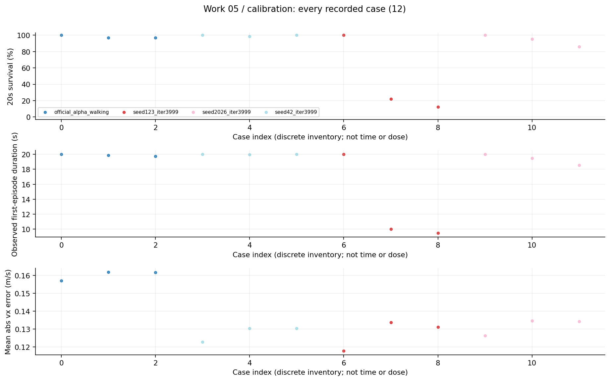

每个点是一项真实任务；横轴仅是文件记录顺序，不是连续变量，故不连线。点保留评估seed差异。条件、模型和分母可在全数据浏览器按编号查询；早停时误差只覆盖终止前。

### 图2 全部任务点 coarse

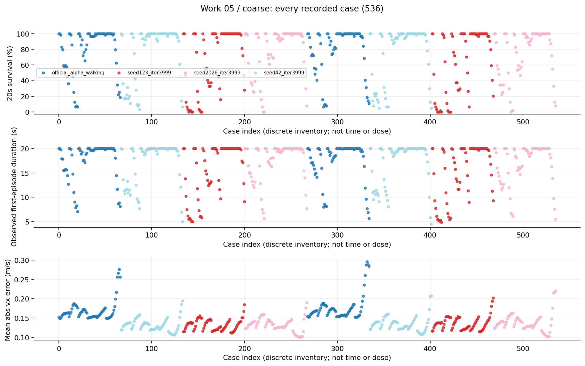

每个点是一项真实任务；横轴仅是文件记录顺序，不是连续变量，故不连线。点保留评估seed差异。条件、模型和分母可在全数据浏览器按编号查询；早停时误差只覆盖终止前。

### 图3 全部任务点 combinations

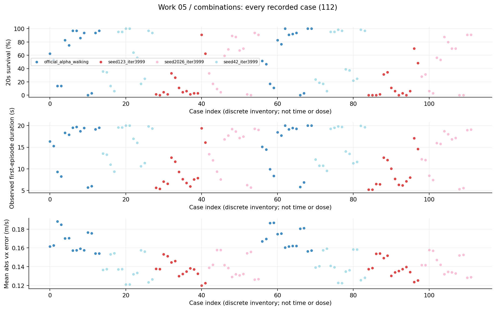

每个点是一项真实任务；横轴仅是文件记录顺序，不是连续变量，故不连线。点保留评估seed差异。条件、模型和分母可在全数据浏览器按编号查询；早停时误差只覆盖终止前。

### 图4 全部任务点 commands

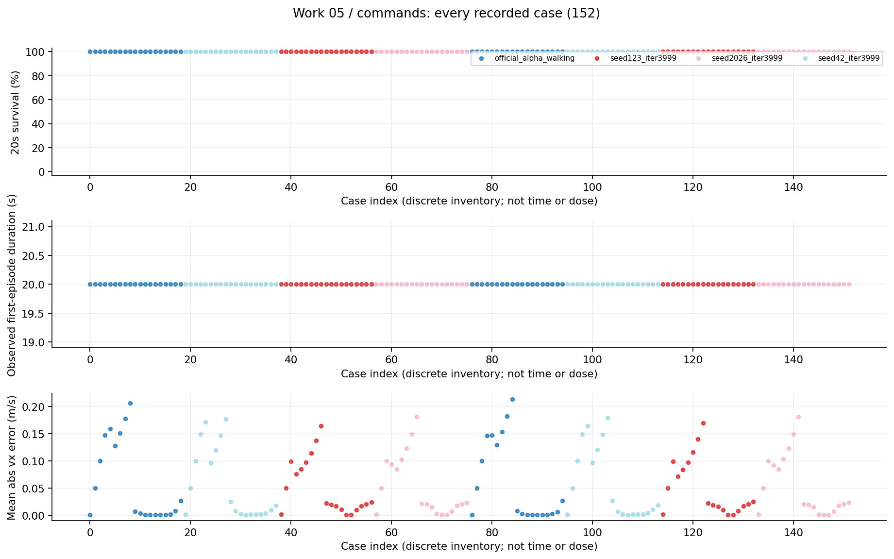

每个点是一项真实任务；横轴仅是文件记录顺序，不是连续变量，故不连线。点保留评估seed差异。条件、模型和分母可在全数据浏览器按编号查询；早停时误差只覆盖终止前。

### 图5 全部任务点 confirmation

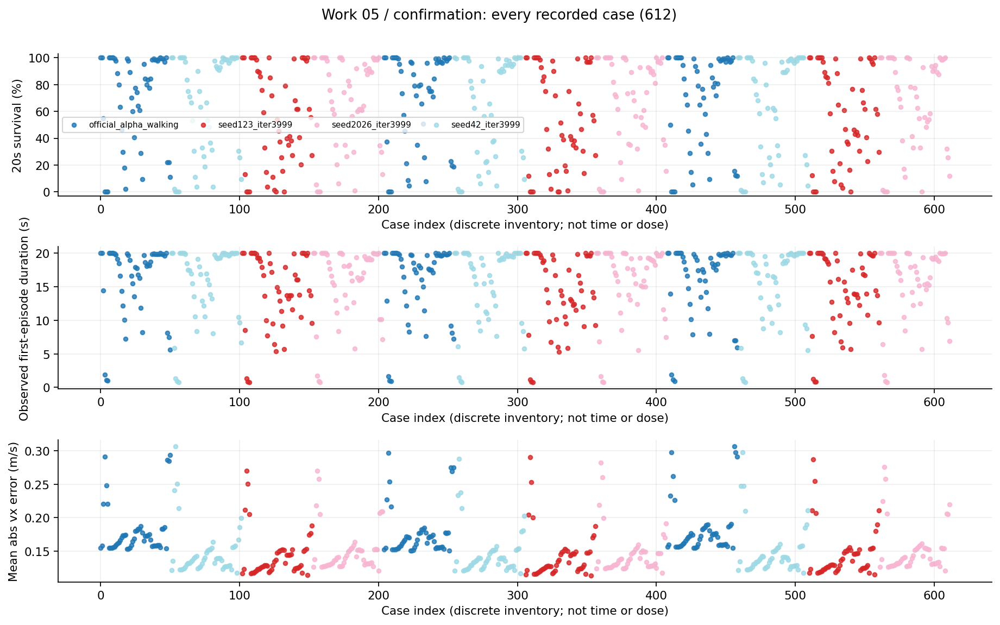

每个点是一项真实任务；横轴仅是文件记录顺序，不是连续变量，故不连线。点保留评估seed差异。条件、模型和分母可在全数据浏览器按编号查询；早停时误差只覆盖终止前。

### 图6 全部任务点 delay_freeze_exploration

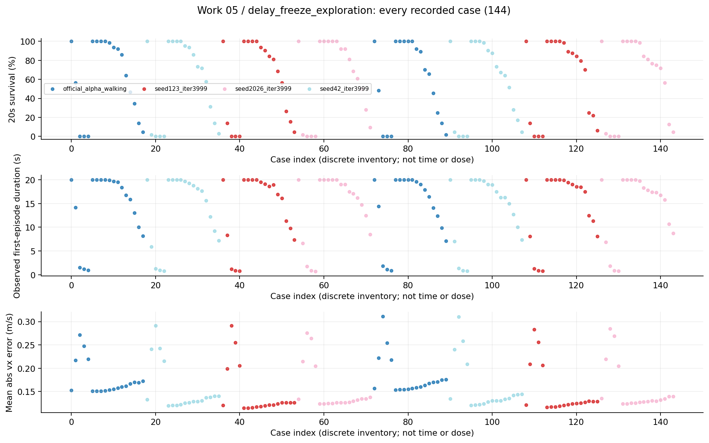

每个点是一项真实任务；横轴仅是文件记录顺序，不是连续变量，故不连线。点保留评估seed差异。条件、模型和分母可在全数据浏览器按编号查询；早停时误差只覆盖终止前。

### 图7 全部任务点 local

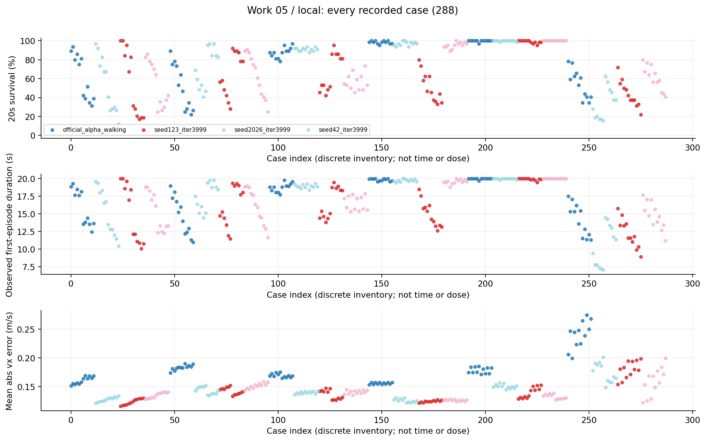

每个点是一项真实任务；横轴仅是文件记录顺序，不是连续变量，故不连线。点保留评估seed差异。条件、模型和分母可在全数据浏览器按编号查询；早停时误差只覆盖终止前。

### 图8 全部任务点 smoke

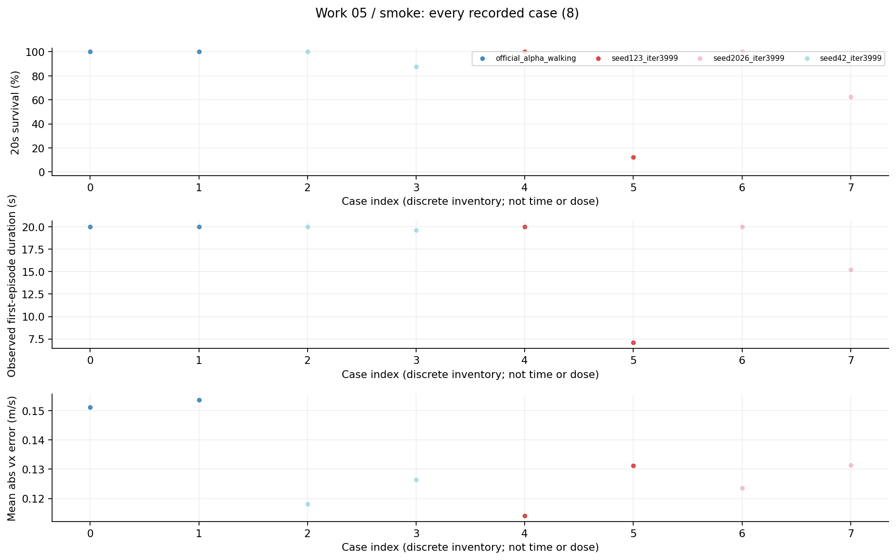

每个点是一项真实任务；横轴仅是文件记录顺序，不是连续变量，故不连线。点保留评估seed差异。条件、模型和分母可在全数据浏览器按编号查询；早停时误差只覆盖终止前。

### 图9 全部任务点 time

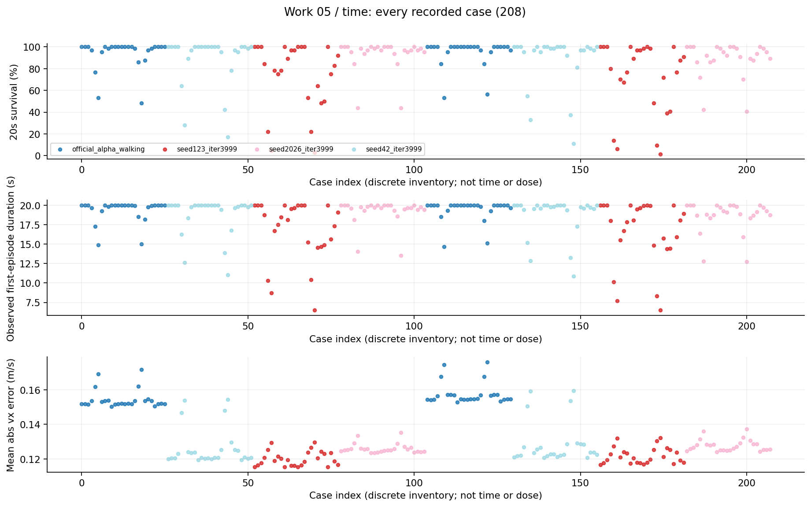

每个点是一项真实任务；横轴仅是文件记录顺序，不是连续变量，故不连线。点保留评估seed差异。条件、模型和分母可在全数据浏览器按编号查询；早停时误差只覆盖终止前。

### 图10 channel combinations

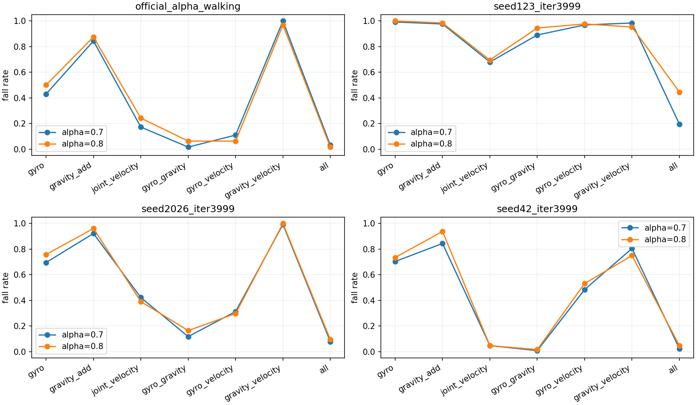

横轴是通道组合类别，纵轴为存活/寿命等结果。组合响应不等于各单通道损害之和；同alpha的输入范数不同，不能直接当协同作用的因果证明。

### 图11 coarse imu bias all

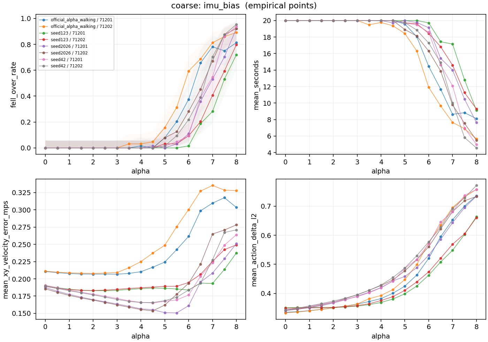

两个探索评估seed的幅度或机制扫描。本图关注IMU偏置；存活百分比越高只表示越少提前终止，不代表跟踪更准。强度轴只按本故障定义解释，不能把不同通道同alpha视为等输入能量。探索与确认分开读，准确分母和seed见图例及数据浏览器。

### 图12 coarse noise all

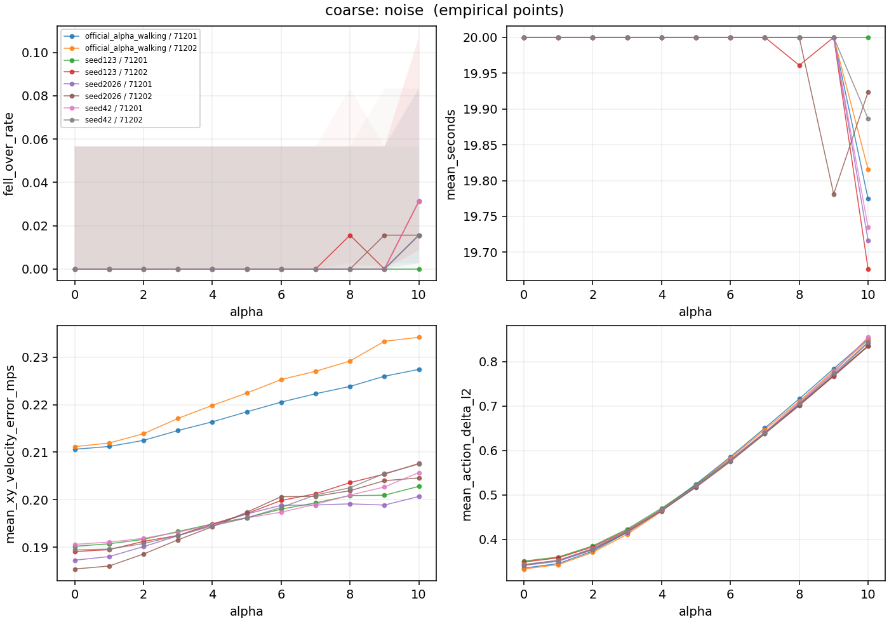

两个探索评估seed的幅度或机制扫描。本图关注传感段噪声；存活百分比越高只表示越少提前终止，不代表跟踪更准。强度轴只按本故障定义解释，不能把不同通道同alpha视为等输入能量。探索与确认分开读，准确分母和seed见图例及数据浏览器。

### 图13 coarse pulse all

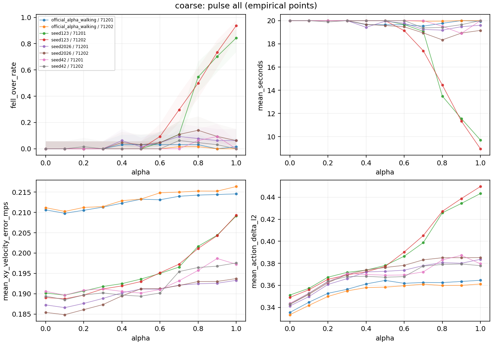

两个探索评估seed的幅度或机制扫描。本图关注联合传感段；存活百分比越高只表示越少提前终止，不代表跟踪更准。强度轴只按本故障定义解释，不能把不同通道同alpha视为等输入能量。探索与确认分开读，准确分母和seed见图例及数据浏览器。

### 图14 coarse pulse gravity add

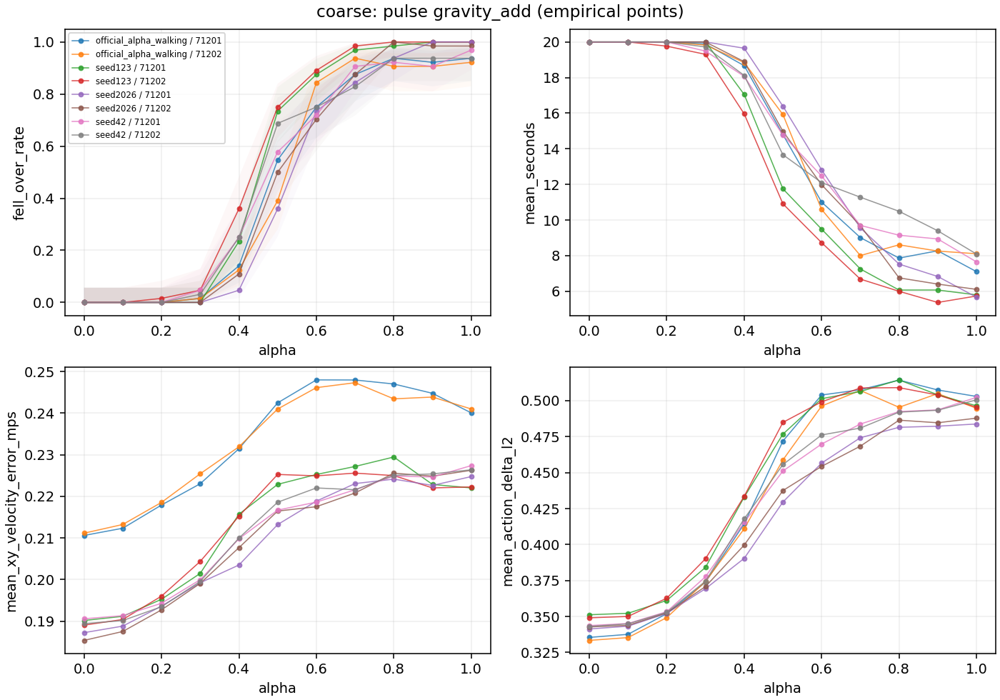

两个探索评估seed的幅度或机制扫描。本图关注重力投影向量加性偏移；存活百分比越高只表示越少提前终止，不代表跟踪更准。强度轴只按本故障定义解释，不能把不同通道同alpha视为等输入能量。探索与确认分开读，准确分母和seed见图例及数据浏览器。

### 图15 coarse pulse gyro

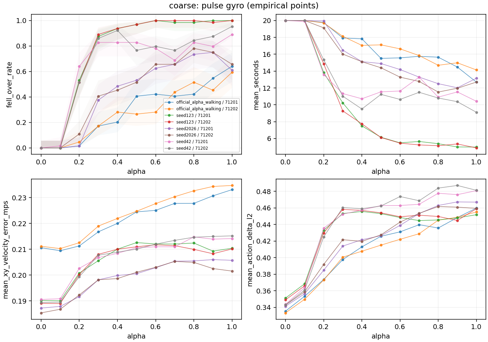

两个探索评估seed的幅度或机制扫描。本图关注躯干角速度；存活百分比越高只表示越少提前终止，不代表跟踪更准。强度轴只按本故障定义解释，不能把不同通道同alpha视为等输入能量。探索与确认分开读，准确分母和seed见图例及数据浏览器。

### 图16 coarse pulse joint velocity

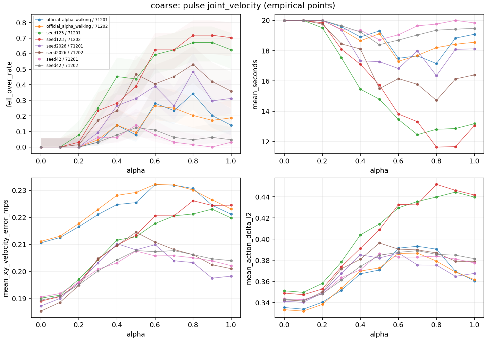

两个探索评估seed的幅度或机制扫描。本图关注关节速度；存活百分比越高只表示越少提前终止，不代表跟踪更准。强度轴只按本故障定义解释，不能把不同通道同alpha视为等输入能量。探索与确认分开读，准确分母和seed见图例及数据浏览器。

### 图17 confirmation delay all

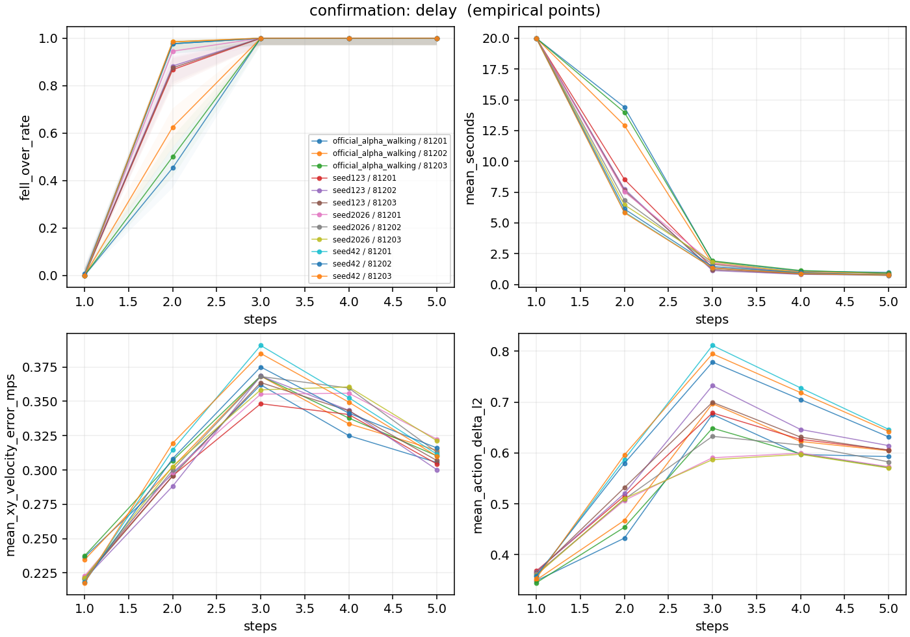

横轴为额外观测延迟步或其对应毫秒，一控制步20ms；原生延迟仍保留，不能把该轴叫硬件端到端总时延。纵轴存活和寿命须同时看。探索与确认是不同seed队列，不合并为新样本。

### 图18 confirmation freeze all

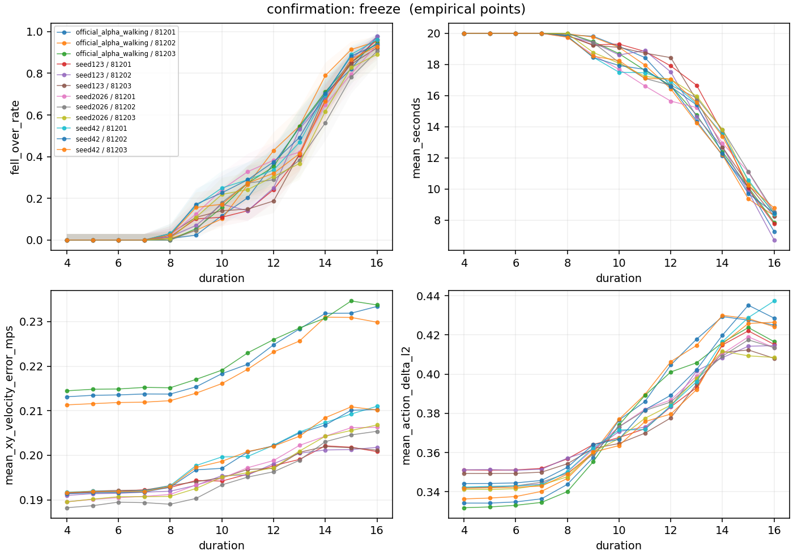

横轴为观测冻结控制步数，一步20ms；名义持续时间与最后一帧实际陈旧年龄差一控制步。冻结越久不保证各模型排名不变；存活不等于任务成功。

### 图19 confirmation imu bias all

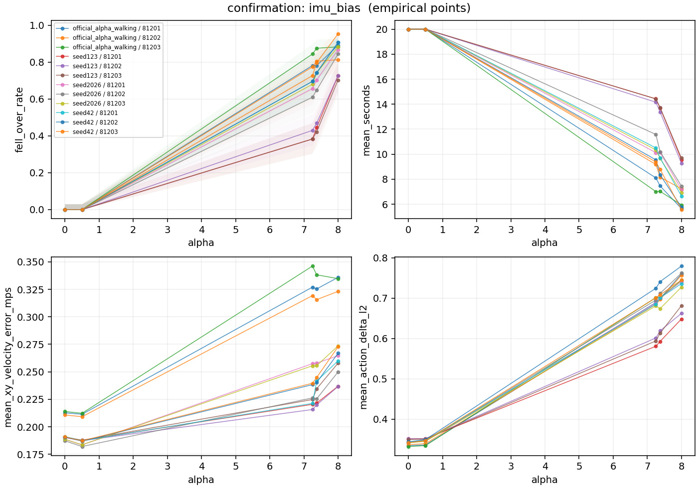

三新评估seed确认。本图关注IMU偏置；存活百分比越高只表示越少提前终止，不代表跟踪更准。强度轴只按本故障定义解释，不能把不同通道同alpha视为等输入能量。探索与确认分开读，准确分母和seed见图例及数据浏览器。

### 图20 confirmation noise all

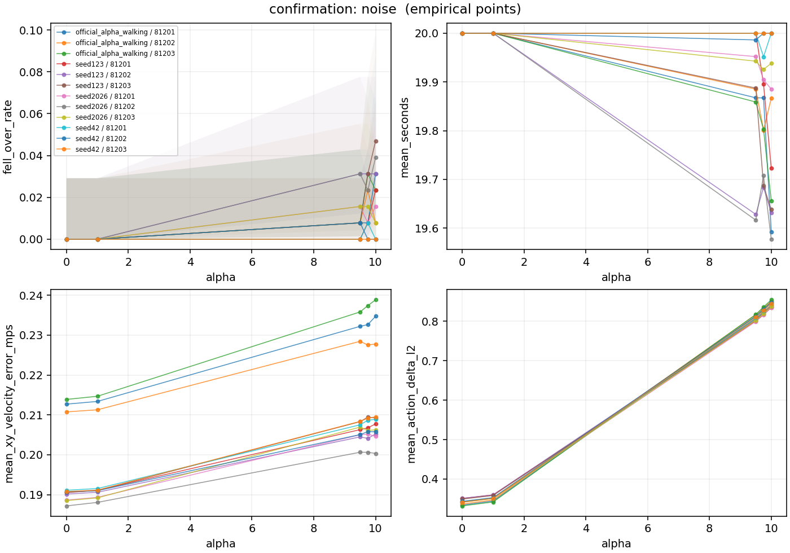

三新评估seed确认。本图关注传感段噪声；存活百分比越高只表示越少提前终止，不代表跟踪更准。强度轴只按本故障定义解释，不能把不同通道同alpha视为等输入能量。探索与确认分开读，准确分母和seed见图例及数据浏览器。

### 图21 confirmation pulse all

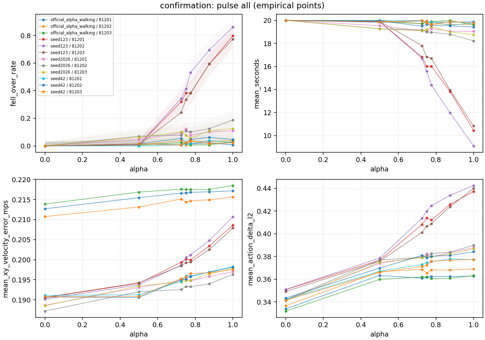

三新评估seed确认。本图关注联合传感段；存活百分比越高只表示越少提前终止，不代表跟踪更准。强度轴只按本故障定义解释，不能把不同通道同alpha视为等输入能量。探索与确认分开读，准确分母和seed见图例及数据浏览器。

### 图22 confirmation pulse gravity add

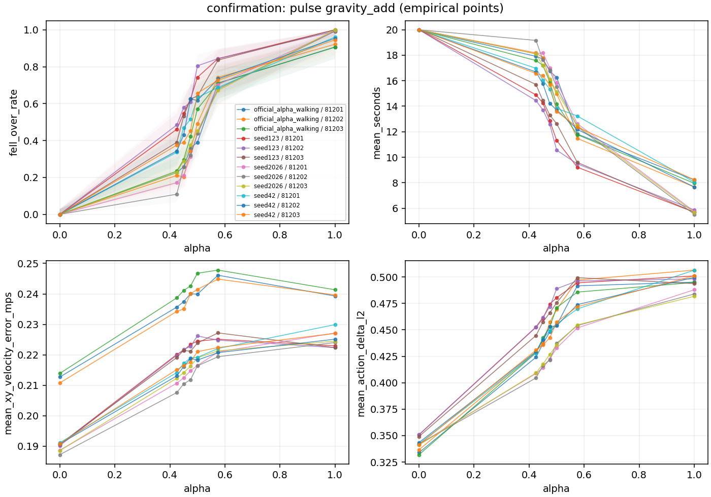

三新评估seed确认。本图关注重力投影向量加性偏移；存活百分比越高只表示越少提前终止，不代表跟踪更准。强度轴只按本故障定义解释，不能把不同通道同alpha视为等输入能量。探索与确认分开读，准确分母和seed见图例及数据浏览器。

### 图23 confirmation pulse gyro

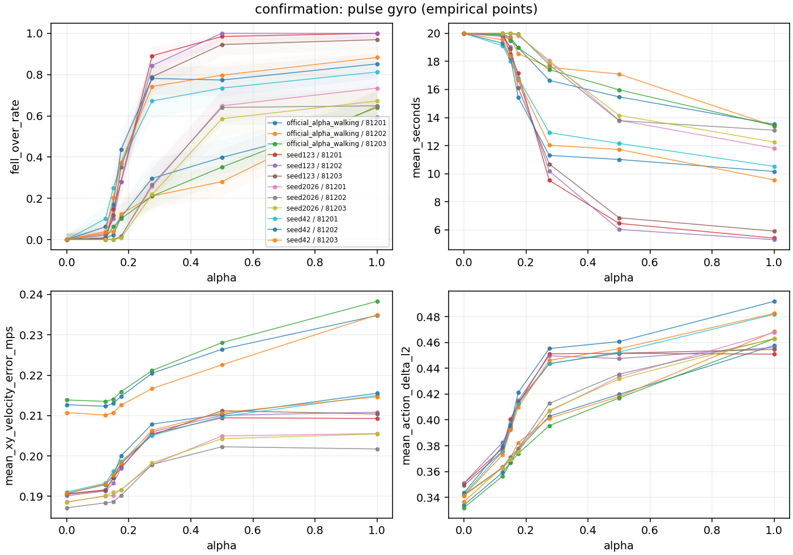

三新评估seed确认。本图关注躯干角速度；存活百分比越高只表示越少提前终止，不代表跟踪更准。强度轴只按本故障定义解释，不能把不同通道同alpha视为等输入能量。探索与确认分开读，准确分母和seed见图例及数据浏览器。

### 图24 confirmation pulse joint velocity

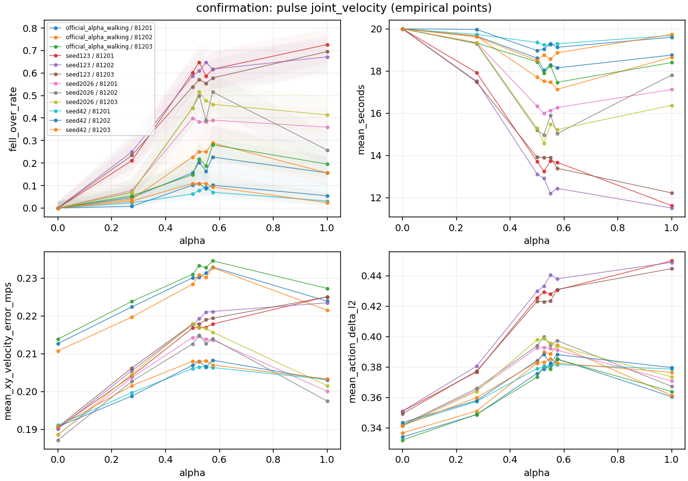

三新评估seed确认。本图关注关节速度；存活百分比越高只表示越少提前终止，不代表跟踪更准。强度轴只按本故障定义解释，不能把不同通道同alpha视为等输入能量。探索与确认分开读，准确分母和seed见图例及数据浏览器。

### 图25 delay freeze exploration delay all

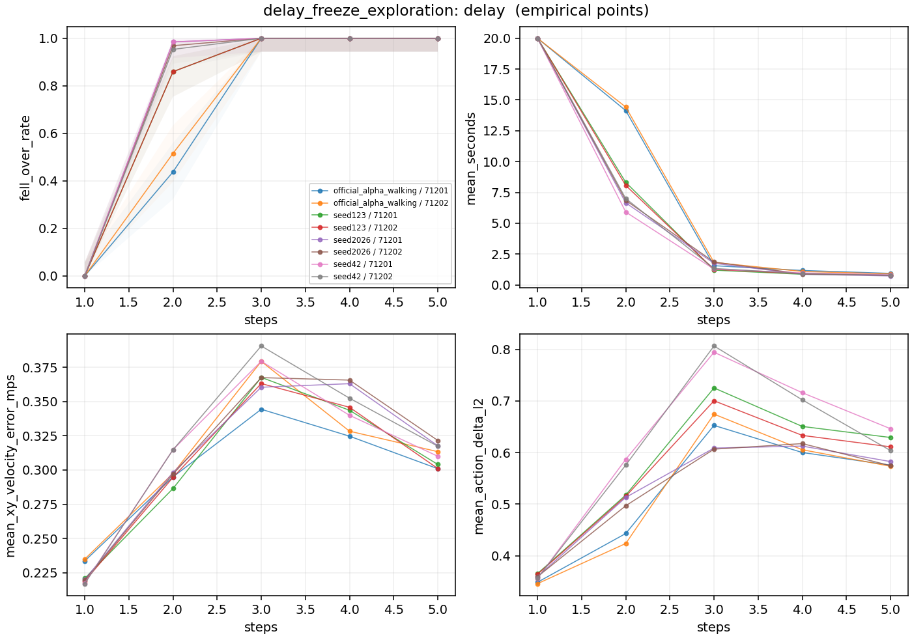

横轴为观测冻结控制步数，一步20ms；名义持续时间与最后一帧实际陈旧年龄差一控制步。冻结越久不保证各模型排名不变；存活不等于任务成功。

### 图26 delay freeze exploration freeze all

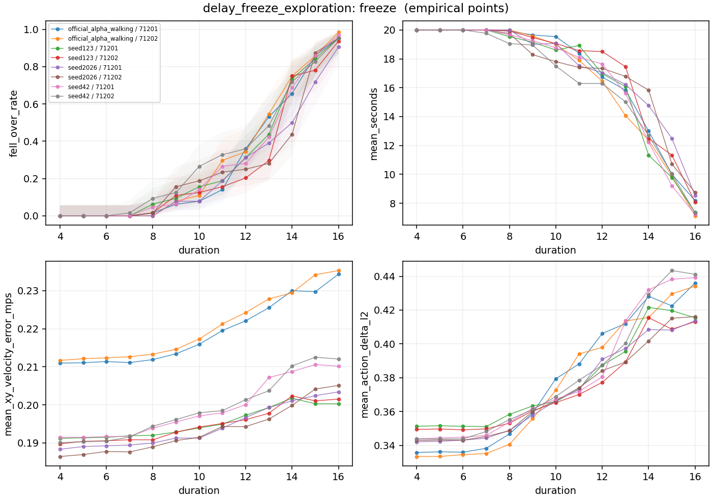

横轴为观测冻结控制步数，一步20ms；名义持续时间与最后一帧实际陈旧年龄差一控制步。冻结越久不保证各模型排名不变；存活不等于任务成功。

### 图27 local imu bias all

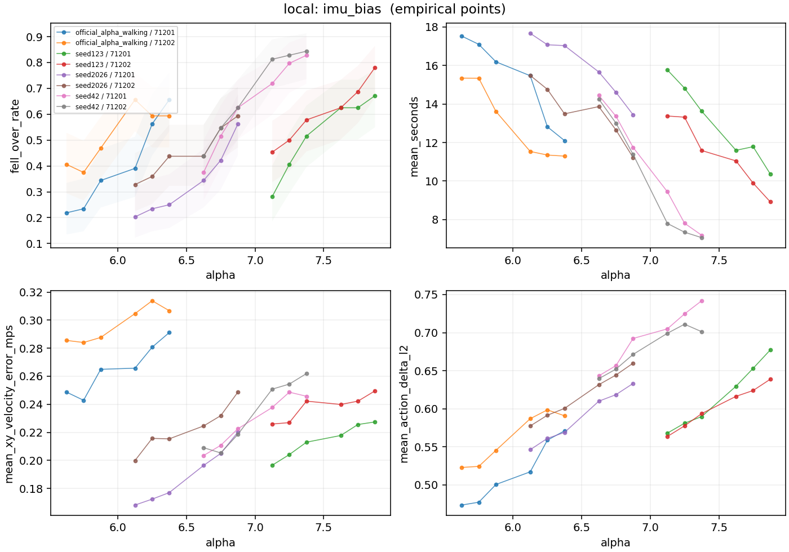

两个探索评估seed的幅度或机制扫描。本图关注IMU偏置；存活百分比越高只表示越少提前终止，不代表跟踪更准。强度轴只按本故障定义解释，不能把不同通道同alpha视为等输入能量。探索与确认分开读，准确分母和seed见图例及数据浏览器。

### 图28 local noise all

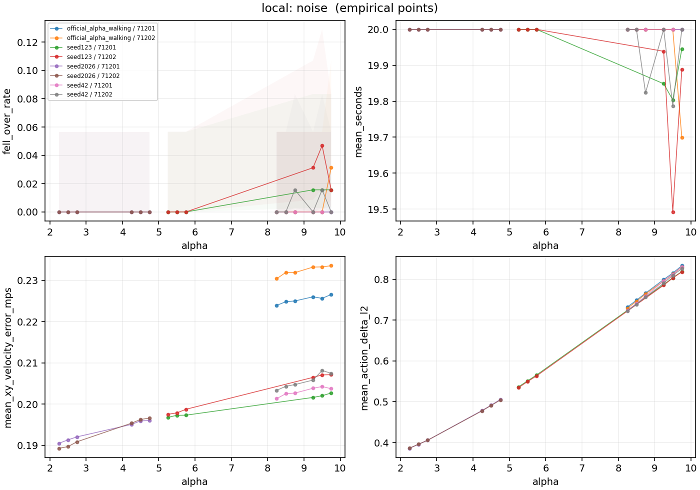

两个探索评估seed的幅度或机制扫描。本图关注传感段噪声；存活百分比越高只表示越少提前终止，不代表跟踪更准。强度轴只按本故障定义解释，不能把不同通道同alpha视为等输入能量。探索与确认分开读，准确分母和seed见图例及数据浏览器。

### 图29 local pulse all

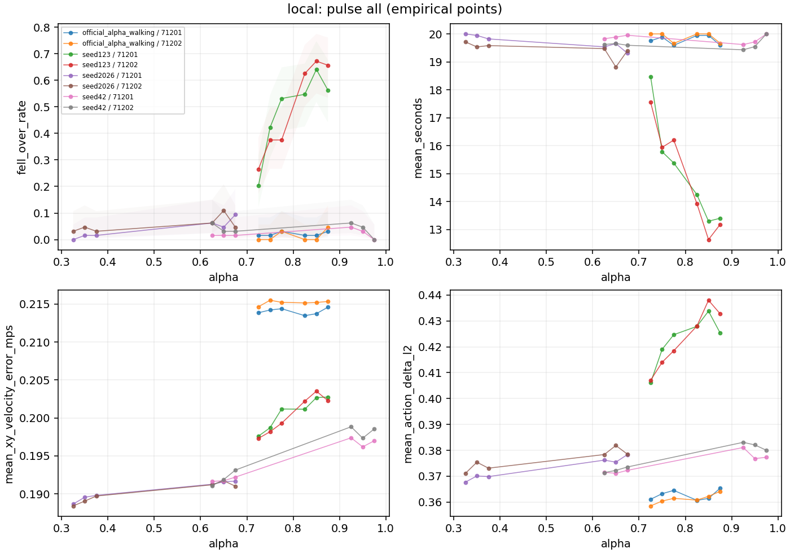

两个探索评估seed的幅度或机制扫描。本图关注联合传感段；存活百分比越高只表示越少提前终止，不代表跟踪更准。强度轴只按本故障定义解释，不能把不同通道同alpha视为等输入能量。探索与确认分开读，准确分母和seed见图例及数据浏览器。

### 图30 local pulse gravity add

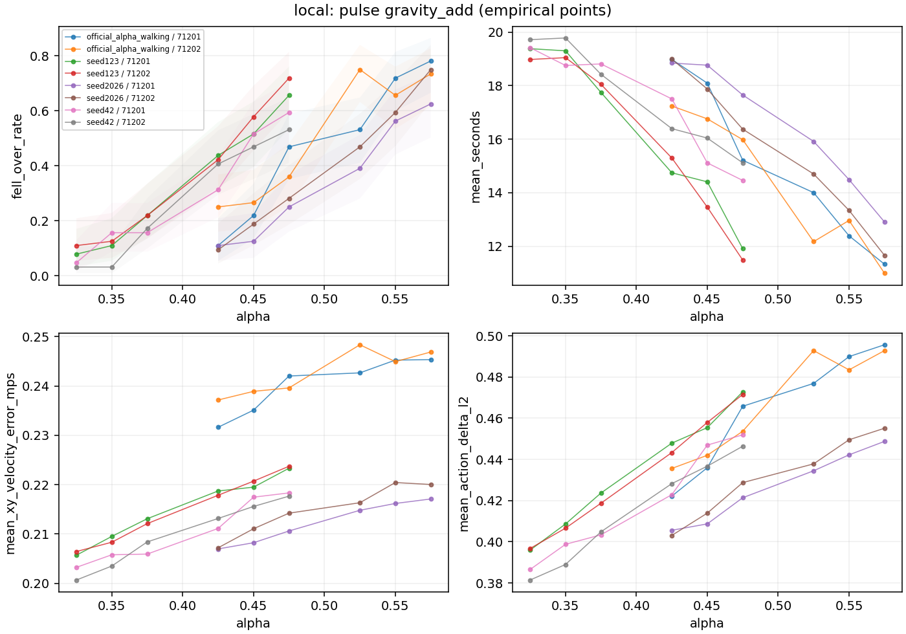

两个探索评估seed的幅度或机制扫描。本图关注重力投影向量加性偏移；存活百分比越高只表示越少提前终止，不代表跟踪更准。强度轴只按本故障定义解释，不能把不同通道同alpha视为等输入能量。探索与确认分开读，准确分母和seed见图例及数据浏览器。

### 图31 local pulse gyro

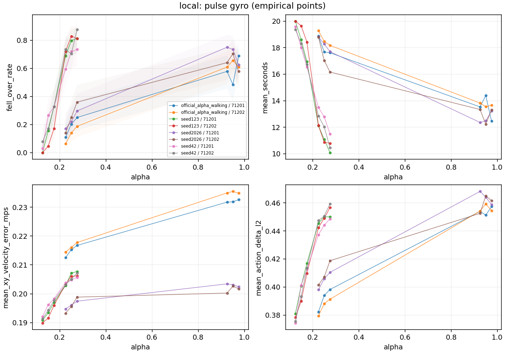

两个探索评估seed的幅度或机制扫描。本图关注躯干角速度；存活百分比越高只表示越少提前终止，不代表跟踪更准。强度轴只按本故障定义解释，不能把不同通道同alpha视为等输入能量。探索与确认分开读，准确分母和seed见图例及数据浏览器。

### 图32 local pulse joint velocity

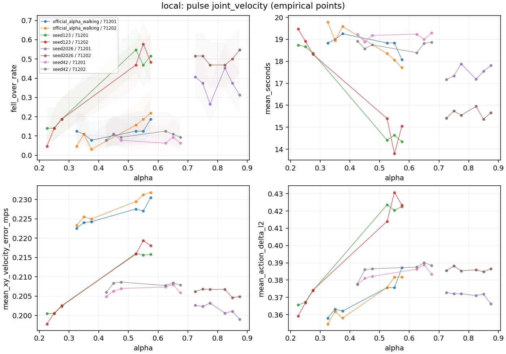

两个探索评估seed的幅度或机制扫描。本图关注关节速度；存活百分比越高只表示越少提前终止，不代表跟踪更准。强度轴只按本故障定义解释，不能把不同通道同alpha视为等输入能量。探索与确认分开读，准确分母和seed见图例及数据浏览器。

### 图33 merged exploration delay all

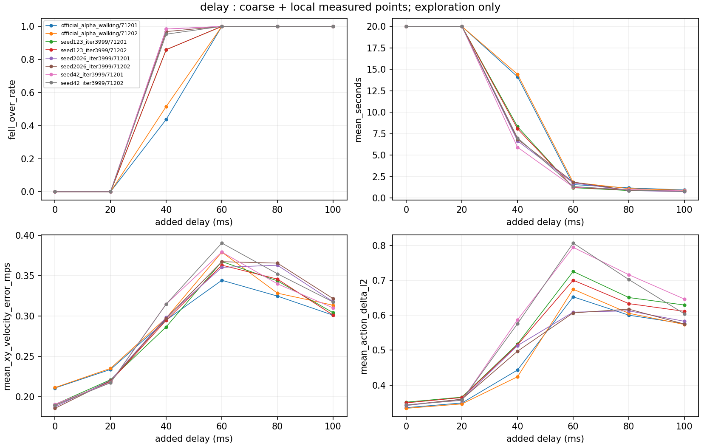

横轴为额外观测延迟步或其对应毫秒，一控制步20ms；原生延迟仍保留，不能把该轴叫硬件端到端总时延。纵轴存活和寿命须同时看。探索与确认是不同seed队列，不合并为新样本。

### 图34 merged exploration freeze all

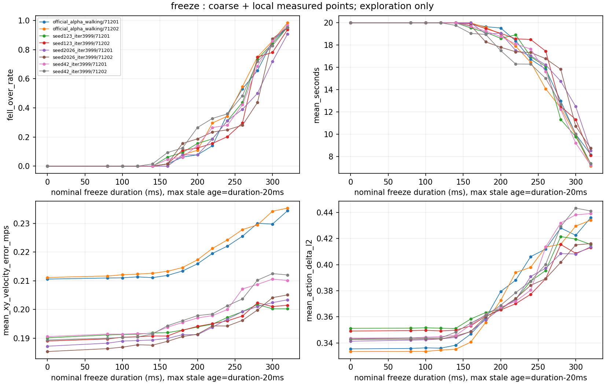

横轴为观测冻结控制步数，一步20ms；名义持续时间与最后一帧实际陈旧年龄差一控制步。冻结越久不保证各模型排名不变；存活不等于任务成功。

### 图35 merged exploration imu bias all

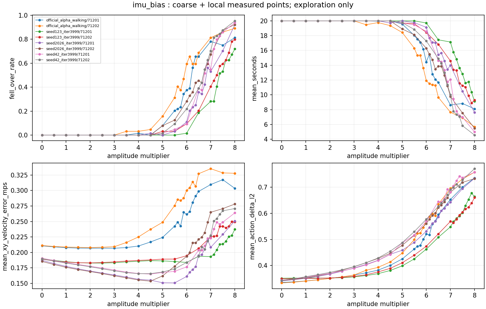

两个探索评估seed的幅度或机制扫描。本图关注IMU偏置；存活百分比越高只表示越少提前终止，不代表跟踪更准。强度轴只按本故障定义解释，不能把不同通道同alpha视为等输入能量。探索与确认分开读，准确分母和seed见图例及数据浏览器。

### 图36 merged exploration noise all

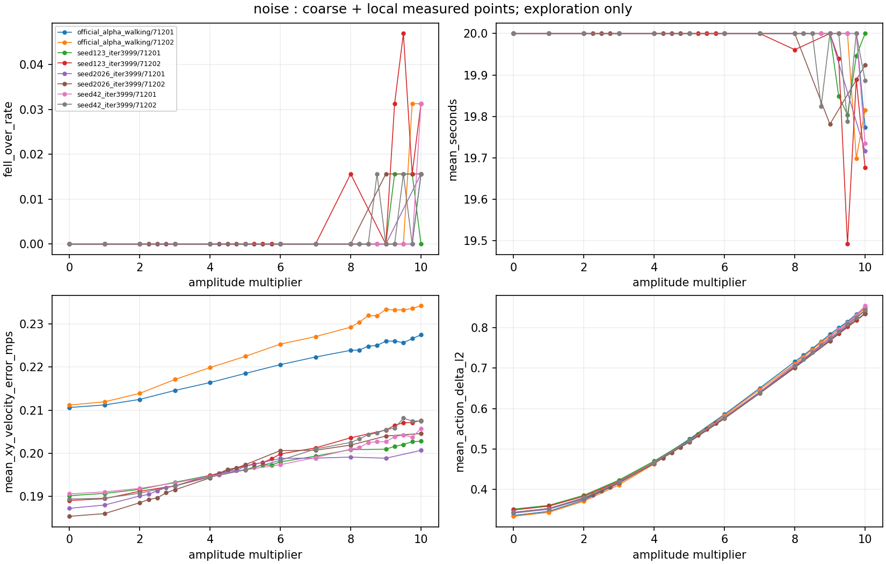

两个探索评估seed的幅度或机制扫描。本图关注传感段噪声；存活百分比越高只表示越少提前终止，不代表跟踪更准。强度轴只按本故障定义解释，不能把不同通道同alpha视为等输入能量。探索与确认分开读，准确分母和seed见图例及数据浏览器。

### 图37 merged exploration pulse all

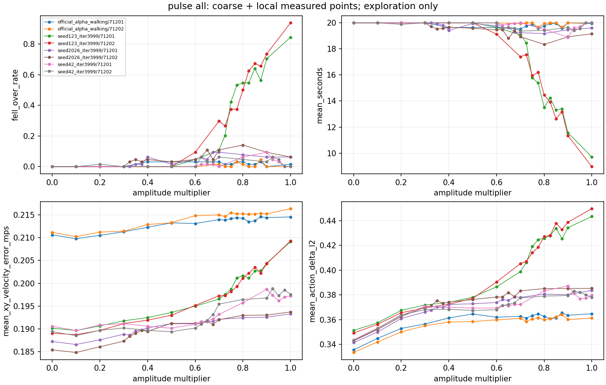

两个探索评估seed的幅度或机制扫描。本图关注联合传感段；存活百分比越高只表示越少提前终止，不代表跟踪更准。强度轴只按本故障定义解释，不能把不同通道同alpha视为等输入能量。探索与确认分开读，准确分母和seed见图例及数据浏览器。

### 图38 merged exploration pulse gravity add

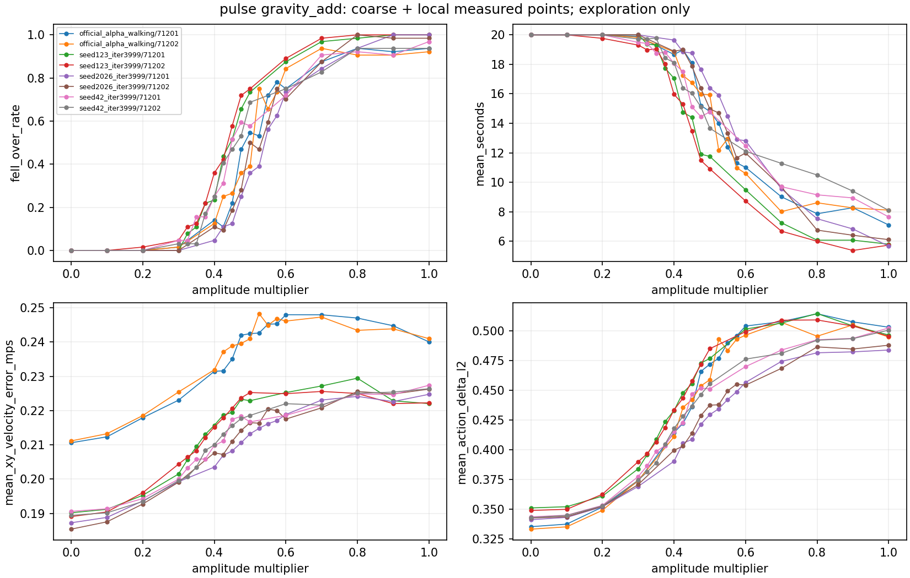

两个探索评估seed的幅度或机制扫描。本图关注重力投影向量加性偏移；存活百分比越高只表示越少提前终止，不代表跟踪更准。强度轴只按本故障定义解释，不能把不同通道同alpha视为等输入能量。探索与确认分开读，准确分母和seed见图例及数据浏览器。

### 图39 merged exploration pulse gyro

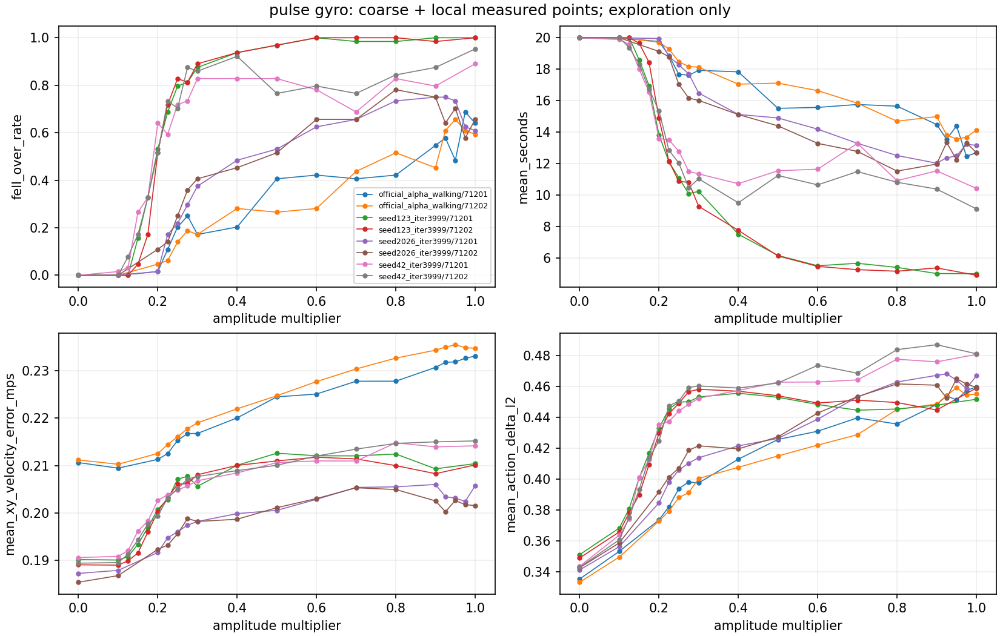

两个探索评估seed的幅度或机制扫描。本图关注躯干角速度；存活百分比越高只表示越少提前终止，不代表跟踪更准。强度轴只按本故障定义解释，不能把不同通道同alpha视为等输入能量。探索与确认分开读，准确分母和seed见图例及数据浏览器。

### 图40 merged exploration pulse joint velocity

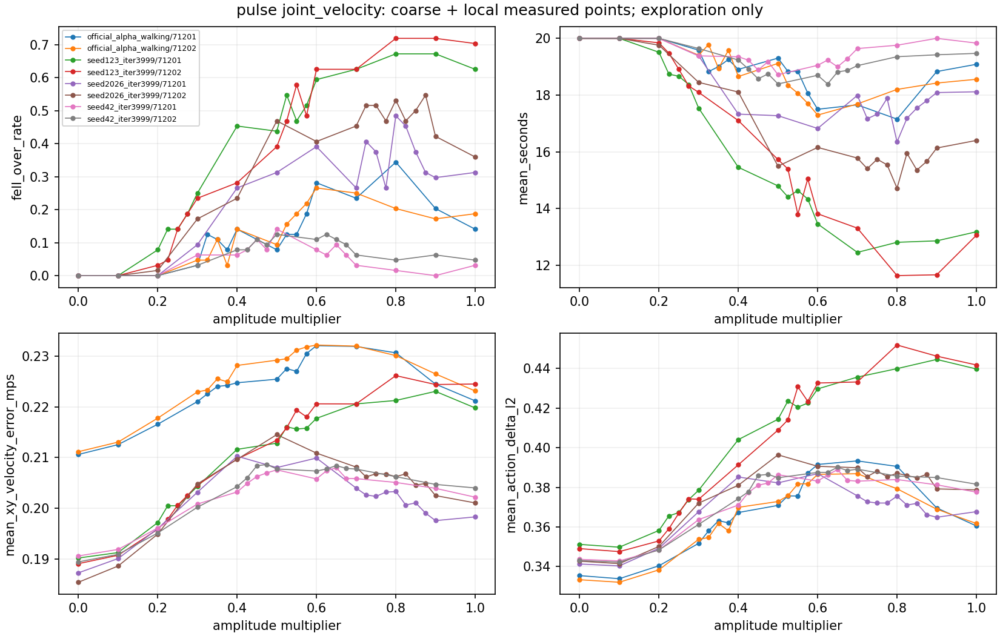

两个探索评估seed的幅度或机制扫描。本图关注关节速度；存活百分比越高只表示越少提前终止，不代表跟踪更准。强度轴只按本故障定义解释，不能把不同通道同alpha视为等输入能量。探索与确认分开读，准确分母和seed见图例及数据浏览器。

### 图41 nominal Forward

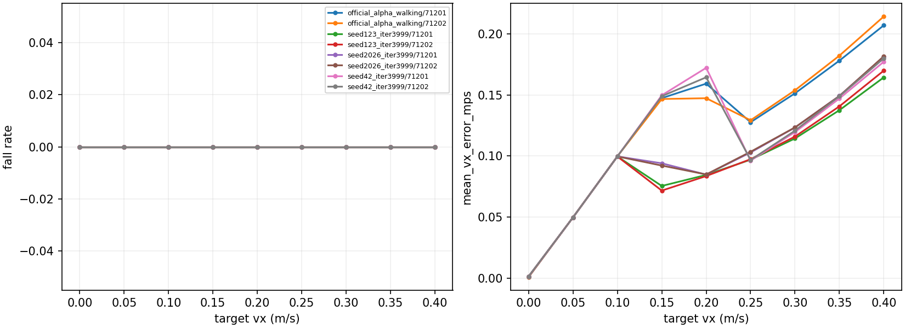

固定命令扫描：Forward观察前向速度误差，Turning观察yaw误差及平移漂移。模型站住不等于跟随命令，目标速度变化时应按相应命令比较。

### 图42 nominal Turning

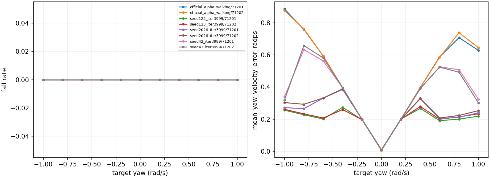

固定命令扫描：Forward观察前向速度误差，Turning观察yaw误差及平移漂移。模型站住不等于跟随命令，目标速度变化时应按相应命令比较。

### 图43 timing cluster

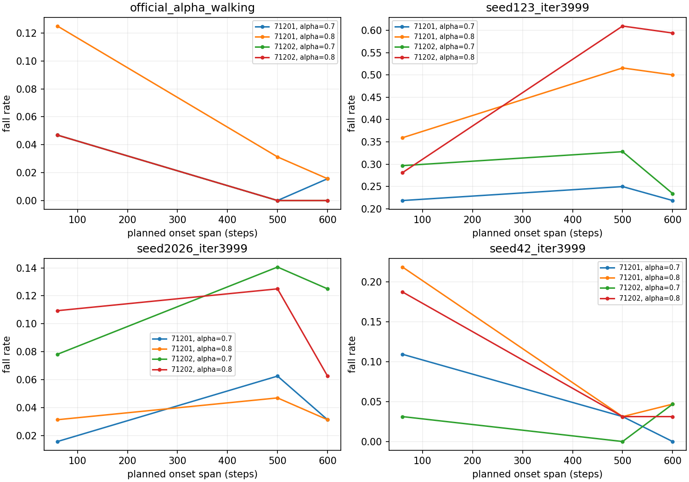

比较脉冲在时间上的聚集安排。横轴为实际协议中的时间安排参数，不是新增训练轮数；暴露次数和早停的关系应结合原始条件查看。

### 图44 timing duration

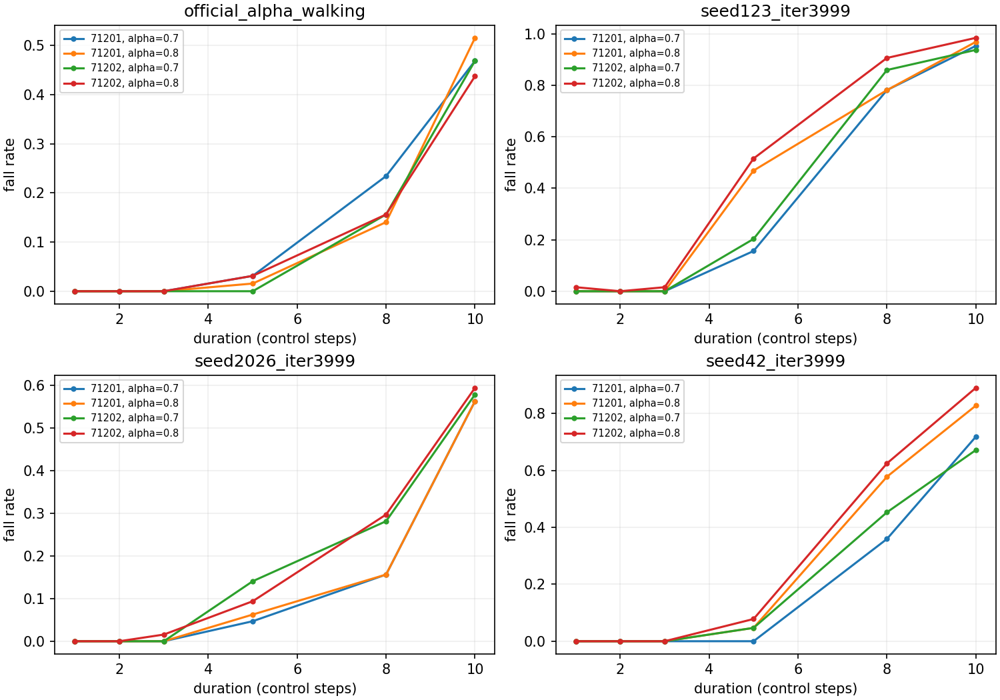

横轴是每次脉冲持续控制步数，一步20ms；纵轴描述首回合结果。改变持续时间也改变计划暴露量，早终止会进一步改变实际暴露，不能当等剂量机制分离。

### 图45 timing single onset

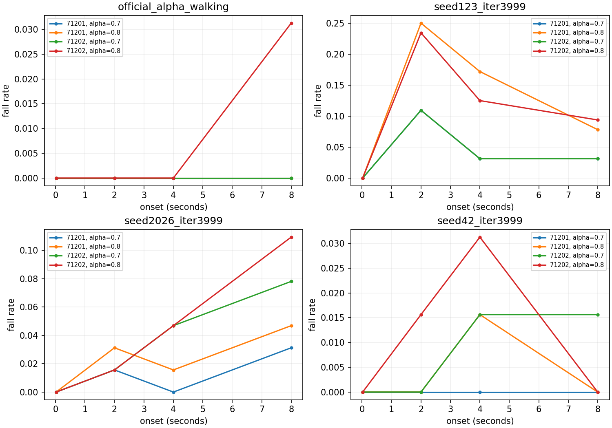

横轴为单次注入起点所在控制步；越靠后意味着机器人所处状态和剩余观察窗口不同。仅两个探索seed，不外推精确最危险时刻。

### 图46 OLD VS NEW TEMPORAL

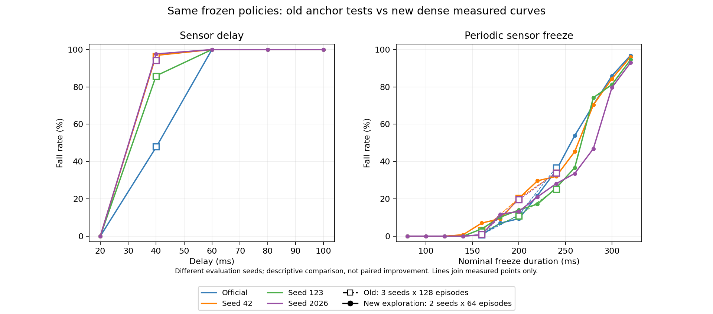

历史补充图，保留用于追溯。本图的队列、幅度、分母或目的不同于本报告主表，不合并计数，不当成新增实验或最终主协议结论。

## 限制与不能支持的结论

本轮重新读取全部2072份CSV并核对记录SHA、唯一任务与主要均值；未重新跑仿真。不能把幅度扫描称为恶意训练投毒或部署攻击可达性证明。不存在未实际采样的25/30/35ms结果。

## 证据入口与复核范围

输入清单与SHA：[input_manifest.json](data/input_manifest.json)。本轮计数/均值复算：[AUDIT.json](data/AUDIT.json)。

- D:\MicroDuckResearch\ti\outputs\microduck_reproduction\fine_response\results\results.json　SHA256 c6cefb92297f8d694df1a9de1f745c16f7f0746f2179b591db1d9f2f38edd158

## 这项工作的价值

价值在于形成可复核、多维而非单点的故障响应基准，能用于定位失效范围、识别模型特有弱点以及检验后续解释；负结果和非单调结果同样保留。

---

# 06 原生延迟诊断研究报告

保留或清零原生观测延迟会显著改变额外延迟故障的结果，且通道选择改变排名。时间合同是必须记录的实验变量。

## 工作范围

4模型×2原生延迟设置×4条件×128首回合，32项、4096回合；只有评估seed1001。

## 我们如何完成这项工作

分别保留训练对应的原生延迟与将其清零；每设置测试clean、全传感段额外40ms、仅IMU额外40ms、仅关节速度额外40ms。清零是另一推理合同，只作为机制消融，不替换正式基准。

## 现有结果及解释

1. 两种设置下各模型clean均128/128存活。全观测额外40ms时，保留到清零：official为63→127，42为5→105，123为18→118，2026为7→119，分母均128。

2. 仅IMU延迟时official两设置都0/128；清零后42、123、2026分别64/128、67/128、82/128。仅关节速度延迟各模型均全存活。

3. 这些结果与“所有本地模型只是总体质量更差”这一简单解释不相容，但还没有把影响定位为唯一的物理时钟错位机制。

## 完整结果表

| 模型或分支 | 条件 | 阶段 | 存活分子/分母 | 存活率 | 平均寿命s | vx误差m/s | XY误差m/s |
|---|---|---|---|---|---|---|---|
| official_alpha_walking | retain_clean_all | priority_diagnostic | 128/128 | 100.00% | 20.0000 | 0.1544 | 0.2121 |
| seed42_iter3999 | retain_clean_all | priority_diagnostic | 128/128 | 100.00% | 20.0000 | 0.1212 | 0.1906 |
| seed123_iter3999 | retain_clean_all | priority_diagnostic | 128/128 | 100.00% | 20.0000 | 0.1166 | 0.1903 |
| seed2026_iter3999 | retain_clean_all | priority_diagnostic | 128/128 | 100.00% | 20.0000 | 0.1246 | 0.1871 |
| official_alpha_walking | zero_clean_all | priority_diagnostic | 128/128 | 100.00% | 20.0000 | 0.1631 | 0.2100 |
| seed42_iter3999 | zero_clean_all | priority_diagnostic | 128/128 | 100.00% | 20.0000 | 0.1273 | 0.1840 |
| seed123_iter3999 | zero_clean_all | priority_diagnostic | 128/128 | 100.00% | 20.0000 | 0.1246 | 0.1837 |
| seed2026_iter3999 | zero_clean_all | priority_diagnostic | 128/128 | 100.00% | 20.0000 | 0.1357 | 0.1850 |
| official_alpha_walking | retain_delay_all | priority_diagnostic | 63/128 | 49.22% | 15.0297 | 0.2161 | 0.2924 |
| seed42_iter3999 | retain_delay_all | priority_diagnostic | 5/128 | 3.91% | 6.1408 | 0.2373 | 0.3104 |
| seed123_iter3999 | retain_delay_all | priority_diagnostic | 18/128 | 14.06% | 8.1364 | 0.2021 | 0.2876 |
| seed2026_iter3999 | retain_delay_all | priority_diagnostic | 7/128 | 5.47% | 7.4812 | 0.2175 | 0.2979 |
| official_alpha_walking | zero_delay_all | priority_diagnostic | 127/128 | 99.22% | 19.8602 | 0.1753 | 0.2537 |
| seed42_iter3999 | zero_delay_all | priority_diagnostic | 105/128 | 82.03% | 17.8622 | 0.1752 | 0.2510 |
| seed123_iter3999 | zero_delay_all | priority_diagnostic | 118/128 | 92.19% | 18.9378 | 0.1516 | 0.2443 |
| seed2026_iter3999 | zero_delay_all | priority_diagnostic | 119/128 | 92.97% | 19.2291 | 0.1884 | 0.2680 |
| official_alpha_walking | retain_delay_imu | priority_diagnostic | 0/128 | 0.00% | 4.7019 | 0.2136 | 0.2755 |
| seed42_iter3999 | retain_delay_imu | priority_diagnostic | 8/128 | 6.25% | 7.0305 | 0.1874 | 0.2493 |
| seed123_iter3999 | retain_delay_imu | priority_diagnostic | 7/128 | 5.47% | 6.5150 | 0.1641 | 0.2342 |
| seed2026_iter3999 | retain_delay_imu | priority_diagnostic | 8/128 | 6.25% | 6.8622 | 0.1669 | 0.2327 |
| official_alpha_walking | zero_delay_imu | priority_diagnostic | 0/128 | 0.00% | 4.1758 | 0.2212 | 0.2773 |
| seed42_iter3999 | zero_delay_imu | priority_diagnostic | 64/128 | 50.00% | 13.4006 | 0.1593 | 0.2175 |
| seed123_iter3999 | zero_delay_imu | priority_diagnostic | 67/128 | 52.34% | 13.5959 | 0.1610 | 0.2242 |
| seed2026_iter3999 | zero_delay_imu | priority_diagnostic | 82/128 | 64.06% | 15.0989 | 0.1595 | 0.2137 |
| official_alpha_walking | retain_delay_joint_velocity | priority_diagnostic | 128/128 | 100.00% | 20.0000 | 0.1558 | 0.2349 |
| seed42_iter3999 | retain_delay_joint_velocity | priority_diagnostic | 128/128 | 100.00% | 20.0000 | 0.1230 | 0.2126 |
| seed123_iter3999 | retain_delay_joint_velocity | priority_diagnostic | 128/128 | 100.00% | 20.0000 | 0.1137 | 0.2100 |
| seed2026_iter3999 | retain_delay_joint_velocity | priority_diagnostic | 128/128 | 100.00% | 20.0000 | 0.1098 | 0.1951 |
| official_alpha_walking | zero_delay_joint_velocity | priority_diagnostic | 128/128 | 100.00% | 20.0000 | 0.1598 | 0.2282 |
| seed42_iter3999 | zero_delay_joint_velocity | priority_diagnostic | 128/128 | 100.00% | 20.0000 | 0.1213 | 0.2024 |
| seed123_iter3999 | zero_delay_joint_velocity | priority_diagnostic | 128/128 | 100.00% | 20.0000 | 0.1150 | 0.2025 |
| seed2026_iter3999 | zero_delay_joint_velocity | priority_diagnostic | 128/128 | 100.00% | 20.0000 | 0.1225 | 0.1964 |

## 图表及读图注释

> 读图注释：原生延迟来自原环境合同，额外延迟是本实验叠加的缓存陈旧。两者不可简单称为“总40ms”。

> 读图注释：同一模型在另一时间合同下改善，不代表应立即修改部署设置；需要保持原正式评价合同。

> 英文坐标速查：survival=规定时长存活；duration/seconds=首回合有效寿命；vx=前向速度；XY=平面速度；yaw=绕竖直轴旋转；MSE=动作拟合平方误差；pp=百分点。完整解释见[读图指南](READING_GUIDE.md)。

### 图1 全部任务点 all

每个点是一项真实任务；横轴仅是文件记录顺序，不是连续变量，故不连线。点保留评估seed差异。条件、模型和分母可在全数据浏览器按编号查询；早停时误差只覆盖终止前。

### 图2 首回合存续曲线 第1组

横轴为首回合仿真秒，纵轴为尚未因任何原因终止的比例；20秒超时保留在终点，不画成死亡。由已保存终止时间重算，在0.1秒网格显示；不是完整姿态轨迹，也不把跨评估seed回合当独立训练。相同曲线可能重合。

### 图3 首回合存续曲线 第2组

横轴为首回合仿真秒，纵轴为尚未因任何原因终止的比例；20秒超时保留在终点，不画成死亡。由已保存终止时间重算，在0.1秒网格显示；不是完整姿态轨迹，也不把跨评估seed回合当独立训练。相同曲线可能重合。

### 图4 01 pulse channels

历史中期CPU分析图，快照覆盖有限；最终完整数据与本轮重算另列，不把该快照冒充最终全部条件。

### 图5 02 temporal response

历史中期CPU分析图，快照覆盖有限；最终完整数据与本轮重算另列，不把该快照冒充最终全部条件。

### 图6 03 native delay ablation

历史中期CPU分析图，快照覆盖有限；最终完整数据与本轮重算另列，不把该快照冒充最终全部条件。

### 图7 04 time to failure

历史中期CPU分析图，快照覆盖有限；最终完整数据与本轮重算另列，不把该快照冒充最终全部条件。

### 图8 05 noise continuous metrics

历史中期CPU分析图，快照覆盖有限；最终完整数据与本轮重算另列，不把该快照冒充最终全部条件。

### 图9 06 truncation warning

历史中期CPU分析图，快照覆盖有限；最终完整数据与本轮重算另列，不把该快照冒充最终全部条件。

### 图10 07 snapshot coverage

历史中期CPU分析图，快照覆盖有限；最终完整数据与本轮重算另列，不把该快照冒充最终全部条件。

## 限制与不能支持的结论

单评估seed、小范围消融，没有三seed独立确认，也没有关节位置单独延迟或逐通道因果对齐证明。本轮复算32份CSV，不新增诊断条件。

## 证据入口与复核范围

输入清单与SHA：[input_manifest.json](data/input_manifest.json)。本轮计数/均值复算：[AUDIT.json](data/AUDIT.json)。

- D:\MicroDuckResearch\ti\outputs\microduck_reproduction\priority_delay_audit\diagnostic_results\results.json　SHA256 c34262c7ced694ddb208628f416bfb440cc11c302021497f2d2391a6e9fb644d

## 这项工作的价值

价值是揭示评价器的时间语义会改变结论，提醒模型验收必须同时冻结字段顺序、采样/延迟合同与注入位置；它提供诊断线索而非一项已经验证的修复方案。

---

# 07 论文报告与统一视频研究报告

图表与视频已经形成可追溯的解释材料，但它们是已有实验的不同表达，不是额外训练或新增统计样本。

## 工作范围

既有2026-10-13报告7张图、精细基准36张原图、12段正式20秒说明视频；另索引2026-10-15论文3张图。

## 我们如何完成这项工作

12段正式视频为四模型各clean、联合脉冲alpha0.7和0.8，固定Forward、seed91201、同相机640×480、50fps、1000帧。首次终止后填充末帧并显示FALL/TERMINATED，不拼接reset。已有逐段解码和SHA核验记录一并索引。

## 现有结果及解释

1. 7张旧论文图分别整理脉冲确认、时序故障、噪声连续指标、通道组合、持续时间、命令扫描和原生延迟。它们的分母、探索/确认身份应以各图注及REPORT_DATA为准。

2. 新的三张论文图概括T clean尾段恢复、900完整配对网格与失败时序。它们只重新表达已有N/T/900数据，不能和原曲线再累计样本。

3. 一段视频展示一个独立说明回合，不能凭它判断总体概率；20秒观看未跌倒也不能证明任务跟踪准确或实体安全。

## 完整结果表

| 模型 | 视频条件 | 可追溯文件 |
|---|---|---|
| 见manifest | 见manifest | D:\MicroDuckResearch\ti\outputs\microduck_reproduction\fine_response\results\videos\official_alpha_walking_clean_seed91201_v2_20s.mp4 |
| 见manifest | 见manifest | D:\MicroDuckResearch\ti\outputs\microduck_reproduction\fine_response\results\videos\official_alpha_walking_all_alpha_0.700000_seed91201_v2_20s.mp4 |
| 见manifest | 见manifest | D:\MicroDuckResearch\ti\outputs\microduck_reproduction\fine_response\results\videos\official_alpha_walking_all_alpha_0.800000_seed91201_v2_20s.mp4 |
| 见manifest | 见manifest | D:\MicroDuckResearch\ti\outputs\microduck_reproduction\fine_response\results\videos\seed42_iter3999_clean_seed91201_v2_20s.mp4 |
| 见manifest | 见manifest | D:\MicroDuckResearch\ti\outputs\microduck_reproduction\fine_response\results\videos\seed42_iter3999_all_alpha_0.700000_seed91201_v2_20s.mp4 |
| 见manifest | 见manifest | D:\MicroDuckResearch\ti\outputs\microduck_reproduction\fine_response\results\videos\seed42_iter3999_all_alpha_0.800000_seed91201_v2_20s.mp4 |
| 见manifest | 见manifest | D:\MicroDuckResearch\ti\outputs\microduck_reproduction\fine_response\results\videos\seed123_iter3999_clean_seed91201_v2_20s.mp4 |
| 见manifest | 见manifest | D:\MicroDuckResearch\ti\outputs\microduck_reproduction\fine_response\results\videos\seed123_iter3999_all_alpha_0.700000_seed91201_v2_20s.mp4 |
| 见manifest | 见manifest | D:\MicroDuckResearch\ti\outputs\microduck_reproduction\fine_response\results\videos\seed123_iter3999_all_alpha_0.800000_seed91201_v2_20s.mp4 |
| 见manifest | 见manifest | D:\MicroDuckResearch\ti\outputs\microduck_reproduction\fine_response\results\videos\seed2026_iter3999_clean_seed91201_v2_20s.mp4 |
| 见manifest | 见manifest | D:\MicroDuckResearch\ti\outputs\microduck_reproduction\fine_response\results\videos\seed2026_iter3999_all_alpha_0.700000_seed91201_v2_20s.mp4 |
| 见manifest | 见manifest | D:\MicroDuckResearch\ti\outputs\microduck_reproduction\fine_response\results\videos\seed2026_iter3999_all_alpha_0.800000_seed91201_v2_20s.mp4 |

## 图表及读图注释

> 读图注释：“原图36张”是精细基准图文件数，不等于36种独立实验。总图册同时保留各图原路径和文件哈希，字节相同的图只复制一份。

> 读图注释：图上的误差条必须按来源说明：Wilson、回合bootstrap、评估seed范围含义不同，不能统一称为95%训练总体置信区间。

> 英文坐标速查：survival=规定时长存活；duration/seconds=首回合有效寿命；vx=前向速度；XY=平面速度；yaw=绕竖直轴旋转；MSE=动作拟合平方误差；pp=百分点。完整解释见[读图指南](READING_GUIDE.md)。

### 图1 fig1 pulse confirmation

既有论文选图，同一实验可能也在第5/15/16报告出现；只是不同表达，不增加样本。图中星号/误差条必须按原图解释。

### 图2 fig2 temporal confirmation

既有论文选图，同一实验可能也在第5/15/16报告出现；只是不同表达，不增加样本。图中星号/误差条必须按原图解释。

### 图3 fig3 noise metrics

既有论文选图，同一实验可能也在第5/15/16报告出现；只是不同表达，不增加样本。图中星号/误差条必须按原图解释。

### 图4 fig4 combinations

既有论文选图，同一实验可能也在第5/15/16报告出现；只是不同表达，不增加样本。图中星号/误差条必须按原图解释。

### 图5 fig5 duration

既有论文选图，同一实验可能也在第5/15/16报告出现；只是不同表达，不增加样本。图中星号/误差条必须按原图解释。

### 图6 fig6 commands

既有论文选图，同一实验可能也在第5/15/16报告出现；只是不同表达，不增加样本。图中星号/误差条必须按原图解释。

### 图7 fig7 native delay

既有论文选图，同一实验可能也在第5/15/16报告出现；只是不同表达，不增加样本。图中星号/误差条必须按原图解释。

### 图8 dose grid

既有论文选图，同一实验可能也在第5/15/16报告出现；只是不同表达，不增加样本。图中星号/误差条必须按原图解释。

### 图9 failure timing

既有论文选图，同一实验可能也在第5/15/16报告出现；只是不同表达，不增加样本。图中星号/误差条必须按原图解释。

### 图10 training recovery

既有论文选图，同一实验可能也在第5/15/16报告出现；只是不同表达，不增加样本。图中星号/误差条必须按原图解释。

## 限制与不能支持的结论

本次只核对已有视频文件与manifest中的SHA，不重新录制；逐段完整解码结论来自既有解码核验记录。未覆盖所有条件每个回合的完整机械遥测。

## 证据入口与复核范围

输入清单与SHA：[input_manifest.json](data/input_manifest.json)。本轮计数/均值复算：[AUDIT.json](data/AUDIT.json)。

## 这项工作的价值

价值是把数字、协议与可见行为连接起来，让导师或复核者发现任务语义、reset拼接和失效阶段等纯均值表格难以暴露的问题。可视化是证据解释工具，而非新增实验成果。

---

# 08 脉冲机制拆分研究报告

去掉启动注入后123仍明显失败，启动异常不足以单独解释弱点；角速度和重力加性单通道对42也很危险。联合响应存在非加性交互线索，不能直接推出唯一机制。

## 工作范围

2模型×10条件×2评估seed×64首回合，40项、2560回合；本轮完成独立逐回合复算。

## 我们如何完成这项工作

评估seed41041、52052。比较clean、legacy_all、startup4/5、walking_all、walking_gyro、walking_gravity_add、walking_joint_velocity、walking_gravity_direction和walking_gravity_norm。模型与幅度保持原样，只分析现有CSV。

## 现有结果及解释

1. 每格合计128首回合：walking_all下42存活119、123存活22；walking_gyro下13和0；walking_gravity_add下4和1；walking_joint_velocity下121和36。

2. startup4和startup5均128/128；仅方向变化为54/128和40/128；仅模长变化两模型都128/128。这支持优先检查方向因素，但不足以证明模长永远无害或单位化可解决问题。

3. 本轮重新核对40份CSV的SHA、唯一首回合、存活/跌倒/NaN/出界，以及寿命、速度误差、动作与扰动等已记录聚合。最大残差约1.19×10^-5，来自回报浮点汇总；没有排除失败回合。

## 完整结果表

| 模型或分支 | 条件 | 阶段 | 存活分子/分母 | 存活率 | 平均寿命s | vx误差m/s | XY误差m/s |
|---|---|---|---|---|---|---|---|
| seed42_iter3999 | clean |  | 128/128 | 100.00% | 20.0000 | 未记录 | 0.1908 |
| seed42_iter3999 | legacy_all |  | 118/128 | 92.19% | 19.0428 | 未记录 | 0.1995 |
| seed42_iter3999 | startup4_all |  | 128/128 | 100.00% | 20.0000 | 未记录 | 0.1911 |
| seed42_iter3999 | startup5_all |  | 128/128 | 100.00% | 20.0000 | 未记录 | 0.1915 |
| seed42_iter3999 | walking_all |  | 119/128 | 92.97% | 19.2492 | 未记录 | 0.1981 |
| seed42_iter3999 | walking_gyro |  | 13/128 | 10.16% | 9.0111 | 未记录 | 0.2162 |
| seed42_iter3999 | walking_gravity_add |  | 4/128 | 3.12% | 7.7614 | 未记录 | 0.2265 |
| seed42_iter3999 | walking_joint_velocity |  | 121/128 | 94.53% | 19.4134 | 未记录 | 0.2032 |
| seed42_iter3999 | walking_gravity_direction |  | 54/128 | 42.19% | 13.8766 | 未记录 | 0.2169 |
| seed42_iter3999 | walking_gravity_norm |  | 128/128 | 100.00% | 20.0000 | 未记录 | 0.1935 |
| seed123_iter3999 | clean |  | 128/128 | 100.00% | 20.0000 | 未记录 | 0.1908 |
| seed123_iter3999 | legacy_all |  | 31/128 | 24.22% | 10.1991 | 未记录 | 0.2118 |
| seed123_iter3999 | startup4_all |  | 128/128 | 100.00% | 20.0000 | 未记录 | 0.1918 |
| seed123_iter3999 | startup5_all |  | 128/128 | 100.00% | 20.0000 | 未记录 | 0.1925 |
| seed123_iter3999 | walking_all |  | 22/128 | 17.19% | 9.8172 | 未记录 | 0.2103 |
| seed123_iter3999 | walking_gyro |  | 0/128 | 0.00% | 5.3723 | 未记录 | 0.2114 |
| seed123_iter3999 | walking_gravity_add |  | 1/128 | 0.78% | 5.7406 | 未记录 | 0.2211 |
| seed123_iter3999 | walking_joint_velocity |  | 36/128 | 28.12% | 11.7519 | 未记录 | 0.2253 |
| seed123_iter3999 | walking_gravity_direction |  | 40/128 | 31.25% | 12.6166 | 未记录 | 0.2108 |
| seed123_iter3999 | walking_gravity_norm |  | 128/128 | 100.00% | 20.0000 | 未记录 | 0.1925 |

## 图表及读图注释

> 读图注释：方向分支将受扰重力方向归一后乘回原模长；模长分支维持原方向仅换模长。它们是观测空间对照，不等同物理安装旋转。

> 读图注释：两评估seed已经用于旧确认，不是完全未用过的holdout；单通道和联合故障的输入能量与早停暴露不同。

> 英文坐标速查：survival=规定时长存活；duration/seconds=首回合有效寿命；vx=前向速度；XY=平面速度；yaw=绕竖直轴旋转；MSE=动作拟合平方误差；pp=百分点。完整解释见[读图指南](READING_GUIDE.md)。

### 图1 全部任务点 all

每个点是一项真实任务；横轴仅是文件记录顺序，不是连续变量，故不连线。点保留评估seed差异。条件、模型和分母可在全数据浏览器按编号查询；早停时误差只覆盖终止前。

### 图2 逐故障首回合存续曲线 第1组

每个面板严格保持同一故障条件，未混合clean、启动和行走故障。纵轴为尚未终止的首回合比例，20秒超时保留在终点；0.1秒显示网格。合并的是同模型同条件评估seed，不是独立训练重复。

### 图3 脉冲机制十条件完整对照

十个真实条件分别展示，每柱两评估seed合计128首回合。条件是类别，不连成剂量曲线；输入能量和早停暴露不同，不作单一因果解释。

### 图4 逐故障首回合存续曲线 第2组

每个面板严格保持同一故障条件，未混合clean、启动和行走故障。纵轴为尚未终止的首回合比例，20秒超时保留在终点；0.1秒显示网格。合并的是同模型同条件评估seed，不是独立训练重复。

## 限制与不能支持的结论

新增的是独立离线复算，不是新实验。动作代理是原始网络输出，pre-step倾角可能漏掉终止物理帧。未新增预算匹配或真实传感器实验，不作统计显著性及硬件安全主张。

## 证据入口与复核范围

输入清单与SHA：[input_manifest.json](data/input_manifest.json)。本轮计数/均值复算：[AUDIT.json](data/AUDIT.json)。

- D:\MicroDuckResearch\ti\outputs\microduck_reproduction\sensor_fault_benchmark\pulse_mechanism\results.json　SHA256 252581fdd95a6064403b2618ade96a07fe9497818df63462298b95942bc0d001

## 这项工作的价值

价值是排除“全由启动异常造成”的单一叙事，揭示单通道与组合排名不能互推，并把此前只核对运行器汇总的pilot提升为可追到逐回合数据的描述性证据。

---

# 09 完整actor监督顺序研究报告

相同数据multiset的顺序会改变完整actor监督更新后的正常跟踪，但当前结果没有表现为满足正常门槛的故障失败。两个ascending分支先发生正常性能回归，故障条件未测。

## 工作范围

42/2026来源、四种顺序分支，40个已执行case、2560首回合；故障测试受正常性能门槛控制。

## 我们如何完成这项工作

使用原PPO actor宽度、原normalizer冻结、teacher干净动作标签；random、ascending、descending各256次LR1e-5监督更新，另no_update。它不是完整奖励—优势—actor/critic的原生PPO。

## 现有结果及解释

1. 八个正常分支均128/128存活；42的no_update/random/ascending/descending vx误差为0.119104/0.119521/0.144713/0.102592m/s；2026约0.124315/0.123335/0.151270/0.116474。

2. 两个ascending未通过正常性能门槛，±6°故障case没有执行；其余六分支的已测旋转条件均存活。报告和浏览器将未测标为未测，不填0。

3. 监督小批次loss随排序变化，但末批角度、优化路径与普通遗忘也在变化。现有设计不能把顺序效应唯一解释为隐蔽污染。

## 完整结果表

| 模型或分支 | 条件 | 阶段 | 存活分子/分母 | 存活率 | 平均寿命s | vx误差m/s | XY误差m/s |
|---|---|---|---|---|---|---|---|
| 42/no_update | pitch=0 |  | 128/128 | 100.00% | 20.0000 | 0.1191 | 未记录 |
| 42/random | pitch=0 |  | 128/128 | 100.00% | 20.0000 | 0.1195 | 未记录 |
| 42/ascending | pitch=0 |  | 128/128 | 100.00% | 20.0000 | 0.1447 | 未记录 |
| 42/descending | pitch=0 |  | 128/128 | 100.00% | 20.0000 | 0.1026 | 未记录 |
| 42/no_update | pitch=-6 |  | 128/128 | 100.00% | 20.0000 | 0.1415 | 未记录 |
| 42/no_update | pitch=6 |  | 128/128 | 100.00% | 20.0000 | 0.1210 | 未记录 |
| 42/random | pitch=-6 |  | 128/128 | 100.00% | 20.0000 | 0.1470 | 未记录 |
| 42/random | pitch=6 |  | 128/128 | 100.00% | 20.0000 | 0.1232 | 未记录 |
| 42/descending | pitch=-6 |  | 128/128 | 100.00% | 20.0000 | 0.1315 | 未记录 |
| 42/descending | pitch=6 |  | 128/128 | 100.00% | 20.0000 | 0.0992 | 未记录 |
| 2026/no_update | pitch=0 |  | 128/128 | 100.00% | 20.0000 | 0.1243 | 未记录 |
| 2026/random | pitch=0 |  | 128/128 | 100.00% | 20.0000 | 0.1233 | 未记录 |
| 2026/ascending | pitch=0 |  | 128/128 | 100.00% | 20.0000 | 0.1513 | 未记录 |
| 2026/descending | pitch=0 |  | 128/128 | 100.00% | 20.0000 | 0.1165 | 未记录 |
| 2026/no_update | pitch=-6 |  | 128/128 | 100.00% | 20.0000 | 0.1418 | 未记录 |
| 2026/no_update | pitch=6 |  | 128/128 | 100.00% | 20.0000 | 0.1201 | 未记录 |
| 2026/random | pitch=-6 |  | 128/128 | 100.00% | 20.0000 | 0.1327 | 未记录 |
| 2026/random | pitch=6 |  | 128/128 | 100.00% | 20.0000 | 0.1264 | 未记录 |
| 2026/descending | pitch=-6 |  | 128/128 | 100.00% | 20.0000 | 0.1264 | 未记录 |
| 2026/descending | pitch=6 |  | 128/128 | 100.00% | 20.0000 | 0.1151 | 未记录 |

## 图表及读图注释

> 读图注释：no_update在本阶段真正是零更新。四分支共用样本，不代表每个分支独立采集一套数据。

> 读图注释：正常门槛既包括存活也包括连续跟踪指标，所以“存活全满”仍可能没有资格继续故障测试。

> 英文坐标速查：survival=规定时长存活；duration/seconds=首回合有效寿命；vx=前向速度；XY=平面速度；yaw=绕竖直轴旋转；MSE=动作拟合平方误差；pp=百分点。完整解释见[读图指南](READING_GUIDE.md)。

### 图1 全部任务点 all

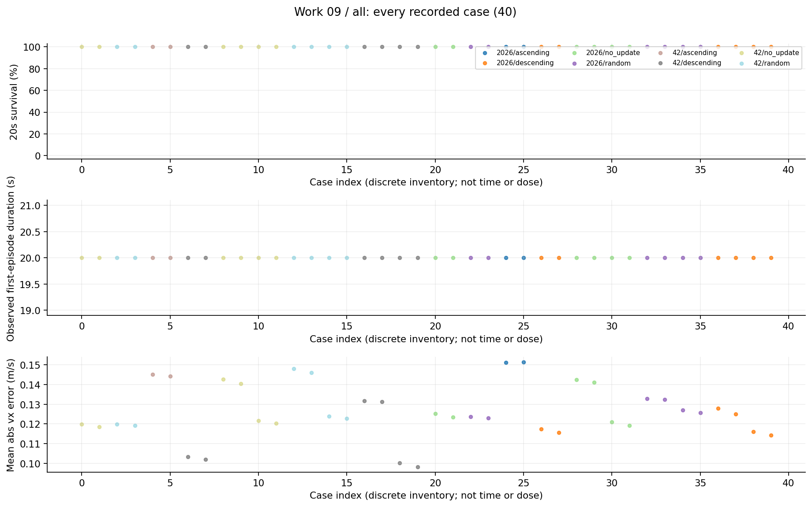

每个点是一项真实任务；横轴仅是文件记录顺序，不是连续变量，故不连线。点保留评估seed差异。条件、模型和分母可在全数据浏览器按编号查询；早停时误差只覆盖终止前。

### 图2 首回合存续曲线 第1组

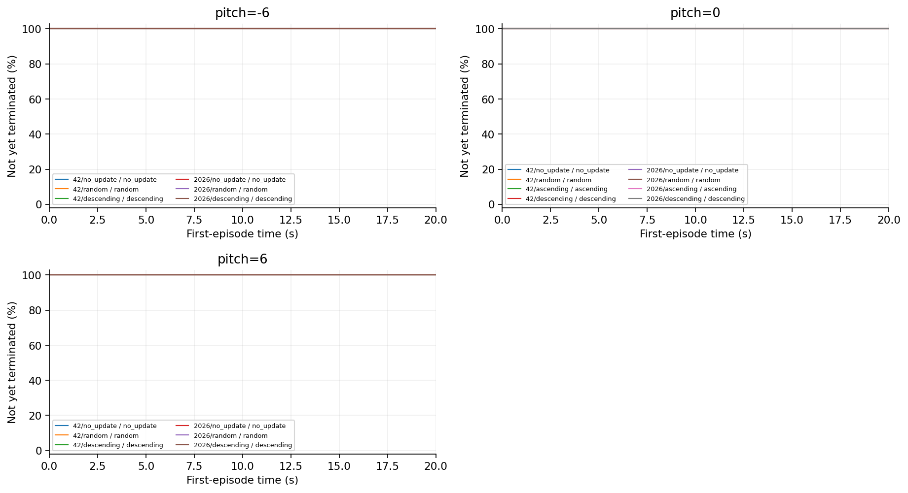

横轴为首回合仿真秒，纵轴为尚未因任何原因终止的比例；20秒超时保留在终点，不画成死亡。由已保存终止时间重算，在0.1秒网格显示；不是完整姿态轨迹，也不把跨评估seed回合当独立训练。相同曲线可能重合。

### 图3 监督更新过程的原始小批次loss

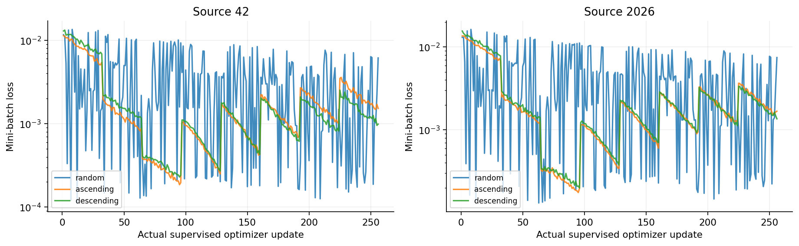

每条线为真实记录的监督更新，不是PPO回报。排序会改变每批样本难度，loss不可直接当全数据收敛或闭环安全。无更新分支没有loss，不补零。

### 图4 closed loop survival

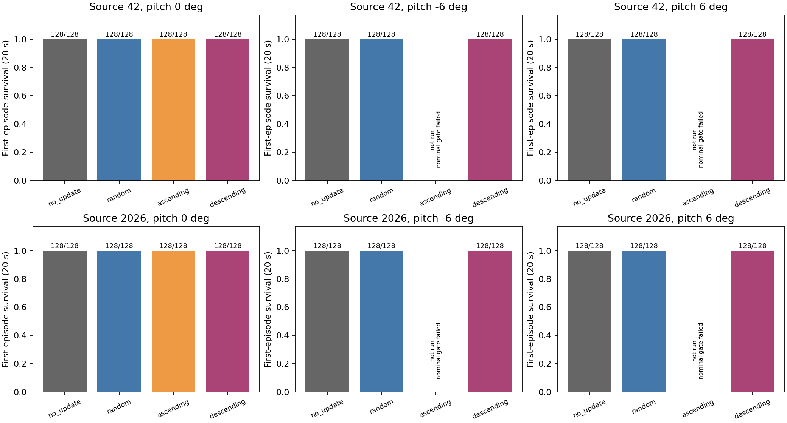

保留原实验图，不改变其样本、区间或协议定义。原图英文标注见本报告名词注释；探索、确认与历史快照不可混合累计。

### 图5 offline mse

保留原实验图，不改变其样本、区间或协议定义。原图英文标注见本报告名词注释；探索、确认与历史快照不可混合累计。

## 限制与不能支持的结论

两个来源、每来源一个训练采集、一个random日程和两个评估seed，没有独立优化seed重复。未测格不能用于计算总体故障成功率。

## 证据入口与复核范围

输入清单与SHA：[input_manifest.json](data/input_manifest.json)。本轮计数/均值复算：[AUDIT.json](data/AUDIT.json)。

- D:\MicroDuckResearch\ti\outputs\microduck_reproduction\mechanism_audit\full_width_order_pilot\results.json　SHA256 fba32b0d9c3da3770e8883b6b6e4dc4c5ce3e7c3a4c1e04728f207f27d9bab1f

## 这项工作的价值

价值是验证完整策略容量下训练顺序确实影响行为，同时用正常性能门槛阻止把普通性能劣化包装成隐蔽攻击；它给下一份共同clean恢复反证提供真实父分支。

---

# 10 同末尾clean恢复研究报告

统一clean尾段后，原顺序分支的正常跟踪差异大幅收缩，全部已测条件存活。这是对“顺序造成强持久破坏”的直接反证。

## 工作范围

八个上一阶段parent各256次同clean监督尾段并重置Adam，另两个frozen；60项、3840首回合。

## 我们如何完成这项工作

所有更新分支使用同clean样本日程、fresh Adam和冻结原normalizer；frozen不更新。评估包含正常与±6°条件。阶段一叫no_update的parent在本阶段也接受clean更新，不应继续解释为零更新对照。

## 现有结果及解释

1. 所有60项、3840首回合存活。42的三种顺序正常vx误差范围从0.042122降至0.000986m/s；2026从0.034796降至0.000462m/s。

2. 42恢复后的random/ascending/descending约0.118836/0.119822/0.119357m/s；2026约0.124227/0.123867/0.123764m/s。相对前阶段的明显分散，终点更加接近。

3. 这不要求把残余非零差异解释为后门：有限优化、末批数据、采样分布和仿真重复性都仍可能参与。

## 完整结果表

| 模型或分支 | 条件 | 阶段 | 存活分子/分母 | 存活率 | 平均寿命s | vx误差m/s | XY误差m/s |
|---|---|---|---|---|---|---|---|
| 42/frozen | pitch=0 |  | 128/128 | 100.00% | 20.0000 | 0.1191 | 未记录 |
| 42/no_update | pitch=0 |  | 128/128 | 100.00% | 20.0000 | 0.1192 | 未记录 |
| 42/random | pitch=0 |  | 128/128 | 100.00% | 20.0000 | 0.1188 | 未记录 |
| 42/ascending | pitch=0 |  | 128/128 | 100.00% | 20.0000 | 0.1198 | 未记录 |
| 42/descending | pitch=0 |  | 128/128 | 100.00% | 20.0000 | 0.1194 | 未记录 |
| 42/frozen | pitch=-6 |  | 128/128 | 100.00% | 20.0000 | 0.1413 | 未记录 |
| 42/frozen | pitch=6 |  | 128/128 | 100.00% | 20.0000 | 0.1211 | 未记录 |
| 42/no_update | pitch=-6 |  | 128/128 | 100.00% | 20.0000 | 0.1417 | 未记录 |
| 42/no_update | pitch=6 |  | 128/128 | 100.00% | 20.0000 | 0.1211 | 未记录 |
| 42/random | pitch=-6 |  | 128/128 | 100.00% | 20.0000 | 0.1376 | 未记录 |
| 42/random | pitch=6 |  | 128/128 | 100.00% | 20.0000 | 0.1219 | 未记录 |
| 42/ascending | pitch=-6 |  | 128/128 | 100.00% | 20.0000 | 0.1404 | 未记录 |
| 42/ascending | pitch=6 |  | 128/128 | 100.00% | 20.0000 | 0.1227 | 未记录 |
| 42/descending | pitch=-6 |  | 128/128 | 100.00% | 20.0000 | 0.1401 | 未记录 |
| 42/descending | pitch=6 |  | 128/128 | 100.00% | 20.0000 | 0.1228 | 未记录 |
| 2026/frozen | pitch=0 |  | 128/128 | 100.00% | 20.0000 | 0.1243 | 未记录 |
| 2026/no_update | pitch=0 |  | 128/128 | 100.00% | 20.0000 | 0.1243 | 未记录 |
| 2026/random | pitch=0 |  | 128/128 | 100.00% | 20.0000 | 0.1242 | 未记录 |
| 2026/ascending | pitch=0 |  | 128/128 | 100.00% | 20.0000 | 0.1239 | 未记录 |
| 2026/descending | pitch=0 |  | 128/128 | 100.00% | 20.0000 | 0.1238 | 未记录 |
| 2026/frozen | pitch=-6 |  | 128/128 | 100.00% | 20.0000 | 0.1417 | 未记录 |
| 2026/frozen | pitch=6 |  | 128/128 | 100.00% | 20.0000 | 0.1201 | 未记录 |
| 2026/no_update | pitch=-6 |  | 128/128 | 100.00% | 20.0000 | 0.1416 | 未记录 |
| 2026/no_update | pitch=6 |  | 128/128 | 100.00% | 20.0000 | 0.1201 | 未记录 |
| 2026/random | pitch=-6 |  | 128/128 | 100.00% | 20.0000 | 0.1394 | 未记录 |
| 2026/random | pitch=6 |  | 128/128 | 100.00% | 20.0000 | 0.1215 | 未记录 |
| 2026/ascending | pitch=-6 |  | 128/128 | 100.00% | 20.0000 | 0.1384 | 未记录 |
| 2026/ascending | pitch=6 |  | 128/128 | 100.00% | 20.0000 | 0.1223 | 未记录 |
| 2026/descending | pitch=-6 |  | 128/128 | 100.00% | 20.0000 | 0.1377 | 未记录 |
| 2026/descending | pitch=6 |  | 128/128 | 100.00% | 20.0000 | 0.1223 | 未记录 |

## 图表及读图注释

> 读图注释：前后两点连线只表示两个实际终点，不是中间每一步都有闭环评估。完整训练loss和已有离线恢复图另列。

> 读图注释：误差范围是分支间max减min，不是标准差或置信区间；数值小也不等于经过预注册的行为等价检验。

> 英文坐标速查：survival=规定时长存活；duration/seconds=首回合有效寿命；vx=前向速度；XY=平面速度；yaw=绕竖直轴旋转；MSE=动作拟合平方误差；pp=百分点。完整解释见[读图指南](READING_GUIDE.md)。

### 图1 全部任务点 all

每个点是一项真实任务；横轴仅是文件记录顺序，不是连续变量，故不连线。点保留评估seed差异。条件、模型和分母可在全数据浏览器按编号查询；早停时误差只覆盖终止前。

### 图2 首回合存续曲线 第1组

横轴为首回合仿真秒，纵轴为尚未因任何原因终止的比例；20秒超时保留在终点，不画成死亡。由已保存终止时间重算，在0.1秒网格显示；不是完整姿态轨迹，也不把跨评估seed回合当独立训练。相同曲线可能重合。

### 图3 监督更新过程的原始小批次loss

每条线为真实记录的监督更新，不是PPO回报。排序会改变每批样本难度，loss不可直接当全数据收敛或闭环安全。无更新分支没有loss，不补零。

### 图4 nominal pre post

保留原实验图，不改变其样本、区间或协议定义。原图英文标注见本报告名词注释；探索、确认与历史快照不可混合累计。

### 图5 recovery tracking

保留原实验图，不改变其样本、区间或协议定义。原图英文标注见本报告名词注释；探索、确认与历史快照不可混合累计。

## 限制与不能支持的结论

clean数据和Adam重置同时标准化，不能分离两者各自的恢复贡献。两评估seed不等于大量独立策略。它仍是监督对照，不是原生PPO。

## 证据入口与复核范围

输入清单与SHA：[input_manifest.json](data/input_manifest.json)。本轮计数/均值复算：[AUDIT.json](data/AUDIT.json)。

- D:\MicroDuckResearch\ti\outputs\microduck_reproduction\mechanism_audit\full_width_clean_recovery\results.json　SHA256 3cb3ca17f9f7c6a5df3bd0982cd3b6cb180f80a5e831b56327281d13acddd0a1

## 这项工作的价值

价值是让负结果约束研究叙事：顺序效应在有限clean恢复下可以显著消退，因而不能仅凭第一阶段差异声称持久污染。它帮助停止缺乏支持的方向。

---

# 11 小型BC 归一化与replay研究报告

离线MSE可以揭示优化路径、归一化与数据覆盖的作用，但当前小BC学生无法稳定完成无故障闭环。离线replay收益不能作为机器人防御有效的证据。

## 工作范围

小型BC顺序筛查、288条件归一化确认、后续终点对照、72fork/216分支replay与8项512回合无故障闭环检查。

## 我们如何完成这项工作

小BC采用61→128→64→14学生及teacher动作标签；归一化确认覆盖两个teacher、采集与初始化、两学习率、顺序及多个恢复时点。replay从同一真实权重与Adam终点分叉为no_update、clean_only、replay50，冻结归一化，在新采集上看clean及±6°MSE。

## 现有结果及解释

1. 早期候选最坏MSE增幅6.32%/8.5%，未达到预声明10%筛查门槛。探索性单调分支的大幅MSE变化不等于跌倒率。

2. 归一化确认288条件、5184个MSE值有限。后续162条件含108计划和54探索，不能全部称为前瞻确认。图册保留阶段身份及所有原图，不把它们混成同一试验。

3. replay在四个teacher/LR块的离线最坏MSE相对clean平均改善约32.3%—52.8%，clean MSE代价约1%—2.1%；原分析先求每fork比值再平均，不能用总均值比替换。

4. 闭环探索中两个teacher各64/64存活；no_update和replay学生各0/64。clean_only分别26/64及1/64。学生正常质量不成立，因此停止扩故障，不把学生自己走不稳解释为投毒效果。

## 完整结果表

| 模型或分支 | 条件 | 阶段 | 存活分子/分母 | 存活率 | 平均寿命s | vx误差m/s | XY误差m/s |
|---|---|---|---|---|---|---|---|
| 42/teacher | Forward |  | 64/64 | 100.00% | 20.0000 | 0.1198 | 未记录 |
| 42/no_update | Forward |  | 0/64 | 0.00% | 1.5659 | 0.2159 | 未记录 |
| 42/clean_only | Forward |  | 26/64 | 40.62% | 9.0597 | 0.1867 | 未记录 |
| 42/replay50 | Forward |  | 0/64 | 0.00% | 1.8069 | 0.1948 | 未记录 |
| 2026/teacher | Forward |  | 64/64 | 100.00% | 20.0000 | 0.1251 | 未记录 |
| 2026/no_update | Forward |  | 0/64 | 0.00% | 1.0828 | 0.2557 | 未记录 |
| 2026/clean_only | Forward |  | 1/64 | 1.56% | 1.5319 | 0.2576 | 未记录 |
| 2026/replay50 | Forward |  | 0/64 | 0.00% | 1.1216 | 0.2153 | 未记录 |

## 图表及读图注释

> 读图注释：MSE是学生动作与teacher动作的平方误差，不是闭环回报、跌倒概率或实体安全。小误差可能因多步分布偏移而累积。

> 读图注释：replay减少clean暴露并保留增强视图，不能唯一归因为“修复归一化污染”。本轮只是离线重绘，旧CPU插值worker仍暂停。

> 英文坐标速查：survival=规定时长存活；duration/seconds=首回合有效寿命；vx=前向速度；XY=平面速度；yaw=绕竖直轴旋转；MSE=动作拟合平方误差；pp=百分点。完整解释见[读图指南](READING_GUIDE.md)。

### 图1 全部任务点 all

每个点是一项真实任务；横轴仅是文件记录顺序，不是连续变量，故不连线。点保留评估seed差异。条件、模型和分母可在全数据浏览器按编号查询；早停时误差只覆盖终止前。

### 图2 逐故障首回合存续曲线 第1组

每个面板严格保持同一故障条件，未混合clean、启动和行走故障。纵轴为尚未终止的首回合比例，20秒超时保留在终点；0.1秒显示网格。合并的是同模型同条件评估seed，不是独立训练重复。

### 图3 离线机制的全部条件与测量时点 normalization 第1组

纵轴为学生拟合teacher动作的MSE，越低只表示离线拟合更接近。按标题所列设计单元对学生/采集重复取均值，未把它们称独立PPO模型。实测离散时点间连线，不代表中间均有测量。

### 图4 离线机制的全部条件与测量时点 normalization 第2组

纵轴为学生拟合teacher动作的MSE，越低只表示离线拟合更接近。按标题所列设计单元对学生/采集重复取均值，未把它们称独立PPO模型。实测离散时点间连线，不代表中间均有测量。

### 图5 离线机制的全部条件与测量时点 normalization 第3组

纵轴为学生拟合teacher动作的MSE，越低只表示离线拟合更接近。按标题所列设计单元对学生/采集重复取均值，未把它们称独立PPO模型。实测离散时点间连线，不代表中间均有测量。

### 图6 离线机制的全部条件与测量时点 replay 第1组

纵轴为学生拟合teacher动作的MSE，越低只表示离线拟合更接近。按标题所列设计单元对学生/采集重复取均值，未把它们称独立PPO模型。实测离散时点间连线，不代表中间均有测量。

### 图7 小BC全部学生的clean尾段前后

只在两端有测量，中间连线不表示完整学习曲线。学生初始化seed不是PPO来源seed。保留未过门槛的结果，不把MSE换算成跌倒率。

### 图8 bc order effect

保留原实验图，不改变其样本、区间或协议定义。原图英文标注见本报告名词注释；探索、确认与历史快照不可混合累计。

### 图9 canary combination heatmap

保留原实验图，不改变其样本、区间或协议定义。原图英文标注见本报告名词注释；探索、确认与历史快照不可混合累计。

### 图10 order amplitude controls

保留原实验图，不改变其样本、区间或协议定义。原图英文标注见本报告名词注释；探索、确认与历史快照不可混合累计。

### 图11 recovery curves

保留原实验图，不改变其样本、区间或协议定义。原图英文标注见本报告名词注释；探索、确认与历史快照不可混合累计。

### 图12 absolute error comparison

保留原实验图，不改变其样本、区间或协议定义。原图英文标注见本报告名词注释；探索、确认与历史快照不可混合累计。

### 图13 normalization specific contrast

保留原实验图，不改变其样本、区间或协议定义。原图英文标注见本报告名词注释；探索、确认与历史快照不可混合累计。

### 图14 confirmation absolute error

保留原实验图，不改变其样本、区间或协议定义。原图英文标注见本报告名词注释；探索、确认与历史快照不可混合累计。

### 图15 confirmation trajectories

保留原实验图，不改变其样本、区间或协议定义。原图英文标注见本报告名词注释；探索、确认与历史快照不可混合累计。

### 图16 replay tradeoff

保留原实验图，不改变其样本、区间或协议定义。原图英文标注见本报告名词注释；探索、确认与历史快照不可混合累计。

### 图17 replay vs clean trajectories

保留原实验图，不改变其样本、区间或协议定义。原图英文标注见本报告名词注释；探索、确认与历史快照不可混合累计。

### 图18 curves

历史CPU部分曲线，旧插值队列仍暂停；未完成的格不补零，不混入正式GPU实验。

### 图19 post update difference

保留原实验图，不改变其样本、区间或协议定义。原图英文标注见本报告名词注释；探索、确认与历史快照不可混合累计。

### 图20 ordertrap gate1 paired effects

历史补充图，保留用于追溯。本图的队列、幅度、分母或目的不同于本报告主表，不合并计数，不当成新增实验或最终主协议结论。

## 限制与不能支持的结论

teacher采样片段覆盖有限；学生容量和闭环分布与PPO原模型不同。两个teacher和许多学生/fork不构成数百次独立PPO训练。没有新增学生训练或恢复暂停队列。

## 证据入口与复核范围

输入清单与SHA：[input_manifest.json](data/input_manifest.json)。本轮计数/均值复算：[AUDIT.json](data/AUDIT.json)。

- D:\MicroDuckResearch\ti\outputs\microduck_reproduction\mechanism_audit\replay_fork_pilot\closed_loop_smoke.json　SHA256 a4cd55e09f1c738c046617817cc8cb005bc73772e3d6d5ce43142ff5bd644a50

## 这项工作的价值

价值在于以廉价机制筛查减少昂贵PPO试错，并用无故障闭环检查及时否定“离线漂亮即可部署”的推断。它提供优化和覆盖的解释线索，不是新防御方法成立。

---

# 12 安全预处理研究报告

实际仿真轨迹上，中值滤波与一帧同步延迟的报警时刻全部一致，未显示超出普通延迟的额外异常机制。只有一个原生跌倒，证据很窄。

## 工作范围

三来源×两采集seed×Nominal/Stress、每项16环境10秒；12项192首回合，Python信号离线分析。

## 我们如何完成这项工作

保存原生终止判定后、reset前的gyro、gravity、四元数、位置和足部接触。对同一首回合轨迹离线比较raw、delay1、median3、median3_unit、gyro_delay1、gravity_delay1，报警不反馈到控制动作。

## 现有结果及解释

1. Nominal96回合无跌倒；Stress96回合仅1次fell_over。NaN和地形出界为0；192/192回合中值与同步一帧延迟的首次和全部报警事件相同。

2. 唯一跌倒为42/11011/Stress/env2：raw报警2.48s，其余分支2.50s，60°代理2.56s，原生70°姿态终止2.60s。采样网格20ms，不能解释为连续时间精确预测。

3. 四元数重构重力误差最大约5.97×10^-8。所有回合至少出现一帧无足部接触，因此无接触本身不能作为跌倒标签。

## 完整结果表

| 模型或分支 | 条件 | 阶段 | 存活分子/分母 | 存活率 | 平均寿命s | vx误差m/s | XY误差m/s |
|---|---|---|---|---|---|---|---|
| 42 | Nominal |  | 32/32 | 100.00% | 10.0000 | 未记录 | 未记录 |
| 42 | Stress |  | 31/32 | 96.88% | 9.7688 | 未记录 | 未记录 |
| 123 | Nominal |  | 32/32 | 100.00% | 10.0000 | 未记录 | 未记录 |
| 123 | Stress |  | 32/32 | 100.00% | 10.0000 | 未记录 | 未记录 |
| 2026 | Nominal |  | 32/32 | 100.00% | 10.0000 | 未记录 | 未记录 |
| 2026 | Stress |  | 32/32 | 100.00% | 10.0000 | 未记录 | 未记录 |

## 图表及读图注释

> 读图注释：原生fell_over是姿态阈值，不是记录了机身撞地。raw提前报警不等于执行保护动作后一定能避免损伤。

> 读图注释：图里的多条信号来自同一轨迹的离线处理，不是六套闭环防御各跑192回合。

> 英文坐标速查：survival=规定时长存活；duration/seconds=首回合有效寿命；vx=前向速度；XY=平面速度；yaw=绕竖直轴旋转；MSE=动作拟合平方误差；pp=百分点。完整解释见[读图指南](READING_GUIDE.md)。

### 图1 全部任务点 all

每个点是一项真实任务；横轴仅是文件记录顺序，不是连续变量，故不连线。点保留评估seed差异。条件、模型和分母可在全数据浏览器按编号查询；早停时误差只覆盖终止前。

### 图2 m42 s11011 Stress env2 fall

保留原实验图，不改变其样本、区间或协议定义。原图英文标注见本报告名词注释；探索、确认与历史快照不可混合累计。

### 图3 max tilt

保留原实验图，不改变其样本、区间或协议定义。原图英文标注见本报告名词注释；探索、确认与历史快照不可混合累计。

### 图4 prediction comparison

较早纯运动学探针，仅作机制背景，不计入本报告192个官方仿真首回合。

### 图5 defense pilot v2 survival

历史补充图，保留用于追溯。本图的队列、幅度、分母或目的不同于本报告主表，不合并计数，不当成新增实验或最终主协议结论。

## 限制与不能支持的结论

没有运行Rust原函数、半精度打包/SFLP融合及实体标定，也没有保护动作闭环收益评估。一个阳性回合不足以支持检出率或普遍安全结论。

## 证据入口与复核范围

输入清单与SHA：[input_manifest.json](data/input_manifest.json)。本轮计数/均值复算：[AUDIT.json](data/AUDIT.json)。

- D:\MicroDuckResearch\ti\outputs\microduck_reproduction\mechanism_audit\sim_fall_filter\results.json　SHA256 3e212ecfb25663689aed7f99580559a8e2b5a2d088da98e10f7345fd6acda54e

## 这项工作的价值

价值是对“滤波可能造成新安全漏洞”的候选解释进行实际轨迹约束，保留有限负证据，并区分数学可能、信号报警与真正闭环安全介入。

---

# 13 零更新克隆研究报告

文件字节、模型状态和同一观测的动作输出一致；独立闭环轨迹却不逐位一致，原模型重复也不同。严格轨迹门槛失败，不能事后放宽标准改称通过。

## 工作范围

两来源、一个评估seed，原模型与零更新克隆在Forward/Turning共512回合，另原模型Forward重复128，共640首回合。

## 我们如何完成这项工作

完整checkpoint克隆但零优化更新。官方runner与独立序列化actor在相同观测上逐帧比较；另以原模型重复仿真区分克隆错误与模拟重复性。归一化mean/var/std/count及eps不变。

## 现有结果及解释

1. 两份完整checkpoint字节一致，同观测actor动作最大绝对差为0。八个原/克隆case均64/64存活，但四组全轨迹哈希不同。

2. 42的Forward原/克隆与原/原逐回合vx误差绝对差均值约0.000471和0.000442m/s；2026约0.000559和0.000583m/s。

3. 原模型自身也出现相当量级的差异，不能把全部闭环差异归为序列化或克隆实现错误；具体数值非确定性来源尚未定位。

## 完整结果表

| 模型或分支 | 条件 | 阶段 | 存活分子/分母 | 存活率 | 平均寿命s | vx误差m/s | XY误差m/s |
|---|---|---|---|---|---|---|---|
| 42/original | Forward |  | 64/64 | 100.00% | 20.0000 | 0.1198 | 未记录 |
| 42/clone | Forward |  | 64/64 | 100.00% | 20.0000 | 0.1198 | 未记录 |
| 42/original | Turning |  | 64/64 | 100.00% | 20.0000 | 0.0006 | 未记录 |
| 42/clone | Turning |  | 64/64 | 100.00% | 20.0000 | 0.0006 | 未记录 |
| 2026/original | Forward |  | 64/64 | 100.00% | 20.0000 | 0.1253 | 未记录 |
| 2026/clone | Forward |  | 64/64 | 100.00% | 20.0000 | 0.1252 | 未记录 |
| 2026/original | Turning |  | 64/64 | 100.00% | 20.0000 | 0.0019 | 未记录 |
| 2026/clone | Turning |  | 64/64 | 100.00% | 20.0000 | 0.0017 | 未记录 |
| 42/repeat_original | Forward | repeat | 64/64 | 100.00% | 20.0000 | 0.1198 | 未记录 |
| 2026/repeat_original | Forward | repeat | 64/64 | 100.00% | 20.0000 | 0.1253 | 未记录 |

## 图表及读图注释

> 读图注释：“同观测函数一致”与“各自运行后经历同一物理轨迹”是两种检查。动作改变状态，之后观测不同会不断累积。

> 读图注释：本次把两条重复原模型记录也纳入总计640的表与图；它们不是独立训练seed，不能拿640回合充当640次训练。

> 英文坐标速查：survival=规定时长存活；duration/seconds=首回合有效寿命；vx=前向速度；XY=平面速度；yaw=绕竖直轴旋转；MSE=动作拟合平方误差；pp=百分点。完整解释见[读图指南](READING_GUIDE.md)。

### 图1 全部任务点 all

每个点是一项真实任务；横轴仅是文件记录顺序，不是连续变量，故不连线。点保留评估seed差异。条件、模型和分母可在全数据浏览器按编号查询；早停时误差只覆盖终止前。

### 图2 逐故障首回合存续曲线 第1组

每个面板严格保持同一故障条件，未混合clean、启动和行走故障。纵轴为尚未终止的首回合比例，20秒超时保留在终点；0.1秒显示网格。合并的是同模型同条件评估seed，不是独立训练重复。

### 图3 原克隆与原原重复的误差差值分布

横轴为相同环境编号的逐回合vx误差绝对差，纵轴为经验累积分布。两组差异相近不构成统计等价证明；闭环严格逐位门槛仍为失败。原/原重复128回合也计入本工作640总量。

## 限制与不能支持的结论

没有故障、没有权重更新、只有一个评估seed。差值仅为描述性重复性参照，不是新预注册容忍阈值。

## 证据入口与复核范围

输入清单与SHA：[input_manifest.json](data/input_manifest.json)。本轮计数/均值复算：[AUDIT.json](data/AUDIT.json)。

- D:\MicroDuckResearch\ti\outputs\microduck_reproduction\mechanism_audit\ppo_clone_baseline\results.json　SHA256 2b270687da7131a4b028f052c2404b3c7bbb794fc280f83e74a43ff3bc4eaddb

## 这项工作的价值

价值是建立后续训练干预之前必须面对的仿真重复性基线，避免把非逐位轨迹差异直接当成模型被修改或攻击成功，同时保留严格失败结论。

---

# 14 V2 N推理统计对照研究报告

干净重校准本身即可使策略失败，说明统计坐标与固定权重兼容性必须先验收；不能把污染校准相对原模型的巨大跌幅全算作污染效果。

## 工作范围

336项、43,008首回合，原模型与统计构造/等价补偿对照，三评估seed。

## 我们如何完成这项工作

区分原统计追加与重设的IMU校准、不同污染比例及首层等价补偿；保持不相关字段和来源身份。N是推理统计对照，不更新原PPO权重。正式逐回合数据与后续独立复算按同条件匹配。

## 现有结果及解释

1. N3干净重校准与N6污染校准的Forward存活都为0%。两者已落在地板，既不支持“污染成功”，也不能据两者相同证明污染毫无额外作用。

2. Pulse07中N3的1152回合有1142个在首脉冲前失败，约99.13%。失效主要在管线进入故障前已发生，而不是脉冲才触发。

3. 首层等价补偿离线最大输出误差约4.77×10^-7，正常闭环存活恢复，支持统计坐标变化的函数传递解释；但不意味着所有故障或所有状态逐位等价。

## 完整结果表

| 模型或分支 | 条件 | 阶段 | 存活分子/分母 | 存活率 | 平均寿命s | vx误差m/s | XY误差m/s |
|---|---|---|---|---|---|---|---|
| 42_N0 | Forward | formal | 384/384 | 100.00% | 20.0000 | 0.1215 | 0.1913 |
| 42_N1 | Forward | formal | 384/384 | 100.00% | 20.0000 | 0.1215 | 0.1913 |
| 42_N2 | Forward | formal | 384/384 | 100.00% | 20.0000 | 0.1215 | 0.1913 |
| 42_N3 | Forward | formal | 0/384 | 0.00% | 1.2685 | 0.2463 | 0.3060 |
| 42_N4 | Forward | formal | 0/384 | 0.00% | 1.3582 | 0.2386 | 0.3000 |
| 42_N5 | Forward | formal | 0/384 | 0.00% | 1.2570 | 0.2431 | 0.3004 |
| 42_N6 | Forward | formal | 0/384 | 0.00% | 1.2580 | 0.2393 | 0.2959 |
| 42_N7 | Forward | formal | 0/384 | 0.00% | 1.2471 | 0.2375 | 0.2947 |
| 42_N6_EQ | Forward | formal | 384/384 | 100.00% | 20.0000 | 0.1215 | 0.1913 |
| 123_N0 | Forward | formal | 384/384 | 100.00% | 20.0000 | 0.1162 | 0.1908 |
| 123_N1 | Forward | formal | 384/384 | 100.00% | 20.0000 | 0.1162 | 0.1908 |
| 123_N2 | Forward | formal | 384/384 | 100.00% | 20.0000 | 0.1162 | 0.1908 |
| 123_N3 | Forward | formal | 0/384 | 0.00% | 1.7095 | 0.2704 | 0.3224 |
| 123_N4 | Forward | formal | 0/384 | 0.00% | 1.7136 | 0.2769 | 0.3271 |
| 123_N5 | Forward | formal | 0/384 | 0.00% | 1.7173 | 0.2713 | 0.3214 |
| 123_N6 | Forward | formal | 0/384 | 0.00% | 1.7112 | 0.2735 | 0.3231 |
| 123_N7 | Forward | formal | 0/384 | 0.00% | 1.6596 | 0.2673 | 0.3183 |
| 123_N6_EQ | Forward | formal | 384/384 | 100.00% | 20.0000 | 0.1162 | 0.1908 |
| 2026_N0 | Forward | formal | 384/384 | 100.00% | 20.0000 | 0.1251 | 0.1883 |
| 2026_N1 | Forward | formal | 384/384 | 100.00% | 20.0000 | 0.1252 | 0.1884 |
| 2026_N2 | Forward | formal | 384/384 | 100.00% | 20.0000 | 0.1251 | 0.1884 |
| 2026_N3 | Forward | formal | 0/384 | 0.00% | 0.9098 | 0.2016 | 0.3012 |
| 2026_N4 | Forward | formal | 0/384 | 0.00% | 0.9291 | 0.2012 | 0.2989 |
| 2026_N5 | Forward | formal | 0/384 | 0.00% | 0.9448 | 0.2026 | 0.2957 |
| 2026_N6 | Forward | formal | 0/384 | 0.00% | 0.9398 | 0.1998 | 0.2912 |
| 2026_N7 | Forward | formal | 0/384 | 0.00% | 0.9376 | 0.2017 | 0.2890 |
| 2026_N6_EQ | Forward | formal | 384/384 | 100.00% | 20.0000 | 0.1251 | 0.1883 |
| official_alpha_walking | Forward | formal | 384/384 | 100.00% | 20.0000 | 0.1543 | 0.2125 |
| 42_N0 | Turning | formal | 384/384 | 100.00% | 20.0000 | 0.0044 | 0.0299 |
| 42_N1 | Turning | formal | 384/384 | 100.00% | 20.0000 | 0.0043 | 0.0294 |
| 42_N2 | Turning | formal | 384/384 | 100.00% | 20.0000 | 0.0043 | 0.0295 |
| 42_N3 | Turning | formal | 11/384 | 2.86% | 2.0616 | 0.1807 | 0.2458 |
| 42_N4 | Turning | formal | 11/384 | 2.86% | 2.0140 | 0.1782 | 0.2441 |
| 42_N5 | Turning | formal | 15/384 | 3.91% | 2.2616 | 0.1778 | 0.2394 |
| 42_N6 | Turning | formal | 19/384 | 4.95% | 2.4773 | 0.1708 | 0.2329 |
| 42_N7 | Turning | formal | 18/384 | 4.69% | 2.3169 | 0.1767 | 0.2367 |
| 42_N6_EQ | Turning | formal | 384/384 | 100.00% | 20.0000 | 0.0043 | 0.0292 |
| 123_N0 | Turning | formal | 384/384 | 100.00% | 20.0000 | 0.0167 | 0.1414 |
| 123_N1 | Turning | formal | 384/384 | 100.00% | 20.0000 | 0.0167 | 0.1414 |
| 123_N2 | Turning | formal | 384/384 | 100.00% | 20.0000 | 0.0167 | 0.1414 |
| 123_N3 | Turning | formal | 0/384 | 0.00% | 1.7149 | 0.1820 | 0.2431 |
| 123_N4 | Turning | formal | 0/384 | 0.00% | 1.7354 | 0.1864 | 0.2478 |
| 123_N5 | Turning | formal | 0/384 | 0.00% | 1.6606 | 0.1851 | 0.2471 |
| 123_N6 | Turning | formal | 0/384 | 0.00% | 1.6501 | 0.1905 | 0.2522 |
| 123_N7 | Turning | formal | 0/384 | 0.00% | 1.6646 | 0.1938 | 0.2538 |
| 123_N6_EQ | Turning | formal | 384/384 | 100.00% | 20.0000 | 0.0167 | 0.1414 |
| 2026_N0 | Turning | formal | 384/384 | 100.00% | 20.0000 | 0.0176 | 0.1364 |
| 2026_N1 | Turning | formal | 384/384 | 100.00% | 20.0000 | 0.0176 | 0.1364 |
| 2026_N2 | Turning | formal | 384/384 | 100.00% | 20.0000 | 0.0176 | 0.1363 |
| 2026_N3 | Turning | formal | 0/384 | 0.00% | 0.9670 | 0.2128 | 0.3001 |
| 2026_N4 | Turning | formal | 0/384 | 0.00% | 0.9975 | 0.2149 | 0.3011 |
| 2026_N5 | Turning | formal | 0/384 | 0.00% | 0.9867 | 0.2150 | 0.2955 |
| 2026_N6 | Turning | formal | 0/384 | 0.00% | 1.0087 | 0.2121 | 0.2919 |
| 2026_N7 | Turning | formal | 0/384 | 0.00% | 0.9766 | 0.2095 | 0.2916 |
| 2026_N6_EQ | Turning | formal | 384/384 | 100.00% | 20.0000 | 0.0176 | 0.1364 |
| official_alpha_walking | Turning | formal | 384/384 | 100.00% | 20.0000 | 0.0030 | 0.0108 |
| 42_N0 | Delay40 | formal | 14/384 | 3.65% | 5.7044 | 0.2417 | 0.3157 |
| 42_N1 | Delay40 | formal | 12/384 | 3.12% | 5.6416 | 0.2423 | 0.3174 |
| 42_N2 | Delay40 | formal | 8/384 | 2.08% | 5.5397 | 0.2394 | 0.3160 |
| 42_N3 | Delay40 | formal | 0/384 | 0.00% | 0.8153 | 0.3062 | 0.3746 |
| 42_N4 | Delay40 | formal | 0/384 | 0.00% | 0.8289 | 0.3097 | 0.3767 |
| 42_N5 | Delay40 | formal | 0/384 | 0.00% | 0.8532 | 0.3225 | 0.3870 |
| 42_N6 | Delay40 | formal | 0/384 | 0.00% | 0.8580 | 0.3227 | 0.3846 |
| 42_N7 | Delay40 | formal | 0/384 | 0.00% | 0.8362 | 0.3221 | 0.3847 |
| 42_N6_EQ | Delay40 | formal | 10/384 | 2.60% | 5.9941 | 0.2418 | 0.3163 |
| 123_N0 | Delay40 | formal | 30/384 | 7.81% | 7.7579 | 0.2073 | 0.2911 |
| 123_N1 | Delay40 | formal | 43/384 | 11.20% | 7.7494 | 0.2031 | 0.2882 |
| 123_N2 | Delay40 | formal | 42/384 | 10.94% | 7.8278 | 0.2028 | 0.2876 |
| 123_N3 | Delay40 | formal | 0/384 | 0.00% | 0.7782 | 0.2892 | 0.3694 |
| 123_N4 | Delay40 | formal | 0/384 | 0.00% | 0.7870 | 0.2948 | 0.3735 |
| 123_N5 | Delay40 | formal | 0/384 | 0.00% | 0.8028 | 0.3025 | 0.3805 |
| 123_N6 | Delay40 | formal | 0/384 | 0.00% | 0.7967 | 0.3085 | 0.3845 |
| 123_N7 | Delay40 | formal | 0/384 | 0.00% | 0.8029 | 0.3070 | 0.3828 |
| 123_N6_EQ | Delay40 | formal | 50/384 | 13.02% | 8.3206 | 0.2023 | 0.2874 |
| 2026_N0 | Delay40 | formal | 19/384 | 4.95% | 7.1768 | 0.2183 | 0.2981 |
| 2026_N1 | Delay40 | formal | 14/384 | 3.65% | 6.9939 | 0.2187 | 0.2984 |
| 2026_N2 | Delay40 | formal | 30/384 | 7.81% | 7.2837 | 0.2168 | 0.2965 |
| 2026_N3 | Delay40 | formal | 0/384 | 0.00% | 0.7309 | 0.2556 | 0.3579 |
| 2026_N4 | Delay40 | formal | 0/384 | 0.00% | 0.7445 | 0.2660 | 0.3613 |
| 2026_N5 | Delay40 | formal | 0/384 | 0.00% | 0.7807 | 0.2727 | 0.3589 |
| 2026_N6 | Delay40 | formal | 0/384 | 0.00% | 0.7892 | 0.2792 | 0.3590 |
| 2026_N7 | Delay40 | formal | 0/384 | 0.00% | 0.7808 | 0.2793 | 0.3619 |
| 2026_N6_EQ | Delay40 | formal | 15/384 | 3.91% | 7.0041 | 0.2185 | 0.2985 |
| official_alpha_walking | Delay40 | formal | 177/384 | 46.09% | 13.6712 | 0.2209 | 0.2967 |
| 42_N0 | Pulse07 | formal | 371/384 | 96.61% | 19.6312 | 0.1266 | 0.1953 |
| 42_N1 | Pulse07 | formal | 373/384 | 97.14% | 19.7363 | 0.1261 | 0.1949 |
| 42_N2 | Pulse07 | formal | 371/384 | 96.61% | 19.6883 | 0.1264 | 0.1952 |
| 42_N3 | Pulse07 | formal | 0/384 | 0.00% | 1.3197 | 0.2462 | 0.3064 |
| 42_N4 | Pulse07 | formal | 0/384 | 0.00% | 1.3330 | 0.2398 | 0.3002 |
| 42_N5 | Pulse07 | formal | 0/384 | 0.00% | 1.2722 | 0.2432 | 0.3004 |
| 42_N6 | Pulse07 | formal | 0/384 | 0.00% | 1.2845 | 0.2376 | 0.2964 |
| 42_N7 | Pulse07 | formal | 0/384 | 0.00% | 1.2376 | 0.2396 | 0.2961 |
| 42_N6_EQ | Pulse07 | formal | 367/384 | 95.57% | 19.5120 | 0.1263 | 0.1951 |
| 123_N0 | Pulse07 | formal | 289/384 | 75.26% | 17.6586 | 0.1231 | 0.1984 |
| 123_N1 | Pulse07 | formal | 292/384 | 76.04% | 17.6216 | 0.1231 | 0.1984 |
| 123_N2 | Pulse07 | formal | 287/384 | 74.74% | 17.5647 | 0.1233 | 0.1985 |
| 123_N3 | Pulse07 | formal | 0/384 | 0.00% | 1.7110 | 0.2719 | 0.3238 |
| 123_N4 | Pulse07 | formal | 0/384 | 0.00% | 1.6894 | 0.2755 | 0.3262 |
| 123_N5 | Pulse07 | formal | 0/384 | 0.00% | 1.6522 | 0.2704 | 0.3218 |
| 123_N6 | Pulse07 | formal | 0/384 | 0.00% | 1.7472 | 0.2710 | 0.3203 |
| 123_N7 | Pulse07 | formal | 0/384 | 0.00% | 1.6431 | 0.2684 | 0.3184 |
| 123_N6_EQ | Pulse07 | formal | 300/384 | 78.12% | 17.8243 | 0.1231 | 0.1983 |
| 2026_N0 | Pulse07 | formal | 344/384 | 89.58% | 19.0045 | 0.1291 | 0.1939 |
| 2026_N1 | Pulse07 | formal | 338/384 | 88.02% | 18.9318 | 0.1291 | 0.1941 |
| 2026_N2 | Pulse07 | formal | 343/384 | 89.32% | 18.9319 | 0.1291 | 0.1940 |
| 2026_N3 | Pulse07 | formal | 0/384 | 0.00% | 0.9111 | 0.2014 | 0.2999 |
| 2026_N4 | Pulse07 | formal | 0/384 | 0.00% | 0.9259 | 0.2020 | 0.3002 |
| 2026_N5 | Pulse07 | formal | 0/384 | 0.00% | 0.9441 | 0.2022 | 0.2954 |
| 2026_N6 | Pulse07 | formal | 0/384 | 0.00% | 0.9496 | 0.1987 | 0.2891 |
| 2026_N7 | Pulse07 | formal | 0/384 | 0.00% | 0.9275 | 0.2011 | 0.2893 |
| 2026_N6_EQ | Pulse07 | formal | 341/384 | 88.80% | 18.9170 | 0.1294 | 0.1943 |
| official_alpha_walking | Pulse07 | formal | 383/384 | 99.74% | 19.9816 | 0.1568 | 0.2158 |

## 图表及读图注释

> 读图注释：normalizer改变输入坐标，原网络权重并不会自动重新适应。均值/尺度失配可能让干净观测也落在不熟悉区域。

> 读图注释：N0/N6EQ与N3/N6应分别对照；不能跨统计管线只挑最大跌幅。图中重合曲线需要结合存活时间，避免地板掩盖差异。

> 英文坐标速查：survival=规定时长存活；duration/seconds=首回合有效寿命；vx=前向速度；XY=平面速度；yaw=绕竖直轴旋转；MSE=动作拟合平方误差；pp=百分点。完整解释见[读图指南](READING_GUIDE.md)。

### 图1 全部任务点 all

每个点是一项真实任务；横轴仅是文件记录顺序，不是连续变量，故不连线。点保留评估seed差异。条件、模型和分母可在全数据浏览器按编号查询；早停时误差只覆盖终止前。

### 图2 首回合存续曲线 第1组

横轴为首回合仿真秒，纵轴为尚未因任何原因终止的比例；20秒超时保留在终点，不画成死亡。由已保存终止时间重算，在0.1秒网格显示；不是完整姿态轨迹，也不把跨评估seed回合当独立训练。相同曲线可能重合。

### 图3 首回合存续曲线 第2组

横轴为首回合仿真秒，纵轴为尚未因任何原因终止的比例；20秒超时保留在终点，不画成死亡。由已保存终止时间重算，在0.1秒网格显示；不是完整姿态轨迹，也不把跨评估seed回合当独立训练。相同曲线可能重合。

### 图4 首回合存续曲线 第3组

横轴为首回合仿真秒，纵轴为尚未因任何原因终止的比例；20秒超时保留在终点，不画成死亡。由已保存终止时间重算，在0.1秒网格显示；不是完整姿态轨迹，也不把跨评估seed回合当独立训练。相同曲线可能重合。

### 图5 dose survival

保留原实验图，不改变其样本、区间或协议定义。原图英文标注见本报告名词注释；探索、确认与历史快照不可混合累计。

### 图6 dose tracking

保留原实验图，不改变其样本、区间或协议定义。原图英文标注见本报告名词注释；探索、确认与历史快照不可混合累计。

### 图7 equivalence survival

保留原实验图，不改变其样本、区间或协议定义。原图英文标注见本报告名词注释；探索、确认与历史快照不可混合累计。

## 限制与不能支持的结论

没有锁定采集分布、旋转或数据覆盖中的唯一原因；没有合法物理扰动等价性证明。NaN/出界为0不等于关节超限为0。

## 证据入口与复核范围

输入清单与SHA：[input_manifest.json](data/input_manifest.json)。本轮计数/均值复算：[AUDIT.json](data/AUDIT.json)。

- D:\MicroDuckResearch\ti\outputs\microduck_reproduction\preprocessing_integrity_v2\n\formal\results.json　SHA256 1d7b2ed8f076557eadcfd690bf7b24d070a960c55c2dc7d207127df543d056c2

## 这项工作的价值

价值是提供强反证与等价补偿机制对照，阻止将基础预处理失配包装为新投毒；它为T真实学习和900固定权重状态效应划定不同解释范围。

---

# 15 V2 T真实PPO续训研究报告

训练输入变换与归一化处理确实能改变故障响应，但作用强烈依赖来源及训练seed；共同clean尾段可恢复多格，未证明统一持久污染。

## 工作范围

24个真实PPO续训分支，各200新增rollout；528项、67,584评估首回合，含150/200终点及统计交换。

## 我们如何完成这项工作

2来源42/123×2训练seed73001/73002×T0/TC/TI×F/U。每分支50clean+100干预+50clean，4096环境×24步，每干预rollout修改9830个actor输入，critic输入不改。TC为gyro与gravity同向±6°，TI为反向；F冻结统计而仍更新权重，U沿原历史追加。

## 现有结果及解释

1. TC_F在150轮相对匹配T0_F的Pulse07差异为-19.79/-33.85/-63.28/-38.54个百分点；200轮后收缩为-5.99/-2.86/-7.29/+2.60，四块都缩小。

2. TI_F最终四块差异约+1.04/-1.56/-68.49/-14.06个百分点。来源123、训练seed73001仍有大残余，但不能泛化到所有来源或另一训练seed。

3. 无干预的T0最终U减F也有-9.64/-1.30/-63.28/+7.81个百分点，F不能被推荐为已经验证的普适防御。

4. 123/73002统计交换：TI_U为26.56%，换clean统计PC为26.82%；clean权重配TI统计CP为82.55%，原T0_U为80.99%。该格终点差异主要跟随权重侧，不证明统计历史无关或已定位后门权重。

## 完整结果表

| 模型或分支 | 条件 | 阶段 | 存活分子/分母 | 存活率 | 平均寿命s | vx误差m/s | XY误差m/s |
|---|---|---|---|---|---|---|---|
| s42_r73001_T0_F_added150 | Forward | T | 384/384 | 100.00% | 20.0000 | 0.1039 | 0.1788 |
| s42_r73001_T0_F_added150 | Pulse07 | T | 377/384 | 98.18% | 19.8492 | 0.1073 | 0.1808 |
| s42_r73001_T0_F_added200 | Forward | T | 384/384 | 100.00% | 20.0000 | 0.1190 | 0.1911 |
| s42_r73001_T0_F_added200 | Turning | T | 384/384 | 100.00% | 20.0000 | 0.0061 | 0.0418 |
| s42_r73001_T0_F_added200 | Delay40 | T | 3/384 | 0.78% | 5.1344 | 0.2279 | 0.3099 |
| s42_r73001_T0_F_added200 | Pulse07 | T | 380/384 | 98.96% | 19.9373 | 0.1211 | 0.1921 |
| s42_r73001_T0_U_added150 | Forward | T | 384/384 | 100.00% | 20.0000 | 0.1134 | 0.1838 |
| s42_r73001_T0_U_added150 | Pulse07 | T | 353/384 | 91.93% | 19.2633 | 0.1271 | 0.1965 |
| s42_r73001_T0_U_added200 | Forward | T | 384/384 | 100.00% | 20.0000 | 0.1173 | 0.1872 |
| s42_r73001_T0_U_added200 | Turning | T | 384/384 | 100.00% | 20.0000 | 0.0045 | 0.0270 |
| s42_r73001_T0_U_added200 | Delay40 | T | 15/384 | 3.91% | 5.6486 | 0.2299 | 0.3076 |
| s42_r73001_T0_U_added200 | Pulse07 | T | 343/384 | 89.32% | 18.6870 | 0.1245 | 0.1936 |
| s42_r73001_TC_F_added150 | Forward | T | 384/384 | 100.00% | 20.0000 | 0.1248 | 0.1951 |
| s42_r73001_TC_F_added150 | Pulse07 | T | 301/384 | 78.39% | 17.8691 | 0.1331 | 0.2037 |
| s42_r73001_TC_F_added200 | Forward | T | 384/384 | 100.00% | 20.0000 | 0.1182 | 0.1923 |
| s42_r73001_TC_F_added200 | Turning | T | 384/384 | 100.00% | 20.0000 | 0.0044 | 0.0261 |
| s42_r73001_TC_F_added200 | Delay40 | T | 19/384 | 4.95% | 7.0013 | 0.2259 | 0.3055 |
| s42_r73001_TC_F_added200 | Pulse07 | T | 357/384 | 92.97% | 19.3014 | 0.1245 | 0.1978 |
| s42_r73001_TC_U_added150 | Forward | T | 384/384 | 100.00% | 20.0000 | 0.1211 | 0.1938 |
| s42_r73001_TC_U_added150 | Pulse07 | T | 368/384 | 95.83% | 19.5806 | 0.1261 | 0.1980 |
| s42_r73001_TC_U_added200 | Forward | T | 384/384 | 100.00% | 20.0000 | 0.1207 | 0.1880 |
| s42_r73001_TC_U_added200 | Turning | T | 384/384 | 100.00% | 20.0000 | 0.0066 | 0.0403 |
| s42_r73001_TC_U_added200 | Delay40 | T | 14/384 | 3.65% | 5.9632 | 0.2472 | 0.3191 |
| s42_r73001_TC_U_added200 | Pulse07 | T | 381/384 | 99.22% | 19.8911 | 0.1245 | 0.1913 |
| s42_r73001_TI_F_added150 | Forward | T | 384/384 | 100.00% | 20.0000 | 0.1265 | 0.1941 |
| s42_r73001_TI_F_added150 | Pulse07 | T | 372/384 | 96.88% | 19.6515 | 0.1286 | 0.1960 |
| s42_r73001_TI_F_added200 | Forward | T | 384/384 | 100.00% | 20.0000 | 0.1153 | 0.1851 |
| s42_r73001_TI_F_added200 | Turning | T | 384/384 | 100.00% | 20.0000 | 0.0072 | 0.0475 |
| s42_r73001_TI_F_added200 | Delay40 | T | 23/384 | 5.99% | 6.9382 | 0.2129 | 0.2901 |
| s42_r73001_TI_F_added200 | Pulse07 | T | 384/384 | 100.00% | 20.0000 | 0.1172 | 0.1865 |
| s42_r73001_TI_U_added150 | Forward | T | 384/384 | 100.00% | 20.0000 | 0.1099 | 0.1860 |
| s42_r73001_TI_U_added150 | Pulse07 | T | 371/384 | 96.61% | 19.7291 | 0.1166 | 0.1914 |
| s42_r73001_TI_U_added200 | Forward | T | 384/384 | 100.00% | 20.0000 | 0.1121 | 0.1821 |
| s42_r73001_TI_U_added200 | Turning | T | 384/384 | 100.00% | 20.0000 | 0.0038 | 0.0224 |
| s42_r73001_TI_U_added200 | Delay40 | T | 17/384 | 4.43% | 5.7687 | 0.2286 | 0.3025 |
| s42_r73001_TI_U_added200 | Pulse07 | T | 378/384 | 98.44% | 19.8760 | 0.1143 | 0.1834 |
| s42_r73002_T0_F_added150 | Forward | T | 384/384 | 100.00% | 20.0000 | 0.1086 | 0.1791 |
| s42_r73002_T0_F_added150 | Pulse07 | T | 383/384 | 99.74% | 19.9919 | 0.1129 | 0.1820 |
| s42_r73002_T0_F_added200 | Forward | T | 384/384 | 100.00% | 20.0000 | 0.1101 | 0.1815 |
| s42_r73002_T0_F_added200 | Turning | T | 384/384 | 100.00% | 20.0000 | 0.0060 | 0.0362 |
| s42_r73002_T0_F_added200 | Delay40 | T | 54/384 | 14.06% | 7.1912 | 0.2339 | 0.3151 |
| s42_r73002_T0_F_added200 | Pulse07 | T | 381/384 | 99.22% | 19.9139 | 0.1142 | 0.1839 |
| s42_r73002_T0_U_added150 | Forward | T | 384/384 | 100.00% | 20.0000 | 0.1219 | 0.1913 |
| s42_r73002_T0_U_added150 | Pulse07 | T | 334/384 | 86.98% | 18.5531 | 0.1328 | 0.2016 |
| s42_r73002_T0_U_added200 | Forward | T | 384/384 | 100.00% | 20.0000 | 0.1120 | 0.1815 |
| s42_r73002_T0_U_added200 | Turning | T | 384/384 | 100.00% | 20.0000 | 0.0021 | 0.0096 |
| s42_r73002_T0_U_added200 | Delay40 | T | 49/384 | 12.76% | 7.8161 | 0.2245 | 0.3019 |
| s42_r73002_T0_U_added200 | Pulse07 | T | 376/384 | 97.92% | 19.8214 | 0.1208 | 0.1889 |
| s42_r73002_TC_F_added150 | Forward | T | 384/384 | 100.00% | 20.0000 | 0.1137 | 0.1872 |
| s42_r73002_TC_F_added150 | Pulse07 | T | 253/384 | 65.89% | 16.5132 | 0.1322 | 0.2041 |
| s42_r73002_TC_F_added200 | Forward | T | 384/384 | 100.00% | 20.0000 | 0.0997 | 0.1753 |
| s42_r73002_TC_F_added200 | Turning | T | 384/384 | 100.00% | 20.0000 | 0.0061 | 0.0363 |
| s42_r73002_TC_F_added200 | Delay40 | T | 36/384 | 9.38% | 6.2665 | 0.2176 | 0.3023 |
| s42_r73002_TC_F_added200 | Pulse07 | T | 370/384 | 96.35% | 19.6254 | 0.1069 | 0.1812 |
| s42_r73002_TC_U_added150 | Forward | T | 384/384 | 100.00% | 20.0000 | 0.1064 | 0.1791 |
| s42_r73002_TC_U_added150 | Pulse07 | T | 351/384 | 91.41% | 19.1176 | 0.1121 | 0.1840 |
| s42_r73002_TC_U_added200 | Forward | T | 384/384 | 100.00% | 20.0000 | 0.1087 | 0.1799 |
| s42_r73002_TC_U_added200 | Turning | T | 384/384 | 100.00% | 20.0000 | 0.0055 | 0.0346 |
| s42_r73002_TC_U_added200 | Delay40 | T | 12/384 | 3.12% | 5.2865 | 0.2393 | 0.3184 |
| s42_r73002_TC_U_added200 | Pulse07 | T | 380/384 | 98.96% | 19.8965 | 0.1141 | 0.1844 |
| s42_r73002_TI_F_added150 | Forward | T | 384/384 | 100.00% | 20.0000 | 0.1210 | 0.1898 |
| s42_r73002_TI_F_added150 | Pulse07 | T | 377/384 | 98.18% | 19.7674 | 0.1270 | 0.1947 |
| s42_r73002_TI_F_added200 | Forward | T | 384/384 | 100.00% | 20.0000 | 0.1038 | 0.1753 |
| s42_r73002_TI_F_added200 | Turning | T | 384/384 | 100.00% | 20.0000 | 0.0052 | 0.0291 |
| s42_r73002_TI_F_added200 | Delay40 | T | 26/384 | 6.77% | 6.7509 | 0.2120 | 0.2954 |
| s42_r73002_TI_F_added200 | Pulse07 | T | 375/384 | 97.66% | 19.7887 | 0.1106 | 0.1811 |
| s42_r73002_TI_U_added150 | Forward | T | 384/384 | 100.00% | 20.0000 | 0.1344 | 0.2016 |
| s42_r73002_TI_U_added150 | Pulse07 | T | 373/384 | 97.14% | 19.7457 | 0.1357 | 0.2011 |
| s42_r73002_TI_U_added200 | Forward | T | 384/384 | 100.00% | 20.0000 | 0.1106 | 0.1814 |
| s42_r73002_TI_U_added200 | Turning | T | 384/384 | 100.00% | 20.0000 | 0.0051 | 0.0381 |
| s42_r73002_TI_U_added200 | Delay40 | T | 9/384 | 2.34% | 5.8755 | 0.2199 | 0.3026 |
| s42_r73002_TI_U_added200 | Pulse07 | T | 368/384 | 95.83% | 19.6779 | 0.1123 | 0.1815 |
| s123_r73001_T0_F_added150 | Forward | T | 384/384 | 100.00% | 20.0000 | 0.1139 | 0.1882 |
| s123_r73001_T0_F_added150 | Pulse07 | T | 356/384 | 92.71% | 19.2836 | 0.1193 | 0.1944 |
| s123_r73001_T0_F_added200 | Forward | T | 384/384 | 100.00% | 20.0000 | 0.1131 | 0.1863 |
| s123_r73001_T0_F_added200 | Turning | T | 384/384 | 100.00% | 20.0000 | 0.0168 | 0.1338 |
| s123_r73001_T0_F_added200 | Delay40 | T | 11/384 | 2.86% | 5.1102 | 0.2108 | 0.2949 |
| s123_r73001_T0_F_added200 | Pulse07 | T | 377/384 | 98.18% | 19.8492 | 0.1177 | 0.1915 |
| s123_r73001_T0_U_added150 | Forward | T | 384/384 | 100.00% | 20.0000 | 0.1075 | 0.1827 |
| s123_r73001_T0_U_added150 | Pulse07 | T | 72/384 | 18.75% | 10.4488 | 0.1219 | 0.2014 |
| s123_r73001_T0_U_added200 | Forward | T | 384/384 | 100.00% | 20.0000 | 0.1082 | 0.1836 |
| s123_r73001_T0_U_added200 | Turning | T | 384/384 | 100.00% | 20.0000 | 0.0165 | 0.1351 |
| s123_r73001_T0_U_added200 | Delay40 | T | 29/384 | 7.55% | 7.5846 | 0.2108 | 0.2922 |
| s123_r73001_T0_U_added200 | Pulse07 | T | 134/384 | 34.90% | 11.8612 | 0.1222 | 0.2027 |
| s123_r73001_TC_F_added150 | Forward | T | 384/384 | 100.00% | 20.0000 | 0.1143 | 0.1889 |
| s123_r73001_TC_F_added150 | Pulse07 | T | 113/384 | 29.43% | 11.7605 | 0.1250 | 0.2052 |
| s123_r73001_TC_F_added200 | Forward | T | 384/384 | 100.00% | 20.0000 | 0.1195 | 0.1929 |
| s123_r73001_TC_F_added200 | Turning | T | 384/384 | 100.00% | 20.0000 | 0.0189 | 0.1415 |
| s123_r73001_TC_F_added200 | Delay40 | T | 48/384 | 12.50% | 8.6927 | 0.1879 | 0.2737 |
| s123_r73001_TC_F_added200 | Pulse07 | T | 349/384 | 90.89% | 19.2476 | 0.1211 | 0.1958 |
| s123_r73001_TC_U_added150 | Forward | T | 384/384 | 100.00% | 20.0000 | 0.1065 | 0.1790 |
| s123_r73001_TC_U_added150 | Pulse07 | T | 33/384 | 8.59% | 7.2320 | 0.1240 | 0.1987 |
| s123_r73001_TC_U_added200 | Forward | T | 384/384 | 100.00% | 20.0000 | 0.1122 | 0.1822 |
| s123_r73001_TC_U_added200 | Turning | T | 384/384 | 100.00% | 20.0000 | 0.0155 | 0.1345 |
| s123_r73001_TC_U_added200 | Delay40 | T | 131/384 | 34.11% | 12.0047 | 0.1767 | 0.2626 |
| s123_r73001_TC_U_added200 | Pulse07 | T | 106/384 | 27.60% | 11.4756 | 0.1249 | 0.1995 |
| s123_r73001_TI_F_added150 | Forward | T | 384/384 | 100.00% | 20.0000 | 0.1166 | 0.1869 |
| s123_r73001_TI_F_added150 | Pulse07 | T | 68/384 | 17.71% | 10.6501 | 0.1319 | 0.2049 |
| s123_r73001_TI_F_added200 | Forward | T | 384/384 | 100.00% | 20.0000 | 0.1082 | 0.1785 |
| s123_r73001_TI_F_added200 | Turning | T | 384/384 | 100.00% | 20.0000 | 0.0138 | 0.1349 |
| s123_r73001_TI_F_added200 | Delay40 | T | 100/384 | 26.04% | 10.5380 | 0.1753 | 0.2604 |
| s123_r73001_TI_F_added200 | Pulse07 | T | 114/384 | 29.69% | 12.0412 | 0.1248 | 0.1986 |
| s123_r73001_TI_U_added150 | Forward | T | 384/384 | 100.00% | 20.0000 | 0.1233 | 0.1912 |
| s123_r73001_TI_U_added150 | Pulse07 | T | 15/384 | 3.91% | 6.7472 | 0.1404 | 0.2140 |
| s123_r73001_TI_U_added200 | Forward | T | 384/384 | 100.00% | 20.0000 | 0.1118 | 0.1819 |
| s123_r73001_TI_U_added200 | Turning | T | 384/384 | 100.00% | 20.0000 | 0.0185 | 0.1365 |
| s123_r73001_TI_U_added200 | Delay40 | T | 29/384 | 7.55% | 7.8172 | 0.1947 | 0.2784 |
| s123_r73001_TI_U_added200 | Pulse07 | T | 147/384 | 38.28% | 11.8762 | 0.1255 | 0.2013 |
| s123_r73002_T0_F_added150 | Forward | T | 384/384 | 100.00% | 20.0000 | 0.1237 | 0.1984 |
| s123_r73002_T0_F_added150 | Pulse07 | T | 239/384 | 62.24% | 16.3145 | 0.1310 | 0.2069 |
| s123_r73002_T0_F_added200 | Forward | T | 384/384 | 100.00% | 20.0000 | 0.1202 | 0.1924 |
| s123_r73002_T0_F_added200 | Turning | T | 384/384 | 100.00% | 20.0000 | 0.0203 | 0.1344 |
| s123_r73002_T0_F_added200 | Delay40 | T | 28/384 | 7.29% | 6.7664 | 0.2159 | 0.2966 |
| s123_r73002_T0_F_added200 | Pulse07 | T | 281/384 | 73.18% | 17.2301 | 0.1271 | 0.1996 |
| s123_r73002_T0_U_added150 | Forward | T | 384/384 | 100.00% | 20.0000 | 0.0987 | 0.1782 |
| s123_r73002_T0_U_added150 | Pulse07 | T | 248/384 | 64.58% | 16.3286 | 0.1080 | 0.1899 |
| s123_r73002_T0_U_added200 | Forward | T | 384/384 | 100.00% | 20.0000 | 0.1204 | 0.1929 |
| s123_r73002_T0_U_added200 | Turning | T | 384/384 | 100.00% | 20.0000 | 0.0251 | 0.1442 |
| s123_r73002_T0_U_added200 | Delay40 | T | 49/384 | 12.76% | 8.5415 | 0.1989 | 0.2816 |
| s123_r73002_T0_U_added200 | Pulse07 | T | 311/384 | 80.99% | 18.0383 | 0.1254 | 0.2006 |
| s123_r73002_TC_F_added150 | Forward | T | 384/384 | 100.00% | 20.0000 | 0.1334 | 0.2019 |
| s123_r73002_TC_F_added150 | Pulse07 | T | 91/384 | 23.70% | 10.0307 | 0.1445 | 0.2172 |
| s123_r73002_TC_F_added200 | Forward | T | 384/384 | 100.00% | 20.0000 | 0.1305 | 0.2009 |
| s123_r73002_TC_F_added200 | Turning | T | 384/384 | 100.00% | 20.0000 | 0.0183 | 0.1400 |
| s123_r73002_TC_F_added200 | Delay40 | T | 109/384 | 28.39% | 10.6735 | 0.1865 | 0.2729 |
| s123_r73002_TC_F_added200 | Pulse07 | T | 291/384 | 75.78% | 17.5352 | 0.1341 | 0.2080 |
| s123_r73002_TC_U_added150 | Forward | T | 384/384 | 100.00% | 20.0000 | 0.1099 | 0.1810 |
| s123_r73002_TC_U_added150 | Pulse07 | T | 38/384 | 9.90% | 8.6684 | 0.1242 | 0.1996 |
| s123_r73002_TC_U_added200 | Forward | T | 384/384 | 100.00% | 20.0000 | 0.1154 | 0.1882 |
| s123_r73002_TC_U_added200 | Turning | T | 384/384 | 100.00% | 20.0000 | 0.0177 | 0.1311 |
| s123_r73002_TC_U_added200 | Delay40 | T | 60/384 | 15.62% | 9.3777 | 0.1876 | 0.2742 |
| s123_r73002_TC_U_added200 | Pulse07 | T | 237/384 | 61.72% | 15.9815 | 0.1229 | 0.1986 |
| s123_r73002_TI_F_added150 | Forward | T | 384/384 | 100.00% | 20.0000 | 0.1135 | 0.1874 |
| s123_r73002_TI_F_added150 | Pulse07 | T | 41/384 | 10.68% | 8.3570 | 0.1281 | 0.2044 |
| s123_r73002_TI_F_added200 | Forward | T | 384/384 | 100.00% | 20.0000 | 0.1181 | 0.1904 |
| s123_r73002_TI_F_added200 | Turning | T | 384/384 | 100.00% | 20.0000 | 0.0118 | 0.1065 |
| s123_r73002_TI_F_added200 | Delay40 | T | 71/384 | 18.49% | 9.7352 | 0.1719 | 0.2600 |
| s123_r73002_TI_F_added200 | Pulse07 | T | 227/384 | 59.11% | 15.8580 | 0.1252 | 0.2000 |
| s123_r73002_TI_U_added150 | Forward | T | 384/384 | 100.00% | 20.0000 | 0.1194 | 0.1889 |
| s123_r73002_TI_U_added150 | Pulse07 | T | 13/384 | 3.39% | 5.9714 | 0.1352 | 0.2062 |
| s123_r73002_TI_U_added200 | Forward | T | 384/384 | 100.00% | 20.0000 | 0.1246 | 0.1927 |
| s123_r73002_TI_U_added200 | Turning | T | 384/384 | 100.00% | 20.0000 | 0.0221 | 0.1388 |
| s123_r73002_TI_U_added200 | Delay40 | T | 7/384 | 1.82% | 5.1899 | 0.2206 | 0.2953 |
| s123_r73002_TI_U_added200 | Pulse07 | T | 102/384 | 26.56% | 11.5985 | 0.1346 | 0.2076 |
| s42_r73001_PC_added200 | Forward | T | 384/384 | 100.00% | 20.0000 | 0.1123 | 0.1822 |
| s42_r73001_PC_added200 | Turning | T | 384/384 | 100.00% | 20.0000 | 0.0038 | 0.0229 |
| s42_r73001_PC_added200 | Delay40 | T | 14/384 | 3.65% | 6.1903 | 0.2277 | 0.3022 |
| s42_r73001_PC_added200 | Pulse07 | T | 378/384 | 98.44% | 19.8649 | 0.1145 | 0.1835 |
| s42_r73001_CP_added200 | Forward | T | 384/384 | 100.00% | 20.0000 | 0.1171 | 0.1870 |
| s42_r73001_CP_added200 | Turning | T | 384/384 | 100.00% | 20.0000 | 0.0044 | 0.0263 |
| s42_r73001_CP_added200 | Delay40 | T | 13/384 | 3.39% | 5.5090 | 0.2332 | 0.3112 |
| s42_r73001_CP_added200 | Pulse07 | T | 356/384 | 92.71% | 19.1644 | 0.1230 | 0.1920 |
| s42_r73002_PC_added200 | Forward | T | 384/384 | 100.00% | 20.0000 | 0.1104 | 0.1813 |
| s42_r73002_PC_added200 | Turning | T | 384/384 | 100.00% | 20.0000 | 0.0052 | 0.0387 |
| s42_r73002_PC_added200 | Delay40 | T | 17/384 | 4.43% | 6.2762 | 0.2192 | 0.3000 |
| s42_r73002_PC_added200 | Pulse07 | T | 372/384 | 96.88% | 19.7177 | 0.1124 | 0.1816 |
| s42_r73002_CP_added200 | Forward | T | 384/384 | 100.00% | 20.0000 | 0.1120 | 0.1816 |
| s42_r73002_CP_added200 | Turning | T | 384/384 | 100.00% | 20.0000 | 0.0021 | 0.0095 |
| s42_r73002_CP_added200 | Delay40 | T | 43/384 | 11.20% | 8.2105 | 0.2238 | 0.3011 |
| s42_r73002_CP_added200 | Pulse07 | T | 380/384 | 98.96% | 19.8956 | 0.1208 | 0.1889 |
| s123_r73001_PC_added200 | Forward | T | 384/384 | 100.00% | 20.0000 | 0.1113 | 0.1816 |
| s123_r73001_PC_added200 | Turning | T | 384/384 | 100.00% | 20.0000 | 0.0185 | 0.1368 |
| s123_r73001_PC_added200 | Delay40 | T | 28/384 | 7.29% | 7.8052 | 0.1918 | 0.2760 |
| s123_r73001_PC_added200 | Pulse07 | T | 161/384 | 41.93% | 12.3889 | 0.1247 | 0.2004 |
| s123_r73001_CP_added200 | Forward | T | 384/384 | 100.00% | 20.0000 | 0.1087 | 0.1840 |
| s123_r73001_CP_added200 | Turning | T | 384/384 | 100.00% | 20.0000 | 0.0165 | 0.1348 |
| s123_r73001_CP_added200 | Delay40 | T | 24/384 | 6.25% | 7.3888 | 0.2106 | 0.2918 |
| s123_r73001_CP_added200 | Pulse07 | T | 134/384 | 34.90% | 12.0424 | 0.1218 | 0.2020 |
| s123_r73002_PC_added200 | Forward | T | 384/384 | 100.00% | 20.0000 | 0.1246 | 0.1927 |
| s123_r73002_PC_added200 | Turning | T | 384/384 | 100.00% | 20.0000 | 0.0223 | 0.1393 |
| s123_r73002_PC_added200 | Delay40 | T | 8/384 | 2.08% | 5.1943 | 0.2220 | 0.2960 |
| s123_r73002_PC_added200 | Pulse07 | T | 103/384 | 26.82% | 11.4801 | 0.1346 | 0.2077 |
| s123_r73002_CP_added200 | Forward | T | 384/384 | 100.00% | 20.0000 | 0.1204 | 0.1929 |
| s123_r73002_CP_added200 | Turning | T | 384/384 | 100.00% | 20.0000 | 0.0250 | 0.1442 |
| s123_r73002_CP_added200 | Delay40 | T | 46/384 | 11.98% | 8.8255 | 0.1974 | 0.2799 |
| s123_r73002_CP_added200 | Pulse07 | T | 317/384 | 82.55% | 18.1739 | 0.1255 | 0.2001 |

## 图表及读图注释

> 读图注释：F仅冻结actor/critic的normalizer，PPO权重继续训练；150到200为共同clean尾段。只在两个终点评估故障，连线不代表连续故障测量。

> 读图注释：本报告同时画24分支实际记录的200步训练曲线、全部16配对格、四条件评估和统计交换。训练mean_reward_per_step与第一份4000轮日志的mean_reward定义不同，不直接比较数值高低。

> 读图注释：三评估seed范围不是95%训练总体置信区间；来源、训练seed、评估seed须分层报告。

> 英文坐标速查：survival=规定时长存活；duration/seconds=首回合有效寿命；vx=前向速度；XY=平面速度；yaw=绕竖直轴旋转；MSE=动作拟合平方误差；pp=百分点。完整解释见[读图指南](READING_GUIDE.md)。

### 图1 全部任务点 all

每个点是一项真实任务；横轴仅是文件记录顺序，不是连续变量，故不连线。点保留评估seed差异。条件、模型和分母可在全数据浏览器按编号查询；早停时误差只覆盖终止前。

### 图2 首回合存续曲线 第1组

横轴为首回合仿真秒，纵轴为尚未因任何原因终止的比例；20秒超时保留在终点，不画成死亡。由已保存终止时间重算，在0.1秒网格显示；不是完整姿态轨迹，也不把跨评估seed回合当独立训练。相同曲线可能重合。

### 图3 首回合存续曲线 第2组

横轴为首回合仿真秒，纵轴为尚未因任何原因终止的比例；20秒超时保留在终点，不画成死亡。由已保存终止时间重算，在0.1秒网格显示；不是完整姿态轨迹，也不把跨评估seed回合当独立训练。相同曲线可能重合。

### 图4 首回合存续曲线 第3组

横轴为首回合仿真秒，纵轴为尚未因任何原因终止的比例；20秒超时保留在终点，不画成死亡。由已保存终止时间重算，在0.1秒网格显示；不是完整姿态轨迹，也不把跨评估seed回合当独立训练。相同曲线可能重合。

### 图5 T全部16格的故障差异与clean尾段恢复

与同来源、同训练seed、同F/U的T0比较。竖线是三个评估seed差值范围，不是95%置信区间。仅150和200两个实测终点，连线不代表中间连续测量。

### 图6 T24分支逐轮训练 Mean reward per environment step

原正式results的200个rollout指标，六线为T0/TC/TI×F/U，灰区为第51—150轮干预期。没有合并TensorBoard中被恢复覆盖的旧尝试；NaN终止另在原数据中保留。训练done_count不是固定评估跌倒率。

### 图7 T24分支逐轮训练 Terminated environments per rollout

原正式results的200个rollout指标，六线为T0/TC/TI×F/U，灰区为第51—150轮干预期。没有合并TensorBoard中被恢复覆盖的旧尝试；NaN终止另在原数据中保留。训练done_count不是固定评估跌倒率。

### 图8 T24分支逐轮训练 Actor normalizer historical count

原正式results的200个rollout指标，六线为T0/TC/TI×F/U，灰区为第51—150轮干预期。没有合并TensorBoard中被恢复覆盖的旧尝试；NaN终止另在原数据中保留。训练done_count不是固定评估跌倒率。

### 图9 T24分支逐轮训练 Critic normalizer historical count

原正式results的200个rollout指标，六线为T0/TC/TI×F/U，灰区为第51—150轮干预期。没有合并TensorBoard中被恢复覆盖的旧尝试；NaN终止另在原数据中保留。训练done_count不是固定评估跌倒率。

### 图10 T24分支逐轮训练 Modified actor inputs per rollout

原正式results的200个rollout指标，六线为T0/TC/TI×F/U，灰区为第51—150轮干预期。没有合并TensorBoard中被恢复覆盖的旧尝试；NaN终止另在原数据中保留。训练done_count不是固定评估跌倒率。

### 图11 T24分支逐轮训练 Collection wall time (s)

原正式results的200个rollout指标，六线为T0/TC/TI×F/U，灰区为第51—150轮干预期。没有合并TensorBoard中被恢复覆盖的旧尝试；NaN终止另在原数据中保留。训练done_count不是固定评估跌倒率。

### 图12 T24分支逐轮训练 Value loss

原正式results的200个rollout指标，六线为T0/TC/TI×F/U，灰区为第51—150轮干预期。没有合并TensorBoard中被恢复覆盖的旧尝试；NaN终止另在原数据中保留。训练done_count不是固定评估跌倒率。

### 图13 T24分支逐轮训练 Surrogate loss

原正式results的200个rollout指标，六线为T0/TC/TI×F/U，灰区为第51—150轮干预期。没有合并TensorBoard中被恢复覆盖的旧尝试；NaN终止另在原数据中保留。训练done_count不是固定评估跌倒率。

### 图14 T24分支逐轮训练 Entropy loss

原正式results的200个rollout指标，六线为T0/TC/TI×F/U，灰区为第51—150轮干预期。没有合并TensorBoard中被恢复覆盖的旧尝试；NaN终止另在原数据中保留。训练done_count不是固定评估跌倒率。

### 图15 final survival

保留原实验图，不改变其样本、区间或协议定义。原图英文标注见本报告名词注释；探索、确认与历史快照不可混合累计。

### 图16 pulse recovery

保留原实验图，不改变其样本、区间或协议定义。原图英文标注见本报告名词注释；探索、确认与历史快照不可混合累计。

## 限制与不能支持的结论

恢复重建环境及延迟历史，不是逐位续训。既定初始学习率标量恢复限制已记录。有限200轮和两训练seed不足以推出普适持久效果，不追加大训练或改变样本量。

## 证据入口与复核范围

输入清单与SHA：[input_manifest.json](data/input_manifest.json)。本轮计数/均值复算：[AUDIT.json](data/AUDIT.json)。

- D:\MicroDuckResearch\ti\outputs\microduck_reproduction\preprocessing_integrity_v2\t\evaluation\results.json　SHA256 5b00b0120278f6b6fea8473b6a6fbb4cf61cbf7317d940847456d96f894befb4

## 这项工作的价值

价值是把纯离线/人工状态结果推进到真实PPO学习过程，并用匹配clean、F/U、恢复尾段和统计交换共同约束解释，使“预处理与学习路径影响故障鲁棒性”成为有限但真实的实证结论。

---

# 16 人工有效剂量状态研究报告

固定权重的人工统计状态有局部额外脉冲退化，但来源异质、存在改善格，且没有统一单调剂量边界。必须扣除同w的干净统计更新影响。

## 工作范围

3原模型+72派生actor，共75模型；900项、115,200首回合；取消的1944项补测不在其中。

## 我们如何完成这项工作

w=.001/.005/.01/.02/.05/.1；p=0/.1/.5/1。以总体矩合并且包含组间均值项构造normalizer，保留原count作来源，不伪称真实收集virtual mass。每模型四条件、三评估seed、各128首回合。

## 现有结果及解释

1. 54个Pulse07额外污染格中32格均值下降，只有11格三个评估seed均严格下降；这些不是11格统计显著发现。9条固定来源/p曲线无一在全部六个w上单调下降。

2. 123、w=.02/p1：同w clean为297/384，污染为268/384，下降7.55个百分点；42、w=.1/p1为377/384到351/384，下降6.77个百分点。

3. 123、w=.1：原模型77.08%，clean更新70.83%，p=.5为64.84%。总降12.24个百分点中，6.25在无污染更新已发生，额外污染为5.99；不能全归为攻击贡献。

4. 所有Forward首回合存活。Delay20差异很小，Delay40 clean接近地板，仅作诊断。完整图保留四条件和正负配对差，不只展示最差格。

## 完整结果表

| 模型或分支 | 条件 | 阶段 | 存活分子/分母 | 存活率 | 平均寿命s | vx误差m/s | XY误差m/s |
|---|---|---|---|---|---|---|---|
| s42_original | Forward |  | 384/384 | 100.00% | 20.0000 | 0.1215 | 0.1913 |
| s123_original | Forward |  | 384/384 | 100.00% | 20.0000 | 0.1162 | 0.1908 |
| s2026_original | Forward |  | 384/384 | 100.00% | 20.0000 | 0.1251 | 0.1883 |
| s42_original | Delay20 |  | 383/384 | 99.74% | 19.9683 | 0.1348 | 0.2179 |
| s42_original | Delay40 |  | 10/384 | 2.60% | 5.9706 | 0.2385 | 0.3137 |
| s42_original | Pulse07 |  | 373/384 | 97.14% | 19.7043 | 0.1261 | 0.1949 |
| s123_original | Delay20 |  | 384/384 | 100.00% | 20.0000 | 0.1223 | 0.2204 |
| s123_original | Delay40 |  | 46/384 | 11.98% | 8.3309 | 0.2034 | 0.2878 |
| s123_original | Pulse07 |  | 296/384 | 77.08% | 17.7333 | 0.1231 | 0.1983 |
| s2026_original | Delay20 |  | 384/384 | 100.00% | 20.0000 | 0.1362 | 0.2213 |
| s2026_original | Delay40 |  | 24/384 | 6.25% | 7.1673 | 0.2173 | 0.2974 |
| s2026_original | Pulse07 |  | 344/384 | 89.58% | 19.0130 | 0.1292 | 0.1940 |
| s42_w0.001_p0 | Delay20 |  | 384/384 | 100.00% | 20.0000 | 0.1343 | 0.2175 |
| s42_w0.001_p0 | Delay40 |  | 12/384 | 3.12% | 5.5887 | 0.2438 | 0.3188 |
| s42_w0.001_p0 | Forward |  | 384/384 | 100.00% | 20.0000 | 0.1215 | 0.1913 |
| s42_w0.001_p0 | Pulse07 |  | 377/384 | 98.18% | 19.8301 | 0.1259 | 0.1947 |
| s42_w0.001_p0.1 | Delay20 |  | 383/384 | 99.74% | 19.9601 | 0.1345 | 0.2177 |
| s42_w0.001_p0.1 | Delay40 |  | 14/384 | 3.65% | 5.7293 | 0.2412 | 0.3157 |
| s42_w0.001_p0.1 | Forward |  | 384/384 | 100.00% | 20.0000 | 0.1215 | 0.1913 |
| s42_w0.001_p0.1 | Pulse07 |  | 371/384 | 96.61% | 19.6169 | 0.1261 | 0.1949 |
| s42_w0.001_p0.5 | Delay20 |  | 384/384 | 100.00% | 20.0000 | 0.1344 | 0.2176 |
| s42_w0.001_p0.5 | Delay40 |  | 12/384 | 3.12% | 5.7445 | 0.2408 | 0.3149 |
| s42_w0.001_p0.5 | Forward |  | 384/384 | 100.00% | 20.0000 | 0.1215 | 0.1913 |
| s42_w0.001_p0.5 | Pulse07 |  | 371/384 | 96.61% | 19.6460 | 0.1264 | 0.1952 |
| s42_w0.001_p1 | Delay20 |  | 381/384 | 99.22% | 19.9234 | 0.1347 | 0.2178 |
| s42_w0.001_p1 | Delay40 |  | 13/384 | 3.39% | 6.0497 | 0.2421 | 0.3165 |
| s42_w0.001_p1 | Forward |  | 384/384 | 100.00% | 20.0000 | 0.1216 | 0.1913 |
| s42_w0.001_p1 | Pulse07 |  | 368/384 | 95.83% | 19.5946 | 0.1264 | 0.1952 |
| s123_w0.001_p0 | Delay20 |  | 384/384 | 100.00% | 20.0000 | 0.1225 | 0.2205 |
| s123_w0.001_p0 | Delay40 |  | 41/384 | 10.68% | 7.6784 | 0.2028 | 0.2876 |
| s123_w0.001_p0 | Forward |  | 384/384 | 100.00% | 20.0000 | 0.1163 | 0.1908 |
| s123_w0.001_p0 | Pulse07 |  | 294/384 | 76.56% | 17.5614 | 0.1230 | 0.1981 |
| s123_w0.001_p0.1 | Delay20 |  | 384/384 | 100.00% | 20.0000 | 0.1223 | 0.2204 |
| s123_w0.001_p0.1 | Delay40 |  | 48/384 | 12.50% | 7.8515 | 0.2052 | 0.2895 |
| s123_w0.001_p0.1 | Forward |  | 384/384 | 100.00% | 20.0000 | 0.1163 | 0.1908 |
| s123_w0.001_p0.1 | Pulse07 |  | 281/384 | 73.18% | 17.4485 | 0.1233 | 0.1985 |
| s123_w0.001_p0.5 | Delay20 |  | 384/384 | 100.00% | 20.0000 | 0.1222 | 0.2203 |
| s123_w0.001_p0.5 | Delay40 |  | 38/384 | 9.90% | 7.8765 | 0.2036 | 0.2882 |
| s123_w0.001_p0.5 | Forward |  | 384/384 | 100.00% | 20.0000 | 0.1162 | 0.1908 |
| s123_w0.001_p0.5 | Pulse07 |  | 282/384 | 73.44% | 17.5190 | 0.1233 | 0.1986 |
| s123_w0.001_p1 | Delay20 |  | 384/384 | 100.00% | 20.0000 | 0.1223 | 0.2204 |
| s123_w0.001_p1 | Delay40 |  | 47/384 | 12.24% | 8.1152 | 0.2024 | 0.2868 |
| s123_w0.001_p1 | Forward |  | 384/384 | 100.00% | 20.0000 | 0.1163 | 0.1908 |
| s123_w0.001_p1 | Pulse07 |  | 280/384 | 72.92% | 17.4919 | 0.1234 | 0.1987 |
| s2026_w0.001_p0 | Delay20 |  | 383/384 | 99.74% | 19.9974 | 0.1366 | 0.2216 |
| s2026_w0.001_p0 | Delay40 |  | 21/384 | 5.47% | 7.2785 | 0.2172 | 0.2975 |
| s2026_w0.001_p0 | Forward |  | 384/384 | 100.00% | 20.0000 | 0.1252 | 0.1884 |
| s2026_w0.001_p0 | Pulse07 |  | 351/384 | 91.41% | 19.1274 | 0.1293 | 0.1941 |
| s2026_w0.001_p0.1 | Delay20 |  | 384/384 | 100.00% | 20.0000 | 0.1364 | 0.2214 |
| s2026_w0.001_p0.1 | Delay40 |  | 25/384 | 6.51% | 7.3541 | 0.2157 | 0.2958 |
| s2026_w0.001_p0.1 | Forward |  | 384/384 | 100.00% | 20.0000 | 0.1251 | 0.1883 |
| s2026_w0.001_p0.1 | Pulse07 |  | 343/384 | 89.32% | 19.0232 | 0.1294 | 0.1941 |
| s2026_w0.001_p0.5 | Delay20 |  | 383/384 | 99.74% | 19.9749 | 0.1363 | 0.2214 |
| s2026_w0.001_p0.5 | Delay40 |  | 27/384 | 7.03% | 7.4901 | 0.2170 | 0.2970 |
| s2026_w0.001_p0.5 | Forward |  | 384/384 | 100.00% | 20.0000 | 0.1252 | 0.1883 |
| s2026_w0.001_p0.5 | Pulse07 |  | 347/384 | 90.36% | 19.0598 | 0.1294 | 0.1941 |
| s2026_w0.001_p1 | Delay20 |  | 384/384 | 100.00% | 20.0000 | 0.1364 | 0.2215 |
| s2026_w0.001_p1 | Delay40 |  | 18/384 | 4.69% | 6.9852 | 0.2176 | 0.2986 |
| s2026_w0.001_p1 | Forward |  | 384/384 | 100.00% | 20.0000 | 0.1252 | 0.1884 |
| s2026_w0.001_p1 | Pulse07 |  | 337/384 | 87.76% | 18.9798 | 0.1292 | 0.1942 |
| s42_w0.005_p0 | Delay20 |  | 382/384 | 99.48% | 19.9360 | 0.1347 | 0.2179 |
| s42_w0.005_p0 | Delay40 |  | 14/384 | 3.65% | 5.7154 | 0.2379 | 0.3130 |
| s42_w0.005_p0 | Forward |  | 384/384 | 100.00% | 20.0000 | 0.1217 | 0.1914 |
| s42_w0.005_p0 | Pulse07 |  | 372/384 | 96.88% | 19.7398 | 0.1261 | 0.1949 |
| s42_w0.005_p0.1 | Delay20 |  | 383/384 | 99.74% | 19.9667 | 0.1346 | 0.2178 |
| s42_w0.005_p0.1 | Delay40 |  | 10/384 | 2.60% | 5.5388 | 0.2422 | 0.3173 |
| s42_w0.005_p0.1 | Forward |  | 384/384 | 100.00% | 20.0000 | 0.1217 | 0.1914 |
| s42_w0.005_p0.1 | Pulse07 |  | 370/384 | 96.35% | 19.6501 | 0.1260 | 0.1948 |
| s42_w0.005_p0.5 | Delay20 |  | 383/384 | 99.74% | 19.9673 | 0.1347 | 0.2178 |
| s42_w0.005_p0.5 | Delay40 |  | 9/384 | 2.34% | 5.5373 | 0.2407 | 0.3160 |
| s42_w0.005_p0.5 | Forward |  | 384/384 | 100.00% | 20.0000 | 0.1216 | 0.1914 |
| s42_w0.005_p0.5 | Pulse07 |  | 371/384 | 96.61% | 19.6492 | 0.1265 | 0.1953 |
| s42_w0.005_p1 | Delay20 |  | 383/384 | 99.74% | 19.9711 | 0.1345 | 0.2177 |
| s42_w0.005_p1 | Delay40 |  | 11/384 | 2.86% | 5.8748 | 0.2387 | 0.3143 |
| s42_w0.005_p1 | Forward |  | 384/384 | 100.00% | 20.0000 | 0.1217 | 0.1914 |
| s42_w0.005_p1 | Pulse07 |  | 369/384 | 96.09% | 19.6104 | 0.1262 | 0.1950 |
| s123_w0.005_p0 | Delay20 |  | 384/384 | 100.00% | 20.0000 | 0.1225 | 0.2206 |
| s123_w0.005_p0 | Delay40 |  | 49/384 | 12.76% | 8.1912 | 0.2018 | 0.2870 |
| s123_w0.005_p0 | Forward |  | 384/384 | 100.00% | 20.0000 | 0.1164 | 0.1910 |
| s123_w0.005_p0 | Pulse07 |  | 283/384 | 73.70% | 17.5746 | 0.1236 | 0.1989 |
| s123_w0.005_p0.1 | Delay20 |  | 384/384 | 100.00% | 20.0000 | 0.1225 | 0.2205 |
| s123_w0.005_p0.1 | Delay40 |  | 39/384 | 10.16% | 7.6764 | 0.2051 | 0.2895 |
| s123_w0.005_p0.1 | Forward |  | 384/384 | 100.00% | 20.0000 | 0.1164 | 0.1910 |
| s123_w0.005_p0.1 | Pulse07 |  | 293/384 | 76.30% | 17.6939 | 0.1231 | 0.1983 |
| s123_w0.005_p0.5 | Delay20 |  | 384/384 | 100.00% | 20.0000 | 0.1224 | 0.2205 |
| s123_w0.005_p0.5 | Delay40 |  | 46/384 | 11.98% | 7.7553 | 0.2044 | 0.2896 |
| s123_w0.005_p0.5 | Forward |  | 384/384 | 100.00% | 20.0000 | 0.1164 | 0.1909 |
| s123_w0.005_p0.5 | Pulse07 |  | 292/384 | 76.04% | 17.5592 | 0.1235 | 0.1987 |
| s123_w0.005_p1 | Delay20 |  | 384/384 | 100.00% | 20.0000 | 0.1225 | 0.2206 |
| s123_w0.005_p1 | Delay40 |  | 39/384 | 10.16% | 7.8418 | 0.2058 | 0.2899 |
| s123_w0.005_p1 | Forward |  | 384/384 | 100.00% | 20.0000 | 0.1165 | 0.1910 |
| s123_w0.005_p1 | Pulse07 |  | 276/384 | 71.88% | 17.2972 | 0.1235 | 0.1987 |
| s2026_w0.005_p0 | Delay20 |  | 384/384 | 100.00% | 20.0000 | 0.1368 | 0.2217 |
| s2026_w0.005_p0 | Delay40 |  | 13/384 | 3.39% | 6.8577 | 0.2166 | 0.2966 |
| s2026_w0.005_p0 | Forward |  | 384/384 | 100.00% | 20.0000 | 0.1254 | 0.1885 |
| s2026_w0.005_p0 | Pulse07 |  | 341/384 | 88.80% | 18.9749 | 0.1296 | 0.1944 |
| s2026_w0.005_p0.1 | Delay20 |  | 384/384 | 100.00% | 20.0000 | 0.1366 | 0.2216 |
| s2026_w0.005_p0.1 | Delay40 |  | 24/384 | 6.25% | 7.5668 | 0.2152 | 0.2956 |
| s2026_w0.005_p0.1 | Forward |  | 384/384 | 100.00% | 20.0000 | 0.1253 | 0.1885 |
| s2026_w0.005_p0.1 | Pulse07 |  | 343/384 | 89.32% | 18.9432 | 0.1295 | 0.1943 |
| s2026_w0.005_p0.5 | Delay20 |  | 384/384 | 100.00% | 20.0000 | 0.1366 | 0.2215 |
| s2026_w0.005_p0.5 | Delay40 |  | 23/384 | 5.99% | 7.6933 | 0.2172 | 0.2974 |
| s2026_w0.005_p0.5 | Forward |  | 384/384 | 100.00% | 20.0000 | 0.1253 | 0.1885 |
| s2026_w0.005_p0.5 | Pulse07 |  | 349/384 | 90.89% | 19.2011 | 0.1294 | 0.1940 |
| s2026_w0.005_p1 | Delay20 |  | 384/384 | 100.00% | 20.0000 | 0.1364 | 0.2214 |
| s2026_w0.005_p1 | Delay40 |  | 16/384 | 4.17% | 7.2345 | 0.2181 | 0.2979 |
| s2026_w0.005_p1 | Forward |  | 384/384 | 100.00% | 20.0000 | 0.1254 | 0.1885 |
| s2026_w0.005_p1 | Pulse07 |  | 341/384 | 88.80% | 18.8337 | 0.1299 | 0.1949 |
| s42_w0.01_p0 | Delay20 |  | 383/384 | 99.74% | 19.9822 | 0.1349 | 0.2179 |
| s42_w0.01_p0 | Delay40 |  | 10/384 | 2.60% | 6.2821 | 0.2387 | 0.3127 |
| s42_w0.01_p0 | Forward |  | 384/384 | 100.00% | 20.0000 | 0.1218 | 0.1915 |
| s42_w0.01_p0 | Pulse07 |  | 369/384 | 96.09% | 19.5979 | 0.1268 | 0.1955 |
| s42_w0.01_p0.1 | Delay20 |  | 383/384 | 99.74% | 19.9949 | 0.1348 | 0.2179 |
| s42_w0.01_p0.1 | Delay40 |  | 12/384 | 3.12% | 5.9313 | 0.2405 | 0.3146 |
| s42_w0.01_p0.1 | Forward |  | 384/384 | 100.00% | 20.0000 | 0.1217 | 0.1915 |
| s42_w0.01_p0.1 | Pulse07 |  | 374/384 | 97.40% | 19.6914 | 0.1267 | 0.1955 |
| s42_w0.01_p0.5 | Delay20 |  | 384/384 | 100.00% | 20.0000 | 0.1347 | 0.2178 |
| s42_w0.01_p0.5 | Delay40 |  | 14/384 | 3.65% | 5.6490 | 0.2396 | 0.3145 |
| s42_w0.01_p0.5 | Forward |  | 384/384 | 100.00% | 20.0000 | 0.1217 | 0.1915 |
| s42_w0.01_p0.5 | Pulse07 |  | 375/384 | 97.66% | 19.7193 | 0.1262 | 0.1950 |
| s42_w0.01_p1 | Delay20 |  | 384/384 | 100.00% | 20.0000 | 0.1347 | 0.2178 |
| s42_w0.01_p1 | Delay40 |  | 10/384 | 2.60% | 5.9691 | 0.2395 | 0.3143 |
| s42_w0.01_p1 | Forward |  | 384/384 | 100.00% | 20.0000 | 0.1217 | 0.1914 |
| s42_w0.01_p1 | Pulse07 |  | 372/384 | 96.88% | 19.6444 | 0.1264 | 0.1951 |
| s123_w0.01_p0 | Delay20 |  | 384/384 | 100.00% | 20.0000 | 0.1228 | 0.2207 |
| s123_w0.01_p0 | Delay40 |  | 40/384 | 10.42% | 7.6418 | 0.2036 | 0.2885 |
| s123_w0.01_p0 | Forward |  | 384/384 | 100.00% | 20.0000 | 0.1166 | 0.1911 |
| s123_w0.01_p0 | Pulse07 |  | 297/384 | 77.34% | 17.8613 | 0.1233 | 0.1984 |
| s123_w0.01_p0.1 | Delay20 |  | 384/384 | 100.00% | 20.0000 | 0.1227 | 0.2207 |
| s123_w0.01_p0.1 | Delay40 |  | 52/384 | 13.54% | 7.8660 | 0.2077 | 0.2907 |
| s123_w0.01_p0.1 | Forward |  | 384/384 | 100.00% | 20.0000 | 0.1166 | 0.1911 |
| s123_w0.01_p0.1 | Pulse07 |  | 287/384 | 74.74% | 17.5683 | 0.1235 | 0.1989 |
| s123_w0.01_p0.5 | Delay20 |  | 384/384 | 100.00% | 20.0000 | 0.1229 | 0.2209 |
| s123_w0.01_p0.5 | Delay40 |  | 37/384 | 9.64% | 7.6008 | 0.2052 | 0.2894 |
| s123_w0.01_p0.5 | Forward |  | 384/384 | 100.00% | 20.0000 | 0.1167 | 0.1912 |
| s123_w0.01_p0.5 | Pulse07 |  | 281/384 | 73.18% | 17.4780 | 0.1237 | 0.1988 |
| s123_w0.01_p1 | Delay20 |  | 384/384 | 100.00% | 20.0000 | 0.1226 | 0.2206 |
| s123_w0.01_p1 | Delay40 |  | 48/384 | 12.50% | 7.9347 | 0.2040 | 0.2889 |
| s123_w0.01_p1 | Forward |  | 384/384 | 100.00% | 20.0000 | 0.1167 | 0.1911 |
| s123_w0.01_p1 | Pulse07 |  | 283/384 | 73.70% | 17.5417 | 0.1238 | 0.1989 |
| s2026_w0.01_p0 | Delay20 |  | 383/384 | 99.74% | 19.9737 | 0.1371 | 0.2220 |
| s2026_w0.01_p0 | Delay40 |  | 23/384 | 5.99% | 7.3935 | 0.2169 | 0.2969 |
| s2026_w0.01_p0 | Forward |  | 384/384 | 100.00% | 20.0000 | 0.1256 | 0.1887 |
| s2026_w0.01_p0 | Pulse07 |  | 349/384 | 90.89% | 19.1832 | 0.1296 | 0.1942 |
| s2026_w0.01_p0.1 | Delay20 |  | 383/384 | 99.74% | 19.9738 | 0.1370 | 0.2219 |
| s2026_w0.01_p0.1 | Delay40 |  | 23/384 | 5.99% | 7.0832 | 0.2170 | 0.2973 |
| s2026_w0.01_p0.1 | Forward |  | 384/384 | 100.00% | 20.0000 | 0.1256 | 0.1887 |
| s2026_w0.01_p0.1 | Pulse07 |  | 343/384 | 89.32% | 18.9878 | 0.1296 | 0.1944 |
| s2026_w0.01_p0.5 | Delay20 |  | 384/384 | 100.00% | 20.0000 | 0.1369 | 0.2217 |
| s2026_w0.01_p0.5 | Delay40 |  | 26/384 | 6.77% | 7.4328 | 0.2164 | 0.2967 |
| s2026_w0.01_p0.5 | Forward |  | 384/384 | 100.00% | 20.0000 | 0.1256 | 0.1887 |
| s2026_w0.01_p0.5 | Pulse07 |  | 344/384 | 89.58% | 19.0660 | 0.1298 | 0.1944 |
| s2026_w0.01_p1 | Delay20 |  | 384/384 | 100.00% | 20.0000 | 0.1369 | 0.2217 |
| s2026_w0.01_p1 | Delay40 |  | 18/384 | 4.69% | 6.8620 | 0.2199 | 0.2984 |
| s2026_w0.01_p1 | Forward |  | 384/384 | 100.00% | 20.0000 | 0.1256 | 0.1886 |
| s2026_w0.01_p1 | Pulse07 |  | 345/384 | 89.84% | 19.0012 | 0.1300 | 0.1946 |
| s42_w0.02_p0 | Delay20 |  | 384/384 | 100.00% | 20.0000 | 0.1348 | 0.2179 |
| s42_w0.02_p0 | Delay40 |  | 15/384 | 3.91% | 5.9608 | 0.2405 | 0.3146 |
| s42_w0.02_p0 | Forward |  | 384/384 | 100.00% | 20.0000 | 0.1219 | 0.1917 |
| s42_w0.02_p0 | Pulse07 |  | 370/384 | 96.35% | 19.7231 | 0.1269 | 0.1956 |
| s42_w0.02_p0.1 | Delay20 |  | 381/384 | 99.22% | 19.9500 | 0.1351 | 0.2181 |
| s42_w0.02_p0.1 | Delay40 |  | 15/384 | 3.91% | 6.0126 | 0.2402 | 0.3145 |
| s42_w0.02_p0.1 | Forward |  | 384/384 | 100.00% | 20.0000 | 0.1219 | 0.1916 |
| s42_w0.02_p0.1 | Pulse07 |  | 375/384 | 97.66% | 19.7513 | 0.1265 | 0.1952 |
| s42_w0.02_p0.5 | Delay20 |  | 382/384 | 99.48% | 19.9432 | 0.1349 | 0.2180 |
| s42_w0.02_p0.5 | Delay40 |  | 12/384 | 3.12% | 5.8502 | 0.2411 | 0.3145 |
| s42_w0.02_p0.5 | Forward |  | 384/384 | 100.00% | 20.0000 | 0.1220 | 0.1916 |
| s42_w0.02_p0.5 | Pulse07 |  | 370/384 | 96.35% | 19.6986 | 0.1265 | 0.1953 |
| s42_w0.02_p1 | Delay20 |  | 382/384 | 99.48% | 19.9360 | 0.1349 | 0.2179 |
| s42_w0.02_p1 | Delay40 |  | 14/384 | 3.65% | 6.1046 | 0.2407 | 0.3153 |
| s42_w0.02_p1 | Forward |  | 384/384 | 100.00% | 20.0000 | 0.1220 | 0.1915 |
| s42_w0.02_p1 | Pulse07 |  | 368/384 | 95.83% | 19.5619 | 0.1264 | 0.1951 |
| s123_w0.02_p0 | Delay20 |  | 384/384 | 100.00% | 20.0000 | 0.1231 | 0.2209 |
| s123_w0.02_p0 | Delay40 |  | 43/384 | 11.20% | 8.1387 | 0.2074 | 0.2916 |
| s123_w0.02_p0 | Forward |  | 384/384 | 100.00% | 20.0000 | 0.1171 | 0.1915 |
| s123_w0.02_p0 | Pulse07 |  | 297/384 | 77.34% | 17.8085 | 0.1239 | 0.1991 |
| s123_w0.02_p0.1 | Delay20 |  | 384/384 | 100.00% | 20.0000 | 0.1232 | 0.2210 |
| s123_w0.02_p0.1 | Delay40 |  | 53/384 | 13.80% | 7.6350 | 0.2075 | 0.2910 |
| s123_w0.02_p0.1 | Forward |  | 384/384 | 100.00% | 20.0000 | 0.1170 | 0.1914 |
| s123_w0.02_p0.1 | Pulse07 |  | 288/384 | 75.00% | 17.6076 | 0.1239 | 0.1989 |
| s123_w0.02_p0.5 | Delay20 |  | 383/384 | 99.74% | 19.9729 | 0.1231 | 0.2210 |
| s123_w0.02_p0.5 | Delay40 |  | 45/384 | 11.72% | 8.0226 | 0.2055 | 0.2898 |
| s123_w0.02_p0.5 | Forward |  | 384/384 | 100.00% | 20.0000 | 0.1171 | 0.1914 |
| s123_w0.02_p0.5 | Pulse07 |  | 277/384 | 72.14% | 17.3244 | 0.1242 | 0.1992 |
| s123_w0.02_p1 | Delay20 |  | 384/384 | 100.00% | 20.0000 | 0.1234 | 0.2212 |
| s123_w0.02_p1 | Delay40 |  | 37/384 | 9.64% | 7.9562 | 0.2075 | 0.2923 |
| s123_w0.02_p1 | Forward |  | 384/384 | 100.00% | 20.0000 | 0.1172 | 0.1914 |
| s123_w0.02_p1 | Pulse07 |  | 268/384 | 69.79% | 17.0957 | 0.1242 | 0.1991 |
| s2026_w0.02_p0 | Delay20 |  | 384/384 | 100.00% | 20.0000 | 0.1376 | 0.2223 |
| s2026_w0.02_p0 | Delay40 |  | 30/384 | 7.81% | 7.4929 | 0.2165 | 0.2967 |
| s2026_w0.02_p0 | Forward |  | 384/384 | 100.00% | 20.0000 | 0.1259 | 0.1890 |
| s2026_w0.02_p0 | Pulse07 |  | 340/384 | 88.54% | 19.0105 | 0.1300 | 0.1947 |
| s2026_w0.02_p0.1 | Delay20 |  | 384/384 | 100.00% | 20.0000 | 0.1376 | 0.2223 |
| s2026_w0.02_p0.1 | Delay40 |  | 28/384 | 7.29% | 7.3941 | 0.2157 | 0.2961 |
| s2026_w0.02_p0.1 | Forward |  | 384/384 | 100.00% | 20.0000 | 0.1260 | 0.1890 |
| s2026_w0.02_p0.1 | Pulse07 |  | 347/384 | 90.36% | 19.0247 | 0.1301 | 0.1948 |
| s2026_w0.02_p0.5 | Delay20 |  | 384/384 | 100.00% | 20.0000 | 0.1372 | 0.2219 |
| s2026_w0.02_p0.5 | Delay40 |  | 33/384 | 8.59% | 7.7774 | 0.2168 | 0.2964 |
| s2026_w0.02_p0.5 | Forward |  | 384/384 | 100.00% | 20.0000 | 0.1260 | 0.1889 |
| s2026_w0.02_p0.5 | Pulse07 |  | 343/384 | 89.32% | 19.0509 | 0.1304 | 0.1949 |
| s2026_w0.02_p1 | Delay20 |  | 384/384 | 100.00% | 20.0000 | 0.1374 | 0.2220 |
| s2026_w0.02_p1 | Delay40 |  | 19/384 | 4.95% | 7.4409 | 0.2187 | 0.2986 |
| s2026_w0.02_p1 | Forward |  | 384/384 | 100.00% | 20.0000 | 0.1260 | 0.1889 |
| s2026_w0.02_p1 | Pulse07 |  | 349/384 | 90.89% | 19.1235 | 0.1301 | 0.1946 |
| s42_w0.05_p0 | Delay20 |  | 384/384 | 100.00% | 20.0000 | 0.1355 | 0.2182 |
| s42_w0.05_p0 | Delay40 |  | 22/384 | 5.73% | 6.5332 | 0.2373 | 0.3126 |
| s42_w0.05_p0 | Forward |  | 384/384 | 100.00% | 20.0000 | 0.1226 | 0.1922 |
| s42_w0.05_p0 | Pulse07 |  | 375/384 | 97.66% | 19.7925 | 0.1270 | 0.1956 |
| s42_w0.05_p0.1 | Delay20 |  | 384/384 | 100.00% | 20.0000 | 0.1354 | 0.2182 |
| s42_w0.05_p0.1 | Delay40 |  | 25/384 | 6.51% | 6.6859 | 0.2380 | 0.3115 |
| s42_w0.05_p0.1 | Forward |  | 384/384 | 100.00% | 20.0000 | 0.1226 | 0.1921 |
| s42_w0.05_p0.1 | Pulse07 |  | 374/384 | 97.40% | 19.7762 | 0.1274 | 0.1959 |
| s42_w0.05_p0.5 | Delay20 |  | 384/384 | 100.00% | 20.0000 | 0.1355 | 0.2182 |
| s42_w0.05_p0.5 | Delay40 |  | 12/384 | 3.12% | 6.2282 | 0.2390 | 0.3134 |
| s42_w0.05_p0.5 | Forward |  | 384/384 | 100.00% | 20.0000 | 0.1227 | 0.1921 |
| s42_w0.05_p0.5 | Pulse07 |  | 373/384 | 97.14% | 19.7563 | 0.1272 | 0.1957 |
| s42_w0.05_p1 | Delay20 |  | 383/384 | 99.74% | 19.9651 | 0.1359 | 0.2185 |
| s42_w0.05_p1 | Delay40 |  | 17/384 | 4.43% | 6.3618 | 0.2386 | 0.3134 |
| s42_w0.05_p1 | Forward |  | 384/384 | 100.00% | 20.0000 | 0.1227 | 0.1920 |
| s42_w0.05_p1 | Pulse07 |  | 370/384 | 96.35% | 19.6484 | 0.1277 | 0.1961 |
| s123_w0.05_p0 | Delay20 |  | 384/384 | 100.00% | 20.0000 | 0.1245 | 0.2219 |
| s123_w0.05_p0 | Delay40 |  | 46/384 | 11.98% | 7.8659 | 0.2098 | 0.2931 |
| s123_w0.05_p0 | Forward |  | 384/384 | 100.00% | 20.0000 | 0.1184 | 0.1924 |
| s123_w0.05_p0 | Pulse07 |  | 285/384 | 74.22% | 17.3855 | 0.1250 | 0.1999 |
| s123_w0.05_p0.1 | Delay20 |  | 384/384 | 100.00% | 20.0000 | 0.1248 | 0.2222 |
| s123_w0.05_p0.1 | Delay40 |  | 42/384 | 10.94% | 8.0741 | 0.2062 | 0.2904 |
| s123_w0.05_p0.1 | Forward |  | 384/384 | 100.00% | 20.0000 | 0.1184 | 0.1924 |
| s123_w0.05_p0.1 | Pulse07 |  | 295/384 | 76.82% | 17.7042 | 0.1251 | 0.2000 |
| s123_w0.05_p0.5 | Delay20 |  | 384/384 | 100.00% | 20.0000 | 0.1246 | 0.2221 |
| s123_w0.05_p0.5 | Delay40 |  | 37/384 | 9.64% | 8.1740 | 0.2097 | 0.2928 |
| s123_w0.05_p0.5 | Forward |  | 384/384 | 100.00% | 20.0000 | 0.1185 | 0.1923 |
| s123_w0.05_p0.5 | Pulse07 |  | 287/384 | 74.74% | 17.6018 | 0.1254 | 0.1999 |
| s123_w0.05_p1 | Delay20 |  | 384/384 | 100.00% | 20.0000 | 0.1250 | 0.2222 |
| s123_w0.05_p1 | Delay40 |  | 34/384 | 8.85% | 7.5715 | 0.2104 | 0.2942 |
| s123_w0.05_p1 | Forward |  | 384/384 | 100.00% | 20.0000 | 0.1187 | 0.1922 |
| s123_w0.05_p1 | Pulse07 |  | 269/384 | 70.05% | 17.1256 | 0.1260 | 0.2003 |
| s2026_w0.05_p0 | Delay20 |  | 384/384 | 100.00% | 20.0000 | 0.1391 | 0.2232 |
| s2026_w0.05_p0 | Delay40 |  | 26/384 | 6.77% | 7.7382 | 0.2167 | 0.2963 |
| s2026_w0.05_p0 | Forward |  | 384/384 | 100.00% | 20.0000 | 0.1273 | 0.1900 |
| s2026_w0.05_p0 | Pulse07 |  | 343/384 | 89.32% | 18.9757 | 0.1313 | 0.1958 |
| s2026_w0.05_p0.1 | Delay20 |  | 384/384 | 100.00% | 20.0000 | 0.1389 | 0.2230 |
| s2026_w0.05_p0.1 | Delay40 |  | 24/384 | 6.25% | 7.4080 | 0.2171 | 0.2963 |
| s2026_w0.05_p0.1 | Forward |  | 384/384 | 100.00% | 20.0000 | 0.1273 | 0.1900 |
| s2026_w0.05_p0.1 | Pulse07 |  | 346/384 | 90.10% | 19.0934 | 0.1314 | 0.1957 |
| s2026_w0.05_p0.5 | Delay20 |  | 383/384 | 99.74% | 19.9746 | 0.1390 | 0.2230 |
| s2026_w0.05_p0.5 | Delay40 |  | 21/384 | 5.47% | 7.1717 | 0.2187 | 0.2986 |
| s2026_w0.05_p0.5 | Forward |  | 384/384 | 100.00% | 20.0000 | 0.1273 | 0.1899 |
| s2026_w0.05_p0.5 | Pulse07 |  | 346/384 | 90.10% | 19.0124 | 0.1317 | 0.1958 |
| s2026_w0.05_p1 | Delay20 |  | 384/384 | 100.00% | 20.0000 | 0.1391 | 0.2229 |
| s2026_w0.05_p1 | Delay40 |  | 15/384 | 3.91% | 6.8612 | 0.2220 | 0.3009 |
| s2026_w0.05_p1 | Forward |  | 384/384 | 100.00% | 20.0000 | 0.1275 | 0.1898 |
| s2026_w0.05_p1 | Pulse07 |  | 344/384 | 89.58% | 19.0463 | 0.1322 | 0.1960 |
| s42_w0.1_p0 | Delay20 |  | 384/384 | 100.00% | 20.0000 | 0.1365 | 0.2188 |
| s42_w0.1_p0 | Delay40 |  | 20/384 | 5.21% | 6.5799 | 0.2356 | 0.3103 |
| s42_w0.1_p0 | Forward |  | 384/384 | 100.00% | 20.0000 | 0.1235 | 0.1930 |
| s42_w0.1_p0 | Pulse07 |  | 377/384 | 98.18% | 19.8337 | 0.1286 | 0.1970 |
| s42_w0.1_p0.1 | Delay20 |  | 383/384 | 99.74% | 19.9832 | 0.1366 | 0.2188 |
| s42_w0.1_p0.1 | Delay40 |  | 16/384 | 4.17% | 6.2442 | 0.2370 | 0.3118 |
| s42_w0.1_p0.1 | Forward |  | 384/384 | 100.00% | 20.0000 | 0.1236 | 0.1930 |
| s42_w0.1_p0.1 | Pulse07 |  | 374/384 | 97.40% | 19.7020 | 0.1289 | 0.1973 |
| s42_w0.1_p0.5 | Delay20 |  | 384/384 | 100.00% | 20.0000 | 0.1369 | 0.2190 |
| s42_w0.1_p0.5 | Delay40 |  | 14/384 | 3.65% | 6.4030 | 0.2369 | 0.3110 |
| s42_w0.1_p0.5 | Forward |  | 384/384 | 100.00% | 20.0000 | 0.1238 | 0.1929 |
| s42_w0.1_p0.5 | Pulse07 |  | 366/384 | 95.31% | 19.5026 | 0.1291 | 0.1972 |
| s42_w0.1_p1 | Delay20 |  | 384/384 | 100.00% | 20.0000 | 0.1368 | 0.2188 |
| s42_w0.1_p1 | Delay40 |  | 14/384 | 3.65% | 6.3159 | 0.2389 | 0.3134 |
| s42_w0.1_p1 | Forward |  | 384/384 | 100.00% | 20.0000 | 0.1238 | 0.1926 |
| s42_w0.1_p1 | Pulse07 |  | 351/384 | 91.41% | 19.2009 | 0.1295 | 0.1973 |
| s123_w0.1_p0 | Delay20 |  | 384/384 | 100.00% | 20.0000 | 0.1269 | 0.2236 |
| s123_w0.1_p0 | Delay40 |  | 43/384 | 11.20% | 7.6863 | 0.2137 | 0.2962 |
| s123_w0.1_p0 | Forward |  | 384/384 | 100.00% | 20.0000 | 0.1206 | 0.1941 |
| s123_w0.1_p0 | Pulse07 |  | 272/384 | 70.83% | 17.2860 | 0.1273 | 0.2018 |
| s123_w0.1_p0.1 | Delay20 |  | 384/384 | 100.00% | 20.0000 | 0.1270 | 0.2236 |
| s123_w0.1_p0.1 | Delay40 |  | 42/384 | 10.94% | 7.7728 | 0.2129 | 0.2951 |
| s123_w0.1_p0.1 | Forward |  | 384/384 | 100.00% | 20.0000 | 0.1206 | 0.1941 |
| s123_w0.1_p0.1 | Pulse07 |  | 279/384 | 72.66% | 17.2754 | 0.1275 | 0.2018 |
| s123_w0.1_p0.5 | Delay20 |  | 384/384 | 100.00% | 20.0000 | 0.1273 | 0.2239 |
| s123_w0.1_p0.5 | Delay40 |  | 37/384 | 9.64% | 8.1144 | 0.2121 | 0.2956 |
| s123_w0.1_p0.5 | Forward |  | 384/384 | 100.00% | 20.0000 | 0.1210 | 0.1940 |
| s123_w0.1_p0.5 | Pulse07 |  | 249/384 | 64.84% | 16.6348 | 0.1283 | 0.2023 |
| s123_w0.1_p1 | Delay20 |  | 384/384 | 100.00% | 20.0000 | 0.1276 | 0.2239 |
| s123_w0.1_p1 | Delay40 |  | 40/384 | 10.42% | 7.8871 | 0.2174 | 0.2984 |
| s123_w0.1_p1 | Forward |  | 384/384 | 100.00% | 20.0000 | 0.1213 | 0.1938 |
| s123_w0.1_p1 | Pulse07 |  | 257/384 | 66.93% | 16.5631 | 0.1291 | 0.2026 |
| s2026_w0.1_p0 | Delay20 |  | 383/384 | 99.74% | 19.9909 | 0.1418 | 0.2250 |
| s2026_w0.1_p0 | Delay40 |  | 35/384 | 9.11% | 8.1176 | 0.2163 | 0.2958 |
| s2026_w0.1_p0 | Forward |  | 384/384 | 100.00% | 20.0000 | 0.1294 | 0.1917 |
| s2026_w0.1_p0 | Pulse07 |  | 337/384 | 87.76% | 18.8156 | 0.1335 | 0.1976 |
| s2026_w0.1_p0.1 | Delay20 |  | 383/384 | 99.74% | 19.9905 | 0.1418 | 0.2249 |
| s2026_w0.1_p0.1 | Delay40 |  | 41/384 | 10.68% | 7.9032 | 0.2179 | 0.2965 |
| s2026_w0.1_p0.1 | Forward |  | 384/384 | 100.00% | 20.0000 | 0.1294 | 0.1916 |
| s2026_w0.1_p0.1 | Pulse07 |  | 344/384 | 89.58% | 19.0341 | 0.1335 | 0.1974 |
| s2026_w0.1_p0.5 | Delay20 |  | 384/384 | 100.00% | 20.0000 | 0.1414 | 0.2243 |
| s2026_w0.1_p0.5 | Delay40 |  | 24/384 | 6.25% | 7.5981 | 0.2203 | 0.2992 |
| s2026_w0.1_p0.5 | Forward |  | 384/384 | 100.00% | 20.0000 | 0.1295 | 0.1913 |
| s2026_w0.1_p0.5 | Pulse07 |  | 344/384 | 89.58% | 19.0533 | 0.1342 | 0.1978 |
| s2026_w0.1_p1 | Delay20 |  | 384/384 | 100.00% | 20.0000 | 0.1416 | 0.2242 |
| s2026_w0.1_p1 | Delay40 |  | 14/384 | 3.65% | 6.7341 | 0.2260 | 0.3039 |
| s2026_w0.1_p1 | Forward |  | 384/384 | 100.00% | 20.0000 | 0.1297 | 0.1911 |
| s2026_w0.1_p1 | Pulse07 |  | 348/384 | 90.62% | 19.0992 | 0.1351 | 0.1980 |

## 图表及读图注释

> 读图注释：w是新数据在人工合并统计中的有效权重，p是新部分污染比例，两者都不是新增训练回合。p=0是必要同w clean，不是原始模型。

> 读图注释：配对是在相同来源、w和评估seed上减对照，不保证不同策略的物理episode轨迹逐位相同。共享clean和嵌套样本使网格相关。

> 英文坐标速查：survival=规定时长存活；duration/seconds=首回合有效寿命；vx=前向速度；XY=平面速度；yaw=绕竖直轴旋转；MSE=动作拟合平方误差；pp=百分点。完整解释见[读图指南](READING_GUIDE.md)。

### 图1 全部任务点 all

每个点是一项真实任务；横轴仅是文件记录顺序，不是连续变量，故不连线。点保留评估seed差异。条件、模型和分母可在全数据浏览器按编号查询；早停时误差只覆盖终止前。

### 图2 首回合存续曲线 第1组

横轴为首回合仿真秒，纵轴为尚未因任何原因终止的比例；20秒超时保留在终点，不画成死亡。由已保存终止时间重算，在0.1秒网格显示；不是完整姿态轨迹，也不把跨评估seed回合当独立训练。相同曲线可能重合。

### 图3 首回合存续曲线 第2组

横轴为首回合仿真秒，纵轴为尚未因任何原因终止的比例；20秒超时保留在终点，不画成死亡。由已保存终止时间重算，在0.1秒网格显示；不是完整姿态轨迹，也不把跨评估seed回合当独立训练。相同曲线可能重合。

### 图4 首回合存续曲线 第3组

横轴为首回合仿真秒，纵轴为尚未因任何原因终止的比例；20秒超时保留在终点，不画成死亡。由已保存终止时间重算，在0.1秒网格显示；不是完整姿态轨迹，也不把跨评估seed回合当独立训练。相同曲线可能重合。

### 图5 首回合存续曲线 第4组

横轴为首回合仿真秒，纵轴为尚未因任何原因终止的比例；20秒超时保留在终点，不画成死亡。由已保存终止时间重算，在0.1秒网格显示；不是完整姿态轨迹，也不把跨评估seed回合当独立训练。相同曲线可能重合。

### 图6 首回合存续曲线 第5组

横轴为首回合仿真秒，纵轴为尚未因任何原因终止的比例；20秒超时保留在终点，不画成死亡。由已保存终止时间重算，在0.1秒网格显示；不是完整姿态轨迹，也不把跨评估seed回合当独立训练。相同曲线可能重合。

### 图7 首回合存续曲线 第6组

横轴为首回合仿真秒，纵轴为尚未因任何原因终止的比例；20秒超时保留在终点，不画成死亡。由已保存终止时间重算，在0.1秒网格显示；不是完整姿态轨迹，也不把跨评估seed回合当独立训练。相同曲线可能重合。

### 图8 首回合存续曲线 第7组

横轴为首回合仿真秒，纵轴为尚未因任何原因终止的比例；20秒超时保留在终点，不画成死亡。由已保存终止时间重算，在0.1秒网格显示；不是完整姿态轨迹，也不把跨评估seed回合当独立训练。相同曲线可能重合。

### 图9 首回合存续曲线 第8组

横轴为首回合仿真秒，纵轴为尚未因任何原因终止的比例；20秒超时保留在终点，不画成死亡。由已保存终止时间重算，在0.1秒网格显示；不是完整姿态轨迹，也不把跨评估seed回合当独立训练。相同曲线可能重合。

### 图10 首回合存续曲线 第9组

横轴为首回合仿真秒，纵轴为尚未因任何原因终止的比例；20秒超时保留在终点，不画成死亡。由已保存终止时间重算，在0.1秒网格显示；不是完整姿态轨迹，也不把跨评估seed回合当独立训练。相同曲线可能重合。

### 图11 首回合存续曲线 第10组

横轴为首回合仿真秒，纵轴为尚未因任何原因终止的比例；20秒超时保留在终点，不画成死亡。由已保存终止时间重算，在0.1秒网格显示；不是完整姿态轨迹，也不把跨评估seed回合当独立训练。相同曲线可能重合。

### 图12 首回合存续曲线 第11组

横轴为首回合仿真秒，纵轴为尚未因任何原因终止的比例；20秒超时保留在终点，不画成死亡。由已保存终止时间重算，在0.1秒网格显示；不是完整姿态轨迹，也不把跨评估seed回合当独立训练。相同曲线可能重合。

### 图13 首回合存续曲线 第12组

横轴为首回合仿真秒，纵轴为尚未因任何原因终止的比例；20秒超时保留在终点，不画成死亡。由已保存终止时间重算，在0.1秒网格显示；不是完整姿态轨迹，也不把跨评估seed回合当独立训练。相同曲线可能重合。

### 图14 首回合存续曲线 第13组

横轴为首回合仿真秒，纵轴为尚未因任何原因终止的比例；20秒超时保留在终点，不画成死亡。由已保存终止时间重算，在0.1秒网格显示；不是完整姿态轨迹，也不把跨评估seed回合当独立训练。相同曲线可能重合。

### 图15 首回合存续曲线 第14组

横轴为首回合仿真秒，纵轴为尚未因任何原因终止的比例；20秒超时保留在终点，不画成死亡。由已保存终止时间重算，在0.1秒网格显示；不是完整姿态轨迹，也不把跨评估seed回合当独立训练。相同曲线可能重合。

### 图16 全部条件的同w配对曲线 survival

每格先在同w、同评估seed下减p=0 clean，再汇总三个seed。横轴w为人工矩合并权重，不是PPO步数或实际采样量；p为新部分污染比例。点间连线仅辅助读图，不外推边界；所有正负结果都保留。

### 图17 全部条件的同w配对曲线 seconds

每格先在同w、同评估seed下减p=0 clean，再汇总三个seed。横轴w为人工矩合并权重，不是PPO步数或实际采样量；p为新部分污染比例。点间连线仅辅助读图，不外推边界；所有正负结果都保留。

### 图18 全部条件的同w配对曲线 vx_error

每格先在同w、同评估seed下减p=0 clean，再汇总三个seed。横轴w为人工矩合并权重，不是PPO步数或实际采样量；p为新部分污染比例。点间连线仅辅助读图，不外推边界；所有正负结果都保留。

### 图19 全部条件的同w配对曲线 action_delta

每格先在同w、同评估seed下减p=0 clean，再汇总三个seed。横轴w为人工矩合并权重，不是PPO步数或实际采样量；p为新部分污染比例。点间连线仅辅助读图，不外推边界；所有正负结果都保留。

### 图20 paired mean action delta l2

保留原实验图，不改变其样本、区间或协议定义。原图英文标注见本报告名词注释；探索、确认与历史快照不可混合累计。

### 图21 paired mean seconds

保留原实验图，不改变其样本、区间或协议定义。原图英文标注见本报告名词注释；探索、确认与历史快照不可混合累计。

### 图22 paired mean vx error mps

保留原实验图，不改变其样本、区间或协议定义。原图英文标注见本报告名词注释；探索、确认与历史快照不可混合累计。

### 图23 paired success rate

保留原实验图，不改变其样本、区间或协议定义。原图英文标注见本报告名词注释；探索、确认与历史快照不可混合累计。

### 图24 survival curves

保留原实验图，不改变其样本、区间或协议定义。原图英文标注见本报告名词注释；探索、确认与历史快照不可混合累计。

### 图25 clean and contamination

保留原实验图，不改变其样本、区间或协议定义。原图英文标注见本报告名词注释；探索、确认与历史快照不可混合累计。

### 图26 dose full grid

保留原实验图，不改变其样本、区间或协议定义。原图英文标注见本报告名词注释；探索、确认与历史快照不可混合累计。

### 图27 failure timing

保留原实验图，不改变其样本、区间或协议定义。原图英文标注见本报告名词注释；探索、确认与历史快照不可混合累计。

### 图28 training recovery

保留原实验图，不改变其样本、区间或协议定义。原图英文标注见本报告名词注释；探索、确认与历史快照不可混合累计。

## 限制与不能支持的结论

统计模型仅用于推理，不能作为续训checkpoint。没有统一正常行为等价界，也不能把正常全存活称为安全。三方式补测已取消，实测0项；本次绘图不会恢复它。

## 证据入口与复核范围

输入清单与SHA：[input_manifest.json](data/input_manifest.json)。本轮计数/均值复算：[AUDIT.json](data/AUDIT.json)。

- D:\MicroDuckResearch\ti\outputs\microduck_reproduction\effective_dose_response\evaluation\results.json　SHA256 b9cdd5b5ca025f5135237798359d8a5ab6bc485aed9186ac7c8d3849fe303ff0

## 这项工作的价值

价值是将“统计更新本身的代价”与“污染相对clean的额外影响”拆开，完整暴露局部效果和反例，阻止由少数最差点推导普适剂量阈值或新增PPO攻击成果。
