# 01 完整PPO训练研究报告

我们完成了三个真实规模的本地MicroDuck运动策略训练，建立后续所有闭环比较的模型底座。三个策略不等于官方发布权重的逐位复现，也不能仅凭训练回报给故障鲁棒性排名。

## 工作范围

三个本地来源seed42、123、2026，4096并行环境，24步rollout，最终checkpoint标签3999。

## 我们如何完成这项工作

沿用公开提交cb70b792312d559a4da09064d92009079671815f的任务和架构。42和123最终谱系各含4000个rollout、393,216,000条环境转移；2026从3250恢复，最终含4001个rollout、393,314,304条转移。图册直接解析四个真实运行目录的TensorBoard，保留全部已记录标量。

## 现有结果及解释

1. seed42最终训练平均回报118.5304，最高127.9663发生在1438；最终平均回合长度960.26步，训练nan记录为0。该运行记录墙钟约11.98小时。

2. 2026父阶段日志到3272，但有效恢复点为3250。图中只把父阶段至3250与恢复段3250—3999作为最终模型谱系展示；重复的3250标签不能简单平均，父阶段3251—3272不计入最终有效训练预算。

3. 后期训练回报受到课程难度、命令和奖励权重变化影响，回报下降不自动代表部署性能退化。正常任务、推扰和传感器故障应查看独立评估报告。

## 完整结果表

| 来源seed | 最终谱系rollout | 历史样本count | 训练平均回报 |
|---|---|---|---|
| 42 | 4000 | 393216000 | 118.53041076660156 |
| 123 | 4000 | 393216000 | 见完整原日志曲线 |
| 2026 | 4001 | 393314304 | 父/恢复分段见图 |

## 图表及读图注释

> 读图注释：rollout是一批采样，不是完整episode。4096×24=98,304条环境转移；同一回合可能跨多个rollout。

> 读图注释：图中所有训练标量使用原日志定义和原尺度，未平滑。fell_over等训练聚合项不是以固定首回合为分母的跌倒百分比。

> 英文坐标速查：survival=规定时长存活；duration/seconds=首回合有效寿命；vx=前向速度；XY=平面速度；yaw=绕竖直轴旋转；MSE=动作拟合平方误差；pp=百分点。完整解释见[读图指南](../READING_GUIDE.md)。

### 图1 三个来源的训练日志 Curriculum

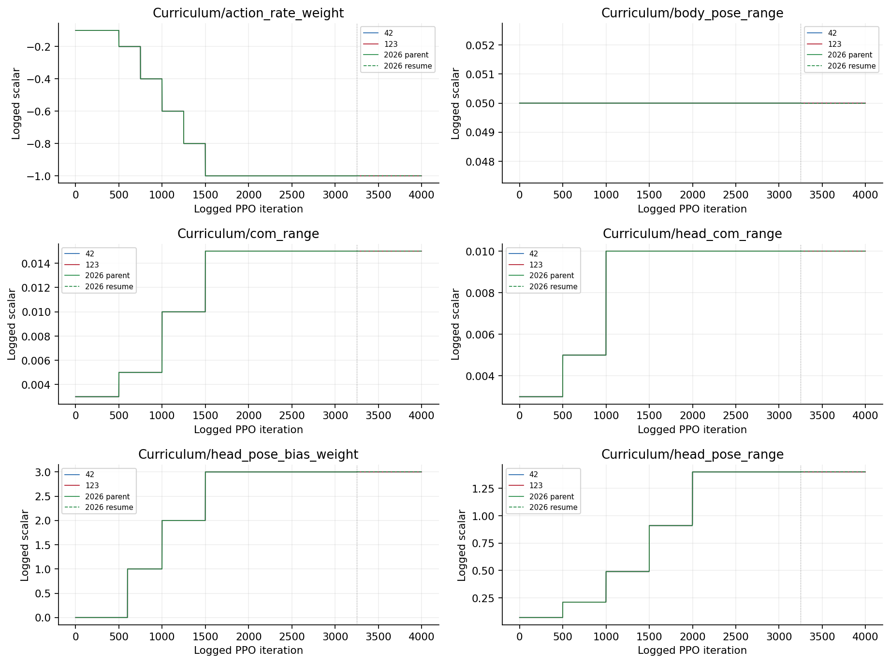

横轴为原日志迭代编号，未平滑。2026实线为保留的parent至3250，虚线为恢复段3250至3999；重复编号不合并为同一训练轮，丢弃parent的3251至3272。训练聚合量不是闭环评估百分比。

### 图2 三个来源的训练日志 Curriculum

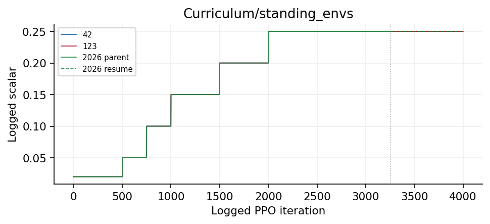

横轴为原日志迭代编号，未平滑。2026实线为保留的parent至3250，虚线为恢复段3250至3999；重复编号不合并为同一训练轮，丢弃parent的3251至3272。训练聚合量不是闭环评估百分比。

### 图3 三个来源的训练日志 Episode_Metrics

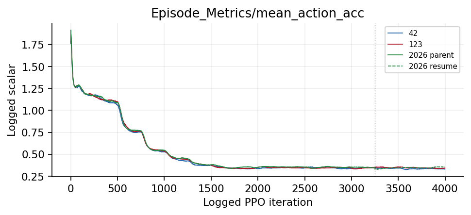

横轴为原日志迭代编号，未平滑。2026实线为保留的parent至3250，虚线为恢复段3250至3999；重复编号不合并为同一训练轮，丢弃parent的3251至3272。训练聚合量不是闭环评估百分比。

### 图4 三个来源的训练日志 Episode_Reward

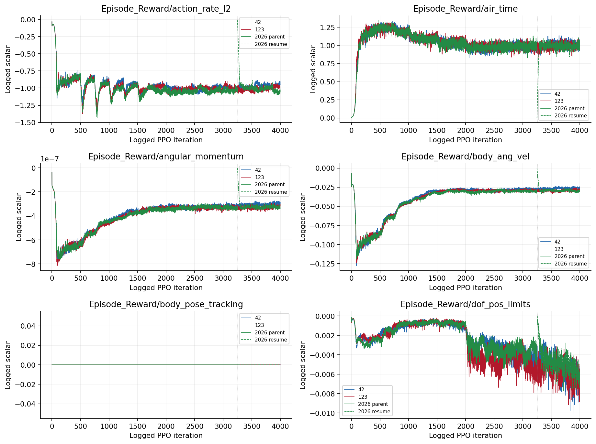

横轴为原日志迭代编号，未平滑。2026实线为保留的parent至3250，虚线为恢复段3250至3999；重复编号不合并为同一训练轮，丢弃parent的3251至3272。训练聚合量不是闭环评估百分比。

### 图5 三个来源的训练日志 Episode_Reward

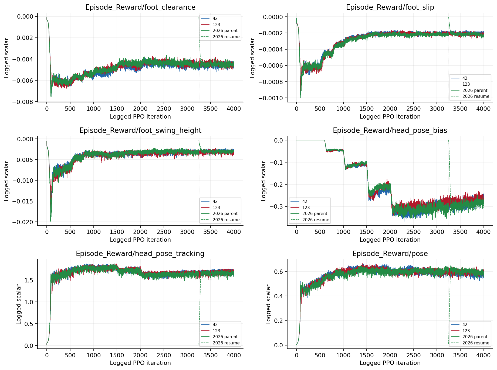

横轴为原日志迭代编号，未平滑。2026实线为保留的parent至3250，虚线为恢复段3250至3999；重复编号不合并为同一训练轮，丢弃parent的3251至3272。训练聚合量不是闭环评估百分比。

### 图6 三个来源的训练日志 Episode_Reward

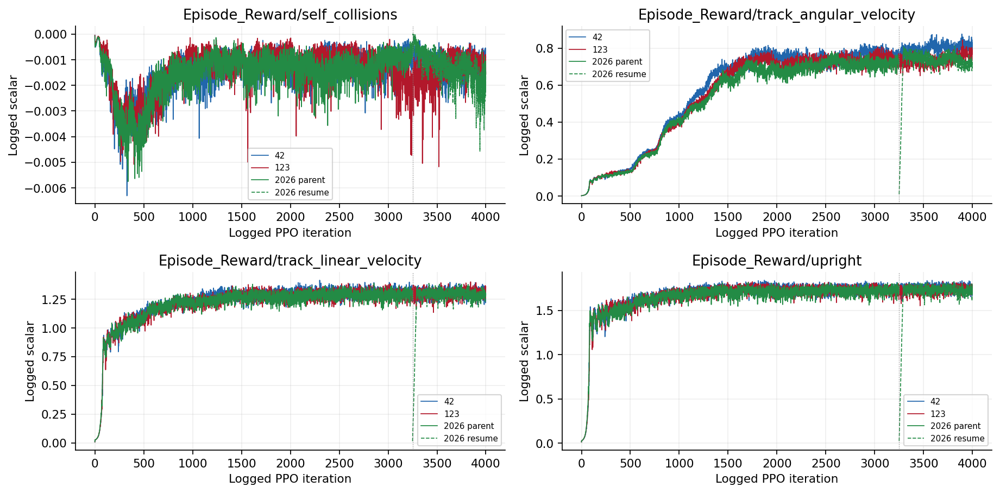

横轴为原日志迭代编号，未平滑。2026实线为保留的parent至3250，虚线为恢复段3250至3999；重复编号不合并为同一训练轮，丢弃parent的3251至3272。训练聚合量不是闭环评估百分比。

### 图7 三个来源的训练日志 Episode_Termination

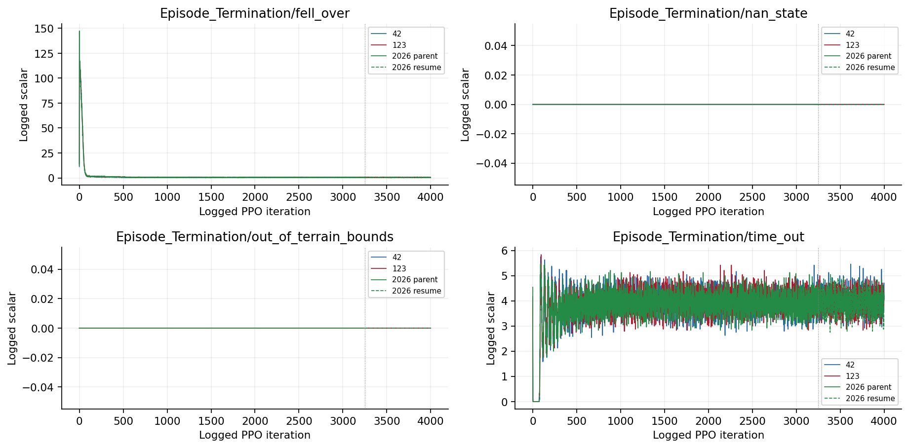

横轴为原日志迭代编号，未平滑。2026实线为保留的parent至3250，虚线为恢复段3250至3999；重复编号不合并为同一训练轮，丢弃parent的3251至3272。训练聚合量不是闭环评估百分比。

### 图8 三个来源的训练日志 Loss

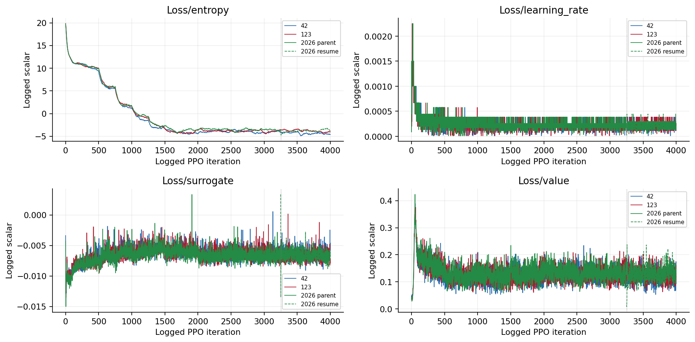

横轴为原日志迭代编号，未平滑。2026实线为保留的parent至3250，虚线为恢复段3250至3999；重复编号不合并为同一训练轮，丢弃parent的3251至3272。训练聚合量不是闭环评估百分比。

### 图9 三个来源的训练日志 Metrics

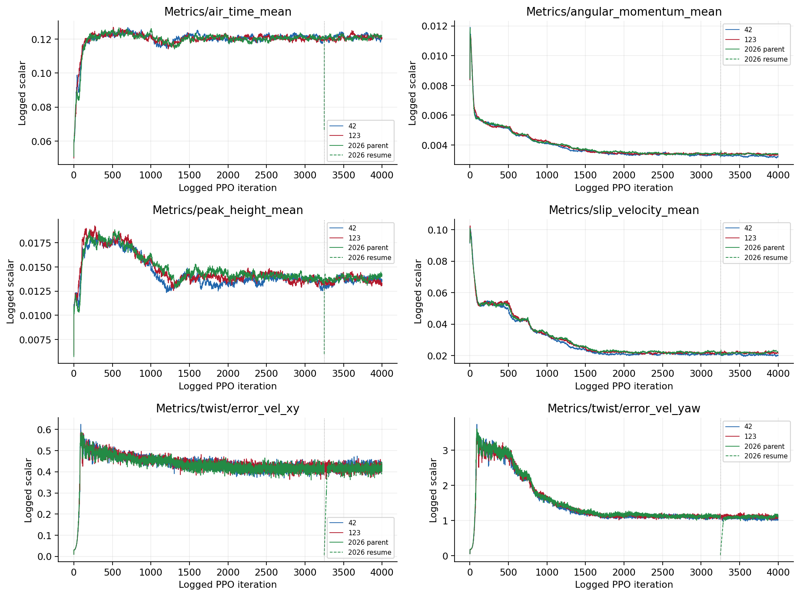

横轴为原日志迭代编号，未平滑。2026实线为保留的parent至3250，虚线为恢复段3250至3999；重复编号不合并为同一训练轮，丢弃parent的3251至3272。训练聚合量不是闭环评估百分比。

### 图10 三个来源的训练日志 Perf

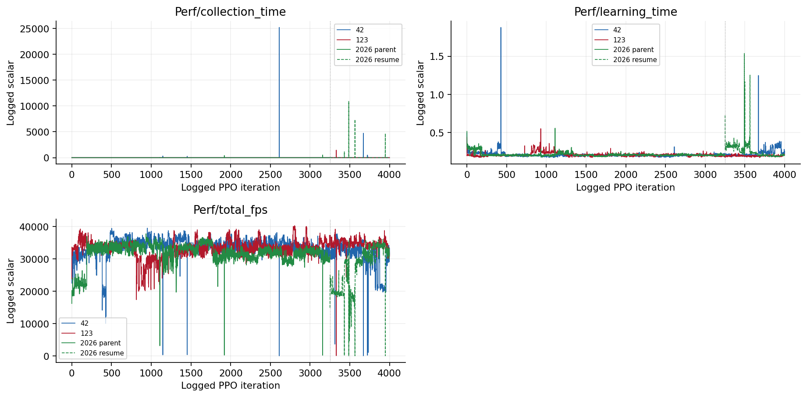

横轴为原日志迭代编号，未平滑。2026实线为保留的parent至3250，虚线为恢复段3250至3999；重复编号不合并为同一训练轮，丢弃parent的3251至3272。训练聚合量不是闭环评估百分比。

### 图11 三个来源的训练日志 Policy

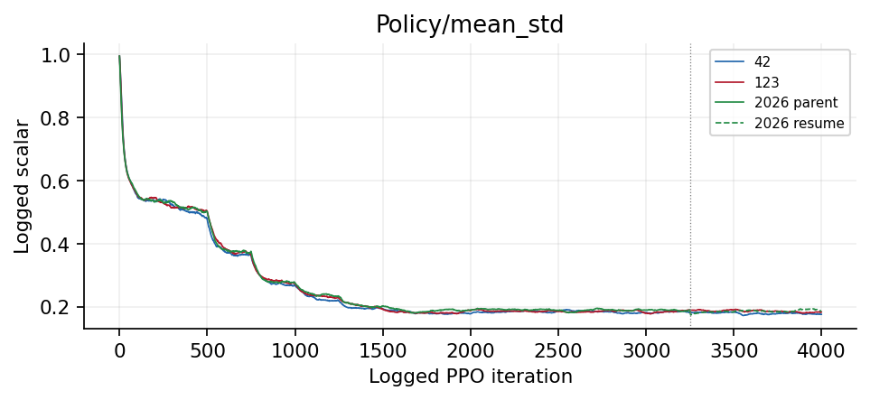

横轴为原日志迭代编号，未平滑。2026实线为保留的parent至3250，虚线为恢复段3250至3999；重复编号不合并为同一训练轮，丢弃parent的3251至3272。训练聚合量不是闭环评估百分比。

### 图12 三个来源的回报与回合长度 迭代轴与时间轴

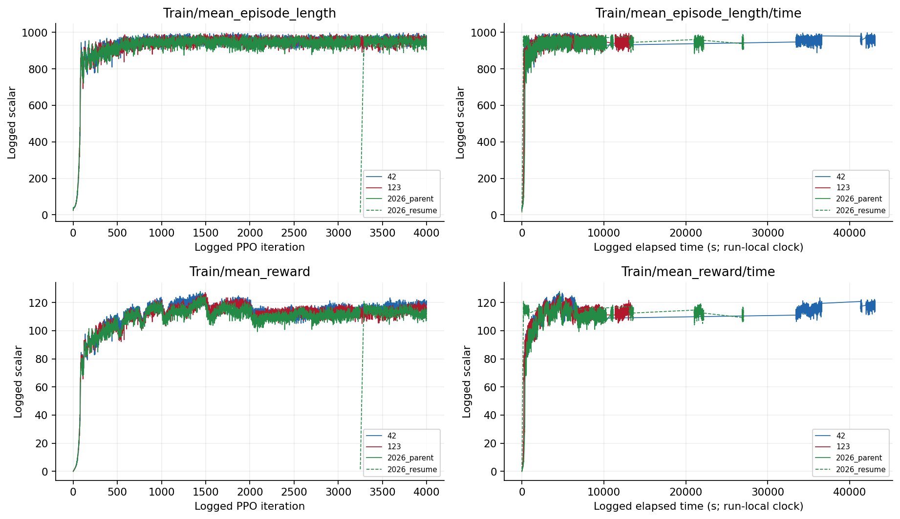

左列横轴为PPO迭代标签，右列为各运行日志elapsed秒，恢复段时钟单独保留，不能看作同一连续墙钟。2026父阶段按3250保存点对应wall_time截断，再与恢复段区分展示，不把/time的秒数误当迭代编号。

### 图13 checkpoint evaluation

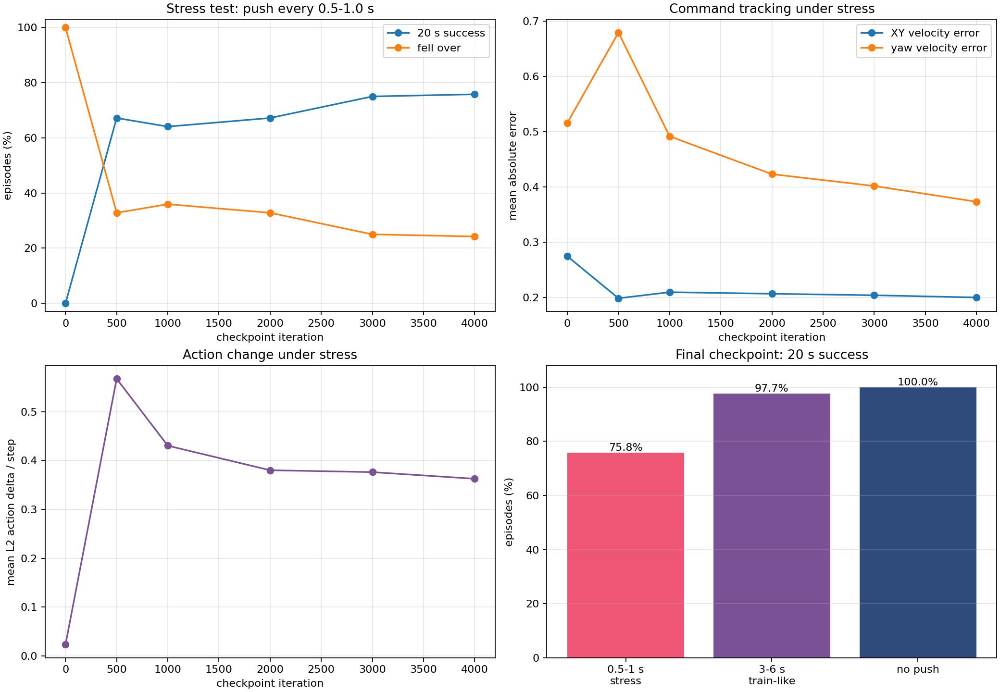

保留原实验图，不改变其样本、区间或协议定义。原图英文标注见本报告名词注释；探索、确认与历史快照不可混合累计。

### 图14 command tracking errors

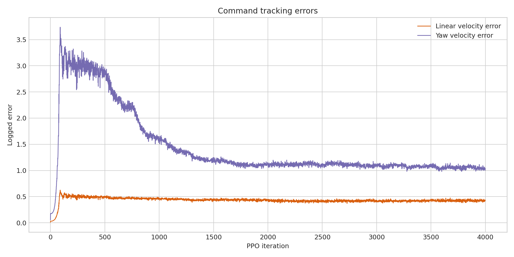

保留原实验图，不改变其样本、区间或协议定义。原图英文标注见本报告名词注释；探索、确认与历史快照不可混合累计。

### 图15 safety and policy metrics

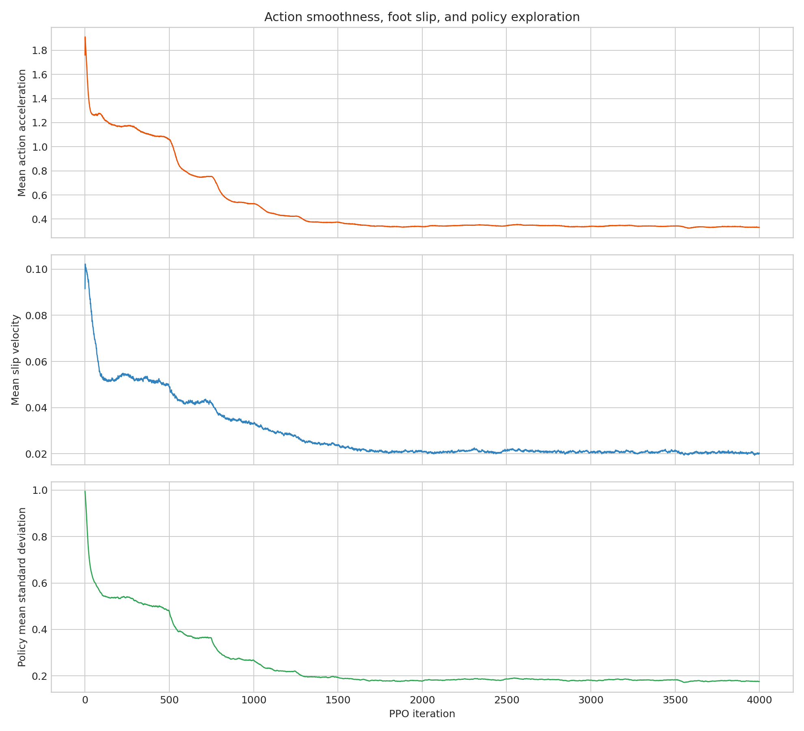

保留原实验图，不改变其样本、区间或协议定义。原图英文标注见本报告名词注释；探索、确认与历史快照不可混合累计。

### 图16 training reward episode

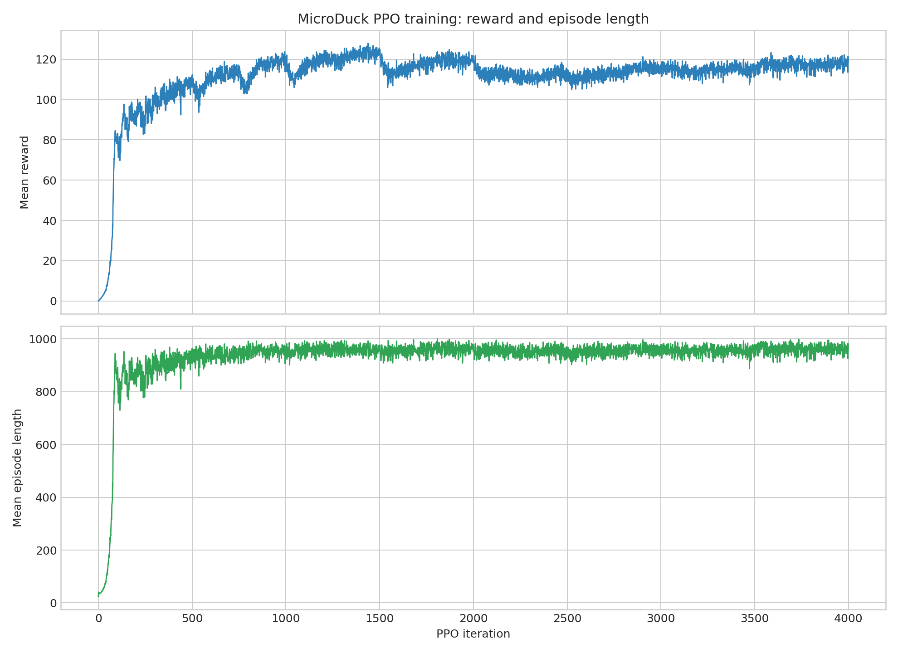

保留原实验图，不改变其样本、区间或协议定义。原图英文标注见本报告名词注释；探索、确认与历史快照不可混合累计。

## 限制与不能支持的结论

只在本地仿真中复现，没有实体或sim-to-real证据。恢复会重建环境、延迟历史和随机状态，不是不中断训练的逐位恢复。2026多出的0.025%预算必须披露，但没有证据将鲁棒性差异归因于它。

## 证据入口与复核范围

输入清单与SHA：[input_manifest.json](../data/input_manifest.json)。本轮计数/均值复算：[AUDIT.json](../data/AUDIT.json)。

## 这项工作的价值

本工作的价值是提供来源清楚、真实规模、可做同协议比较的三个本地策略和完整训练轨迹，使后续故障差异不再建立在小型替代模型或单段视频上。它是实验基础设施成果，不应单独包装为新算法。
