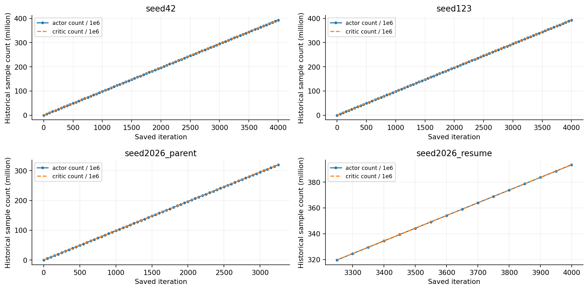

# 02 导出与来源核验研究报告

导出接口与测试输入数值一致性通过；244份真实checkpoint未发现被探针构造的var/std或count不一致。恢复链确实存在2026重复迭代标签，但它不是已发现的恶意污染。

## 工作范围

三个最终ONNX导出，四个实际训练目录中的244份已保存checkpoint及恢复边界。

## 我们如何完成这项工作

分别检查actor和critic统计的有限性、std与sqrt(var)、历史count与环境计数、优化器step，关联配置YAML和TensorBoard。三个导出模型接口为float32的61维输入到14维动作；ONNX checker、CPU推理及既有PyTorch数值对照分别记录，不混为一个检查。

## 现有结果及解释

1. 244份checkpoint分为42的81份、123的81份、2026父阶段66份与恢复阶段16份。已审计actor/critic的std与sqrt(var)最大误差为0，count相同并等于环境common_step_counter×4096。

2. 三个最终ONNX归一化mean及分母分别与对应checkpoint的mean及std+0.01逐元素一致。既有完整输出数值对照最大绝对误差约4.17×10^-7至5.36×10^-7。

3. 2026恢复前3250点含3251个rollout，恢复后同编号点含3252个rollout，count增加98,304、环境计数增加24、Adam step增加20，相互吻合。

## 完整结果表

| 真实训练目录 | 已保存checkpoint数 | 首标签 | 末标签 |
|---|---|---|---|
| seed42 | 81 | 0 | 3999 |
| seed123 | 81 | 0 | 3999 |
| seed2026_parent | 66 | 0 | 3250 |
| seed2026_resume | 16 | 3250 | 3999 |

## 图表及读图注释

> 读图注释：strict加载只检查键与形状，不能代替统计语义检查。mean、var、std、count与eps需要分别解释。

> 读图注释：曲线中actor和critic count重合是审计测得的相同，不是少画了一条；保存点之间连线只用于阅读。

> 英文坐标速查：survival=规定时长存活；duration/seconds=首回合有效寿命；vx=前向速度；XY=平面速度；yaw=绕竖直轴旋转；MSE=动作拟合平方误差；pp=百分点。完整解释见[读图指南](../READING_GUIDE.md)。

### 图1 244份checkpoint历史统计量与迭代对应

点为真实保存点，不是新增训练。actor与critic曲线重合；2026恢复边界实际多一轮，应结合报告中的rollout账本。统计一致性不证明历史从未遭受任何攻击。

## 限制与不能支持的结论

本报告沿用真实checkpoint审计结果，本轮不重新加载244个模型张量。该审计只覆盖保存点和当时核验的文件，不能证明所有历史进程状态都被保存。旧审计的seed123指定副本缺口后来已找到备份，不能沿用为当前模型丢失结论。

## 证据入口与复核范围

输入清单与SHA：[input_manifest.json](../data/input_manifest.json)。本轮计数/均值复算：[AUDIT.json](../data/AUDIT.json)。

- D:\MicroDuckResearch\ti\outputs\microduck_reproduction\mechanism_audit\resume_provenance_audit\results.json　SHA256 076397138d2f33b037c8bc9b2b24fbb374d126f31c85c4e6722d8a3bb0b029b4

## 这项工作的价值

价值在于把导出数值一致、模型来源一致、训练恢复完整性三件事分开验证，排除一类容易误认为研究发现的管线错误，并为每个后续实验建立可追溯模型身份。
