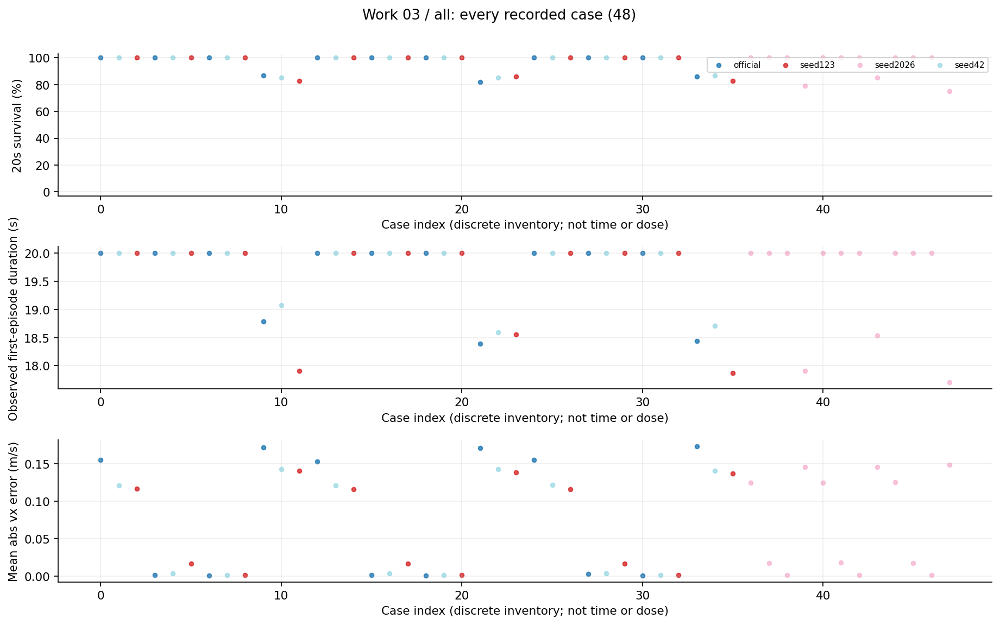
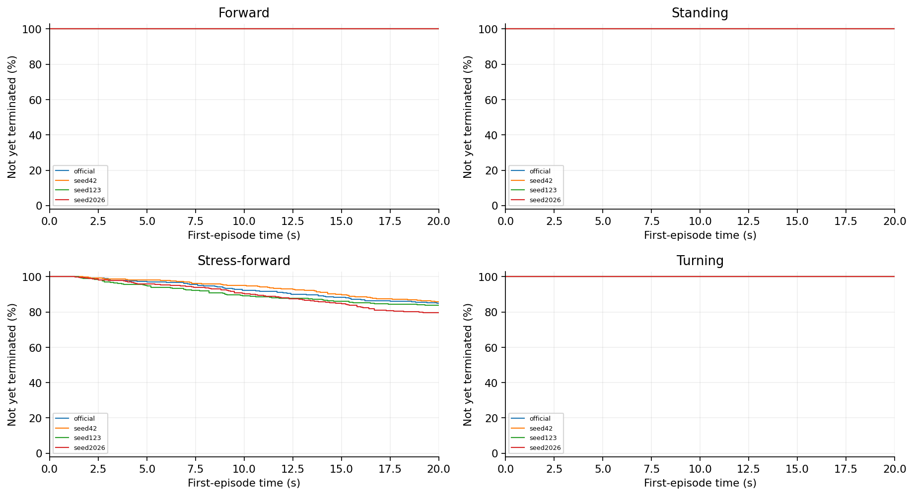
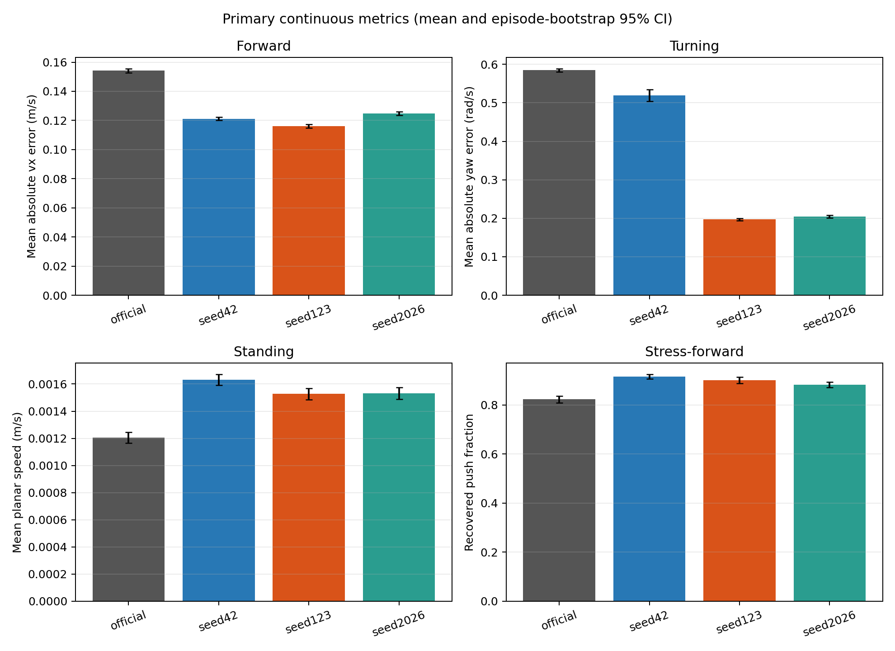
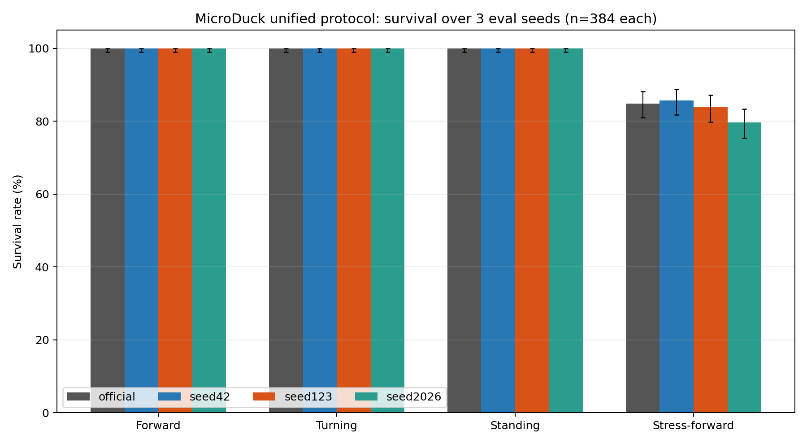
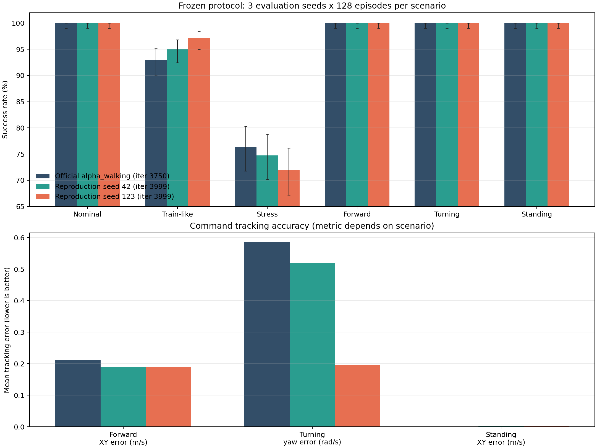
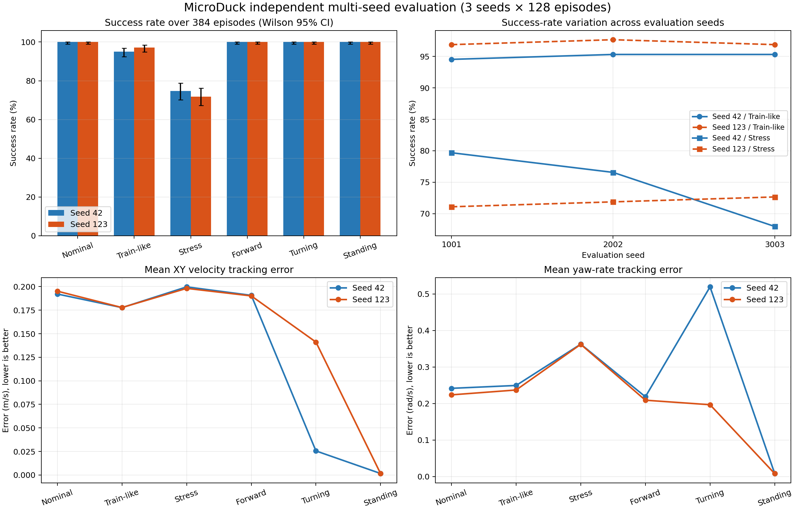
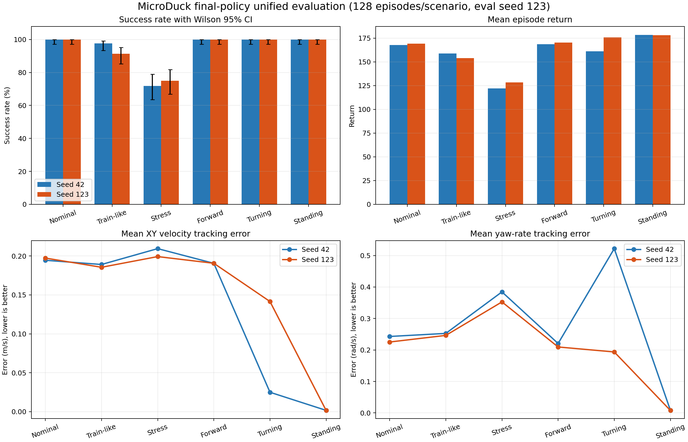
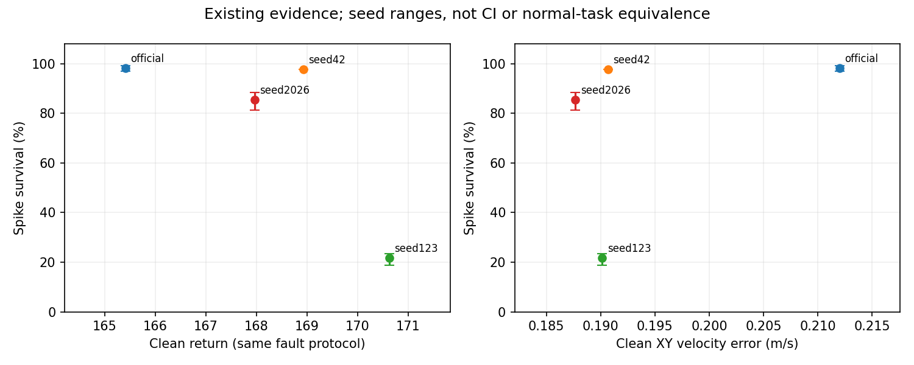
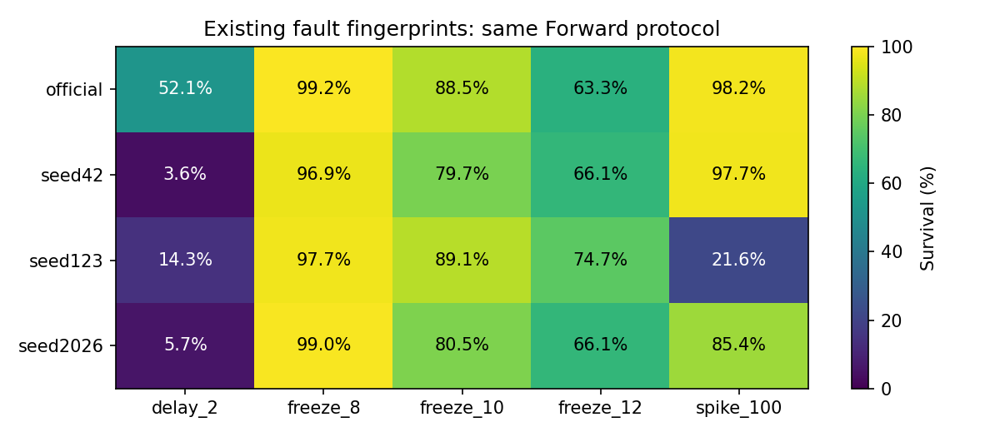

# 03 固定命令任务评估研究报告

所有模型在Forward、Turning和Standing均存活，但任务跟踪能力并不相同；Stress-forward下出现模型差异。因此“没有跌倒”不能单独作为策略能力验收。

## 工作范围

official及三个本地模型，4任务×3评估seed×128首回合，共48项、6144首回合。

## 我们如何完成这项工作

评估seed1001、2002、3003。Forward固定vx=0.3m/s；Turning固定yaw=0.6rad/s且平移目标为0；Standing为零命令；Stress-forward使用同Forward命令并每0.5—1秒推扰。只计第一次终止前的首回合，不把reset后新回合拼入。

## 现有结果及解释

1. Forward平均vx绝对误差，official/42/123/2026依次约0.1542/0.1211/0.1161/0.1248m/s；前三个非推扰任务各模型都是384/384存活。

2. Turning平均yaw误差约0.5851/0.5194/0.1968/0.2047rad/s。但123的平移速度约0.1411m/s，42约0.0257m/s；目标要求原地旋转，不能只按yaw误差说123全面最好。

3. Stress存活约84.90%/85.68%/83.85%/79.69%。这些是固定策略和当前推扰分布的结果，不可将四个点当架构优劣的充分证明。

## 完整结果表

| 模型或分支 | 条件 | 阶段 | 存活分子/分母 | 存活率 | 平均寿命s | vx误差m/s | XY误差m/s |
|---|---|---|---|---|---|---|---|
| official | Forward |  | 384/384 | 100.00% | 20.0000 | 0.1542 | 0.2122 |
| seed42 | Forward |  | 384/384 | 100.00% | 20.0000 | 0.1211 | 0.1907 |
| seed123 | Forward |  | 384/384 | 100.00% | 20.0000 | 0.1161 | 0.1902 |
| official | Turning |  | 384/384 | 100.00% | 20.0000 | 0.0022 | 0.0072 |
| seed42 | Turning |  | 384/384 | 100.00% | 20.0000 | 0.0039 | 0.0257 |
| seed123 | Turning |  | 384/384 | 100.00% | 20.0000 | 0.0170 | 0.1411 |
| official | Standing |  | 384/384 | 100.00% | 20.0000 | 0.0011 | 0.0012 |
| seed42 | Standing |  | 384/384 | 100.00% | 20.0000 | 0.0016 | 0.0016 |
| seed123 | Standing |  | 384/384 | 100.00% | 20.0000 | 0.0015 | 0.0015 |
| official | Stress-forward |  | 326/384 | 84.90% | 18.5385 | 0.1717 | 0.2310 |
| seed42 | Stress-forward |  | 329/384 | 85.68% | 18.7941 | 0.1419 | 0.2088 |
| seed123 | Stress-forward |  | 322/384 | 83.85% | 18.1121 | 0.1385 | 0.2099 |
| seed2026 | Forward |  | 384/384 | 100.00% | 20.0000 | 0.1248 | 0.1877 |
| seed2026 | Turning |  | 384/384 | 100.00% | 20.0000 | 0.0178 | 0.1358 |
| seed2026 | Standing |  | 384/384 | 100.00% | 20.0000 | 0.0014 | 0.0015 |
| seed2026 | Stress-forward |  | 306/384 | 79.69% | 18.0480 | 0.1462 | 0.2117 |

## 图表及读图注释

> 读图注释：速度误差越低通常表示跟踪越好，但早停会截短统计时间，须同时看寿命。不同指标单位不同，不直接合并一个总分。

> 读图注释：Stress恢复时间表示推扰后的跟踪恢复，不是摔倒后自主站起。存活区间和连续指标区间的计算对象也不同。

> 英文坐标速查：survival=规定时长存活；duration/seconds=首回合有效寿命；vx=前向速度；XY=平面速度；yaw=绕竖直轴旋转；MSE=动作拟合平方误差；pp=百分点。完整解释见[读图指南](../READING_GUIDE.md)。

### 图1 全部任务点 all

每个点是一项真实任务；横轴仅是文件记录顺序，不是连续变量，故不连线。点保留评估seed差异。条件、模型和分母可在全数据浏览器按编号查询；早停时误差只覆盖终止前。

### 图2 首回合存续曲线 第1组

横轴为首回合仿真秒，纵轴为尚未因任何原因终止的比例；20秒超时保留在终点，不画成死亡。由已保存终止时间重算，在0.1秒网格显示；不是完整姿态轨迹，也不把跨评估seed回合当独立训练。相同曲线可能重合。

### 图3 primary metrics comparison

保留原实验图，不改变其样本、区间或协议定义。原图英文标注见本报告名词注释；探索、确认与历史快照不可混合累计。

### 图4 survival comparison

保留原实验图，不改变其样本、区间或协议定义。原图英文标注见本报告名词注释；探索、确认与历史快照不可混合累计。

### 图5 three model comparison

历史补充图，保留用于追溯。本图的队列、幅度、分母或目的不同于本报告主表，不合并计数，不当成新增实验或最终主协议结论。

### 图6 multi seed comparison

历史补充图，保留用于追溯。本图的队列、幅度、分母或目的不同于本报告主表，不合并计数，不当成新增实验或最终主协议结论。

### 图7 seed42 vs seed123 unified evaluation

历史补充图，保留用于追溯。本图的队列、幅度、分母或目的不同于本报告主表，不合并计数，不当成新增实验或最终主协议结论。

### 图8 clean vs fault

历史补充图，保留用于追溯。本图的队列、幅度、分母或目的不同于本报告主表，不合并计数，不当成新增实验或最终主协议结论。

### 图9 fault fingerprints

历史补充图，保留用于追溯。本图的队列、幅度、分母或目的不同于本报告主表，不合并计数，不当成新增实验或最终主协议结论。

## 限制与不能支持的结论

本轮复算48项原CSV的计数和主要连续均值；历史bootstrap区间沿用已有分析，不重新包装为训练总体置信度。三次评估seed不是三次重新训练，没有事后新增任务成功阈值。

## 证据入口与复核范围

输入清单与SHA：[input_manifest.json](../data/input_manifest.json)。本轮计数/均值复算：[AUDIT.json](../data/AUDIT.json)。

- D:\MicroDuckResearch\ti\outputs\microduck_reproduction\task_protocol_v2\four_model_final\four_model_results.json　SHA256 daee8fe5e92cbfab2a1b67241608266092e6346b9578718ccf3a51ec9d5b923a

## 这项工作的价值

本工作的价值是把任务语义从“能站住”扩展为速度跟踪、旋转、静止漂移和抗推扰的多维验收，为后续故障试验提供正常性能参照。
