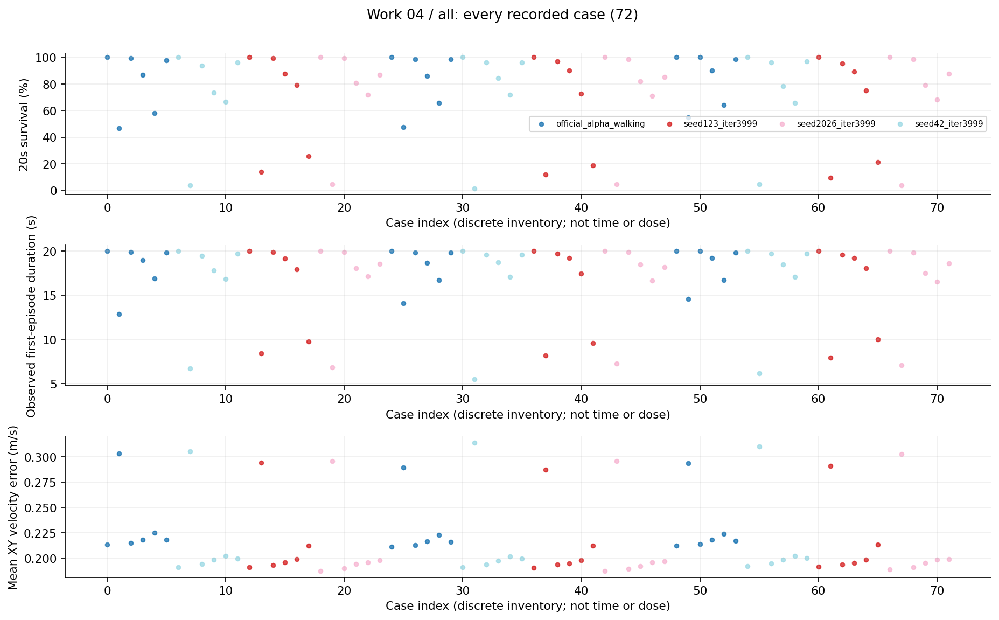
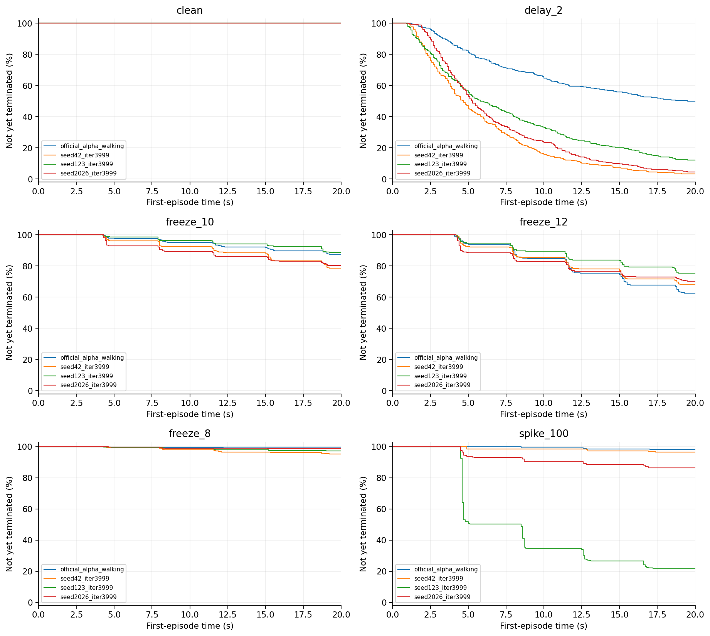
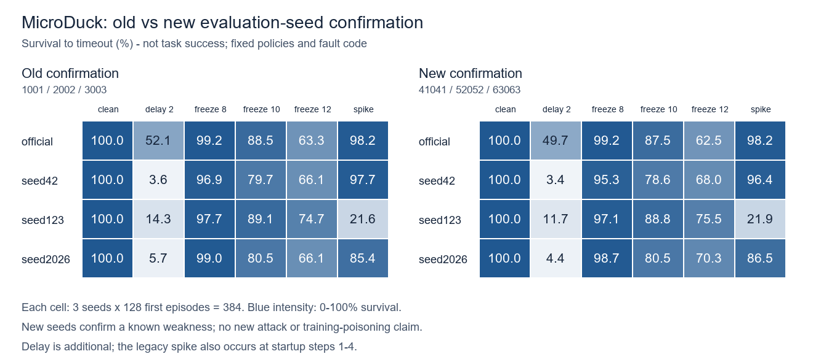
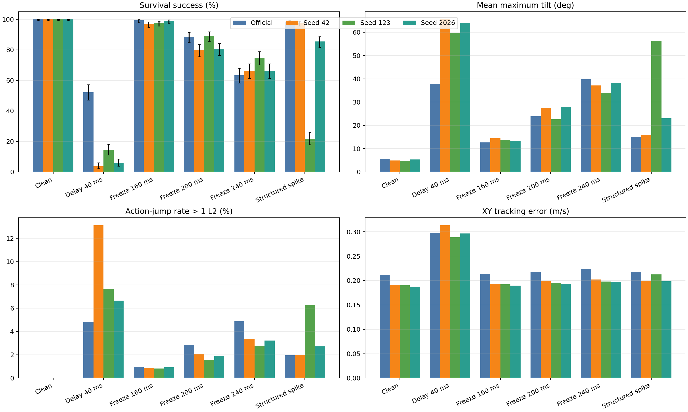
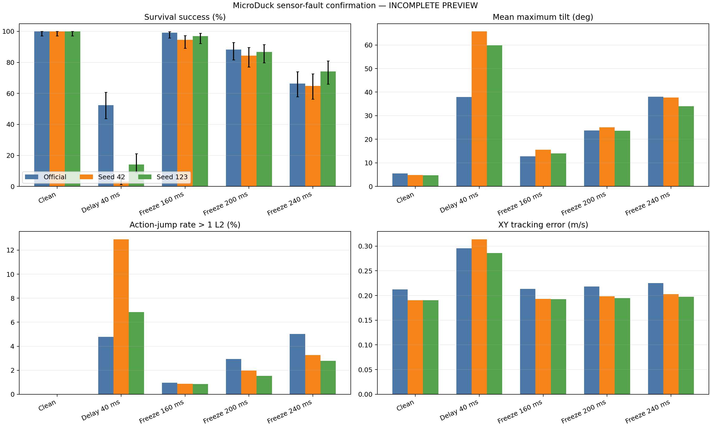
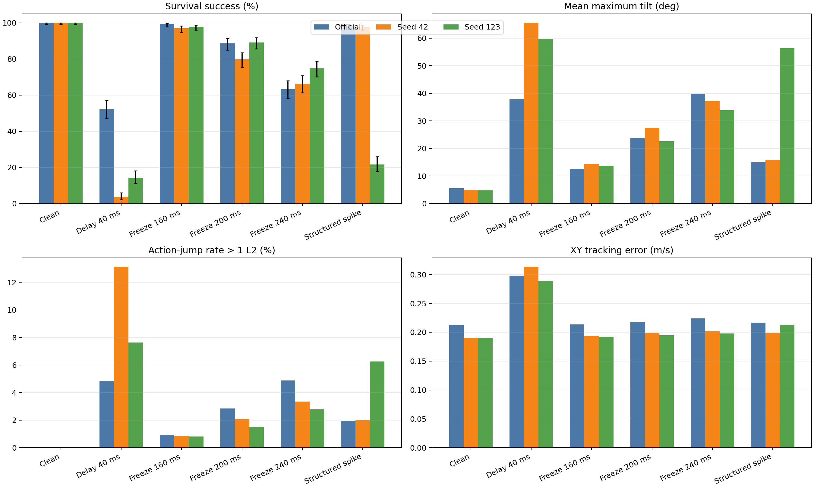
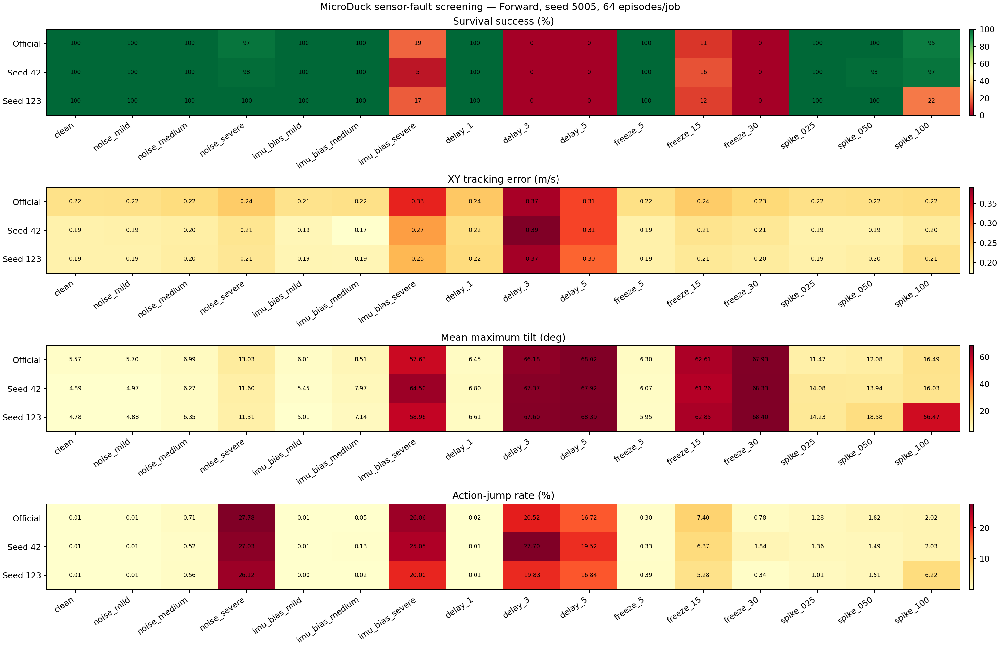

# 04 独立评估seed故障确认研究报告

seed123对既定联合脉冲的脆弱性在三个新评估seed中重复；它是冻结策略的故障指纹复现，不是训练污染原因的确认。

## 工作范围

4模型×6条件×3新评估seed×128首回合，72项、9216首回合。

## 我们如何完成这项工作

独立评估seed41041、52052、63063；条件为clean、额外40ms延迟、freeze8/10/12及旧spike_100。旧脉冲既含step1—4启动注入，也含之后的周期注入；与后来的纯行走脉冲必须分开。

## 现有结果及解释

1. 新seed下脉冲存活：42分别123/128、123/128、124/128；123分别33/128、24/128、27/128。123减42平均下降74.48个百分点，三个seed同方向。

2. 合并新seed，official脉冲98.18%，42为96.35%，123为21.88%，2026为86.46%。这不是精细基准纯行走脉冲alpha1的19.01%那一格，两个协议不能互换。

3. 延迟和freeze的模型差异也保留。完整72项都纳入点图与表格，未只选主比较或只展示最差模型。

## 完整结果表

| 模型或分支 | 条件 | 阶段 | 存活分子/分母 | 存活率 | 平均寿命s | vx误差m/s | XY误差m/s |
|---|---|---|---|---|---|---|---|
| official_alpha_walking | clean |  | 384/384 | 100.00% | 20.0000 | 未记录 | 0.2122 |
| official_alpha_walking | delay_2 |  | 191/384 | 49.74% | 13.8624 | 未记录 | 0.2953 |
| official_alpha_walking | freeze_8 |  | 381/384 | 99.22% | 19.8982 | 未记录 | 0.2137 |
| official_alpha_walking | freeze_10 |  | 336/384 | 87.50% | 18.9542 | 未记录 | 0.2175 |
| official_alpha_walking | freeze_12 |  | 240/384 | 62.50% | 16.7624 | 未记录 | 0.2238 |
| official_alpha_walking | spike_100 |  | 377/384 | 98.18% | 19.8446 | 未记录 | 0.2169 |
| seed42_iter3999 | clean |  | 384/384 | 100.00% | 20.0000 | 未记录 | 0.1910 |
| seed42_iter3999 | delay_2 |  | 13/384 | 3.39% | 6.0918 | 未记录 | 0.3097 |
| seed42_iter3999 | freeze_8 |  | 366/384 | 95.31% | 19.5744 | 未记录 | 0.1939 |
| seed42_iter3999 | freeze_10 |  | 302/384 | 78.65% | 18.3249 | 未记录 | 0.1979 |
| seed42_iter3999 | freeze_12 |  | 261/384 | 67.97% | 16.9977 | 未记录 | 0.2019 |
| seed42_iter3999 | spike_100 |  | 370/384 | 96.35% | 19.6466 | 未记录 | 0.1993 |
| seed123_iter3999 | clean |  | 384/384 | 100.00% | 20.0000 | 未记录 | 0.1907 |
| seed123_iter3999 | delay_2 |  | 45/384 | 11.72% | 8.1665 | 未记录 | 0.2907 |
| seed123_iter3999 | freeze_8 |  | 373/384 | 97.14% | 19.7336 | 未记录 | 0.1931 |
| seed123_iter3999 | freeze_10 |  | 341/384 | 88.80% | 19.2026 | 未记录 | 0.1951 |
| seed123_iter3999 | freeze_12 |  | 290/384 | 75.52% | 17.8054 | 未记录 | 0.1983 |
| seed123_iter3999 | spike_100 |  | 84/384 | 21.88% | 9.7883 | 未记录 | 0.2124 |
| seed2026_iter3999 | clean |  | 384/384 | 100.00% | 20.0000 | 未记录 | 0.1876 |
| seed2026_iter3999 | delay_2 |  | 17/384 | 4.43% | 7.0224 | 未记录 | 0.2978 |
| seed2026_iter3999 | freeze_8 |  | 379/384 | 98.70% | 19.8533 | 未记录 | 0.1898 |
| seed2026_iter3999 | freeze_10 |  | 309/384 | 80.47% | 18.0133 | 未记录 | 0.1936 |
| seed2026_iter3999 | freeze_12 |  | 270/384 | 70.31% | 16.7924 | 未记录 | 0.1965 |
| seed2026_iter3999 | spike_100 |  | 332/384 | 86.46% | 18.4209 | 未记录 | 0.1976 |

## 图表及读图注释

> 读图注释：新旧评估seed是不同队列，不作逐episode配对；模型相同不意味着仿真轨迹逐位相同。

> 读图注释：三个新seed的同向结果支持在该评估分布下重复，但不能扩展成对所有训练seed、所有故障的结论。

> 英文坐标速查：survival=规定时长存活；duration/seconds=首回合有效寿命；vx=前向速度；XY=平面速度；yaw=绕竖直轴旋转；MSE=动作拟合平方误差；pp=百分点。完整解释见[读图指南](../READING_GUIDE.md)。

### 图1 全部任务点 all

每个点是一项真实任务；横轴仅是文件记录顺序，不是连续变量，故不连线。点保留评估seed差异。条件、模型和分母可在全数据浏览器按编号查询；早停时误差只覆盖终止前。

### 图2 逐故障首回合存续曲线 第1组

每个面板严格保持同一故障条件，未混合clean、启动和行走故障。纵轴为尚未终止的首回合比例，20秒超时保留在终点；0.1秒显示网格。合并的是同模型同条件评估seed，不是独立训练重复。

### 图3 old new survival

保留原实验图，不改变其样本、区间或协议定义。原图英文标注见本报告名词注释；探索、确认与历史快照不可混合累计。

### 图4 confirmatory summary four models

历史补充图，保留用于追溯。本图的队列、幅度、分母或目的不同于本报告主表，不合并计数，不当成新增实验或最终主协议结论。

### 图5 confirmatory summary

历史补充图，保留用于追溯。本图的队列、幅度、分母或目的不同于本报告主表，不合并计数，不当成新增实验或最终主协议结论。

### 图6 confirmatory summary

早期筛查或旧确认图，协议可能含启动脉冲，不能替代后来新seed确认或纯行走精细基准；不重复计入9216回合。

### 图7 sensor fault heatmaps

早期筛查或旧确认图，协议可能含启动脉冲，不能替代后来新seed确认或纯行走精细基准；不重复计入9216回合。

## 限制与不能支持的结论

本轮再次检查72份CSV的已记录SHA、首回合计数及主要均值。故障幅度与旧注入器未变。没有重新训练、没有实体入口验证，也未把非有限值或失败回合过滤。

## 证据入口与复核范围

输入清单与SHA：[input_manifest.json](../data/input_manifest.json)。本轮计数/均值复算：[AUDIT.json](../data/AUDIT.json)。

- D:\MicroDuckResearch\ti\outputs\microduck_reproduction\sensor_fault_benchmark\independent_confirmation\results.json　SHA256 f9c8548855933d6aab745b98caf576b59b41d96c00f8a867120d3757e6deb616

## 这项工作的价值

价值是将单一队列中看到的模型弱点升级为新评估seed下可重复的行为证据，减少“恰好某次仿真很差”的解释；同时明确复现现象与解释现象是两个阶段。
