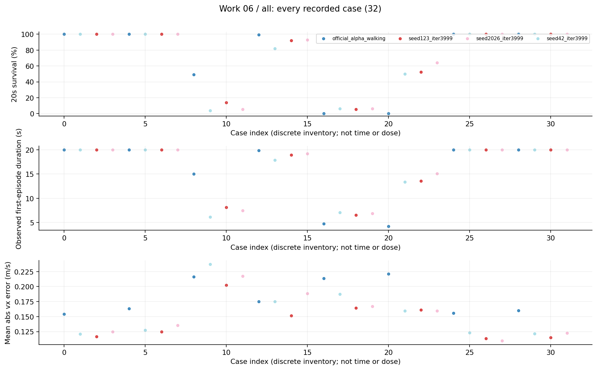
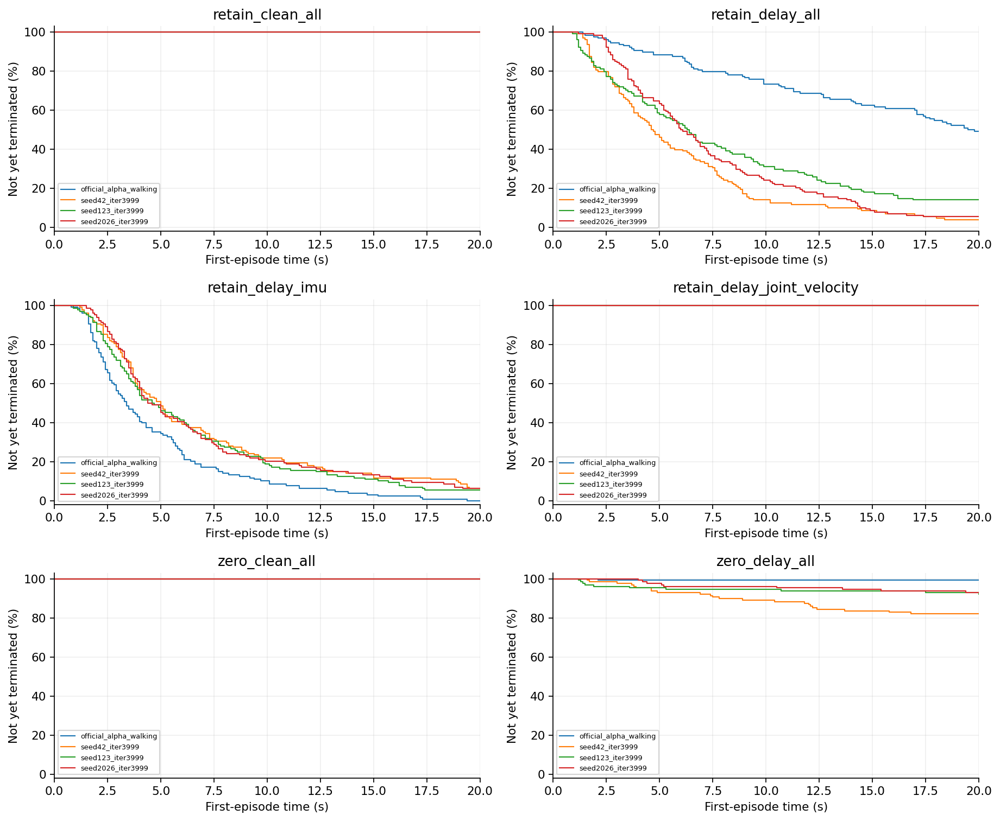
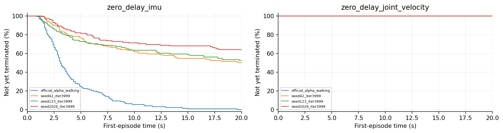
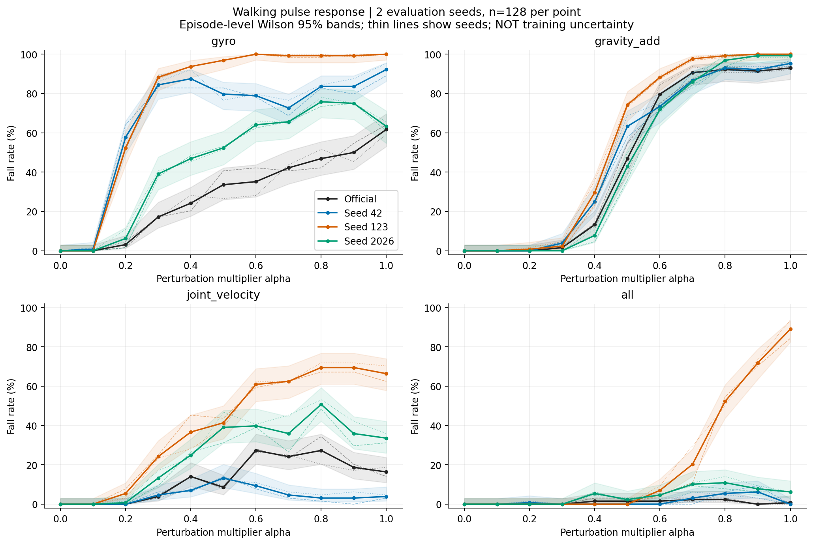
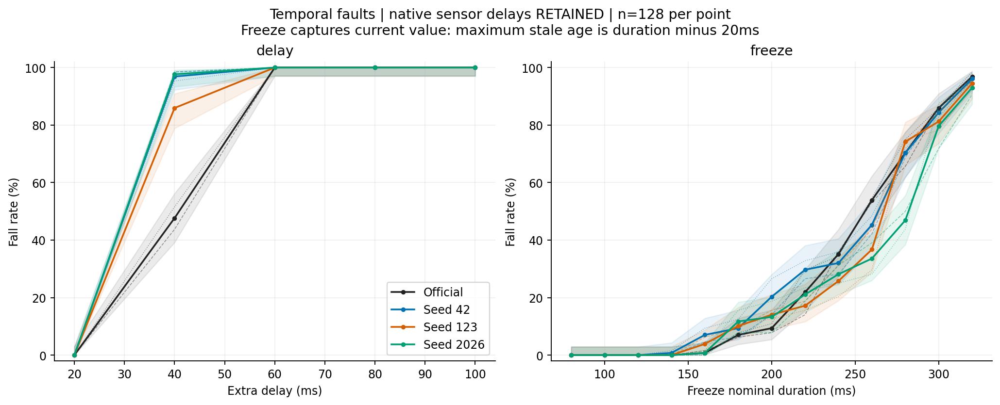
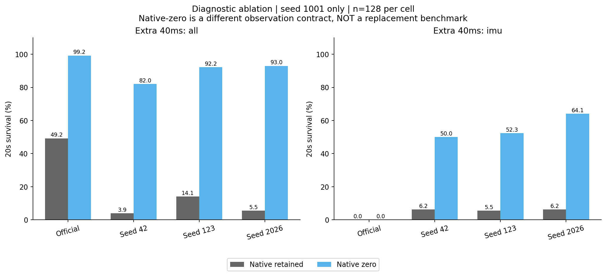
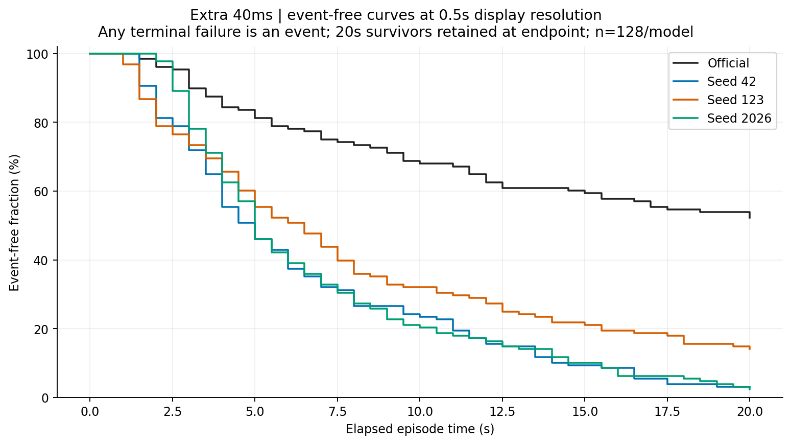
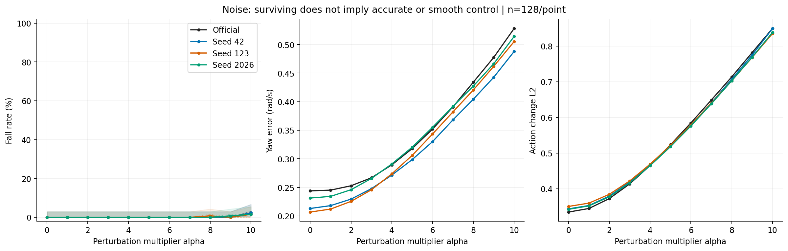
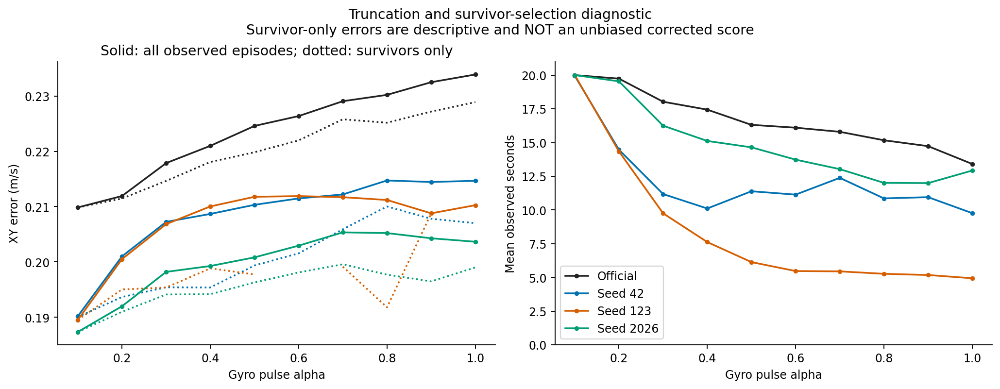
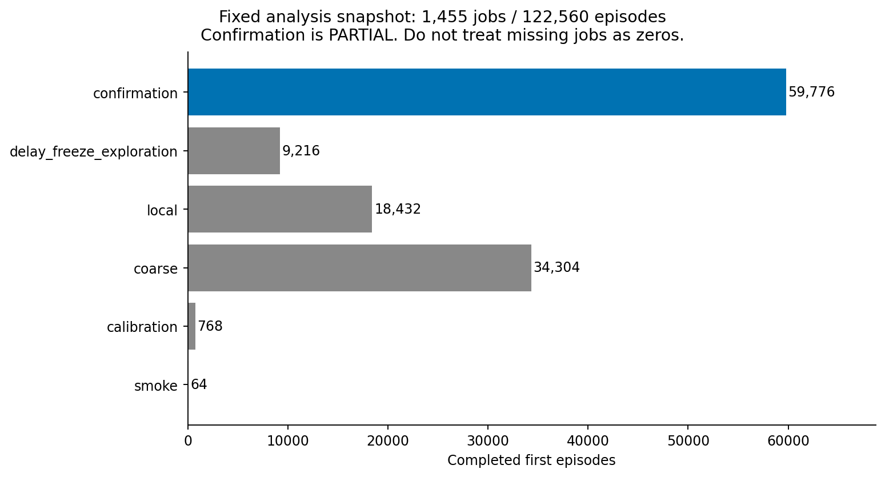

# 06 原生延迟诊断研究报告

保留或清零原生观测延迟会显著改变额外延迟故障的结果，且通道选择改变排名。时间合同是必须记录的实验变量。

## 工作范围

4模型×2原生延迟设置×4条件×128首回合，32项、4096回合；只有评估seed1001。

## 我们如何完成这项工作

分别保留训练对应的原生延迟与将其清零；每设置测试clean、全传感段额外40ms、仅IMU额外40ms、仅关节速度额外40ms。清零是另一推理合同，只作为机制消融，不替换正式基准。

## 现有结果及解释

1. 两种设置下各模型clean均128/128存活。全观测额外40ms时，保留到清零：official为63→127，42为5→105，123为18→118，2026为7→119，分母均128。

2. 仅IMU延迟时official两设置都0/128；清零后42、123、2026分别64/128、67/128、82/128。仅关节速度延迟各模型均全存活。

3. 这些结果与“所有本地模型只是总体质量更差”这一简单解释不相容，但还没有把影响定位为唯一的物理时钟错位机制。

## 完整结果表

| 模型或分支 | 条件 | 阶段 | 存活分子/分母 | 存活率 | 平均寿命s | vx误差m/s | XY误差m/s |
|---|---|---|---|---|---|---|---|
| official_alpha_walking | retain_clean_all | priority_diagnostic | 128/128 | 100.00% | 20.0000 | 0.1544 | 0.2121 |
| seed42_iter3999 | retain_clean_all | priority_diagnostic | 128/128 | 100.00% | 20.0000 | 0.1212 | 0.1906 |
| seed123_iter3999 | retain_clean_all | priority_diagnostic | 128/128 | 100.00% | 20.0000 | 0.1166 | 0.1903 |
| seed2026_iter3999 | retain_clean_all | priority_diagnostic | 128/128 | 100.00% | 20.0000 | 0.1246 | 0.1871 |
| official_alpha_walking | zero_clean_all | priority_diagnostic | 128/128 | 100.00% | 20.0000 | 0.1631 | 0.2100 |
| seed42_iter3999 | zero_clean_all | priority_diagnostic | 128/128 | 100.00% | 20.0000 | 0.1273 | 0.1840 |
| seed123_iter3999 | zero_clean_all | priority_diagnostic | 128/128 | 100.00% | 20.0000 | 0.1246 | 0.1837 |
| seed2026_iter3999 | zero_clean_all | priority_diagnostic | 128/128 | 100.00% | 20.0000 | 0.1357 | 0.1850 |
| official_alpha_walking | retain_delay_all | priority_diagnostic | 63/128 | 49.22% | 15.0297 | 0.2161 | 0.2924 |
| seed42_iter3999 | retain_delay_all | priority_diagnostic | 5/128 | 3.91% | 6.1408 | 0.2373 | 0.3104 |
| seed123_iter3999 | retain_delay_all | priority_diagnostic | 18/128 | 14.06% | 8.1364 | 0.2021 | 0.2876 |
| seed2026_iter3999 | retain_delay_all | priority_diagnostic | 7/128 | 5.47% | 7.4812 | 0.2175 | 0.2979 |
| official_alpha_walking | zero_delay_all | priority_diagnostic | 127/128 | 99.22% | 19.8602 | 0.1753 | 0.2537 |
| seed42_iter3999 | zero_delay_all | priority_diagnostic | 105/128 | 82.03% | 17.8622 | 0.1752 | 0.2510 |
| seed123_iter3999 | zero_delay_all | priority_diagnostic | 118/128 | 92.19% | 18.9378 | 0.1516 | 0.2443 |
| seed2026_iter3999 | zero_delay_all | priority_diagnostic | 119/128 | 92.97% | 19.2291 | 0.1884 | 0.2680 |
| official_alpha_walking | retain_delay_imu | priority_diagnostic | 0/128 | 0.00% | 4.7019 | 0.2136 | 0.2755 |
| seed42_iter3999 | retain_delay_imu | priority_diagnostic | 8/128 | 6.25% | 7.0305 | 0.1874 | 0.2493 |
| seed123_iter3999 | retain_delay_imu | priority_diagnostic | 7/128 | 5.47% | 6.5150 | 0.1641 | 0.2342 |
| seed2026_iter3999 | retain_delay_imu | priority_diagnostic | 8/128 | 6.25% | 6.8622 | 0.1669 | 0.2327 |
| official_alpha_walking | zero_delay_imu | priority_diagnostic | 0/128 | 0.00% | 4.1758 | 0.2212 | 0.2773 |
| seed42_iter3999 | zero_delay_imu | priority_diagnostic | 64/128 | 50.00% | 13.4006 | 0.1593 | 0.2175 |
| seed123_iter3999 | zero_delay_imu | priority_diagnostic | 67/128 | 52.34% | 13.5959 | 0.1610 | 0.2242 |
| seed2026_iter3999 | zero_delay_imu | priority_diagnostic | 82/128 | 64.06% | 15.0989 | 0.1595 | 0.2137 |
| official_alpha_walking | retain_delay_joint_velocity | priority_diagnostic | 128/128 | 100.00% | 20.0000 | 0.1558 | 0.2349 |
| seed42_iter3999 | retain_delay_joint_velocity | priority_diagnostic | 128/128 | 100.00% | 20.0000 | 0.1230 | 0.2126 |
| seed123_iter3999 | retain_delay_joint_velocity | priority_diagnostic | 128/128 | 100.00% | 20.0000 | 0.1137 | 0.2100 |
| seed2026_iter3999 | retain_delay_joint_velocity | priority_diagnostic | 128/128 | 100.00% | 20.0000 | 0.1098 | 0.1951 |
| official_alpha_walking | zero_delay_joint_velocity | priority_diagnostic | 128/128 | 100.00% | 20.0000 | 0.1598 | 0.2282 |
| seed42_iter3999 | zero_delay_joint_velocity | priority_diagnostic | 128/128 | 100.00% | 20.0000 | 0.1213 | 0.2024 |
| seed123_iter3999 | zero_delay_joint_velocity | priority_diagnostic | 128/128 | 100.00% | 20.0000 | 0.1150 | 0.2025 |
| seed2026_iter3999 | zero_delay_joint_velocity | priority_diagnostic | 128/128 | 100.00% | 20.0000 | 0.1225 | 0.1964 |

## 图表及读图注释

> 读图注释：原生延迟来自原环境合同，额外延迟是本实验叠加的缓存陈旧。两者不可简单称为“总40ms”。

> 读图注释：同一模型在另一时间合同下改善，不代表应立即修改部署设置；需要保持原正式评价合同。

> 英文坐标速查：survival=规定时长存活；duration/seconds=首回合有效寿命；vx=前向速度；XY=平面速度；yaw=绕竖直轴旋转；MSE=动作拟合平方误差；pp=百分点。完整解释见[读图指南](../READING_GUIDE.md)。

### 图1 全部任务点 all

每个点是一项真实任务；横轴仅是文件记录顺序，不是连续变量，故不连线。点保留评估seed差异。条件、模型和分母可在全数据浏览器按编号查询；早停时误差只覆盖终止前。

### 图2 首回合存续曲线 第1组

横轴为首回合仿真秒，纵轴为尚未因任何原因终止的比例；20秒超时保留在终点，不画成死亡。由已保存终止时间重算，在0.1秒网格显示；不是完整姿态轨迹，也不把跨评估seed回合当独立训练。相同曲线可能重合。

### 图3 首回合存续曲线 第2组

横轴为首回合仿真秒，纵轴为尚未因任何原因终止的比例；20秒超时保留在终点，不画成死亡。由已保存终止时间重算，在0.1秒网格显示；不是完整姿态轨迹，也不把跨评估seed回合当独立训练。相同曲线可能重合。

### 图4 01 pulse channels

历史中期CPU分析图，快照覆盖有限；最终完整数据与本轮重算另列，不把该快照冒充最终全部条件。

### 图5 02 temporal response

历史中期CPU分析图，快照覆盖有限；最终完整数据与本轮重算另列，不把该快照冒充最终全部条件。

### 图6 03 native delay ablation

历史中期CPU分析图，快照覆盖有限；最终完整数据与本轮重算另列，不把该快照冒充最终全部条件。

### 图7 04 time to failure

历史中期CPU分析图，快照覆盖有限；最终完整数据与本轮重算另列，不把该快照冒充最终全部条件。

### 图8 05 noise continuous metrics

历史中期CPU分析图，快照覆盖有限；最终完整数据与本轮重算另列，不把该快照冒充最终全部条件。

### 图9 06 truncation warning

历史中期CPU分析图，快照覆盖有限；最终完整数据与本轮重算另列，不把该快照冒充最终全部条件。

### 图10 07 snapshot coverage

历史中期CPU分析图，快照覆盖有限；最终完整数据与本轮重算另列，不把该快照冒充最终全部条件。

## 限制与不能支持的结论

单评估seed、小范围消融，没有三seed独立确认，也没有关节位置单独延迟或逐通道因果对齐证明。本轮复算32份CSV，不新增诊断条件。

## 证据入口与复核范围

输入清单与SHA：[input_manifest.json](../data/input_manifest.json)。本轮计数/均值复算：[AUDIT.json](../data/AUDIT.json)。

- D:\MicroDuckResearch\ti\outputs\microduck_reproduction\priority_delay_audit\diagnostic_results\results.json　SHA256 c34262c7ced694ddb208628f416bfb440cc11c302021497f2d2391a6e9fb644d

## 这项工作的价值

价值是揭示评价器的时间语义会改变结论，提醒模型验收必须同时冻结字段顺序、采样/延迟合同与注入位置；它提供诊断线索而非一项已经验证的修复方案。
