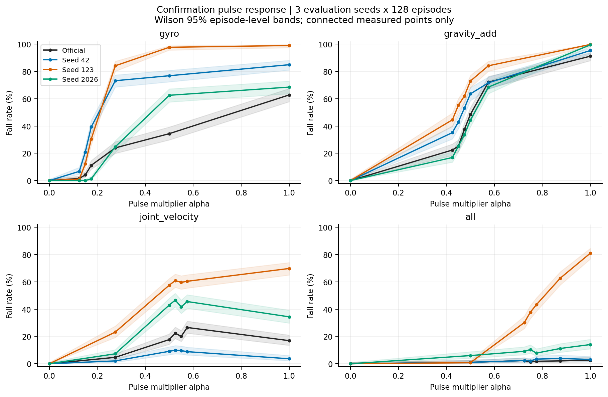
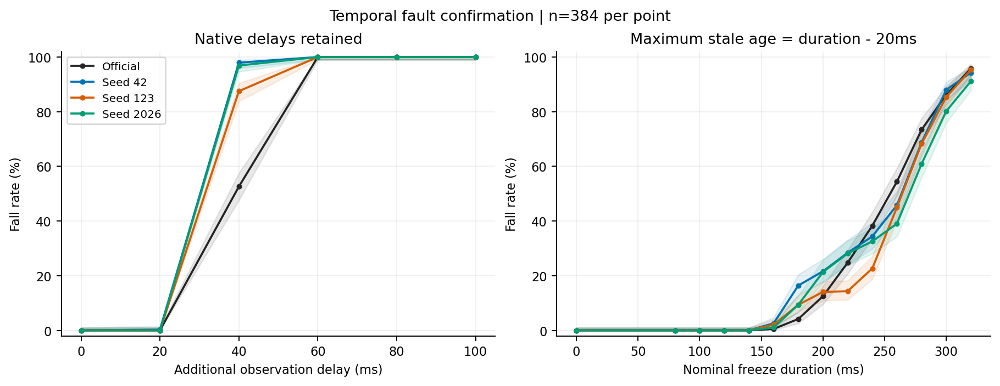
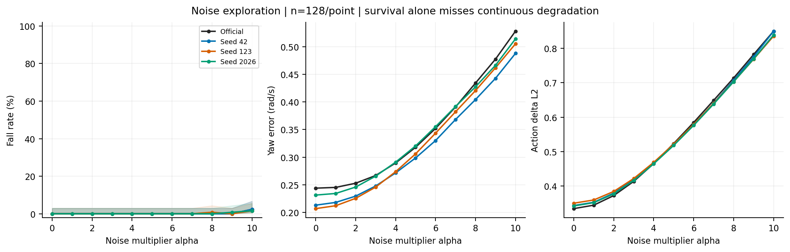
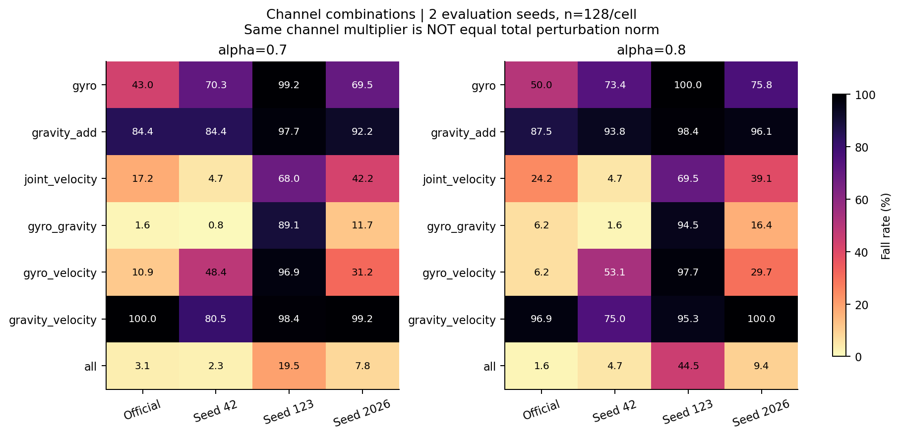
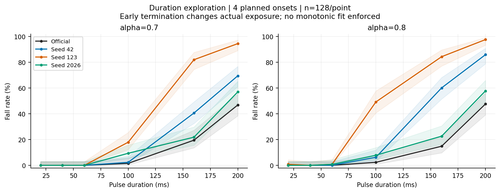
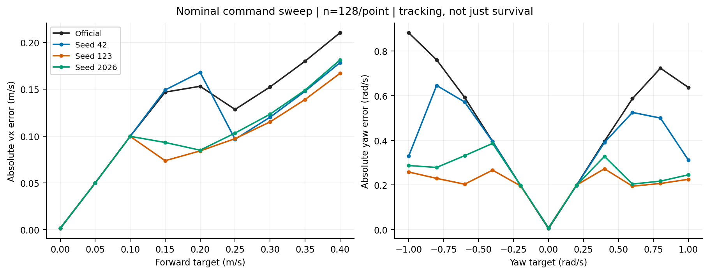
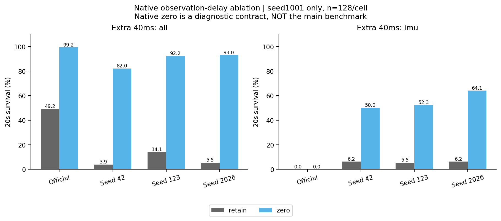
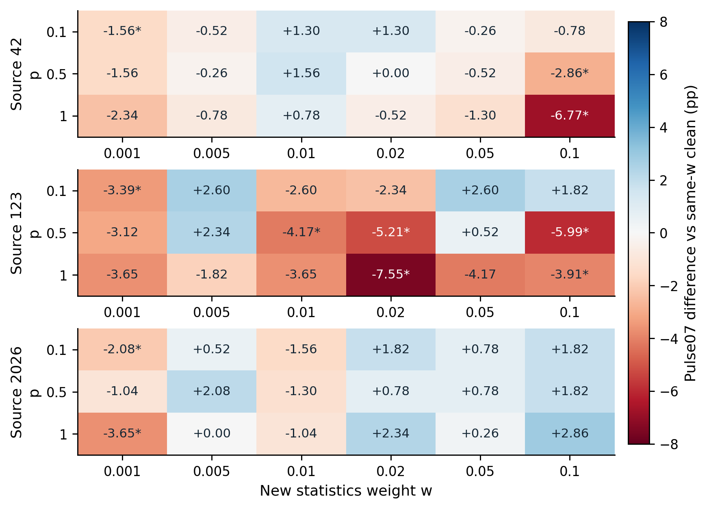

# 07 论文报告与统一视频研究报告

图表与视频已经形成可追溯的解释材料，但它们是已有实验的不同表达，不是额外训练或新增统计样本。

## 工作范围

既有2026-10-13报告7张图、精细基准36张原图、12段正式20秒说明视频；另索引2026-10-15论文3张图。

## 我们如何完成这项工作

12段正式视频为四模型各clean、联合脉冲alpha0.7和0.8，固定Forward、seed91201、同相机640×480、50fps、1000帧。首次终止后填充末帧并显示FALL/TERMINATED，不拼接reset。已有逐段解码和SHA核验记录一并索引。

## 现有结果及解释

1. 7张旧论文图分别整理脉冲确认、时序故障、噪声连续指标、通道组合、持续时间、命令扫描和原生延迟。它们的分母、探索/确认身份应以各图注及REPORT_DATA为准。

2. 新的三张论文图概括T clean尾段恢复、900完整配对网格与失败时序。它们只重新表达已有N/T/900数据，不能和原曲线再累计样本。

3. 一段视频展示一个独立说明回合，不能凭它判断总体概率；20秒观看未跌倒也不能证明任务跟踪准确或实体安全。

## 完整结果表

| 模型 | 视频条件 | 可追溯文件 |
|---|---|---|
| 见manifest | 见manifest | D:\MicroDuckResearch\ti\outputs\microduck_reproduction\fine_response\results\videos\official_alpha_walking_clean_seed91201_v2_20s.mp4 |
| 见manifest | 见manifest | D:\MicroDuckResearch\ti\outputs\microduck_reproduction\fine_response\results\videos\official_alpha_walking_all_alpha_0.700000_seed91201_v2_20s.mp4 |
| 见manifest | 见manifest | D:\MicroDuckResearch\ti\outputs\microduck_reproduction\fine_response\results\videos\official_alpha_walking_all_alpha_0.800000_seed91201_v2_20s.mp4 |
| 见manifest | 见manifest | D:\MicroDuckResearch\ti\outputs\microduck_reproduction\fine_response\results\videos\seed42_iter3999_clean_seed91201_v2_20s.mp4 |
| 见manifest | 见manifest | D:\MicroDuckResearch\ti\outputs\microduck_reproduction\fine_response\results\videos\seed42_iter3999_all_alpha_0.700000_seed91201_v2_20s.mp4 |
| 见manifest | 见manifest | D:\MicroDuckResearch\ti\outputs\microduck_reproduction\fine_response\results\videos\seed42_iter3999_all_alpha_0.800000_seed91201_v2_20s.mp4 |
| 见manifest | 见manifest | D:\MicroDuckResearch\ti\outputs\microduck_reproduction\fine_response\results\videos\seed123_iter3999_clean_seed91201_v2_20s.mp4 |
| 见manifest | 见manifest | D:\MicroDuckResearch\ti\outputs\microduck_reproduction\fine_response\results\videos\seed123_iter3999_all_alpha_0.700000_seed91201_v2_20s.mp4 |
| 见manifest | 见manifest | D:\MicroDuckResearch\ti\outputs\microduck_reproduction\fine_response\results\videos\seed123_iter3999_all_alpha_0.800000_seed91201_v2_20s.mp4 |
| 见manifest | 见manifest | D:\MicroDuckResearch\ti\outputs\microduck_reproduction\fine_response\results\videos\seed2026_iter3999_clean_seed91201_v2_20s.mp4 |
| 见manifest | 见manifest | D:\MicroDuckResearch\ti\outputs\microduck_reproduction\fine_response\results\videos\seed2026_iter3999_all_alpha_0.700000_seed91201_v2_20s.mp4 |
| 见manifest | 见manifest | D:\MicroDuckResearch\ti\outputs\microduck_reproduction\fine_response\results\videos\seed2026_iter3999_all_alpha_0.800000_seed91201_v2_20s.mp4 |

## 图表及读图注释

> 读图注释：“原图36张”是精细基准图文件数，不等于36种独立实验。总图册同时保留各图原路径和文件哈希，字节相同的图只复制一份。

> 读图注释：图上的误差条必须按来源说明：Wilson、回合bootstrap、评估seed范围含义不同，不能统一称为95%训练总体置信区间。

> 英文坐标速查：survival=规定时长存活；duration/seconds=首回合有效寿命；vx=前向速度；XY=平面速度；yaw=绕竖直轴旋转；MSE=动作拟合平方误差；pp=百分点。完整解释见[读图指南](../READING_GUIDE.md)。

### 图1 fig1 pulse confirmation

既有论文选图，同一实验可能也在第5/15/16报告出现；只是不同表达，不增加样本。图中星号/误差条必须按原图解释。

### 图2 fig2 temporal confirmation

既有论文选图，同一实验可能也在第5/15/16报告出现；只是不同表达，不增加样本。图中星号/误差条必须按原图解释。

### 图3 fig3 noise metrics

既有论文选图，同一实验可能也在第5/15/16报告出现；只是不同表达，不增加样本。图中星号/误差条必须按原图解释。

### 图4 fig4 combinations

既有论文选图，同一实验可能也在第5/15/16报告出现；只是不同表达，不增加样本。图中星号/误差条必须按原图解释。

### 图5 fig5 duration

既有论文选图，同一实验可能也在第5/15/16报告出现；只是不同表达，不增加样本。图中星号/误差条必须按原图解释。

### 图6 fig6 commands

既有论文选图，同一实验可能也在第5/15/16报告出现；只是不同表达，不增加样本。图中星号/误差条必须按原图解释。

### 图7 fig7 native delay

既有论文选图，同一实验可能也在第5/15/16报告出现；只是不同表达，不增加样本。图中星号/误差条必须按原图解释。

### 图8 dose grid

既有论文选图，同一实验可能也在第5/15/16报告出现；只是不同表达，不增加样本。图中星号/误差条必须按原图解释。

### 图9 failure timing

既有论文选图，同一实验可能也在第5/15/16报告出现；只是不同表达，不增加样本。图中星号/误差条必须按原图解释。

### 图10 training recovery

既有论文选图，同一实验可能也在第5/15/16报告出现；只是不同表达，不增加样本。图中星号/误差条必须按原图解释。

## 限制与不能支持的结论

本次只核对已有视频文件与manifest中的SHA，不重新录制；逐段完整解码结论来自既有解码核验记录。未覆盖所有条件每个回合的完整机械遥测。

## 证据入口与复核范围

输入清单与SHA：[input_manifest.json](../data/input_manifest.json)。本轮计数/均值复算：[AUDIT.json](../data/AUDIT.json)。

## 这项工作的价值

价值是把数字、协议与可见行为连接起来，让导师或复核者发现任务语义、reset拼接和失效阶段等纯均值表格难以暴露的问题。可视化是证据解释工具，而非新增实验成果。
