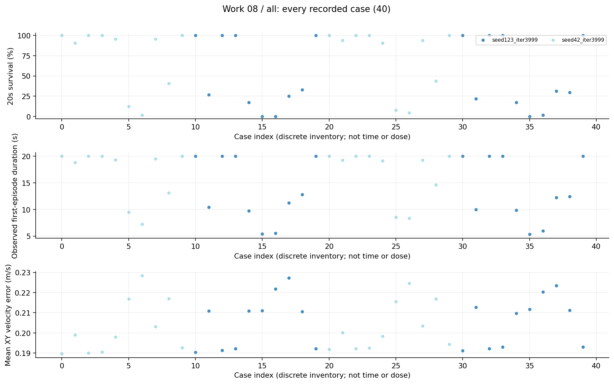
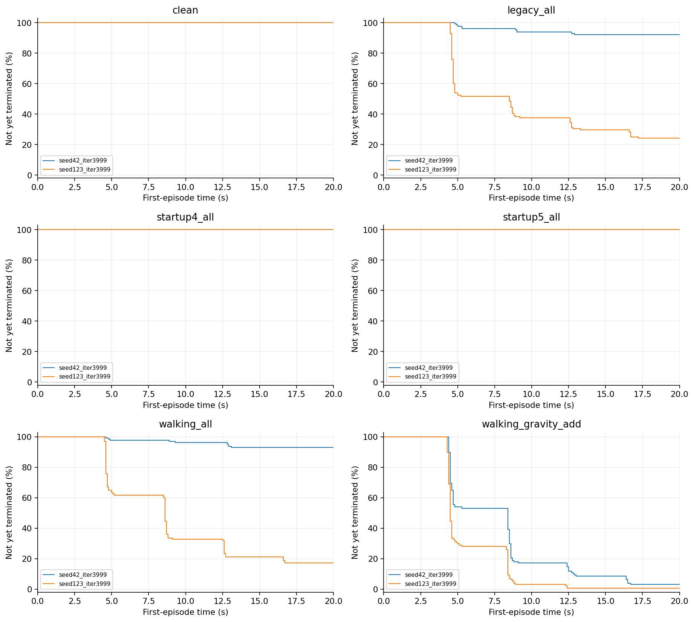
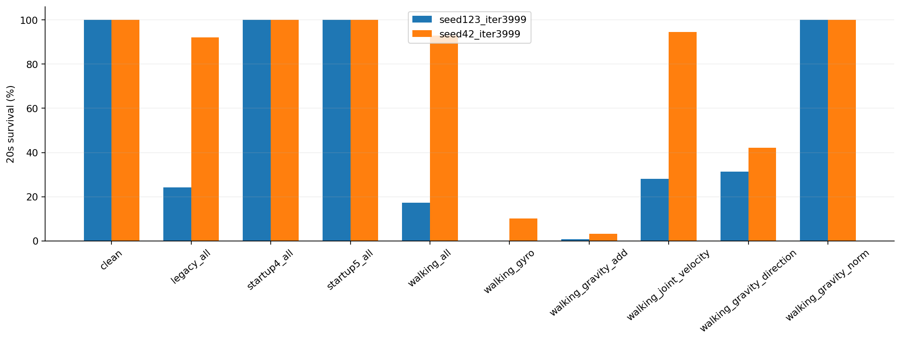
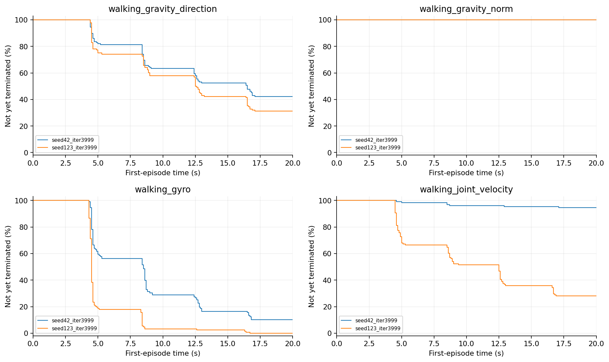

# 08 脉冲机制拆分研究报告

去掉启动注入后123仍明显失败，启动异常不足以单独解释弱点；角速度和重力加性单通道对42也很危险。联合响应存在非加性交互线索，不能直接推出唯一机制。

## 工作范围

2模型×10条件×2评估seed×64首回合，40项、2560回合；本轮完成独立逐回合复算。

## 我们如何完成这项工作

评估seed41041、52052。比较clean、legacy_all、startup4/5、walking_all、walking_gyro、walking_gravity_add、walking_joint_velocity、walking_gravity_direction和walking_gravity_norm。模型与幅度保持原样，只分析现有CSV。

## 现有结果及解释

1. 每格合计128首回合：walking_all下42存活119、123存活22；walking_gyro下13和0；walking_gravity_add下4和1；walking_joint_velocity下121和36。

2. startup4和startup5均128/128；仅方向变化为54/128和40/128；仅模长变化两模型都128/128。这支持优先检查方向因素，但不足以证明模长永远无害或单位化可解决问题。

3. 本轮重新核对40份CSV的SHA、唯一首回合、存活/跌倒/NaN/出界，以及寿命、速度误差、动作与扰动等已记录聚合。最大残差约1.19×10^-5，来自回报浮点汇总；没有排除失败回合。

## 完整结果表

| 模型或分支 | 条件 | 阶段 | 存活分子/分母 | 存活率 | 平均寿命s | vx误差m/s | XY误差m/s |
|---|---|---|---|---|---|---|---|
| seed42_iter3999 | clean |  | 128/128 | 100.00% | 20.0000 | 未记录 | 0.1908 |
| seed42_iter3999 | legacy_all |  | 118/128 | 92.19% | 19.0428 | 未记录 | 0.1995 |
| seed42_iter3999 | startup4_all |  | 128/128 | 100.00% | 20.0000 | 未记录 | 0.1911 |
| seed42_iter3999 | startup5_all |  | 128/128 | 100.00% | 20.0000 | 未记录 | 0.1915 |
| seed42_iter3999 | walking_all |  | 119/128 | 92.97% | 19.2492 | 未记录 | 0.1981 |
| seed42_iter3999 | walking_gyro |  | 13/128 | 10.16% | 9.0111 | 未记录 | 0.2162 |
| seed42_iter3999 | walking_gravity_add |  | 4/128 | 3.12% | 7.7614 | 未记录 | 0.2265 |
| seed42_iter3999 | walking_joint_velocity |  | 121/128 | 94.53% | 19.4134 | 未记录 | 0.2032 |
| seed42_iter3999 | walking_gravity_direction |  | 54/128 | 42.19% | 13.8766 | 未记录 | 0.2169 |
| seed42_iter3999 | walking_gravity_norm |  | 128/128 | 100.00% | 20.0000 | 未记录 | 0.1935 |
| seed123_iter3999 | clean |  | 128/128 | 100.00% | 20.0000 | 未记录 | 0.1908 |
| seed123_iter3999 | legacy_all |  | 31/128 | 24.22% | 10.1991 | 未记录 | 0.2118 |
| seed123_iter3999 | startup4_all |  | 128/128 | 100.00% | 20.0000 | 未记录 | 0.1918 |
| seed123_iter3999 | startup5_all |  | 128/128 | 100.00% | 20.0000 | 未记录 | 0.1925 |
| seed123_iter3999 | walking_all |  | 22/128 | 17.19% | 9.8172 | 未记录 | 0.2103 |
| seed123_iter3999 | walking_gyro |  | 0/128 | 0.00% | 5.3723 | 未记录 | 0.2114 |
| seed123_iter3999 | walking_gravity_add |  | 1/128 | 0.78% | 5.7406 | 未记录 | 0.2211 |
| seed123_iter3999 | walking_joint_velocity |  | 36/128 | 28.12% | 11.7519 | 未记录 | 0.2253 |
| seed123_iter3999 | walking_gravity_direction |  | 40/128 | 31.25% | 12.6166 | 未记录 | 0.2108 |
| seed123_iter3999 | walking_gravity_norm |  | 128/128 | 100.00% | 20.0000 | 未记录 | 0.1925 |

## 图表及读图注释

> 读图注释：方向分支将受扰重力方向归一后乘回原模长；模长分支维持原方向仅换模长。它们是观测空间对照，不等同物理安装旋转。

> 读图注释：两评估seed已经用于旧确认，不是完全未用过的holdout；单通道和联合故障的输入能量与早停暴露不同。

> 英文坐标速查：survival=规定时长存活；duration/seconds=首回合有效寿命；vx=前向速度；XY=平面速度；yaw=绕竖直轴旋转；MSE=动作拟合平方误差；pp=百分点。完整解释见[读图指南](../READING_GUIDE.md)。

### 图1 全部任务点 all

每个点是一项真实任务；横轴仅是文件记录顺序，不是连续变量，故不连线。点保留评估seed差异。条件、模型和分母可在全数据浏览器按编号查询；早停时误差只覆盖终止前。

### 图2 逐故障首回合存续曲线 第1组

每个面板严格保持同一故障条件，未混合clean、启动和行走故障。纵轴为尚未终止的首回合比例，20秒超时保留在终点；0.1秒显示网格。合并的是同模型同条件评估seed，不是独立训练重复。

### 图3 脉冲机制十条件完整对照

十个真实条件分别展示，每柱两评估seed合计128首回合。条件是类别，不连成剂量曲线；输入能量和早停暴露不同，不作单一因果解释。

### 图4 逐故障首回合存续曲线 第2组

每个面板严格保持同一故障条件，未混合clean、启动和行走故障。纵轴为尚未终止的首回合比例，20秒超时保留在终点；0.1秒显示网格。合并的是同模型同条件评估seed，不是独立训练重复。

## 限制与不能支持的结论

新增的是独立离线复算，不是新实验。动作代理是原始网络输出，pre-step倾角可能漏掉终止物理帧。未新增预算匹配或真实传感器实验，不作统计显著性及硬件安全主张。

## 证据入口与复核范围

输入清单与SHA：[input_manifest.json](../data/input_manifest.json)。本轮计数/均值复算：[AUDIT.json](../data/AUDIT.json)。

- D:\MicroDuckResearch\ti\outputs\microduck_reproduction\sensor_fault_benchmark\pulse_mechanism\results.json　SHA256 252581fdd95a6064403b2618ade96a07fe9497818df63462298b95942bc0d001

## 这项工作的价值

价值是排除“全由启动异常造成”的单一叙事，揭示单通道与组合排名不能互推，并把此前只核对运行器汇总的pilot提升为可追到逐回合数据的描述性证据。
