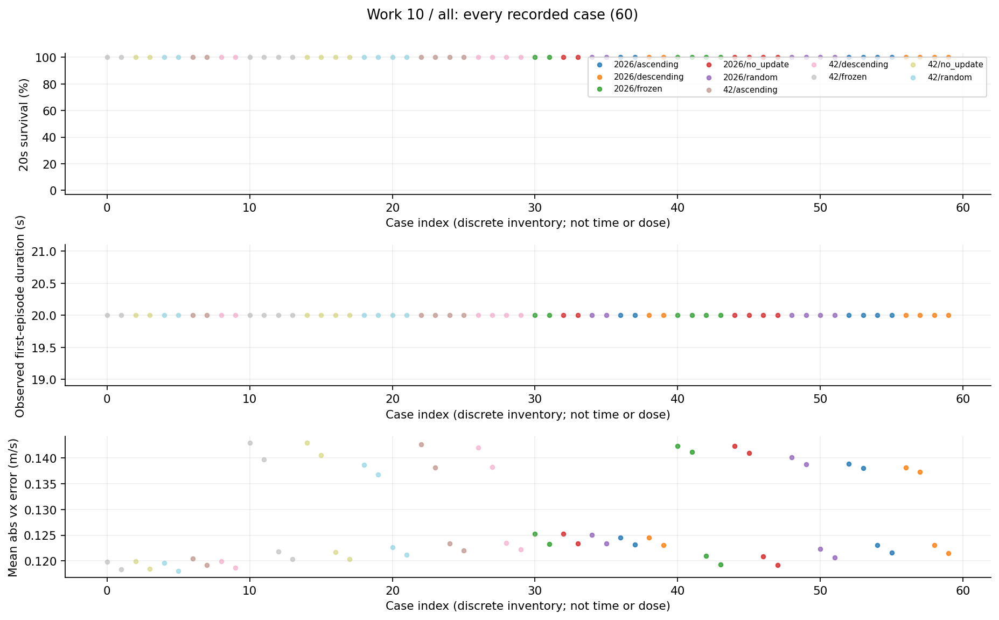
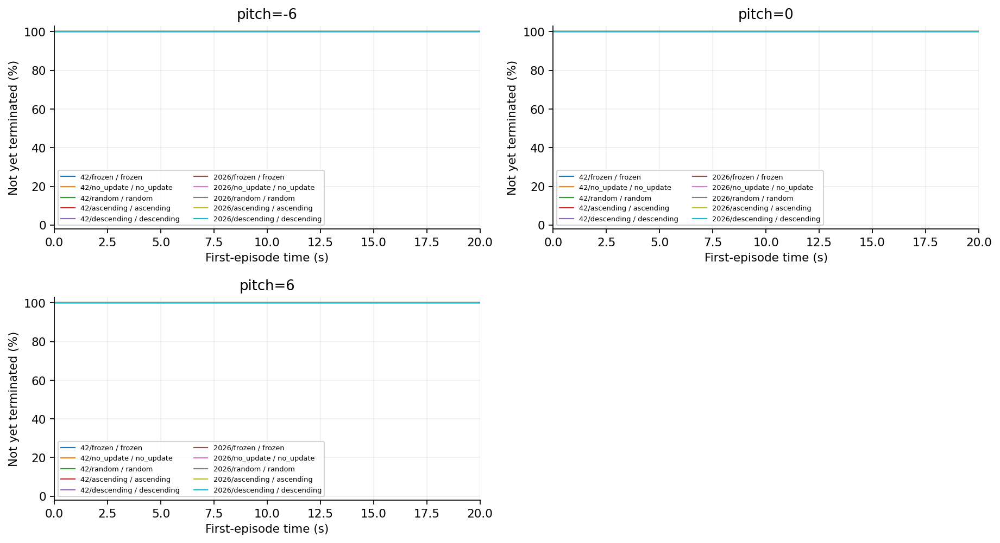
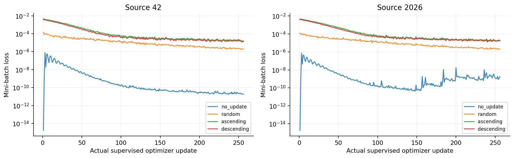
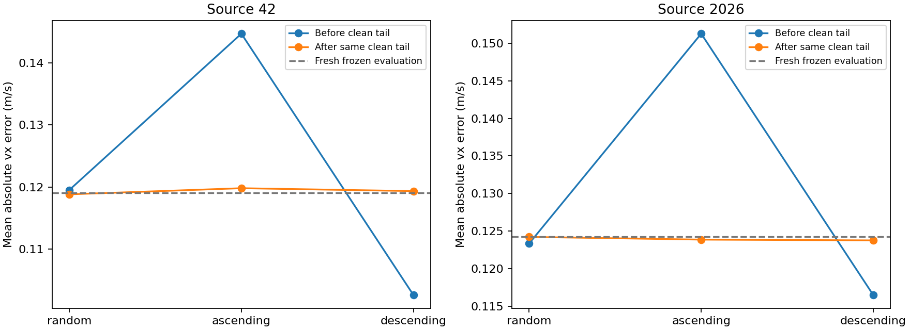
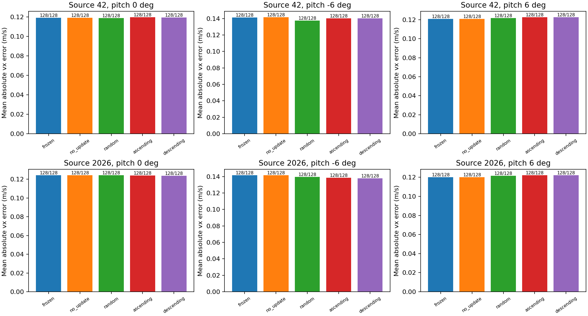

# 10 同末尾clean恢复研究报告

统一clean尾段后，原顺序分支的正常跟踪差异大幅收缩，全部已测条件存活。这是对“顺序造成强持久破坏”的直接反证。

## 工作范围

八个上一阶段parent各256次同clean监督尾段并重置Adam，另两个frozen；60项、3840首回合。

## 我们如何完成这项工作

所有更新分支使用同clean样本日程、fresh Adam和冻结原normalizer；frozen不更新。评估包含正常与±6°条件。阶段一叫no_update的parent在本阶段也接受clean更新，不应继续解释为零更新对照。

## 现有结果及解释

1. 所有60项、3840首回合存活。42的三种顺序正常vx误差范围从0.042122降至0.000986m/s；2026从0.034796降至0.000462m/s。

2. 42恢复后的random/ascending/descending约0.118836/0.119822/0.119357m/s；2026约0.124227/0.123867/0.123764m/s。相对前阶段的明显分散，终点更加接近。

3. 这不要求把残余非零差异解释为后门：有限优化、末批数据、采样分布和仿真重复性都仍可能参与。

## 完整结果表

| 模型或分支 | 条件 | 阶段 | 存活分子/分母 | 存活率 | 平均寿命s | vx误差m/s | XY误差m/s |
|---|---|---|---|---|---|---|---|
| 42/frozen | pitch=0 |  | 128/128 | 100.00% | 20.0000 | 0.1191 | 未记录 |
| 42/no_update | pitch=0 |  | 128/128 | 100.00% | 20.0000 | 0.1192 | 未记录 |
| 42/random | pitch=0 |  | 128/128 | 100.00% | 20.0000 | 0.1188 | 未记录 |
| 42/ascending | pitch=0 |  | 128/128 | 100.00% | 20.0000 | 0.1198 | 未记录 |
| 42/descending | pitch=0 |  | 128/128 | 100.00% | 20.0000 | 0.1194 | 未记录 |
| 42/frozen | pitch=-6 |  | 128/128 | 100.00% | 20.0000 | 0.1413 | 未记录 |
| 42/frozen | pitch=6 |  | 128/128 | 100.00% | 20.0000 | 0.1211 | 未记录 |
| 42/no_update | pitch=-6 |  | 128/128 | 100.00% | 20.0000 | 0.1417 | 未记录 |
| 42/no_update | pitch=6 |  | 128/128 | 100.00% | 20.0000 | 0.1211 | 未记录 |
| 42/random | pitch=-6 |  | 128/128 | 100.00% | 20.0000 | 0.1376 | 未记录 |
| 42/random | pitch=6 |  | 128/128 | 100.00% | 20.0000 | 0.1219 | 未记录 |
| 42/ascending | pitch=-6 |  | 128/128 | 100.00% | 20.0000 | 0.1404 | 未记录 |
| 42/ascending | pitch=6 |  | 128/128 | 100.00% | 20.0000 | 0.1227 | 未记录 |
| 42/descending | pitch=-6 |  | 128/128 | 100.00% | 20.0000 | 0.1401 | 未记录 |
| 42/descending | pitch=6 |  | 128/128 | 100.00% | 20.0000 | 0.1228 | 未记录 |
| 2026/frozen | pitch=0 |  | 128/128 | 100.00% | 20.0000 | 0.1243 | 未记录 |
| 2026/no_update | pitch=0 |  | 128/128 | 100.00% | 20.0000 | 0.1243 | 未记录 |
| 2026/random | pitch=0 |  | 128/128 | 100.00% | 20.0000 | 0.1242 | 未记录 |
| 2026/ascending | pitch=0 |  | 128/128 | 100.00% | 20.0000 | 0.1239 | 未记录 |
| 2026/descending | pitch=0 |  | 128/128 | 100.00% | 20.0000 | 0.1238 | 未记录 |
| 2026/frozen | pitch=-6 |  | 128/128 | 100.00% | 20.0000 | 0.1417 | 未记录 |
| 2026/frozen | pitch=6 |  | 128/128 | 100.00% | 20.0000 | 0.1201 | 未记录 |
| 2026/no_update | pitch=-6 |  | 128/128 | 100.00% | 20.0000 | 0.1416 | 未记录 |
| 2026/no_update | pitch=6 |  | 128/128 | 100.00% | 20.0000 | 0.1201 | 未记录 |
| 2026/random | pitch=-6 |  | 128/128 | 100.00% | 20.0000 | 0.1394 | 未记录 |
| 2026/random | pitch=6 |  | 128/128 | 100.00% | 20.0000 | 0.1215 | 未记录 |
| 2026/ascending | pitch=-6 |  | 128/128 | 100.00% | 20.0000 | 0.1384 | 未记录 |
| 2026/ascending | pitch=6 |  | 128/128 | 100.00% | 20.0000 | 0.1223 | 未记录 |
| 2026/descending | pitch=-6 |  | 128/128 | 100.00% | 20.0000 | 0.1377 | 未记录 |
| 2026/descending | pitch=6 |  | 128/128 | 100.00% | 20.0000 | 0.1223 | 未记录 |

## 图表及读图注释

> 读图注释：前后两点连线只表示两个实际终点，不是中间每一步都有闭环评估。完整训练loss和已有离线恢复图另列。

> 读图注释：误差范围是分支间max减min，不是标准差或置信区间；数值小也不等于经过预注册的行为等价检验。

> 英文坐标速查：survival=规定时长存活；duration/seconds=首回合有效寿命；vx=前向速度；XY=平面速度；yaw=绕竖直轴旋转；MSE=动作拟合平方误差；pp=百分点。完整解释见[读图指南](../READING_GUIDE.md)。

### 图1 全部任务点 all

每个点是一项真实任务；横轴仅是文件记录顺序，不是连续变量，故不连线。点保留评估seed差异。条件、模型和分母可在全数据浏览器按编号查询；早停时误差只覆盖终止前。

### 图2 首回合存续曲线 第1组

横轴为首回合仿真秒，纵轴为尚未因任何原因终止的比例；20秒超时保留在终点，不画成死亡。由已保存终止时间重算，在0.1秒网格显示；不是完整姿态轨迹，也不把跨评估seed回合当独立训练。相同曲线可能重合。

### 图3 监督更新过程的原始小批次loss

每条线为真实记录的监督更新，不是PPO回报。排序会改变每批样本难度，loss不可直接当全数据收敛或闭环安全。无更新分支没有loss，不补零。

### 图4 nominal pre post

保留原实验图，不改变其样本、区间或协议定义。原图英文标注见本报告名词注释；探索、确认与历史快照不可混合累计。

### 图5 recovery tracking

保留原实验图，不改变其样本、区间或协议定义。原图英文标注见本报告名词注释；探索、确认与历史快照不可混合累计。

## 限制与不能支持的结论

clean数据和Adam重置同时标准化，不能分离两者各自的恢复贡献。两评估seed不等于大量独立策略。它仍是监督对照，不是原生PPO。

## 证据入口与复核范围

输入清单与SHA：[input_manifest.json](../data/input_manifest.json)。本轮计数/均值复算：[AUDIT.json](../data/AUDIT.json)。

- D:\MicroDuckResearch\ti\outputs\microduck_reproduction\mechanism_audit\full_width_clean_recovery\results.json　SHA256 3cb3ca17f9f7c6a5df3bd0982cd3b6cb180f80a5e831b56327281d13acddd0a1

## 这项工作的价值

价值是让负结果约束研究叙事：顺序效应在有限clean恢复下可以显著消退，因而不能仅凭第一阶段差异声称持久污染。它帮助停止缺乏支持的方向。
