# 11 小型BC 归一化与replay研究报告

离线MSE可以揭示优化路径、归一化与数据覆盖的作用，但当前小BC学生无法稳定完成无故障闭环。离线replay收益不能作为机器人防御有效的证据。

## 工作范围

小型BC顺序筛查、288条件归一化确认、后续终点对照、72fork/216分支replay与8项512回合无故障闭环检查。

## 我们如何完成这项工作

小BC采用61→128→64→14学生及teacher动作标签；归一化确认覆盖两个teacher、采集与初始化、两学习率、顺序及多个恢复时点。replay从同一真实权重与Adam终点分叉为no_update、clean_only、replay50，冻结归一化，在新采集上看clean及±6°MSE。

## 现有结果及解释

1. 早期候选最坏MSE增幅6.32%/8.5%，未达到预声明10%筛查门槛。探索性单调分支的大幅MSE变化不等于跌倒率。

2. 归一化确认288条件、5184个MSE值有限。后续162条件含108计划和54探索，不能全部称为前瞻确认。图册保留阶段身份及所有原图，不把它们混成同一试验。

3. replay在四个teacher/LR块的离线最坏MSE相对clean平均改善约32.3%—52.8%，clean MSE代价约1%—2.1%；原分析先求每fork比值再平均，不能用总均值比替换。

4. 闭环探索中两个teacher各64/64存活；no_update和replay学生各0/64。clean_only分别26/64及1/64。学生正常质量不成立，因此停止扩故障，不把学生自己走不稳解释为投毒效果。

## 完整结果表

| 模型或分支 | 条件 | 阶段 | 存活分子/分母 | 存活率 | 平均寿命s | vx误差m/s | XY误差m/s |
|---|---|---|---|---|---|---|---|
| 42/teacher | Forward |  | 64/64 | 100.00% | 20.0000 | 0.1198 | 未记录 |
| 42/no_update | Forward |  | 0/64 | 0.00% | 1.5659 | 0.2159 | 未记录 |
| 42/clean_only | Forward |  | 26/64 | 40.62% | 9.0597 | 0.1867 | 未记录 |
| 42/replay50 | Forward |  | 0/64 | 0.00% | 1.8069 | 0.1948 | 未记录 |
| 2026/teacher | Forward |  | 64/64 | 100.00% | 20.0000 | 0.1251 | 未记录 |
| 2026/no_update | Forward |  | 0/64 | 0.00% | 1.0828 | 0.2557 | 未记录 |
| 2026/clean_only | Forward |  | 1/64 | 1.56% | 1.5319 | 0.2576 | 未记录 |
| 2026/replay50 | Forward |  | 0/64 | 0.00% | 1.1216 | 0.2153 | 未记录 |

## 图表及读图注释

> 读图注释：MSE是学生动作与teacher动作的平方误差，不是闭环回报、跌倒概率或实体安全。小误差可能因多步分布偏移而累积。

> 读图注释：replay减少clean暴露并保留增强视图，不能唯一归因为“修复归一化污染”。本轮只是离线重绘，旧CPU插值worker仍暂停。

> 英文坐标速查：survival=规定时长存活；duration/seconds=首回合有效寿命；vx=前向速度；XY=平面速度；yaw=绕竖直轴旋转；MSE=动作拟合平方误差；pp=百分点。完整解释见[读图指南](../READING_GUIDE.md)。

### 图1 全部任务点 all

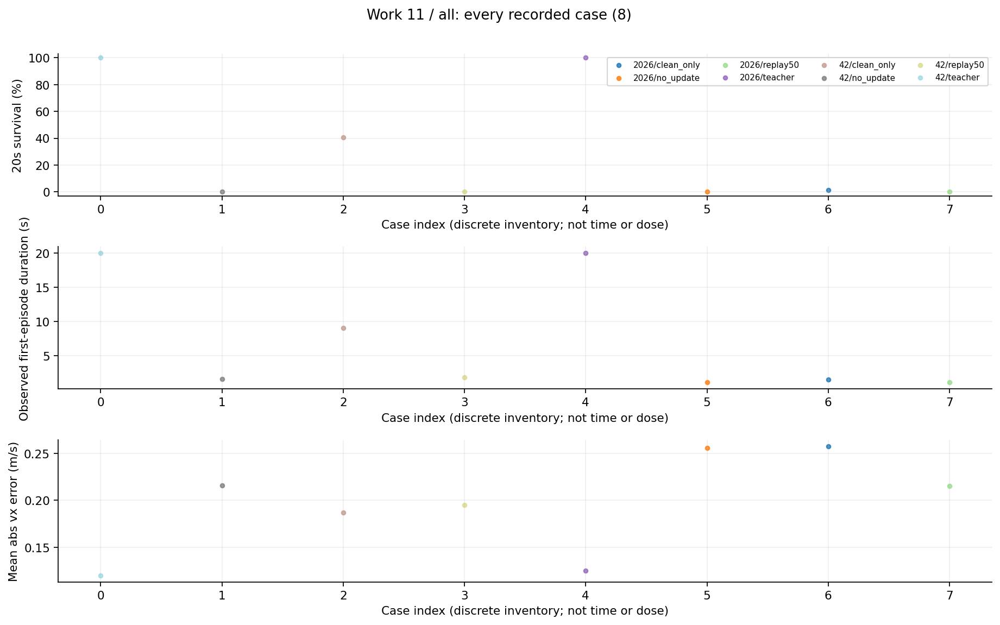

每个点是一项真实任务；横轴仅是文件记录顺序，不是连续变量，故不连线。点保留评估seed差异。条件、模型和分母可在全数据浏览器按编号查询；早停时误差只覆盖终止前。

### 图2 逐故障首回合存续曲线 第1组

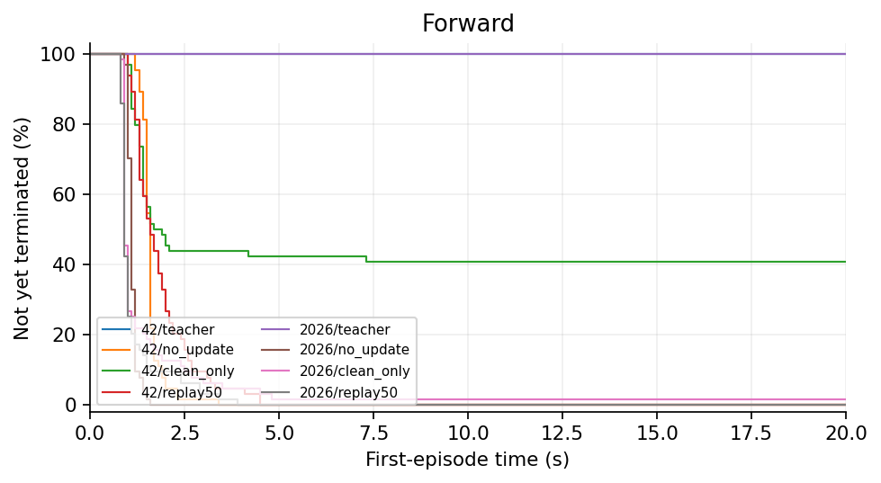

每个面板严格保持同一故障条件，未混合clean、启动和行走故障。纵轴为尚未终止的首回合比例，20秒超时保留在终点；0.1秒显示网格。合并的是同模型同条件评估seed，不是独立训练重复。

### 图3 离线机制的全部条件与测量时点 normalization 第1组

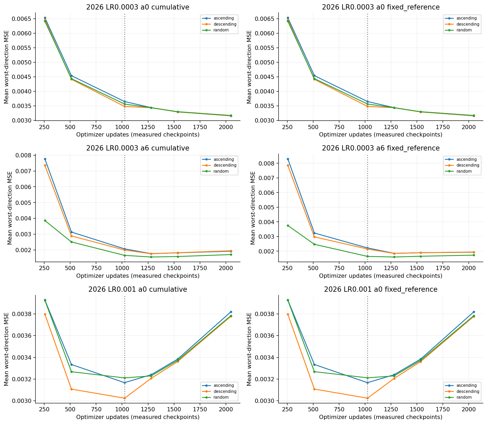

纵轴为学生拟合teacher动作的MSE，越低只表示离线拟合更接近。按标题所列设计单元对学生/采集重复取均值，未把它们称独立PPO模型。实测离散时点间连线，不代表中间均有测量。

### 图4 离线机制的全部条件与测量时点 normalization 第2组

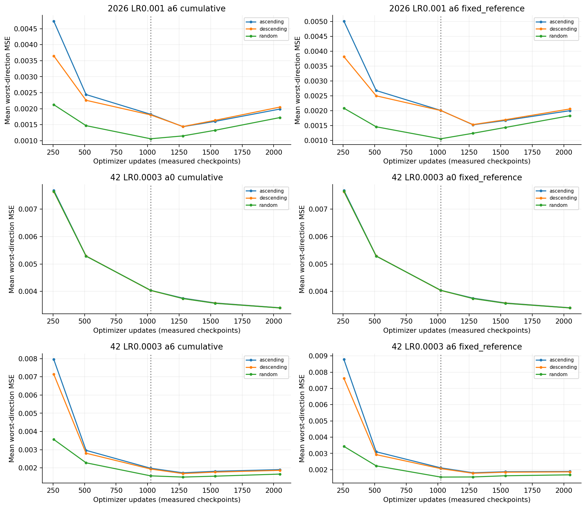

纵轴为学生拟合teacher动作的MSE，越低只表示离线拟合更接近。按标题所列设计单元对学生/采集重复取均值，未把它们称独立PPO模型。实测离散时点间连线，不代表中间均有测量。

### 图5 离线机制的全部条件与测量时点 normalization 第3组

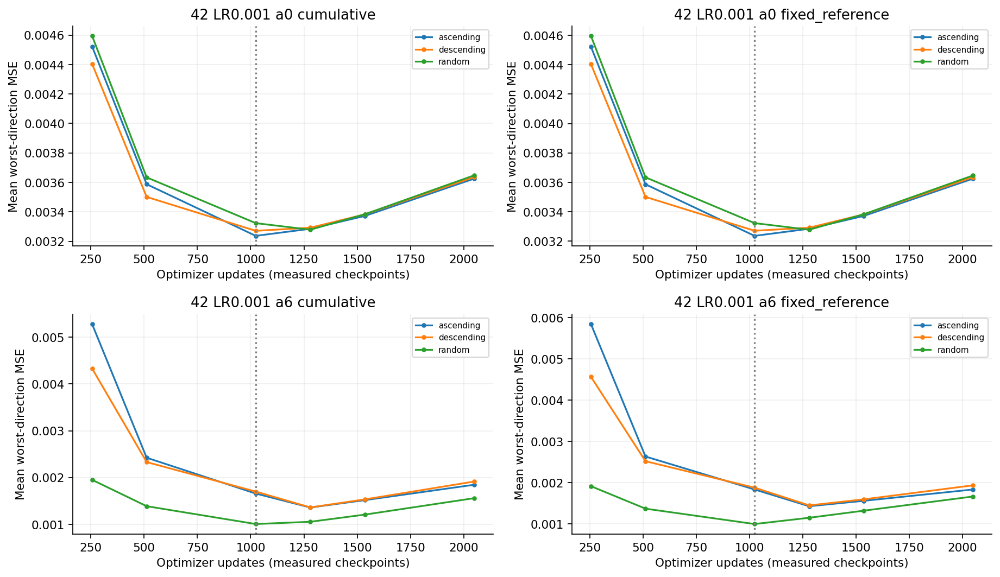

纵轴为学生拟合teacher动作的MSE，越低只表示离线拟合更接近。按标题所列设计单元对学生/采集重复取均值，未把它们称独立PPO模型。实测离散时点间连线，不代表中间均有测量。

### 图6 离线机制的全部条件与测量时点 replay 第1组

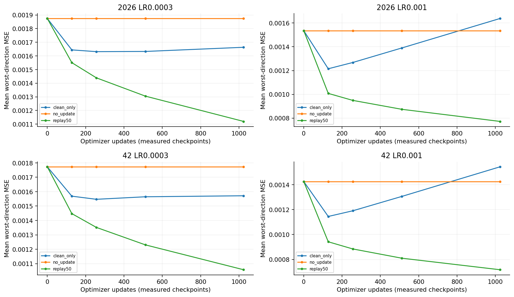

纵轴为学生拟合teacher动作的MSE，越低只表示离线拟合更接近。按标题所列设计单元对学生/采集重复取均值，未把它们称独立PPO模型。实测离散时点间连线，不代表中间均有测量。

### 图7 小BC全部学生的clean尾段前后

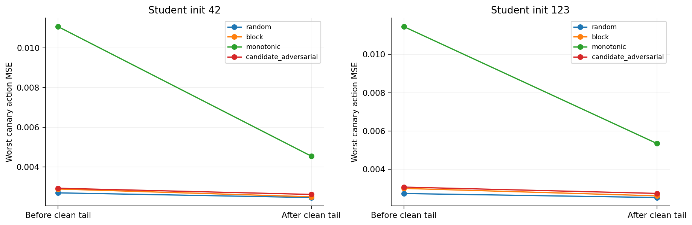

只在两端有测量，中间连线不表示完整学习曲线。学生初始化seed不是PPO来源seed。保留未过门槛的结果，不把MSE换算成跌倒率。

### 图8 bc order effect

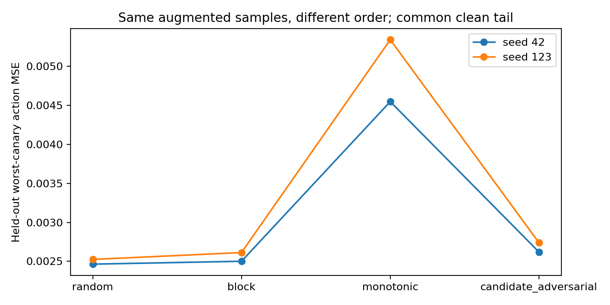

保留原实验图，不改变其样本、区间或协议定义。原图英文标注见本报告名词注释；探索、确认与历史快照不可混合累计。

### 图9 canary combination heatmap

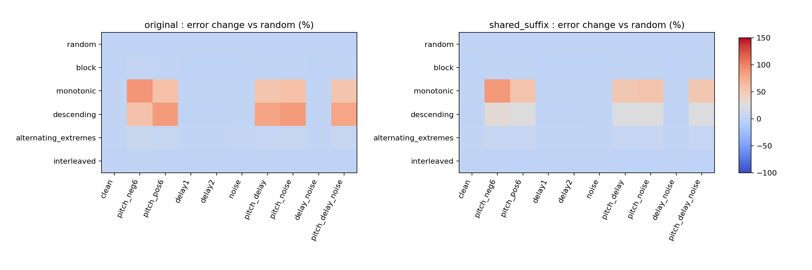

保留原实验图，不改变其样本、区间或协议定义。原图英文标注见本报告名词注释；探索、确认与历史快照不可混合累计。

### 图10 order amplitude controls

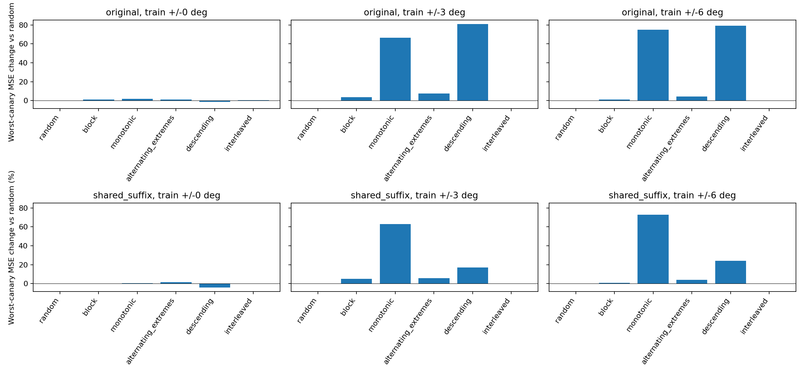

保留原实验图，不改变其样本、区间或协议定义。原图英文标注见本报告名词注释；探索、确认与历史快照不可混合累计。

### 图11 recovery curves

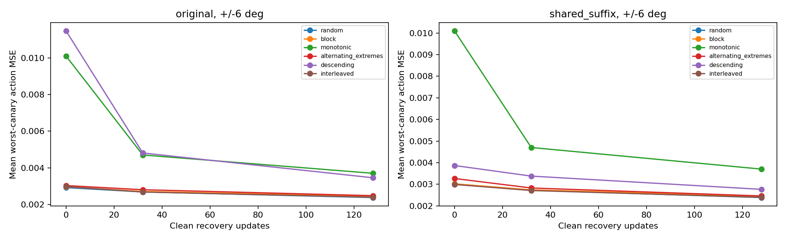

保留原实验图，不改变其样本、区间或协议定义。原图英文标注见本报告名词注释；探索、确认与历史快照不可混合累计。

### 图12 absolute error comparison

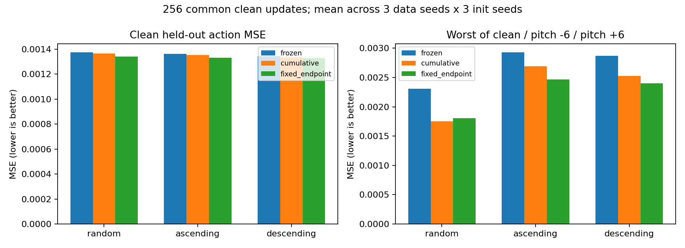

保留原实验图，不改变其样本、区间或协议定义。原图英文标注见本报告名词注释；探索、确认与历史快照不可混合累计。

### 图13 normalization specific contrast

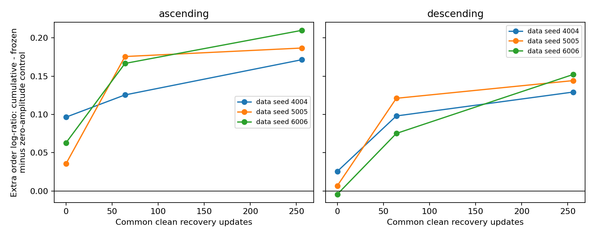

保留原实验图，不改变其样本、区间或协议定义。原图英文标注见本报告名词注释；探索、确认与历史快照不可混合累计。

### 图14 confirmation absolute error

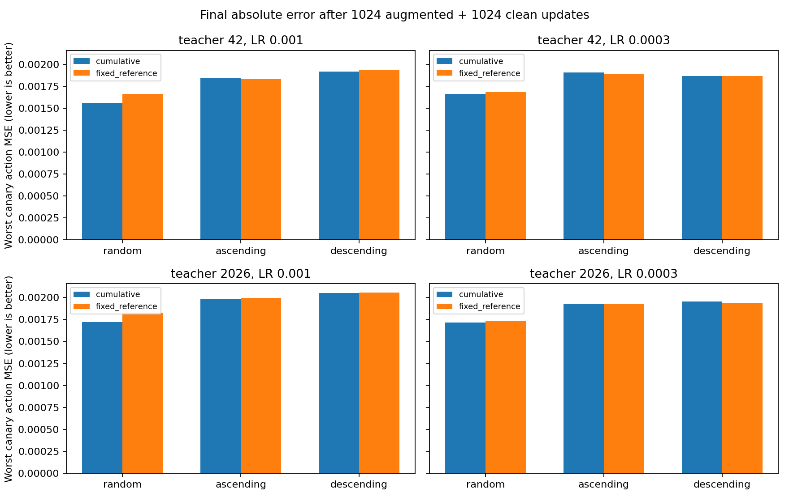

保留原实验图，不改变其样本、区间或协议定义。原图英文标注见本报告名词注释；探索、确认与历史快照不可混合累计。

### 图15 confirmation trajectories

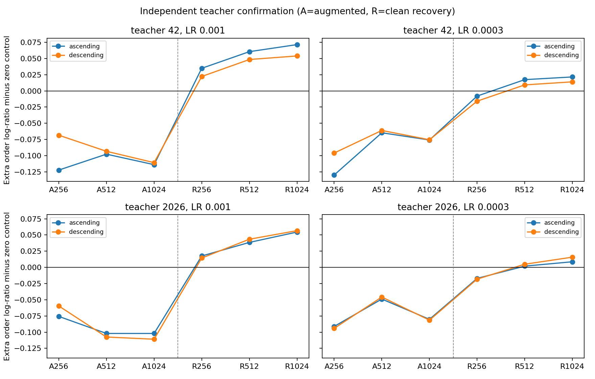

保留原实验图，不改变其样本、区间或协议定义。原图英文标注见本报告名词注释；探索、确认与历史快照不可混合累计。

### 图16 replay tradeoff

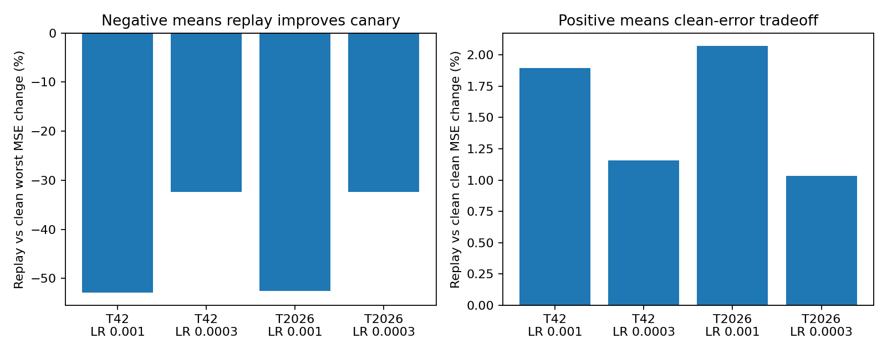

保留原实验图，不改变其样本、区间或协议定义。原图英文标注见本报告名词注释；探索、确认与历史快照不可混合累计。

### 图17 replay vs clean trajectories

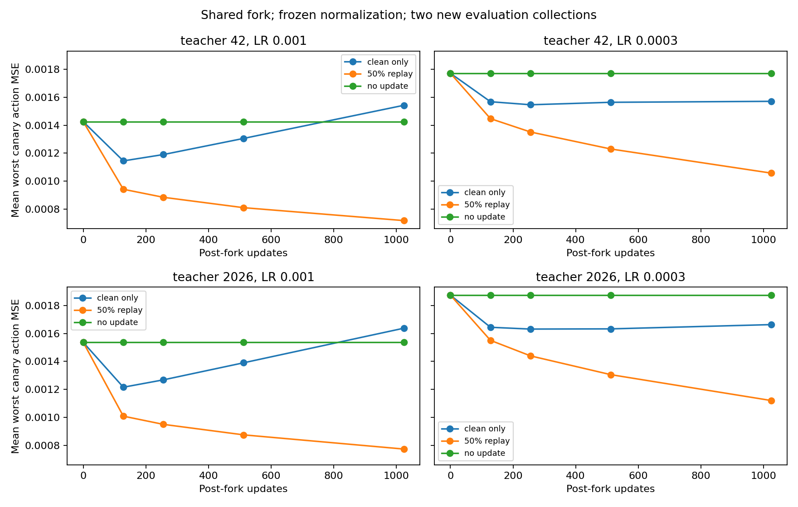

保留原实验图，不改变其样本、区间或协议定义。原图英文标注见本报告名词注释；探索、确认与历史快照不可混合累计。

### 图18 curves

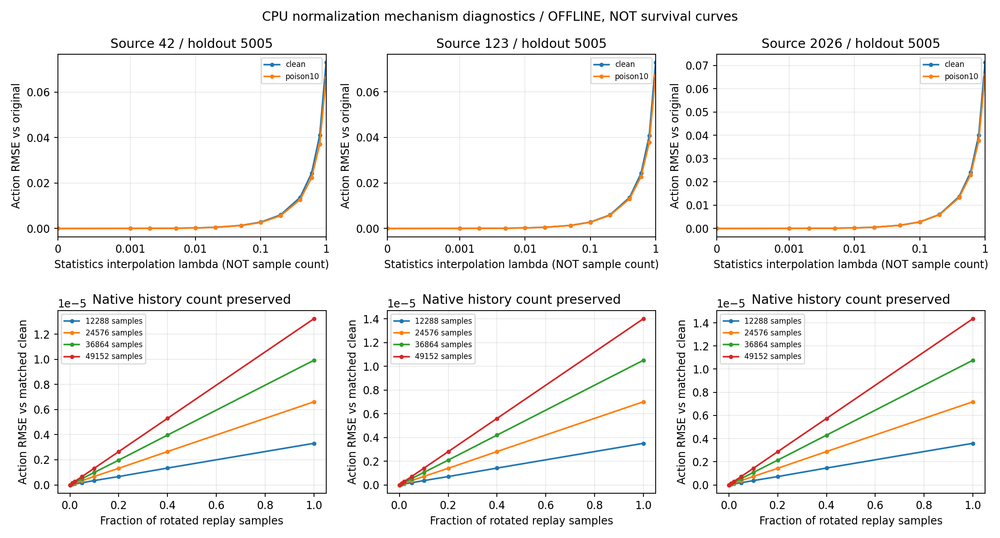

历史CPU部分曲线，旧插值队列仍暂停；未完成的格不补零，不混入正式GPU实验。

### 图19 post update difference

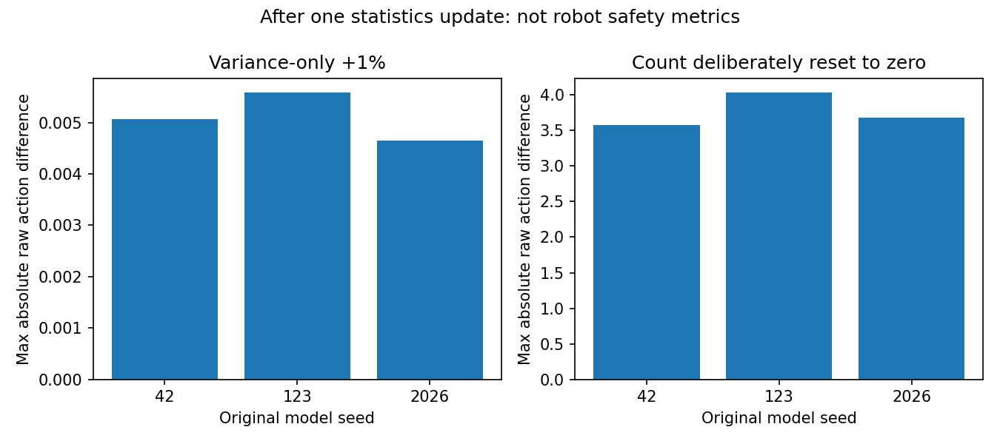

保留原实验图，不改变其样本、区间或协议定义。原图英文标注见本报告名词注释；探索、确认与历史快照不可混合累计。

### 图20 ordertrap gate1 paired effects

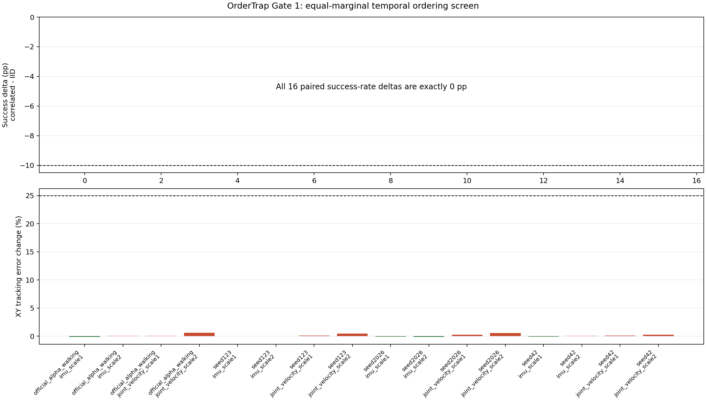

历史补充图，保留用于追溯。本图的队列、幅度、分母或目的不同于本报告主表，不合并计数，不当成新增实验或最终主协议结论。

## 限制与不能支持的结论

teacher采样片段覆盖有限；学生容量和闭环分布与PPO原模型不同。两个teacher和许多学生/fork不构成数百次独立PPO训练。没有新增学生训练或恢复暂停队列。

## 证据入口与复核范围

输入清单与SHA：[input_manifest.json](../data/input_manifest.json)。本轮计数/均值复算：[AUDIT.json](../data/AUDIT.json)。

- D:\MicroDuckResearch\ti\outputs\microduck_reproduction\mechanism_audit\replay_fork_pilot\closed_loop_smoke.json　SHA256 a4cd55e09f1c738c046617817cc8cb005bc73772e3d6d5ce43142ff5bd644a50

## 这项工作的价值

价值在于以廉价机制筛查减少昂贵PPO试错，并用无故障闭环检查及时否定“离线漂亮即可部署”的推断。它提供优化和覆盖的解释线索，不是新防御方法成立。
