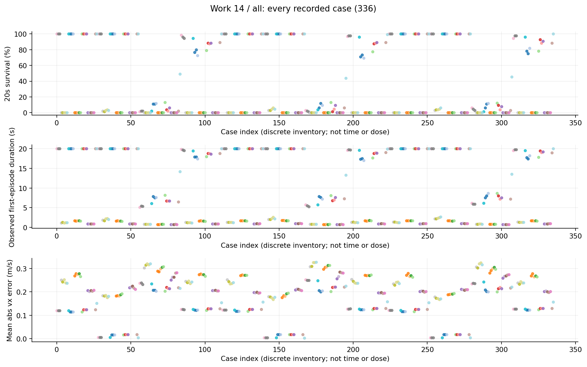
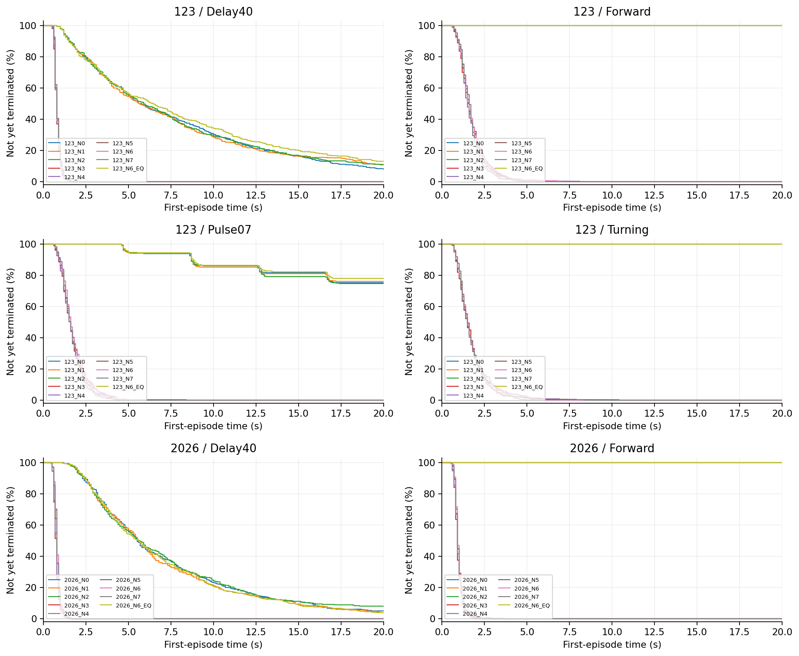
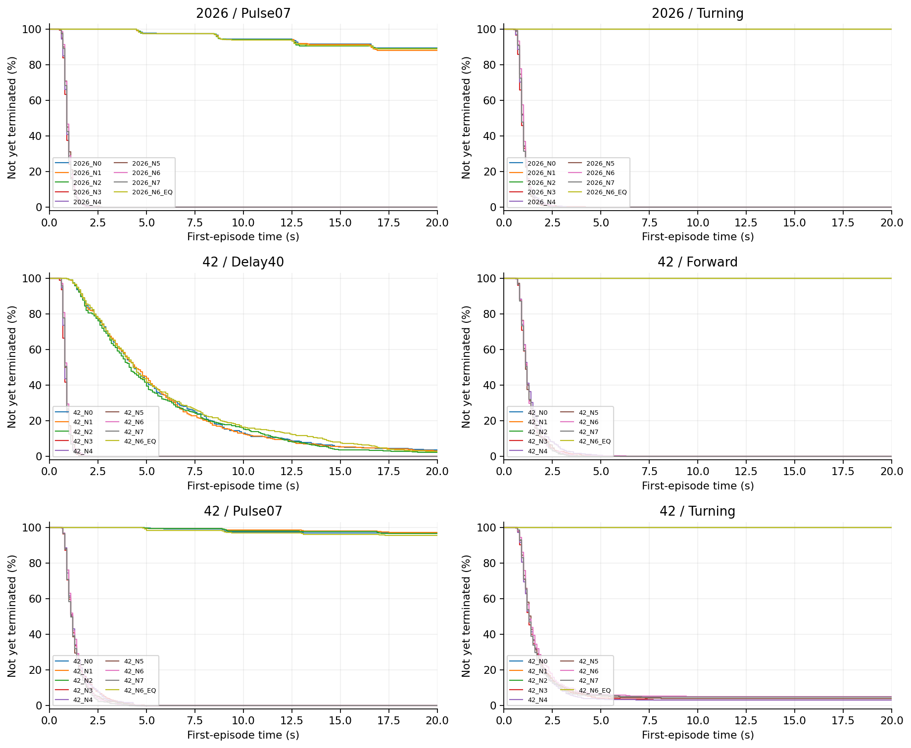
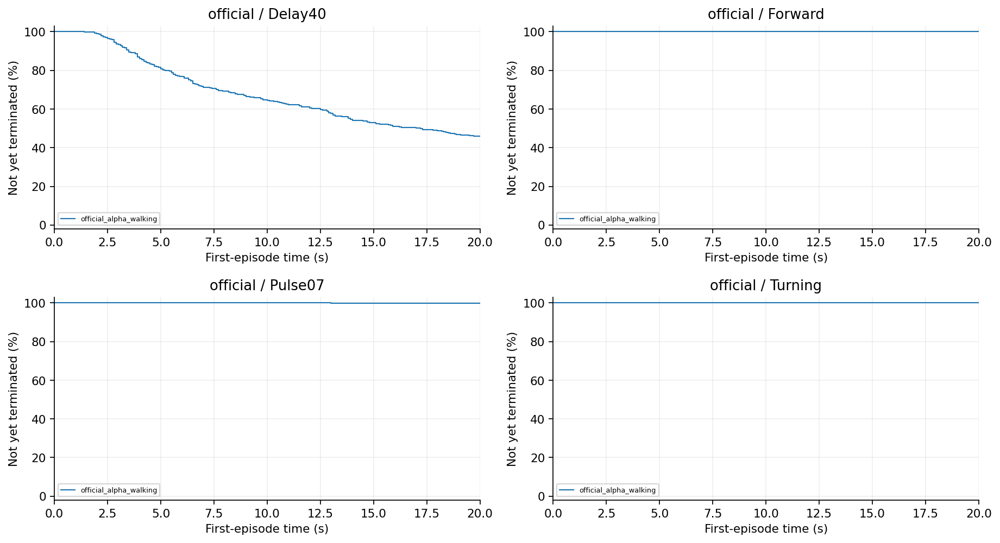
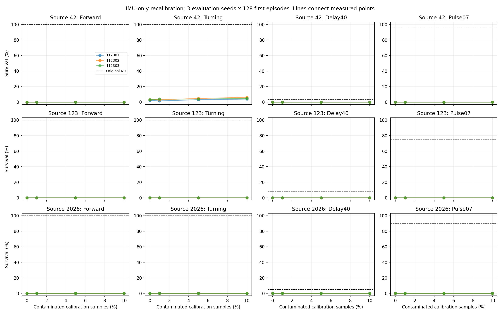
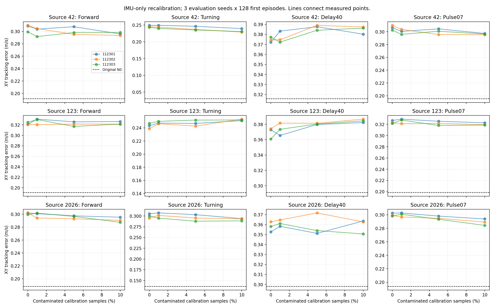
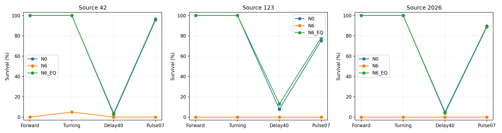

# 14 V2 N推理统计对照研究报告

干净重校准本身即可使策略失败，说明统计坐标与固定权重兼容性必须先验收；不能把污染校准相对原模型的巨大跌幅全算作污染效果。

## 工作范围

336项、43,008首回合，原模型与统计构造/等价补偿对照，三评估seed。

## 我们如何完成这项工作

区分原统计追加与重设的IMU校准、不同污染比例及首层等价补偿；保持不相关字段和来源身份。N是推理统计对照，不更新原PPO权重。正式逐回合数据与后续独立复算按同条件匹配。

## 现有结果及解释

1. N3干净重校准与N6污染校准的Forward存活都为0%。两者已落在地板，既不支持“污染成功”，也不能据两者相同证明污染毫无额外作用。

2. Pulse07中N3的1152回合有1142个在首脉冲前失败，约99.13%。失效主要在管线进入故障前已发生，而不是脉冲才触发。

3. 首层等价补偿离线最大输出误差约4.77×10^-7，正常闭环存活恢复，支持统计坐标变化的函数传递解释；但不意味着所有故障或所有状态逐位等价。

## 完整结果表

| 模型或分支 | 条件 | 阶段 | 存活分子/分母 | 存活率 | 平均寿命s | vx误差m/s | XY误差m/s |
|---|---|---|---|---|---|---|---|
| 42_N0 | Forward | formal | 384/384 | 100.00% | 20.0000 | 0.1215 | 0.1913 |
| 42_N1 | Forward | formal | 384/384 | 100.00% | 20.0000 | 0.1215 | 0.1913 |
| 42_N2 | Forward | formal | 384/384 | 100.00% | 20.0000 | 0.1215 | 0.1913 |
| 42_N3 | Forward | formal | 0/384 | 0.00% | 1.2685 | 0.2463 | 0.3060 |
| 42_N4 | Forward | formal | 0/384 | 0.00% | 1.3582 | 0.2386 | 0.3000 |
| 42_N5 | Forward | formal | 0/384 | 0.00% | 1.2570 | 0.2431 | 0.3004 |
| 42_N6 | Forward | formal | 0/384 | 0.00% | 1.2580 | 0.2393 | 0.2959 |
| 42_N7 | Forward | formal | 0/384 | 0.00% | 1.2471 | 0.2375 | 0.2947 |
| 42_N6_EQ | Forward | formal | 384/384 | 100.00% | 20.0000 | 0.1215 | 0.1913 |
| 123_N0 | Forward | formal | 384/384 | 100.00% | 20.0000 | 0.1162 | 0.1908 |
| 123_N1 | Forward | formal | 384/384 | 100.00% | 20.0000 | 0.1162 | 0.1908 |
| 123_N2 | Forward | formal | 384/384 | 100.00% | 20.0000 | 0.1162 | 0.1908 |
| 123_N3 | Forward | formal | 0/384 | 0.00% | 1.7095 | 0.2704 | 0.3224 |
| 123_N4 | Forward | formal | 0/384 | 0.00% | 1.7136 | 0.2769 | 0.3271 |
| 123_N5 | Forward | formal | 0/384 | 0.00% | 1.7173 | 0.2713 | 0.3214 |
| 123_N6 | Forward | formal | 0/384 | 0.00% | 1.7112 | 0.2735 | 0.3231 |
| 123_N7 | Forward | formal | 0/384 | 0.00% | 1.6596 | 0.2673 | 0.3183 |
| 123_N6_EQ | Forward | formal | 384/384 | 100.00% | 20.0000 | 0.1162 | 0.1908 |
| 2026_N0 | Forward | formal | 384/384 | 100.00% | 20.0000 | 0.1251 | 0.1883 |
| 2026_N1 | Forward | formal | 384/384 | 100.00% | 20.0000 | 0.1252 | 0.1884 |
| 2026_N2 | Forward | formal | 384/384 | 100.00% | 20.0000 | 0.1251 | 0.1884 |
| 2026_N3 | Forward | formal | 0/384 | 0.00% | 0.9098 | 0.2016 | 0.3012 |
| 2026_N4 | Forward | formal | 0/384 | 0.00% | 0.9291 | 0.2012 | 0.2989 |
| 2026_N5 | Forward | formal | 0/384 | 0.00% | 0.9448 | 0.2026 | 0.2957 |
| 2026_N6 | Forward | formal | 0/384 | 0.00% | 0.9398 | 0.1998 | 0.2912 |
| 2026_N7 | Forward | formal | 0/384 | 0.00% | 0.9376 | 0.2017 | 0.2890 |
| 2026_N6_EQ | Forward | formal | 384/384 | 100.00% | 20.0000 | 0.1251 | 0.1883 |
| official_alpha_walking | Forward | formal | 384/384 | 100.00% | 20.0000 | 0.1543 | 0.2125 |
| 42_N0 | Turning | formal | 384/384 | 100.00% | 20.0000 | 0.0044 | 0.0299 |
| 42_N1 | Turning | formal | 384/384 | 100.00% | 20.0000 | 0.0043 | 0.0294 |
| 42_N2 | Turning | formal | 384/384 | 100.00% | 20.0000 | 0.0043 | 0.0295 |
| 42_N3 | Turning | formal | 11/384 | 2.86% | 2.0616 | 0.1807 | 0.2458 |
| 42_N4 | Turning | formal | 11/384 | 2.86% | 2.0140 | 0.1782 | 0.2441 |
| 42_N5 | Turning | formal | 15/384 | 3.91% | 2.2616 | 0.1778 | 0.2394 |
| 42_N6 | Turning | formal | 19/384 | 4.95% | 2.4773 | 0.1708 | 0.2329 |
| 42_N7 | Turning | formal | 18/384 | 4.69% | 2.3169 | 0.1767 | 0.2367 |
| 42_N6_EQ | Turning | formal | 384/384 | 100.00% | 20.0000 | 0.0043 | 0.0292 |
| 123_N0 | Turning | formal | 384/384 | 100.00% | 20.0000 | 0.0167 | 0.1414 |
| 123_N1 | Turning | formal | 384/384 | 100.00% | 20.0000 | 0.0167 | 0.1414 |
| 123_N2 | Turning | formal | 384/384 | 100.00% | 20.0000 | 0.0167 | 0.1414 |
| 123_N3 | Turning | formal | 0/384 | 0.00% | 1.7149 | 0.1820 | 0.2431 |
| 123_N4 | Turning | formal | 0/384 | 0.00% | 1.7354 | 0.1864 | 0.2478 |
| 123_N5 | Turning | formal | 0/384 | 0.00% | 1.6606 | 0.1851 | 0.2471 |
| 123_N6 | Turning | formal | 0/384 | 0.00% | 1.6501 | 0.1905 | 0.2522 |
| 123_N7 | Turning | formal | 0/384 | 0.00% | 1.6646 | 0.1938 | 0.2538 |
| 123_N6_EQ | Turning | formal | 384/384 | 100.00% | 20.0000 | 0.0167 | 0.1414 |
| 2026_N0 | Turning | formal | 384/384 | 100.00% | 20.0000 | 0.0176 | 0.1364 |
| 2026_N1 | Turning | formal | 384/384 | 100.00% | 20.0000 | 0.0176 | 0.1364 |
| 2026_N2 | Turning | formal | 384/384 | 100.00% | 20.0000 | 0.0176 | 0.1363 |
| 2026_N3 | Turning | formal | 0/384 | 0.00% | 0.9670 | 0.2128 | 0.3001 |
| 2026_N4 | Turning | formal | 0/384 | 0.00% | 0.9975 | 0.2149 | 0.3011 |
| 2026_N5 | Turning | formal | 0/384 | 0.00% | 0.9867 | 0.2150 | 0.2955 |
| 2026_N6 | Turning | formal | 0/384 | 0.00% | 1.0087 | 0.2121 | 0.2919 |
| 2026_N7 | Turning | formal | 0/384 | 0.00% | 0.9766 | 0.2095 | 0.2916 |
| 2026_N6_EQ | Turning | formal | 384/384 | 100.00% | 20.0000 | 0.0176 | 0.1364 |
| official_alpha_walking | Turning | formal | 384/384 | 100.00% | 20.0000 | 0.0030 | 0.0108 |
| 42_N0 | Delay40 | formal | 14/384 | 3.65% | 5.7044 | 0.2417 | 0.3157 |
| 42_N1 | Delay40 | formal | 12/384 | 3.12% | 5.6416 | 0.2423 | 0.3174 |
| 42_N2 | Delay40 | formal | 8/384 | 2.08% | 5.5397 | 0.2394 | 0.3160 |
| 42_N3 | Delay40 | formal | 0/384 | 0.00% | 0.8153 | 0.3062 | 0.3746 |
| 42_N4 | Delay40 | formal | 0/384 | 0.00% | 0.8289 | 0.3097 | 0.3767 |
| 42_N5 | Delay40 | formal | 0/384 | 0.00% | 0.8532 | 0.3225 | 0.3870 |
| 42_N6 | Delay40 | formal | 0/384 | 0.00% | 0.8580 | 0.3227 | 0.3846 |
| 42_N7 | Delay40 | formal | 0/384 | 0.00% | 0.8362 | 0.3221 | 0.3847 |
| 42_N6_EQ | Delay40 | formal | 10/384 | 2.60% | 5.9941 | 0.2418 | 0.3163 |
| 123_N0 | Delay40 | formal | 30/384 | 7.81% | 7.7579 | 0.2073 | 0.2911 |
| 123_N1 | Delay40 | formal | 43/384 | 11.20% | 7.7494 | 0.2031 | 0.2882 |
| 123_N2 | Delay40 | formal | 42/384 | 10.94% | 7.8278 | 0.2028 | 0.2876 |
| 123_N3 | Delay40 | formal | 0/384 | 0.00% | 0.7782 | 0.2892 | 0.3694 |
| 123_N4 | Delay40 | formal | 0/384 | 0.00% | 0.7870 | 0.2948 | 0.3735 |
| 123_N5 | Delay40 | formal | 0/384 | 0.00% | 0.8028 | 0.3025 | 0.3805 |
| 123_N6 | Delay40 | formal | 0/384 | 0.00% | 0.7967 | 0.3085 | 0.3845 |
| 123_N7 | Delay40 | formal | 0/384 | 0.00% | 0.8029 | 0.3070 | 0.3828 |
| 123_N6_EQ | Delay40 | formal | 50/384 | 13.02% | 8.3206 | 0.2023 | 0.2874 |
| 2026_N0 | Delay40 | formal | 19/384 | 4.95% | 7.1768 | 0.2183 | 0.2981 |
| 2026_N1 | Delay40 | formal | 14/384 | 3.65% | 6.9939 | 0.2187 | 0.2984 |
| 2026_N2 | Delay40 | formal | 30/384 | 7.81% | 7.2837 | 0.2168 | 0.2965 |
| 2026_N3 | Delay40 | formal | 0/384 | 0.00% | 0.7309 | 0.2556 | 0.3579 |
| 2026_N4 | Delay40 | formal | 0/384 | 0.00% | 0.7445 | 0.2660 | 0.3613 |
| 2026_N5 | Delay40 | formal | 0/384 | 0.00% | 0.7807 | 0.2727 | 0.3589 |
| 2026_N6 | Delay40 | formal | 0/384 | 0.00% | 0.7892 | 0.2792 | 0.3590 |
| 2026_N7 | Delay40 | formal | 0/384 | 0.00% | 0.7808 | 0.2793 | 0.3619 |
| 2026_N6_EQ | Delay40 | formal | 15/384 | 3.91% | 7.0041 | 0.2185 | 0.2985 |
| official_alpha_walking | Delay40 | formal | 177/384 | 46.09% | 13.6712 | 0.2209 | 0.2967 |
| 42_N0 | Pulse07 | formal | 371/384 | 96.61% | 19.6312 | 0.1266 | 0.1953 |
| 42_N1 | Pulse07 | formal | 373/384 | 97.14% | 19.7363 | 0.1261 | 0.1949 |
| 42_N2 | Pulse07 | formal | 371/384 | 96.61% | 19.6883 | 0.1264 | 0.1952 |
| 42_N3 | Pulse07 | formal | 0/384 | 0.00% | 1.3197 | 0.2462 | 0.3064 |
| 42_N4 | Pulse07 | formal | 0/384 | 0.00% | 1.3330 | 0.2398 | 0.3002 |
| 42_N5 | Pulse07 | formal | 0/384 | 0.00% | 1.2722 | 0.2432 | 0.3004 |
| 42_N6 | Pulse07 | formal | 0/384 | 0.00% | 1.2845 | 0.2376 | 0.2964 |
| 42_N7 | Pulse07 | formal | 0/384 | 0.00% | 1.2376 | 0.2396 | 0.2961 |
| 42_N6_EQ | Pulse07 | formal | 367/384 | 95.57% | 19.5120 | 0.1263 | 0.1951 |
| 123_N0 | Pulse07 | formal | 289/384 | 75.26% | 17.6586 | 0.1231 | 0.1984 |
| 123_N1 | Pulse07 | formal | 292/384 | 76.04% | 17.6216 | 0.1231 | 0.1984 |
| 123_N2 | Pulse07 | formal | 287/384 | 74.74% | 17.5647 | 0.1233 | 0.1985 |
| 123_N3 | Pulse07 | formal | 0/384 | 0.00% | 1.7110 | 0.2719 | 0.3238 |
| 123_N4 | Pulse07 | formal | 0/384 | 0.00% | 1.6894 | 0.2755 | 0.3262 |
| 123_N5 | Pulse07 | formal | 0/384 | 0.00% | 1.6522 | 0.2704 | 0.3218 |
| 123_N6 | Pulse07 | formal | 0/384 | 0.00% | 1.7472 | 0.2710 | 0.3203 |
| 123_N7 | Pulse07 | formal | 0/384 | 0.00% | 1.6431 | 0.2684 | 0.3184 |
| 123_N6_EQ | Pulse07 | formal | 300/384 | 78.12% | 17.8243 | 0.1231 | 0.1983 |
| 2026_N0 | Pulse07 | formal | 344/384 | 89.58% | 19.0045 | 0.1291 | 0.1939 |
| 2026_N1 | Pulse07 | formal | 338/384 | 88.02% | 18.9318 | 0.1291 | 0.1941 |
| 2026_N2 | Pulse07 | formal | 343/384 | 89.32% | 18.9319 | 0.1291 | 0.1940 |
| 2026_N3 | Pulse07 | formal | 0/384 | 0.00% | 0.9111 | 0.2014 | 0.2999 |
| 2026_N4 | Pulse07 | formal | 0/384 | 0.00% | 0.9259 | 0.2020 | 0.3002 |
| 2026_N5 | Pulse07 | formal | 0/384 | 0.00% | 0.9441 | 0.2022 | 0.2954 |
| 2026_N6 | Pulse07 | formal | 0/384 | 0.00% | 0.9496 | 0.1987 | 0.2891 |
| 2026_N7 | Pulse07 | formal | 0/384 | 0.00% | 0.9275 | 0.2011 | 0.2893 |
| 2026_N6_EQ | Pulse07 | formal | 341/384 | 88.80% | 18.9170 | 0.1294 | 0.1943 |
| official_alpha_walking | Pulse07 | formal | 383/384 | 99.74% | 19.9816 | 0.1568 | 0.2158 |

## 图表及读图注释

> 读图注释：normalizer改变输入坐标，原网络权重并不会自动重新适应。均值/尺度失配可能让干净观测也落在不熟悉区域。

> 读图注释：N0/N6EQ与N3/N6应分别对照；不能跨统计管线只挑最大跌幅。图中重合曲线需要结合存活时间，避免地板掩盖差异。

> 英文坐标速查：survival=规定时长存活；duration/seconds=首回合有效寿命；vx=前向速度；XY=平面速度；yaw=绕竖直轴旋转；MSE=动作拟合平方误差；pp=百分点。完整解释见[读图指南](../READING_GUIDE.md)。

### 图1 全部任务点 all

每个点是一项真实任务；横轴仅是文件记录顺序，不是连续变量，故不连线。点保留评估seed差异。条件、模型和分母可在全数据浏览器按编号查询；早停时误差只覆盖终止前。

### 图2 首回合存续曲线 第1组

横轴为首回合仿真秒，纵轴为尚未因任何原因终止的比例；20秒超时保留在终点，不画成死亡。由已保存终止时间重算，在0.1秒网格显示；不是完整姿态轨迹，也不把跨评估seed回合当独立训练。相同曲线可能重合。

### 图3 首回合存续曲线 第2组

横轴为首回合仿真秒，纵轴为尚未因任何原因终止的比例；20秒超时保留在终点，不画成死亡。由已保存终止时间重算，在0.1秒网格显示；不是完整姿态轨迹，也不把跨评估seed回合当独立训练。相同曲线可能重合。

### 图4 首回合存续曲线 第3组

横轴为首回合仿真秒，纵轴为尚未因任何原因终止的比例；20秒超时保留在终点，不画成死亡。由已保存终止时间重算，在0.1秒网格显示；不是完整姿态轨迹，也不把跨评估seed回合当独立训练。相同曲线可能重合。

### 图5 dose survival

保留原实验图，不改变其样本、区间或协议定义。原图英文标注见本报告名词注释；探索、确认与历史快照不可混合累计。

### 图6 dose tracking

保留原实验图，不改变其样本、区间或协议定义。原图英文标注见本报告名词注释；探索、确认与历史快照不可混合累计。

### 图7 equivalence survival

保留原实验图，不改变其样本、区间或协议定义。原图英文标注见本报告名词注释；探索、确认与历史快照不可混合累计。

## 限制与不能支持的结论

没有锁定采集分布、旋转或数据覆盖中的唯一原因；没有合法物理扰动等价性证明。NaN/出界为0不等于关节超限为0。

## 证据入口与复核范围

输入清单与SHA：[input_manifest.json](../data/input_manifest.json)。本轮计数/均值复算：[AUDIT.json](../data/AUDIT.json)。

- D:\MicroDuckResearch\ti\outputs\microduck_reproduction\preprocessing_integrity_v2\n\formal\results.json　SHA256 1d7b2ed8f076557eadcfd690bf7b24d070a960c55c2dc7d207127df543d056c2

## 这项工作的价值

价值是提供强反证与等价补偿机制对照，阻止将基础预处理失配包装为新投毒；它为T真实学习和900固定权重状态效应划定不同解释范围。
